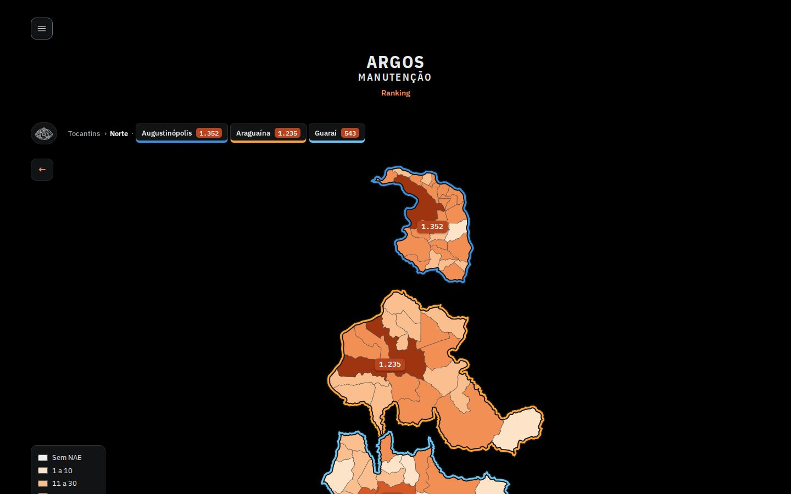
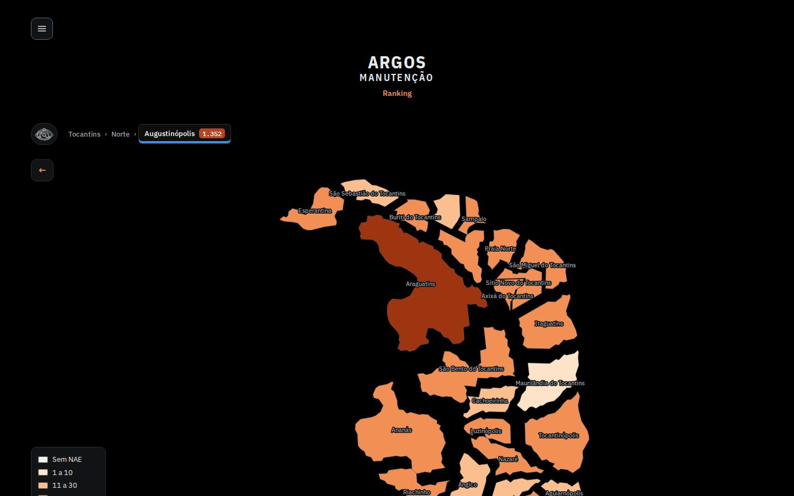
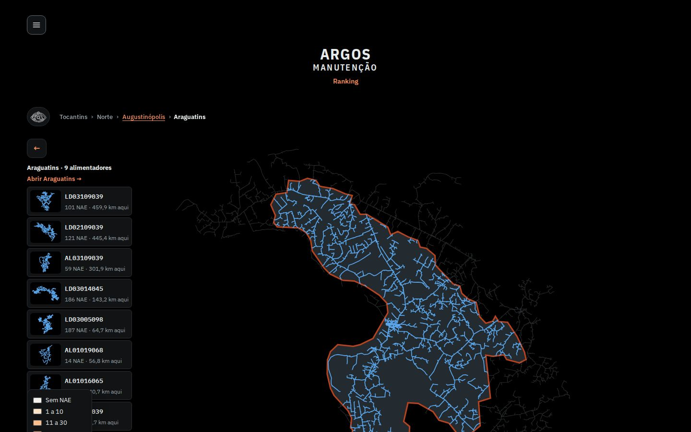
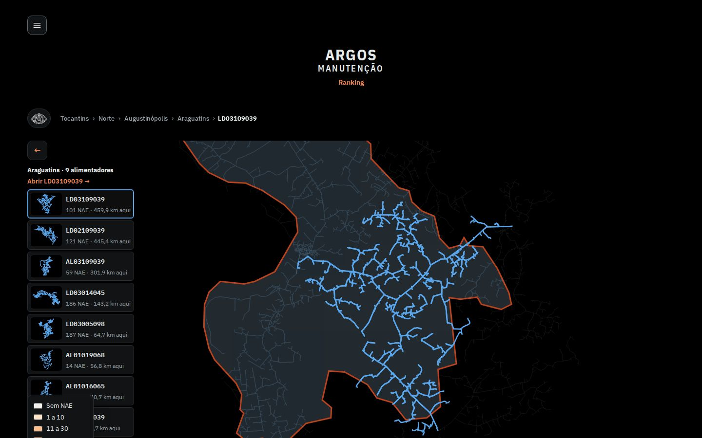
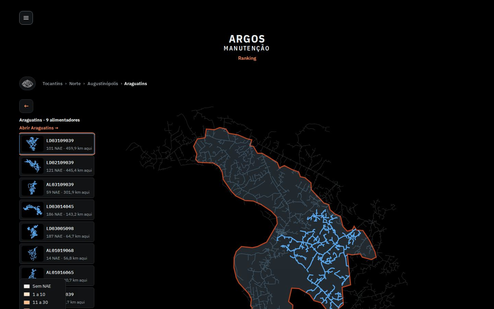
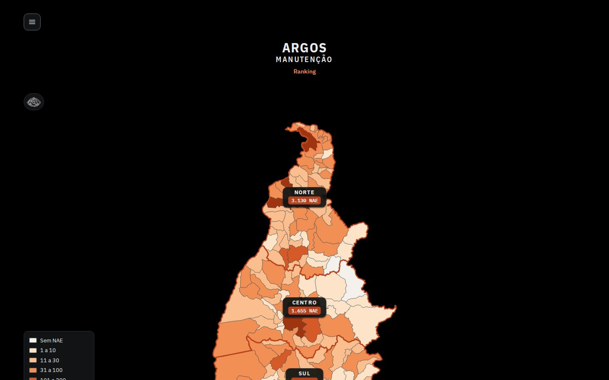
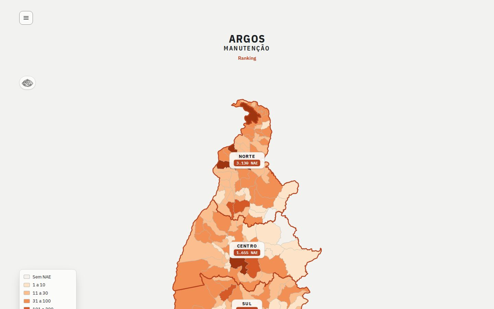
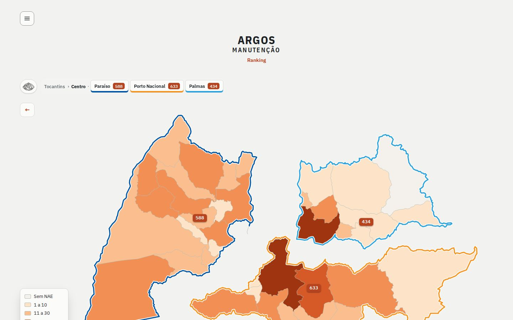

# P1 · Visão geral e navegação do mapa — ARGOS Manutenção

Slides prontos (título + tópicos curtos + print numerado). Prints reais de https://lgrsv.github.io/vera-vegeta-o-back/teste/ em 15/10/2026, tema escuro, JPEG 1440x900 (`-desk`) e 390x844 (`-mob`). Reprodutível com `prints.js` (rodar com `NODE_USE_ENV_PROXY=1 NODE_EXTRA_CA_CERTS=/root/.ccr/ca-bundle.crt node prints.js`).

**Fio condutor da apresentação:** o mapa é uma escada de zoom — Estado → Regional → Polo → Município → Alimentador. Cada degrau responde a uma pergunta de rotina: "onde está o problema?", "qual equipe/região?", "qual rede?", e por fim abre a página do alimentador. A cor e os números são sempre a **NAE-Vegetação** (NAE = interrupções por vegetação): quanto mais escura a cor, mais interrupções causadas por árvore/galho na rede.

---

## Slide 1 — Tocantins de ponta a ponta: onde está a vegetação derrubando a rede

- Mapa dos municípios do Tocantins pintado pela **NAE-Vegetação**, em 6 faixas: Sem NAE, 1 a 10, 11 a 30, 31 a 100, 101 a 200, 201 ou mais (legenda no canto).
- Três **cards pretos**, um por regional, com o total de NAE: **Norte 3.130**, **Centro 1.655**, **Sul 963** (soma: 5.748 NAE).
- Leitura imediata: o Norte concentra mais da metade das interrupções por vegetação (3.130 de 5.748); manchas mais escuras = municípios prioritários para poda.
- Para que serve: decidir em segundos **para onde olhar primeiro** na programação de poda.
- Como usar: clicar em um card (ou município) de uma regional.

**Print 1** — `01-estado-desk.jpg` · celular: `01-estado-mob.jpg`

---

## Slide 2 — Regional e polo: do território às equipes

- Ao abrir a regional, as outras somem e os **polos** aparecem na barra, cada um com cor própria e sua NAE.
- **Norte:** Augustinópolis **1.352** · Araguaína **1.235** · Guaraí **543** (somam 3.130).
- **Centro:** Paraíso **588** · Porto Nacional **633** · Palmas **434** (somam 1.655).
- Clicar em um polo afasta os municípios dele, tira os demais do mapa e mostra o nome de cada município (print 3: Augustinópolis, com Araguatins em destaque).
- Para que serve: comparar polos e distribuir esforço de poda e equipes entre eles.

**Print 2** — `02-regional-desk.jpg` · celular: `02-regional-mob.jpg`
**Print 3** — `03-polo-desk.jpg` · celular: `03-polo-mob.jpg`

---

## Slide 3 — Município: a rede de cada alimentador e a lista ao lado

- Clicar em um município (ex.: **Araguatins**, polo Augustinópolis) aproxima o mapa: as redes dos alimentadores aparecem em uma cor só (azul); fora do município a rede fica apagada em cinza.
- A lista à esquerda mostra **9 alimentadores** do município, cada um com miniatura da rede, **NAE** e **km dentro do município**. Ex.: LD03109039 — 101 NAE · 459,9 km; LD02109039 — 121 NAE · 445,4 km; LD03014045 — 186 NAE · 143,2 km; LD03005098 — 187 NAE · 64,7 km; AL02109039 — 0 NAE · 26,6 km.
- Passar o mouse numa linha da lista (ou na rede) destaca aquele alimentador; "Abrir Araguatins →" leva à página do município.
- Para que serve: ver **quais alimentadores atendem o município** e qual pesa mais em NAE — mais km nem sempre significa mais NAE (LD03005098 tem 64,7 km aqui e 187 NAE).
- No celular, a lista fica numa gaveta (seta ^ embaixo do mapa).

**Print 4** — `04-municipio-desk.jpg` · celular: `04-municipio-mob.jpg` e, com a lista aberta, `04b-municipio-lista-mob.jpg`

---

## Slide 4 — Foco no alimentador: zoom e "Abrir AL →"

- Clicar em um alimentador (na lista ou na rede) dá **zoom** na rede inteira dele; os demais apagam. Ex.: **LD03109039** (101 NAE).
- O link da caixa muda para **"Abrir LD03109039 →"** e a trilha ganha o último passo: Tocantins › Norte › Augustinópolis › Araguatins › LD03109039.
- **Segundo clique** no mesmo alimentador (ou no link) abre a **página do alimentador**, com trechos T1/T2/T3, NAE por trecho e camadas de manutenção.
- Para que serve: conferir a **forma e a extensão** da rede antes de planejar a poda e entrar direto no detalhe por trecho.

**Print 5** — `05-foco-alimentador-desk.jpg` · celular: `05-foco-alimentador-mob.jpg`

---

## Slide 5 — Voltar sem se perder: trilha, botão ← e Esc

- A **trilha** na barra (Tocantins › Norte › Augustinópolis › Araguatins › LD03109039) tem cada passo clicável e volta direto até ele.
- O botão **←** (abaixo da barra) e a tecla **Esc** sobem um nível por vez: alimentador → município → polo → regional → Tocantins.
- Setas do teclado percorrem os municípios vizinhos; Enter abre o selecionado (navegação toda acessível por teclado).
- Para que serve: explorar à vontade, sem perder o contexto — útil em reunião, quando se salta de um polo a outro.

**Print 6** — `06-esc-volta-municipio-desk.jpg` (Esc a partir do foco)
**Print 7** — `07-esc-volta-polo-desk.jpg`
**Print 8** — `08-esc-volta-regional-desk.jpg`
**Print 9** — `09-esc-volta-estado-desk.jpg`
Celular: mesmos nomes com `-mob`.

---

## Slide 6 — Tema claro (Night shift)

- Fundo preto por padrão (ideal para sala de controle e plantão); o **Night shift** do menu ☰ (ou **Shift+K**) alterna para o tema claro, bom para projetor e impressão.
- Mesmos dados e mesma navegação: **Norte 3.130 · Centro 1.655 · Sul 963**; no Centro, Paraíso 588 · Porto Nacional 633 · Palmas 434.
- A escala de cores da NAE se mantém nos dois temas, então prints de um e outro são comparáveis.

**Print 10** — `10-estado-claro-desk.jpg` · celular: `10-estado-claro-mob.jpg`
**Print 11** — `11-regional-claro-desk.jpg` · celular: `11-regional-claro-mob.jpg`

---

## Observações para quem apresenta (não vão nos slides)

- Em 1440x900 o mapa do estado passa da altura da tela (o card **Sul 963** fica cortado embaixo; é preciso rolar). Ao apresentar, use zoom do navegador em 80–90% ou mostre o print em tela cheia do mapa.
- No nível município/foco, a legenda de cores (canto inferior esquerdo) sobrepõe as últimas linhas da lista de alimentadores em 1440x900 — ponto a levar para o agente de mapa (tema 2/1).
- Números lidos direto do site em 15/10/2026; o site não mostra o período da NAE na página inicial, por isso os slides não citam período.
- Fluxo usado nos prints: Norte → Augustinópolis → Araguatins → LD03109039 (desktop e celular).
