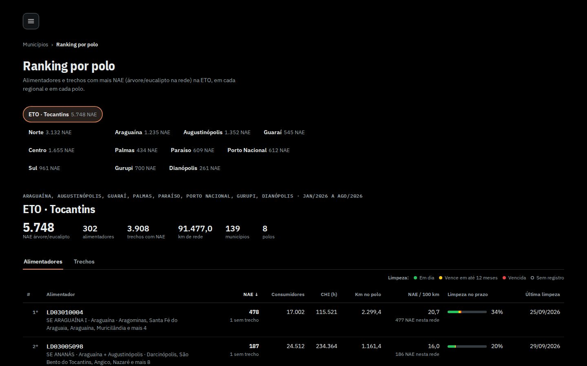
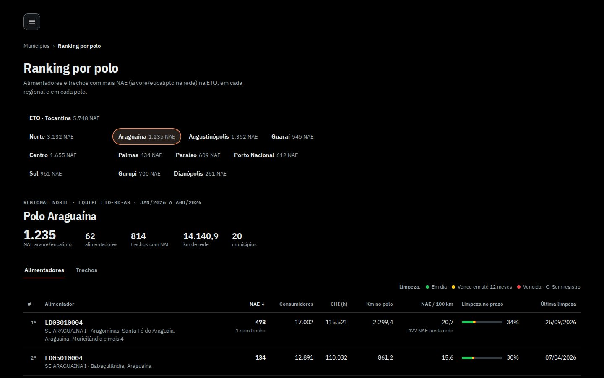
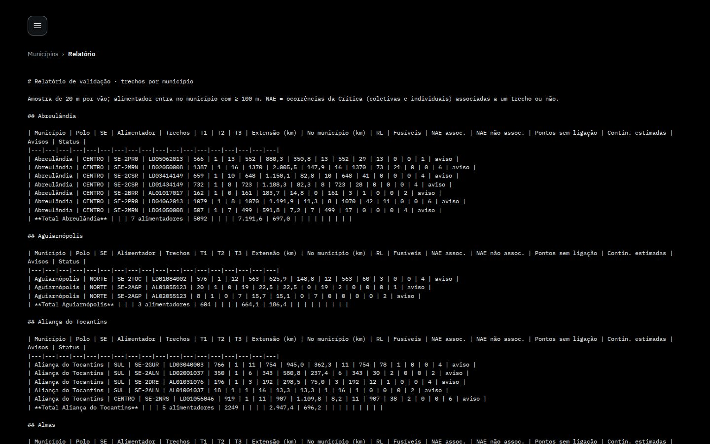
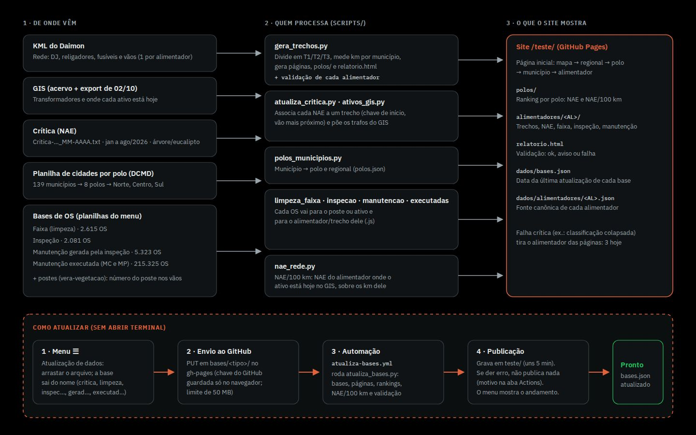
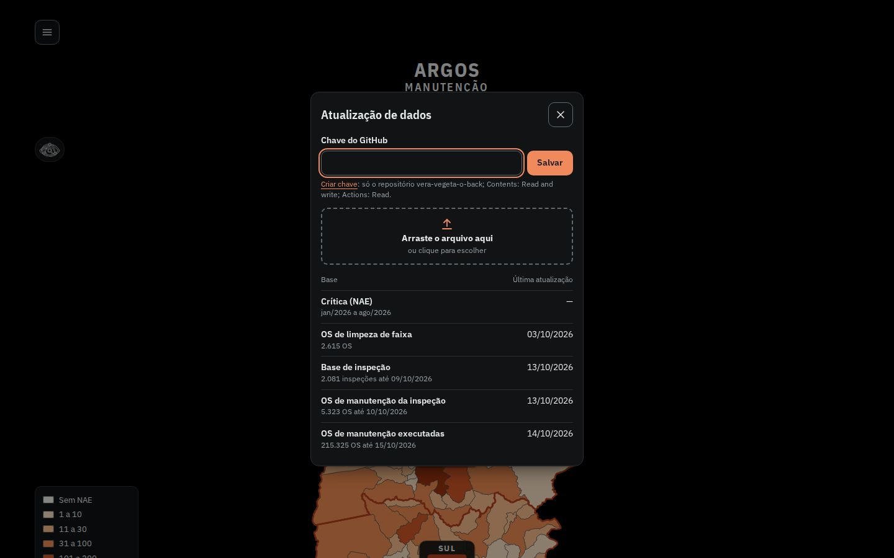

# P4 · Ranking por polos, NAE/100 km, validação e origem dos dados

Material de apresentação do ARGOS Manutenção. 6 slides prontos: título, 3 a 5 tópicos curtos e o print numerado
(versão 1440x900 para tela e 390x844 para celular, tema escuro, JPEG). Números lidos do site ao vivo em 15/10/2026
(`/teste/polos/`, `/teste/relatorio.html`, `/teste/dados/bases.json`); método conferido no código
(`alimentador/site/ranking-polos.js`, `scripts/gera_trechos.py`, `scripts/atualiza_bases.py`,
`scripts/README-gera_trechos.md`).

| Slide | Tema | Print (1440 / 390) |
|---|---|---|
| 1 | Ranking por polo: ETO, regionais e polos | `01-ranking-eto-*.jpg` |
| 2 | Dentro de um polo: alimentadores e trechos | `02-polo-araguaina-*.jpg` · `03b-trechos-t3-*.jpg` |
| 3 | NAE e NAE/100 km: como a conta é feita | `03-nae-por-100km-*.jpg` |
| 4 | Relatório de validação | `04-relatorio-topo-*.jpg` · `04b-relatorio-total-*.jpg` |
| 5 | Fluxo dos dados: de onde vem cada número | `05-fluxo-dados-*.jpg` |
| 6 | Como atualizar as bases | `06a-menu-*.jpg` · `06-atualizacao-bases-*.jpg` |

---

## Slide 1 · Ranking por polo: onde está a NAE

- Página `/teste/polos/`: o mesmo ranking em três níveis, ETO (Tocantins inteiro), regional (Norte, Centro, Sul) e polo (8).
- Cada botão já mostra a NAE de árvore/eucalipto: ETO 5.748 · Norte 3.132 · Centro 1.655 · Sul 961.
- Maior NAE por polo: Augustinópolis 1.352 e Araguaína 1.235; menor: Dianópolis 261.
- Período da Crítica: jan/2026 a ago/2026. Rede no ranking: 302 alimentadores, 3.908 trechos com NAE, 91.477 km, 139 municípios.
- O endereço guarda a escolha (`#araguaina`, `#regional-norte`, `#eto/trechos/T3`): dá para mandar o link de uma visão.

**Print 1:** `01-ranking-eto-1440.jpg` · `01-ranking-eto-390.jpg`



---

## Slide 2 · Dentro de um polo: alimentadores e trechos

- Duas abas: **Alimentadores** (um por linha) e **Trechos** (T1, T2, T3 com filtro de classe).
- Colunas: NAE, consumidores, CHI (h), km no polo, NAE/100 km, limpeza no prazo (barra) e data da última limpeza.
- Clicar nos títulos ordena; clicar na linha abre o alimentador (no trecho, já com o trecho selecionado).
- Exemplo, Polo Araguaína: 1.235 NAE, 62 alimentadores, 814 trechos com NAE, 14.140,9 km, 20 municípios, equipe ETO-RD-AR.
- No topo da ETO: LD03010004 (SE Araguaína I) com 478 NAE, 17.002 consumidores e 2.299,4 km.
- No celular cada linha vira um cartão, com a NAE em destaque.

**Print 2:** `02-polo-araguaina-1440.jpg` · `02-polo-araguaina-390.jpg` (extra: `03b-trechos-t3-*.jpg`, trechos T3 da ETO, 3.550 dos 3.908)



---

## Slide 3 · NAE e NAE/100 km: como a conta é feita

- **NAE** = ocorrências da Crítica de causa Meio Ambiente (subcausa árvore/eucalipto na rede); a coluna NAE segue a Crítica.
- **NAE/100 km** = NAE da mesma rede dos km, dividida pelos km e multiplicada por 100. Sai a NAE cujo ativo hoje está em outro alimentador no GIS; entra a de outro alimentador cujo ativo está aqui.
- Por isso a célula mostra "74 NAE nesta rede" abaixo do 28,0 (AL02096004: NAE 82, 264,3 km).
- Leitura por polo (NAE na rede ÷ km x 100): Augustinópolis 18,0 · Araguaína 8,7 · Palmas 6,7 · Porto Nacional 5,4 · Guaraí 4,6 · Paraíso 4,1 · Gurupi 3,8 · Dianópolis 2,6.
- Atenção: trecho muito curto distorce a taxa (T3 com 0,0 km chega a milhares por 100 km); para trechos, ordenar por NAE.
- A linha "Como contamos", no pé da página, traz o método, a regra da limpeza no prazo (T1 a cada 3 anos, T2 a cada 4, T3 a cada 5) e a fonte dos polos.

**Print 3:** `03-nae-por-100km-1440.jpg` · `03-nae-por-100km-390.jpg` (Polo Araguaína ordenado por NAE/100 km)


---

## Slide 4 · Relatório de validação

- Página `/teste/relatorio.html`, refeita a cada geração: uma tabela por município, com polo, SE, trechos T1/T2/T3, km, religadores, fusíveis, NAE associada e não associada, avisos e status.
- Resultado hoje: 139 municípios; 319 alimentadores processados sem falha (91.534,6 km, 71.314 trechos): 13 "ok" e 306 com "aviso".
- Falha crítica tira o alimentador das páginas: são 3 (classificação colapsada, ex.: LD02424015 com 1.673 km em 1 trecho). Outros 18 não têm município com 100 m ou mais de rede.
- Avisos mais comuns: alimentador sem 2º religador (tronco decidido por heurística), seccionamento (chave 03/33/02 com religador depois), vãos na divisa entre municípios, trechos a revisar.
- Serve de checklist antes de publicar: nada é publicado se a validação dos arquivos falhar.

**Print 4:** `04-relatorio-topo-1440.jpg` · `04-relatorio-topo-390.jpg` (extra: `04b-relatorio-total-*.jpg`, total geral e avisos)



---

## Slide 5 · Fluxo dos dados: de onde vem cada número

- **KML do Daimon:** a rede, com DJ, religadores, fusíveis e vãos; é a única fonte com as chaves e dá os trechos T1/T2/T3.
- **Crítica (NAE):** `Critica-…_MM-AAAA.txt`, um arquivo por mês; cada ocorrência vai para um trecho (abrangência DJ, chave de início, vão mais próximo do ativo).
- **GIS:** transformadores (acervo) e a posição atual de cada ativo, usada no NAE/100 km.
- **Bases de OS:** limpeza de faixa (2.615), inspeção (2.081), manutenção gerada pela inspeção (5.323) e manutenção executada (215.325 OS, MC e MP).
- **Polos:** planilha de cidades por polo e regional (DCMD): 139 municípios, 8 polos.

```
 DE ONDE VÊM                     QUEM PROCESSA (scripts/)              O QUE O SITE MOSTRA (/teste/)
 ───────────                     ────────────────────────              ─────────────────────────────
 KML do Daimon (rede, chaves) ─▶ gera_trechos.py (T1/T2/T3, km  ─────▶ página inicial (mapa)
 Postes (vera-vegetacao)         por município, páginas, polos,        alimentadores/<AL>/ (painel)
 Crítica (NAE, 1 arq. por mês) ▶ atualiza_critica.py ───────────────▶ polos/ (ranking)
 GIS (trafos, ativo hoje)      ▶ ativos_gis.py · nae_rede.py ───────▶ relatorio.html (validação)
 Planilha de polos (DCMD)      ▶ polos_municipios.py (polos.json)      dados/bases.json (datas)
 OS: faixa · inspeção ·        ▶ limpeza_faixa · inspecao ·
     manutenção · executadas     manutencao · executadas

 COMO ATUALIZAR:  menu ☰ → Atualização de dados → bases/<tipo>/ no GitHub
                  → automação atualiza-bases.yml → atualiza_bases.py → publica em teste/ (uns 5 min)
```

**Print 5:** `05-fluxo-dados-1440.jpg` · `05-fluxo-dados-390.jpg` (diagrama em SVG: `fluxo.html`)



---

## Slide 6 · Como atualizar as bases

- Menu ☰ → **Atualização de dados**: arrastar (ou escolher) o arquivo; a base sai do nome (`critica`, `limpeza`, `inspec…`, `gerad…`, `executad…`) ou escolhe-se na lista.
- O site envia o arquivo para a pasta `bases/<tipo>/` do repositório (GitHub) e acompanha a automação; a chave do GitHub fica só naquele navegador. Limite de 50 MB: a executada vai em .zip.
- A automação `atualiza-bases.yml` roda `atualiza_bases.py`: Crítica (troca o mês do arquivo inteiro), limpeza, inspeção, manutenção e executadas; depois refaz páginas e rankings, o NAE/100 km e a validação. Leva uns 5 minutos.
- Se algo der erro, nada é publicado (o motivo fica na aba Actions). Cada base mostra a data da última atualização:

| Base | Última atualização (processada) | Volume |
|---|---|---|
| Crítica (NAE) | meses jan/2026 a ago/2026 | 5.748 NAE no ranking |
| OS de limpeza de faixa | 03/10/2026 | 2.615 OS |
| Base de inspeção | 13/10/2026 (até 09/10) | 2.081 inspeções |
| OS de manutenção da inspeção | 13/10/2026 (até 10/10) | 5.323 OS |
| OS de manutenção executadas | 14/10/2026 (até 15/10) | 215.325 OS |

**Print 6:** `06-atualizacao-bases-1440.jpg` · `06-atualizacao-bases-390.jpg` (extra: `06a-menu-*.jpg`, menu aberto)



---

## Observações para quem apresenta

- O relatório (`relatorio.html`) é texto corrido em Markdown: no celular é melhor mostrar o print 4b ou usar o computador.
- Os números do ranking mudam quando entra Crítica nova (o mês do arquivo é trocado inteiro); reler `/polos/` antes da reunião.
- O diálogo de atualização pede a chave do GitHub na primeira vez; na apresentação, mostrar sem enviar nada.
- Para refazer os prints: `node prints.js` nesta pasta (usa `ponte.js` para a rede do ambiente; o diagrama vem de `fluxo.html`).
