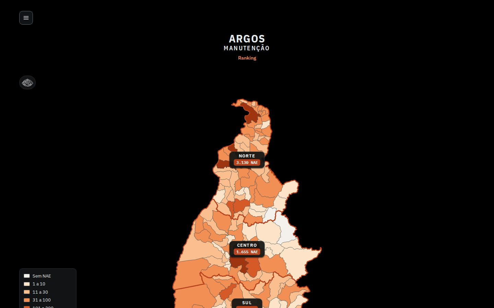
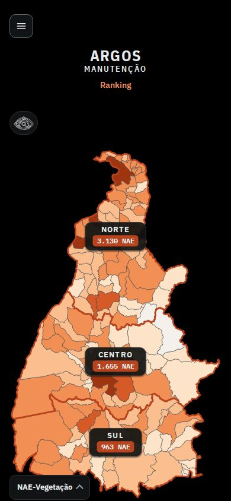

# ARGOS Manutenção: roteiro de apresentação de 10 minutos

Público: gestores e equipes de manutenção/poda da distribuição (Tocantins).
Site de demonstração: https://lgrsv.github.io/vera-vegeta-o-back/teste/
Números conferidos no site ao vivo e no código em 15/10/2026 (Crítica de jan a ago/2026). Se alguma base for atualizada antes da apresentação, os números mudam: releia a tabela "Números para citar" abaixo.

| Capa no computador (1440x900) | Capa no celular (390x844) |
|---|---|
|  |  |

Arquivos desta pasta: `README.md` (este roteiro), `01-capa-1440x900.jpg`, `02-capa-390x844.jpg`, `prints.js` (gera os dois prints: `node prints.js`).

## Resumo (a mensagem em 5 linhas)

1. Problema: árvore e eucalipto na rede derrubam alimentadores; de jan a ago/2026 foram 5.748 ocorrências (NAE) no Tocantins, e a equipe precisa decidir onde podar primeiro.
2. O ARGOS põe num mapa só a rede (Daimon), as ocorrências da Crítica por trecho e as OS de limpeza, inspeção e manutenção.
3. Demonstração em ordem: mapa (estado > regional > polo > município > alimentador), busca, página do alimentador (T1/T2/T3, NAE por trecho, camadas, croqui) e ranking por polo.
4. Ganho: do "quem mais interrompe" ao "qual trecho, entre quais chaves, quantos km sem limpeza", com o croqui Excel pronto para a equipe de campo.
5. Próximos passos: atualizar a Crítica todo mês pelo menu, piloto com um polo, validar trechos e posição das OS com as equipes.

## Antes de começar (checklist de 2 minutos)

- Abra 4 abas já carregadas: (1) página inicial; (2) `.../teste/alimentadores/LD01072001/`; (3) `.../teste/polos/#eto`; (4) `.../teste/relatorio.html`. A demonstração começa na aba 1.
- Notebook 1440x900: use zoom de 80% do navegador (Ctrl e menos). No zoom 100% o cartão Sul e a legenda ficam cortados na parte de baixo da tela (visível no print da capa).
- O tema é escuro por padrão (Night shift ligado). Em sala clara de projetor, Shift+K (fora de campos de texto) troca para o tema claro.
- O satélite do painel (Esri) precisa de internet. Teste antes.
- Plano B se o site estiver lento: use o alimentador pequeno LD01072001 (154 km) em vez do LD03010004 (2.299 km) e mostre os prints desta pasta.

## Números para citar (todos vistos no site)

| Número | Onde aparece |
|---|---|
| 5.748 NAE de árvore/eucalipto no Tocantins, jan a ago/2026 | Ranking, cabeçalho "ETO · Tocantins"; soma dos três cartões do mapa |
| Regionais no mapa: Norte 3.130, Centro 1.655, Sul 963 | Cartões pretos da página inicial |
| Polos no mapa (NAE): Augustinópolis 1.352, Araguaína 1.235, Guaraí 543 (Norte); Palmas 434, Paraíso 588, Porto Nacional 633 (Centro); Gurupi 702, Dianópolis 261 (Sul) | Barra do mapa ao abrir cada regional |
| 139 municípios, 8 polos, 302 alimentadores no ranking, 3.908 trechos com NAE, 91.477,0 km de rede | Ranking, escopo ETO |
| 319 alimentadores processados sem falha (91.534,6 km, 71.314 trechos), 3 de fora | Relatório de validação, "Total geral" |
| Araguaína (município): 33 alimentadores; Palmas (município): 46 alimentadores | Lista à esquerda ao abrir o município |
| 1º do ranking: LD03010004, SE Araguaína I, 478 NAE, 2.299,4 km, 17.002 consumidores, 115.521 h de CHI, 20,7 NAE/100 km, 34% da limpeza no prazo, última limpeza 25/09/2026 | Ranking, ETO |
| 2º LD03005098 (187 NAE), 3º LD03014045 (186), 4º LD02059122 (170), 5º LD05010004 (134) | Ranking, ETO |
| LD01072001 (SE Porto Nacional): 153,98 km, 199 trechos (T1 1 com 13,02 km; T2 3 com 25,97 km; T3 195 com 114,99 km), 23 NAE | Página do alimentador |
| T1 do LD01072001: 4 desarmes do DJ por árvore (150, 150, 304 e 160 consumidores); limpeza vencida em 7,9 km e sem registro em 5,1 km dos 13,02 km | Detalhe do trecho T1 |
| LD03010004: 1.997 trechos (T1 1 com 13,11 km; T2 20 com 408,60 km; T3 1.976 com 1.877,65 km); 97 OS de limpeza executadas, 783,1 km de 2.299,3 km | Página do alimentador |
| Regra de limpeza: T1 a cada 3 anos, T2 a cada 4, T3 a cada 5 | Detalhe do trecho e ranking |

## Roteiro minuto a minuto

Cada linha traz o que mostrar na tela e o texto sugerido (em primeira pessoa, pode ser adaptado). Os cliques exatos da demonstração estão na seção seguinte.

| Min | Tela | O que falar |
|---|---|---|
| 0:00 a 1:00 | Slide 2 (Problema) ou capa | "Vegetação é uma das causas que mais derrubam alimentadores. De janeiro a agosto de 2026 foram 5.748 ocorrências de árvore ou eucalipto na rede e na faixa, só no Tocantins. A equipe de poda tem hora e braço limitados. A pergunta de hoje é simples: onde podar primeiro? Em dez minutos eu mostro como o ARGOS responde isso." |
| 1:00 a 2:00 | Capa, página inicial | "O ARGOS junta quatro coisas num mapa só: a rede de média tensão que vem do Daimon, dividida em trechos; as ocorrências da Crítica, cada uma encaixada no trecho certo; as ordens de serviço de limpeza de faixa, inspeção e manutenção; e a posição de tudo isso no satélite. Aqui está o Tocantins pintado pela NAE de cada município. Os três cartões pretos são as regionais: Norte 3.130, Centro 1.655 e Sul 963. Esses três números somam os 5.748." |
| 2:00 a 3:00 | Mapa: regional e polo | "Clico no Norte. O mapa aproxima, as outras regionais saem e os polos se afastam. Na barra em cima aparecem os polos com a NAE de cada um: Augustinópolis 1.352, Araguaína 1.235, Guaraí 543. Clico em Araguaína: agora são os municípios do polo, com o nome de cada um. A cor é a faixa de NAE na legenda." |
| 3:00 a 4:00 | Mapa: município e alimentador | "Clico em Araguaína, o município. A rede de cada alimentador aparece em azul e, à esquerda, a lista: são 33 alimentadores, cada um com a NAE e os km que passam aqui. O primeiro, LD03010004, tem 478 NAE. Clico nele: o mapa aproxima na rede inteira. Um segundo clique abre a página dele. Antes disso, quero mostrar a busca." (Não abra ainda. Volte pelo caminho "Tocantins >" na barra.) |
| 4:00 a 5:00 | Busca (lupa com o olho do ARGOS) | "A busca aceita quatro coisas: município, alimentador, ativo e OS. Digito `Araguaína` e vejo o município com 33 alimentadores. Digito um religador, `7933799001`: o site diz que é o religador que abre o T2-A do LD01072001. Dou Enter e clico em Abrir no mapa. Para OS, o número com o ano, por exemplo `000943/2022`: aparecem 6 OS com esse número, de equipes diferentes. Por isso vale informar a equipe." |
| 5:00 a 6:00 | Página do alimentador: visão geral | "Estamos no LD01072001, SE Porto Nacional. A tabela mostra como a rede foi dividida: 199 trechos, 153,98 km. T1 vai do disjuntor ao primeiro religador, T2 de religador a religador, T3 depois de cada fusível. Cada trecho tem chave de início e de fim. Os botões T1, T2 e T3 em cima do mapa ligam e desligam cada classe. No painel: 23 NAE de vegetação no alimentador." |
| 6:00 a 7:00 | Página do alimentador: trecho, camadas, croqui | "Clico no T1. Quatro desarmes do disjuntor por árvore, com 150, 150, 304 e 160 consumidores, cada um com data e hora. Mais abaixo, a limpeza de faixa: no T1 a regra é a cada 3 anos, e aqui 7,9 km estão vencidos e 5,1 km sem registro. No Menu do mapa ligo as camadas Faixa, Inspeção, Insp>manut e Manutenção, e o botão de tela cheia. Em Dados, Downloads, Faixa, o Croqui da faixa gera o Excel do modelo da Energisa já preenchido, com chave inicial e final, coordenadas e as figuras do trecho." |
| 7:00 a 8:00 | Ranking por polo | "Volto à página inicial e clico em Ranking. Aqui é a visão do gestor. Tocantins: 302 alimentadores, 8 polos. A tabela ordena por NAE, e mostra consumidores, CHI, km, NAE por 100 km, limpeza no prazo e a data da última limpeza. O 1º é o LD03010004, o mesmo que vimos no mapa: 478 NAE, 17.002 consumidores, e só 34% da limpeza no prazo. A aba Trechos faz a mesma lista por trecho. Posso filtrar por regional ou por polo." |
| 8:00 a 9:00 | Slide de benefícios | "O que isso muda: primeiro, a decisão deixa de ser por alimentador inteiro e passa a ser por trecho, entre duas chaves. Segundo, NAE, limpeza, inspeção e manutenção ficam no mesmo lugar. Terceiro, a equipe sai com croqui e chave de início e fim, sem refazer o trabalho de escritório. Quarto, o relatório de validação mostra o que foi conferido: 319 alimentadores processados e 3 de fora, com o motivo. Funciona no celular, sem instalar nada." |
| 9:00 a 10:00 | Slide de próximos passos | "Proposta: um, carregar a Crítica de setembro e manter a rotina mensal pelo menu de atualização. Dois, um piloto com um polo, por exemplo Augustinópolis ou Araguaína, os de maior NAE. Três, validar com as equipes ETO-RD os trechos marcados para revisão e a posição das OS. Quatro, definir quem atualiza e quando. Cinco, colher o que falta no uso de campo. Perguntas?" |

## Demonstração: cliques exatos

1. **Mapa.** Página inicial. Clique no cartão **Norte** (3.130 NAE). Na barra, chips dos polos. Clique no chip **Araguaína** (1.235). Clique no município **Araguaína**: a lista à esquerda mostra "Araguaína · 33 alimentadores", com `LD03010004` em 1º (478 NAE · 451,2 km aqui). Passe o mouse numa linha: o alimentador se destaca. Clique nele para dar zoom. Para voltar, use o caminho "Tocantins ›" na barra, o botão de seta ou a tecla Esc.
2. **Busca.** Clique no botão do olho do ARGOS (canto esquerdo, acima do mapa). Digite `Araguaína` (município), depois `7933799001` (religador), Enter e **Abrir no mapa**. O site abre o LD01072001 já no trecho T2-A (4 NAE, 2 delas registradas em outro alimentador). Se quiser mostrar OS: `000943/2022`.
3. **Alimentador.** No LD01072001: tabela por classe; botões T1/T2/T3; digite `T1` na busca de trecho para abrir o T1 (início DJ LD01072001, fim 7927413001, 13,02 km, 256 vãos); role o painel até a limpeza de faixa; abra o **Menu** do mapa (Faixa, Inspeção, Insp>manut, Manutenção, tela cheia). O croqui fica em **Dados > Downloads > Faixa**; Ctrl+clique seleciona vários trechos; sem seleção, sai do alimentador inteiro.
4. **Ranking.** Na página inicial, link **Ranking** (ou `polos/#eto`). Mostre o cabeçalho, ordene por **NAE / 100 km** clicando no título da coluna, depois volte para NAE. Clique na aba **Trechos**. Escolha um polo (ex.: Araguaína: 1.235 NAE, 62 alimentadores, 814 trechos com NAE, 14.140,9 km, 20 municípios).
5. **Relatório de validação.** Rodapé da página inicial. Mostre só o "Total geral" (139 municípios, 319 alimentadores) e a lista de "Não processados".

Menu ☰ (todas as páginas): Atualização de dados, Night shift (Shift+K) e Script KML > trechos (.zip). Cite de passagem; a atualização de dados é assunto de "próximos passos".

## Texto pronto para slide

Slides de apoio (a demonstração é ao vivo). Título e 3 a 5 tópicos curtos por slide.

**Slide 1. ARGOS Manutenção** (print 01-capa-1440x900.jpg)
- Onde podar primeiro: vegetação e interrupções no Tocantins
- Mapa da NAE por município, regional, polo e alimentador
- Apresentação de 10 minutos

**Slide 2. O problema**
- Árvore e eucalipto na rede derrubam alimentadores
- 5.748 ocorrências (NAE) de jan a ago/2026
- A equipe de poda não alcança tudo ao mesmo tempo
- Pergunta: onde podar primeiro?

**Slide 3. O que é o ARGOS**
- Rede de média tensão do Daimon, dividida em trechos T1, T2 e T3
- Ocorrências da Crítica, uma por trecho
- OS de limpeza de faixa, inspeção e manutenção no mesmo mapa
- Site no navegador, também no celular (print 02-capa-390x844.jpg)

**Slide 4. Demonstração 1: mapa e busca**
- Tocantins > regional > polo > município > alimentador
- Cartões pretos: Norte 3.130, Centro 1.655, Sul 963
- Busca: município, alimentador, ativo ou OS

**Slide 5. Demonstração 2: página do alimentador**
- T1 (DJ ao 1º religador), T2 (religador a religador), T3 (depois de cada fusível)
- NAE por trecho, com data, ativo, causa e consumidores
- Camadas: Faixa, Inspeção, Insp>manut, Manutenção
- Tela cheia e croqui Excel do trecho

**Slide 6. Demonstração 3: ranking por polo**
- Alimentadores e trechos ordenados por NAE
- Consumidores, CHI, km e NAE por 100 km
- Limpeza no prazo e última limpeza
- 1º: LD03010004 com 478 NAE

**Slide 7. Benefícios**
- Decisão por trecho, não por alimentador inteiro
- NAE, limpeza, inspeção e manutenção num só lugar
- Chave de início e fim e croqui prontos para o campo
- Relatório de validação transparente
- Atualização mensal pelo menu

**Slide 8. Próximos passos**
- Carregar a Crítica de setembro e manter a rotina mensal
- Piloto com um polo (Augustinópolis ou Araguaína)
- Validar trechos a revisar e posição das OS com as equipes ETO-RD
- Definir responsável e calendário de atualização

**Slide 9. Perguntas**
- Link do site e contato
- O que falta para o uso no dia a dia da poda?

## Glossário

| Termo | Significado no ARGOS |
|---|---|
| **NAE** | Ocorrência da Crítica contada por trecho. No site, "NAE - vegetação": causa Meio Ambiente com subcausa Árvore (pequeno/médio ou grande porte) ou Eucalipto, na rede ou na faixa. Ficam fora árvore no ramal de entrada de serviço e poda de árvores. Conta coletivas e individuais; o detalhe do trecho mostra a divisão. O repositório não traz a expansão oficial da sigla: confirme com a área de indicadores antes de falar de cor. |
| **NAE/100 km** | NAE dividida pelos km de rede, vezes 100. Permite comparar alimentadores de tamanhos diferentes. Está no ranking. |
| **T1, T2, T3** | Classes de trecho. T1: do disjuntor (DJ) ao 1º religador. T2: de um religador a outro; cada religador seguinte abre um novo T2 (T2-A, T2-B...). T3: cada fusível abre um T3 (T3-A, T3-B...), inclusive fusível depois de fusível: não existe T4. Exceção: o 1º fusível da linha principal a menos de 300 m depois de um religador não abre T3. Letras só nascem em ativo (chave). |
| **DJ** | Disjuntor do alimentador, na subestação. Começa o T1. |
| **Religador** | Equipamento de proteção que religa a linha após um desarme (código de chave 79). Abre o T2. |
| **Fusível** | Chave fusível (códigos 03, 33 e 02). Abre o T3. Fusível com religador depois dele é seccionamento e não muda a classe. |
| **Chave** | Equipamento de manobra e proteção na rede (DJ, religador, fusível, faca, etc.). Cada trecho vai de uma chave a outra. Chaves 88, 80, 90, 31 e 68 não dividem trecho; aparecem no mapa de perto. |
| **OS** | Ordem de serviço. Número/ano com a equipe na frente, ex.: `ETO-RD-PO 001259/2026`. O ARGOS lê quatro bases: limpeza de faixa, inspeção, manutenção gerada pela inspeção e manutenção executada. |
| **Polo** | Grupo de municípios atendido por uma equipe ETO-RD. São 8: Augustinópolis, Araguaína, Guaraí, Palmas, Paraíso, Porto Nacional, Gurupi e Dianópolis. |
| **Regional** | Agrupamento de polos: Norte, Centro e Sul. |
| **ETO** | Escopo do ranking que reúne os 8 polos (Tocantins inteiro). As equipes de campo são as ETO-RD de cada polo; só OS de limpeza executadas por elas contam no ranking. |
| **Crítica** | Base mensal de interrupções (arquivos `Critica-CHEIO_MM-AAAA.txt`). Alimenta a NAE, os consumidores e o CHI. No site: jan a ago/2026. |
| **Daimon** | Sistema de onde sai o export KML da rede de média tensão (chaves e trechos de cada alimentador). É a única fonte das chaves usadas para montar T1, T2 e T3. |
| **CHI (h)** | Consumidor-hora interrompido: consumidores atingidos vezes minutos de interrupção, divididos por 60. |
| **Faixa / limpeza de faixa** | Faixa de servidão da linha. A limpeza segue a regra T1 a cada 3 anos, T2 a cada 4 e T3 a cada 5; o ranking mostra o percentual no prazo. |
| **Alimentador** | Circuito de média tensão que sai de uma subestação (SE). Códigos `AL...` e `LD...`. |
| **Croqui** | Excel do modelo da Energisa de limpeza de faixa, já preenchido (chaves, coordenadas UTM, alimentador, extensão, município, figuras). |
| **Night shift** | Tema escuro (padrão, fundo preto) ou claro. Atalho Shift+K. |

## Perguntas frequentes

**1. Como o ARGOS ajuda a decidir onde podar primeiro?**
Ele ordena, não decide por você. Leitura sugerida: no Ranking, ordene por NAE (volume); confira consumidores e CHI (impacto) e NAE/100 km (concentração); veja "Limpeza no prazo" e a última limpeza; abra o alimentador e olhe os trechos. Exemplo real: no T1 do LD01072001 foram 4 desarmes do DJ por árvore e 7,9 km de limpeza vencida mais 5,1 km sem registro, dos 13,02 km. Esse é um candidato claro.

**2. O que entra na NAE do site?**
Só ocorrências de vegetação: causa Meio Ambiente com subcausa Árvore (pequeno/médio ou grande porte) ou Eucalipto, na rede ou na faixa. Árvore no ramal de entrada de serviço e poda de árvores ficam de fora. Cada ocorrência vem da Crítica e é associada a um trecho pela chave do problema ou pelo vão mais próximo do ativo. O período atual é jan a ago/2026.

**3. Por que o número de um polo no mapa é diferente do ranking?**
O total é o mesmo (5.748), mas a NAE sem trecho localizado é distribuída de formas diferentes: no mapa vai para o município com mais rede do alimentador; no ranking, para o polo com mais rede. Exemplos: Norte 3.130 no mapa e 3.132 no ranking; Paraíso 588 e 609; Porto Nacional 633 e 612. Regra prática: use o mapa para falar de município e o ranking para falar de polo, e avise a plateia.

**4. Como ler NAE/100 km?**
É a NAE dividida pelos km do alimentador no polo, vezes 100. Serve para comparar alimentadores de tamanhos diferentes, mas alimentador pequeno infla o índice: o LD02076103 tem 57,8 NAE/100 km com 34 NAE em 48,4 km, enquanto o LD03010004, com 478 NAE em 2.299,4 km, tem 20,7. Use o índice junto com a NAE absoluta, nunca sozinho.

**5. Por que um alimentador pode não ter T2?**
T2 só existe depois de um religador. O AL03037009, por exemplo, tem T1 de 29,71 km, nenhum T2 e 170 trechos T3: sem religador, o T1 vai até o fim do tronco e o resto abre em fusíveis. A explicação completa da regra está em "Como os trechos são divididos", em Dados, no fim do painel.

**6. Os dados estão atualizados? Como atualizar?**
Hoje: Crítica de jan a ago/2026 (setembro ainda não carregado); OS de manutenção executadas até 15/10/2026 (215.325 OS); inspeção até 09/10/2026 (2.081); manutenção gerada pela inspeção até 10/10/2026 (5.323); limpeza de faixa com 2.615 OS (processada em 03/10). A rede vem do export do Daimon. Para atualizar: Menu ☰, Atualização de dados, arrastar o arquivo (o tipo sai do nome). Na primeira vez pede uma chave do GitHub, guardada só naquele navegador. A automação leva uns 5 minutos e, se der erro, não publica nada.

**7. A posição das OS e da limpeza no mapa é exata?**
É aproximada. A posição vem das chaves e ativos citados na OS e dos km da descrição. Na manutenção executada, 93% das OS têm posição. O vencimento da limpeza (em dia, vence em até 12 meses, vencida) é calculado contra a data do dia em que a página é aberta.

**8. O que significam "sem trecho" e "registrada em outro alimentador"?**
"Sem trecho": a ocorrência não pôde ser localizada num trecho (ativo fora do cadastro ou defeito na subestação). Ela conta no total, mas não no mapa do trecho. "Registrada em outro alimentador": a Crítica lançou a ocorrência num alimentador, mas o ativo hoje está em outro no GIS; o detalhe mostra isso e a coluna "NAE nesta rede" do ranking ajusta a conta do NAE/100 km. Exemplo: o LD03010004 tem 478 NAE e 477 "nesta rede".

**9. Por que quase todos os alimentadores têm "aviso" e 3 ficaram de fora?**
Aviso não é erro: são conferências para revisar (vãos na divisa entre municípios, chave 03 tratada como seccionamento, alimentador sem 2º religador, sem arquivo de postes). No relatório de validação são 306 com aviso, 13 ok e 3 com falha (AL01102271, LD01414015 e LD02424015: classificação colapsada, um trecho só para centenas de km). Outros alimentadores ficam fora por não ter município com 100 m ou mais de rede.

**10. Quem pode ver o site? Tem dado de consumidor?**
É uma versão de teste no GitHub Pages: sem login, com `noindex` (não aparece em buscadores), mas qualquer pessoa com o link abre, e o repositório é público (arquivos enviados pelo menu ficam visíveis). O número da UC (consumidor) não é guardado; o detalhe mostra quantos consumidores foram atingidos, não quem. Combine com TI/segurança antes de divulgar o link fora do grupo.

## Observações para quem apresenta

- Seja honesto sobre limites: posição das OS é aproximada, trechos marcados "a revisar" existem, a Crítica está até agosto.
- Não prometa funcionalidades que não vimos: por exemplo, zoom com Ctrl e roda do mouse no mapa inicial não existe hoje.
- Se perguntarem por qualquer número que não está aqui, abra a página e mostre, em vez de estimar.
- O carregamento do alimentador grande (LD03010004) leva poucos segundos; abra a aba antes.

## Como o roteiro foi conferido

- Navegação no site ao vivo com Playwright: cartões Norte, Centro e Sul e chips de polos; município de Araguaína (33 alimentadores) e Palmas (46); busca por alimentador, município, religador e OS; páginas LD01072001, LD03010004 e AL03037009; ranking `#eto` (alimentadores e trechos) e relatório.
- Leitura do código: `alimentador/site/mapa-municipios.js`, `busca-ativo.js`, `menu.js`, `ranking-polos.js`, `telacheia.js`, `croqui.js`, `limpeza.js`, `scripts/gera_trechos.py`, `scripts/README-gera_trechos.md`, `alimentador/README.md` e a skill `trechos-alimentador` (regras e Crítica).
- `manifesto.json`, `dados/bases.json` e `relatorio.md` do site para totais e datas das bases.
- Nenhum arquivo do site ou dos dados foi alterado; nada foi enviado ao repositório.
