# ARGOS Manutenção: roteiro de slides da apresentação (versão revisada, rodada 3)

Público: gestores e equipes de manutenção da distribuição (limpeza de faixa, inspeção e manutenção) (Tocantins). Duração: 10 minutos, 23 slides (os marcados "se sobrar tempo" podem ser pulados).
Site de demonstração: https://lgrsv.github.io/vera-vegeta-o-back/teste/
Todos os prints foram refeitos em 15/10/2026 no site ao vivo (tema escuro, JPEG, `-d` = computador 1440x900, `-m` = celular 390x844) e todos os números foram conferidos no site e nos dados dele (Crítica de jan a ago/2026). Se alguma base for atualizada antes da apresentação, os números mudam: releia a tabela "Números para citar".

Este arquivo substitui os README dos pacotes p1 a p5 (a versão do fim da noite, 23h45, está desatualizada: busca, legenda, rótulos, lista do município, rodapé e ranking mudaram).

| Capa no computador | Capa no celular |
|---|---|
|  | 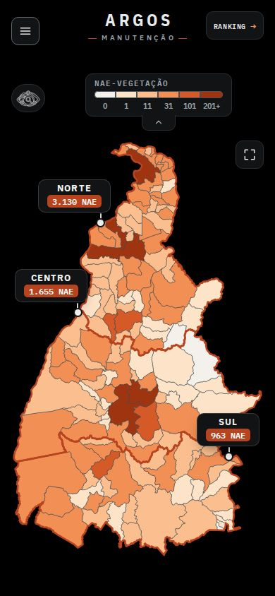 |

## Resumo (a mensagem em 5 linhas)

1. Problema: árvore e eucalipto na rede derrubam alimentadores; de jan a ago/2026 foram 5.748 ocorrências (NAE) no Tocantins e a manutenção precisa decidir onde agir primeiro.
2. O ARGOS põe num mapa só a rede (KML do GIS), as ocorrências da Crítica por trecho e as OS de limpeza de faixa, inspeção e manutenção.
3. Demonstração em ordem: mapa (estado, regional, polo, município, alimentador), busca atrás do olho, página do alimentador (T1/T2/T3, NAE por trecho, camadas, croqui) e ranking por polo.
4. Ganho: do "quem mais interrompe" ao "qual trecho, entre quais chaves, quantos km sem limpeza", com o croqui Excel pronto para a equipe de campo.
5. Próximos passos: atualizar a Crítica todo mês pelo menu, piloto com um polo, validar trechos e posição das OS com as equipes.

## Ordem e tempo

| Bloco | Slides | Tempo | O que dizer em uma frase |
|---|---|---|---|
| Abertura | 1 a 3 | 0:00 a 1:30 | "De jan a ago/2026 foram 5.748 ocorrências de árvore e eucalipto na rede. Onde agir primeiro?" |
| Mapa | 4 a 8 | 1:30 a 4:00 | "Do Tocantins ao alimentador em cinco cliques; a cor e o número são sempre a NAE de vegetação." |
| Busca e menu | 9 a 11 | 4:00 a 5:15 | "Um só campo atrás do olho: regional, polo, município, alimentador, ativo e OS." |
| Alimentador | 12 a 17 | 5:15 a 7:45 | "Cada trecho tem chave de início e fim, NAE, limpeza, inspeção e manutenção; o croqui sai em Excel." |
| Ranking | 18 e 19 | 7:45 a 8:30 | "A visão do gestor: qual alimentador e qual trecho primeiro." |
| Dados | 20 e 21 | 8:30 a 9:00 | "De onde vem cada número e como atualizar sem abrir terminal." |
| Fechamento | 22 e 23 | 9:00 a 10:00 | "Piloto com um polo, rotina mensal e perguntas." |

Se faltar tempo, pule os slides 8, 11 e 17 (tela cheia e tema claro, menu, croqui e downloads).

## Antes de começar (checklist de 2 minutos)

- Abra 4 abas já carregadas: (1) página inicial; (2) `.../teste/alimentadores/LD01072001/`; (3) `.../teste/polos/#eto`; (4) `.../teste/relatorio.html`. A demonstração começa na aba 1.
- Notebook 1440x900: use zoom de 80% a 90% do navegador (Ctrl e menos). No zoom 100% o mapa do estado passa da altura da tela e o sul do estado fica cortado embaixo (visível no print da capa).
- O tema é escuro por padrão. Em sala clara de projetor, Shift+K (fora de campos de texto) troca para o claro. A escolha de tema e a da legenda ficam guardadas no navegador: se os números de NAE sumirem do mapa, a legenda está recolhida (clique na orelhinha "NAE" para trazer de volta).
- O satélite do painel (Esri) precisa de internet. Teste antes.
- Um clique num alimentador da lista (ou na rede, no mapa) abre a página dele na mesma aba, e o mapa não guarda o nível no endereço: para refazer o caminho, use a busca. Prefira abrir o alimentador pela aba 2.
- Plano B se o site estiver lento: use o alimentador pequeno LD01072001 (154 km) em vez do LD03010004 (2.299 km) e mostre os prints desta pasta.

## Números para citar (todos vistos no site em 15/10/2026)

| Número | Onde aparece |
|---|---|
| 5.748 NAE de árvore/eucalipto no Tocantins, jan a ago/2026 | Ranking (ETO · Tocantins); soma das três regionais do mapa |
| Regionais: Norte 3.130, Centro 1.655, Sul 963 | Bandeirinhas pretas do mapa e botões do ranking (os mesmos números) |
| Polos (NAE): Augustinópolis 1.352, Araguaína 1.235, Guaraí 543 (Norte); Palmas 434, Paraíso 588, Porto Nacional 633 (Centro); Gurupi 702, Dianópolis 261 (Sul) | Barra do mapa ao abrir a regional e botões do ranking (mesmos números); o número do polo é a soma dos municípios dele |
| 139 municípios, 8 polos, 302 alimentadores, 3.908 trechos com NAE (T1 101, T2 257, T3 3.550), 91.477,0 km de rede | Ranking, escopo ETO |
| Busca: Norte 3 polos e 65 municípios; Centro 3 polos e 40; Sul 2 polos e 34 | Lista da busca (olho), sem digitar |
| Araguatins: 327 NAE, 9 alimentadores; Araguaína (município): 380 NAE, 33 alimentadores; Palmas (município): 336 NAE, 46 alimentadores | Mapa e busca |
| Relatório de validação: 319 alimentadores processados sem falha (91.534,6 km, 71.314 trechos), 306 alimentadores com aviso, 3 falhas críticas, 18 sem município com 100 m ou mais de rede | `relatorio.html` ("Total geral", "Avisos", "Não processados") |
| 1º do ranking: LD03010004, SE Araguaína I, 478 NAE (477 nesta rede), 2.299,4 km, 17.002 consumidores, 115.521 h de CHI, 20,7 NAE/100 km, 34% da limpeza no prazo, última limpeza 25/09/2026 | Ranking, ETO |
| 2º LD03005098 (187 NAE), 3º LD03014045 (186), 4º LD02059122 (170), 5º LD05010004 (134) | Ranking, ETO |
| Polo Araguaína: 1.235 NAE, 62 alimentadores, 814 trechos com NAE, 14.140,9 km, 20 municípios | Ranking, polo |
| AL02096004: NAE 82 (74 nesta rede), 264,3 km, 28,0 NAE/100 km | Ranking, Polo Araguaína ordenado por NAE/100 km |
| LD01072001 (SE Porto Nacional): 153,98 km, 199 trechos (T1 1 com 13,02 km; T2 3 com 25,97 km; T3 195 com 114,99 km), 23 NAE | Página do alimentador |
| LD01072001, T1: 4 desarmes do DJ por árvore (150, 150, 304 e 160 consumidores); limpeza vencida em 7,9 km e sem registro em 5,1 km dos 13,02 km | Detalhe do trecho T1 |
| LD01072001, faixa: 6 OS executadas, 24,2 km de 154,0 km; 3 criadas (21,0 km); vencimento: em dia 3,9 km, vence em 12 meses 12,4 km, vencida 7,9 km, sem registro 129,7 km | Painel, Limpeza de faixa |
| LD01072001: 21 inspeções (34,0 km), 825 OS de manutenção em 415 ativos, 153 OS Insp→manut no prazo | Painel, camadas |
| LD03010004: 1.997 trechos (T1 1 com 13,11 km; T2 20 com 408,60 km; T3 1.976 com 1.877,65 km); 97 OS de limpeza executadas, 783,1 km de 2.299,3 km | Página do alimentador |
| AL03037009 (SE Guaraí I): 211,66 km, 171 trechos (T1 29,71 km; T2 nenhum; T3 170 com 181,95 km), 37 NAE | Página do alimentador |
| Bases: limpeza 2.615 OS (03/10); inspeção 2.081 (até 09/10); manutenção da inspeção 5.323 (até 10/10); executadas 215.325 OS (até 15/10); Crítica jan a ago/2026 | Menu ☰, Atualização de dados |
| Regra de limpeza: T1 a cada 3 anos, T2 a cada 4, T3 a cada 5 | Detalhe do trecho e ranking |

---

# Slides

## Abertura (0:00 a 1:30)

### Slide 1. ARGOS Manutenção
- Manutenção da rede no Tocantins: vegetação, interrupções, inspeção e OS
- Mapa da NAE por município, polo e alimentador
- Dados da Crítica de jan a ago/2026
- Apresentação de 10 minutos

Prints: `prints/01-capa-d.jpg` · `prints/01-capa-m.jpg`

### Slide 2. O problema
- Árvore e eucalipto na rede derrubam alimentadores
- 5.748 ocorrências (NAE) de jan a ago/2026 no Tocantins: Norte 3.130, Centro 1.655, Sul 963
- As equipes de manutenção não alcançam tudo ao mesmo tempo
- Pergunta: onde agir primeiro?

Prints: `prints/02-problema-d.jpg` · `prints/02-problema-m.jpg`

### Slide 3. O que é o ARGOS
- Rede de média tensão do GIS (KML) dividida em trechos T1, T2 e T3 (319 alimentadores, 91.534,6 km)
- Ocorrências da Crítica, cada uma no trecho certo
- OS de limpeza de faixa, inspeção e manutenção no mesmo mapa
- Site no navegador, também no celular, sem instalar nada

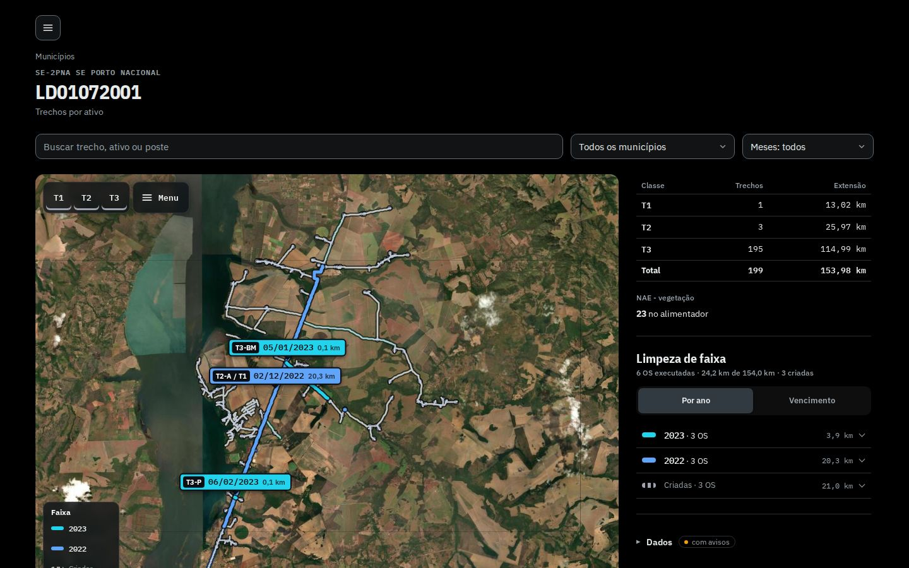
Prints: `prints/03-o-que-e-d.jpg` · `prints/03-o-que-e-m.jpg`

## Mapa (1:30 a 4:00)

### Slide 4. Estado: o Tocantins pintado pela NAE
- Municípios coloridos pela NAE-Vegetação em 6 faixas: 0, 1 a 10, 11 a 30, 31 a 100, 101 a 200 e 201 ou mais
- Bandeirinhas pretas saem do contorno de cada regional: Norte 3.130, Centro 1.655, Sul 963 (soma 5.748)
- A legenda tem título e orelhinha: recolhida, tira os números do mapa e deixa só a cor
- No alto: menu ☰, olho (busca), Ranking e tela cheia

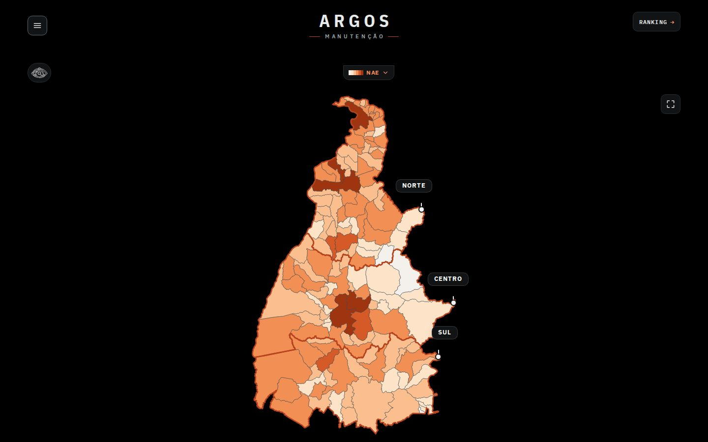
Prints: `prints/04-estado-d.jpg` · `prints/04b-estado-legenda-recolhida-d.jpg` · celular: mesmos nomes com `-m`

### Slide 5. Regional e polo: do território às equipes
- Clicar na bandeirinha abre a regional: as outras saem e os polos aparecem na barra, cada um com cor e NAE
- Norte: Augustinópolis 1.352, Araguaína 1.235, Guaraí 543. Centro: Palmas 434, Paraíso 588, Porto Nacional 633. Sul: Gurupi 702, Dianópolis 261
- Ao abrir o polo, todos os municípios têm rótulo com nome e NAE (dentro, ou ao lado com um fio)
- A trilha "Tocantins › Norte › Augustinópolis" volta direto a qualquer passo

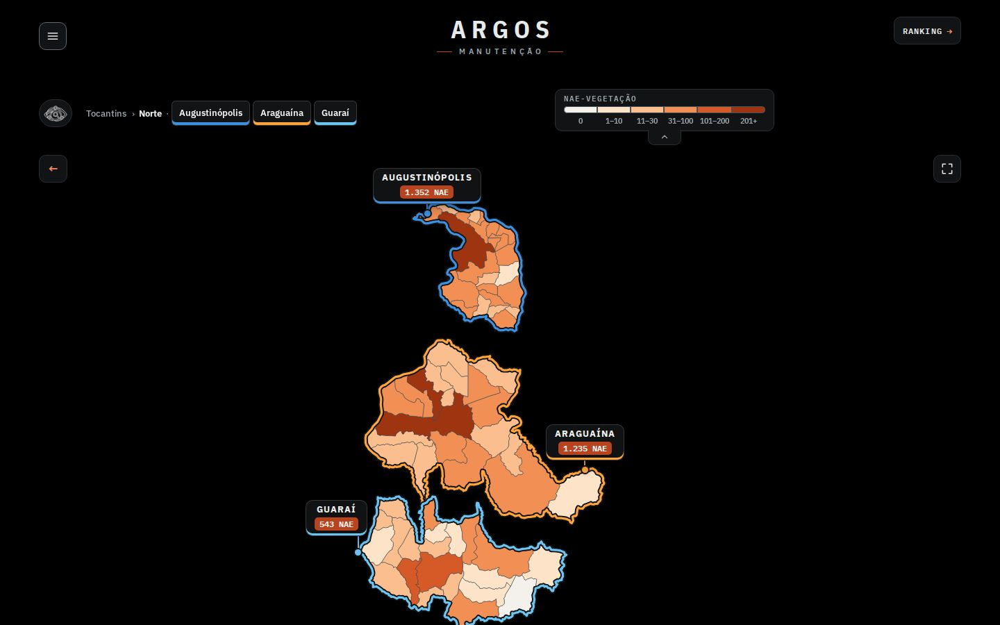
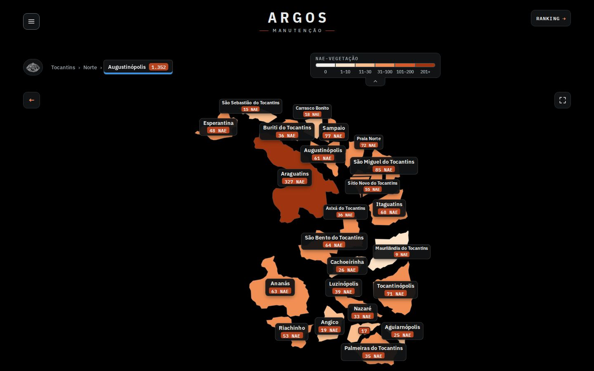
Prints: `prints/05-regional-norte-d.jpg` · `prints/05b-polo-augustinopolis-d.jpg` · celular: `-m`

### Slide 6. Município: a rede de cada alimentador
- Clicar no município (ex.: Araguatins, 327 NAE) mostra a rede de cada alimentador em azul; o resto fica apagado
- A lista abre embaixo do olho: 9 alimentadores, cada um com miniatura da rede, código e NAE (LD03005098 187, LD03014045 186, LD02109039 121, LD03109039 101)
- Passar o mouse numa linha destaca a rede; um clique abre a página do alimentador
- No celular a lista abre sobre o mapa

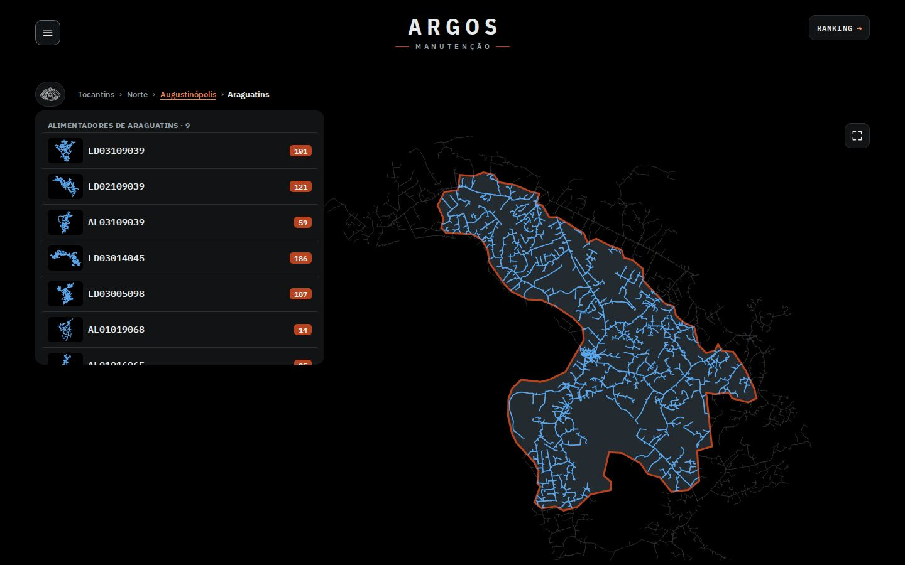
Prints: `prints/06-municipio-d.jpg` · `prints/06-municipio-m.jpg`

### Slide 7. Foco no alimentador e como voltar
- Escolher o alimentador na busca leva o mapa até ele (regional, polo, município) e aproxima a rede inteira
- A trilha ganha o último passo: Tocantins › Norte › Augustinópolis › Araguatins › LD03109039
- A seta ← e a tecla Esc sobem um nível por vez; setas do teclado andam pelos municípios e Enter abre
- Clicar na rede aproximada abre a página do alimentador (T1/T2/T3, NAE por trecho, camadas)

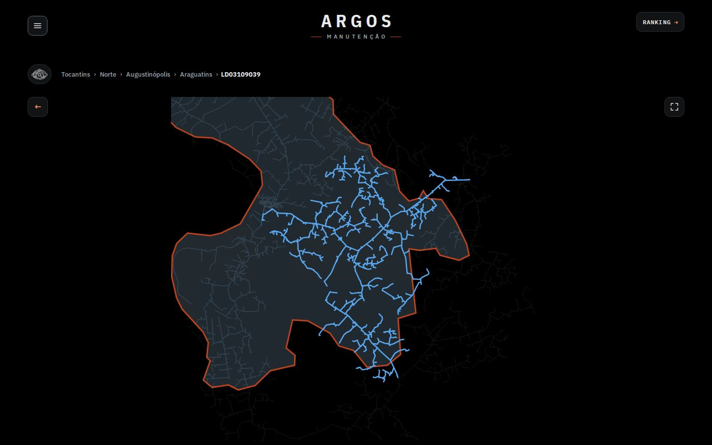
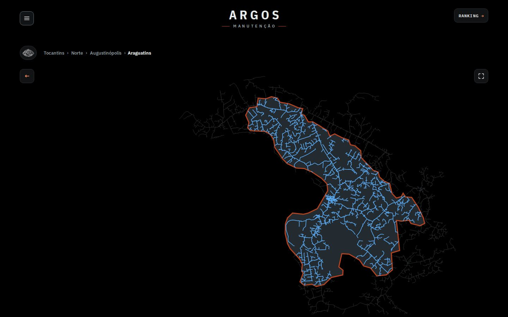
Prints: `prints/07-foco-alimentador-d.jpg` · `prints/07b-esc-municipio-d.jpg` · `prints/07c-esc-polo-d.jpg` · celular: `-m`

### Slide 8. Tela cheia e tema claro (se sobrar tempo)
- Botão de tela cheia no canto direito do mapa: a barra, a legenda e o mapa cobrem a tela; Esc sai
- Night shift: tema claro pelo menu ☰ ou com Shift+K, bom para projetor e impressão
- Mesmos dados e mesma navegação nos dois temas
- A escolha de tema e a de legenda ficam guardadas no navegador

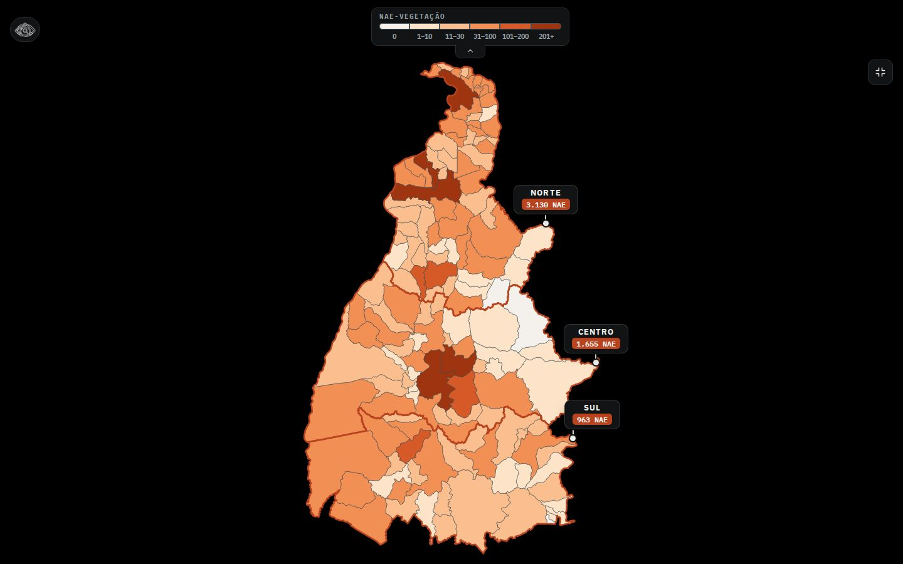
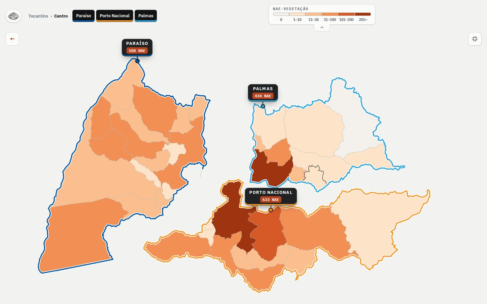
Prints: `prints/08-tela-cheia-d.jpg` · `prints/08b-estado-claro-d.jpg` · `prints/08c-regional-claro-d.jpg` · celular: `-m`

## Busca e menu (4:00 a 5:15)

### Slide 9. Busca atrás do olho do ARGOS
- Tocar no olho (canto esquerdo, acima do mapa) abre o campo; a tecla "/" também abre
- Sem digitar: as 3 regionais (Norte 3 polos e 65 municípios, Centro 3 e 40, Sul 2 e 34) e os alimentadores com mais NAE
- Digitando: polos, municípios, alimentadores e ativos; ignora maiúsculas e acentos. "Palmas": polo (434 NAE) e município (46 alimentadores, 336 NAE)
- Alimentador: AL03037009, SE Guaraí I, 2 municípios, 212 km, 37 NAE; escolher leva o mapa até ele

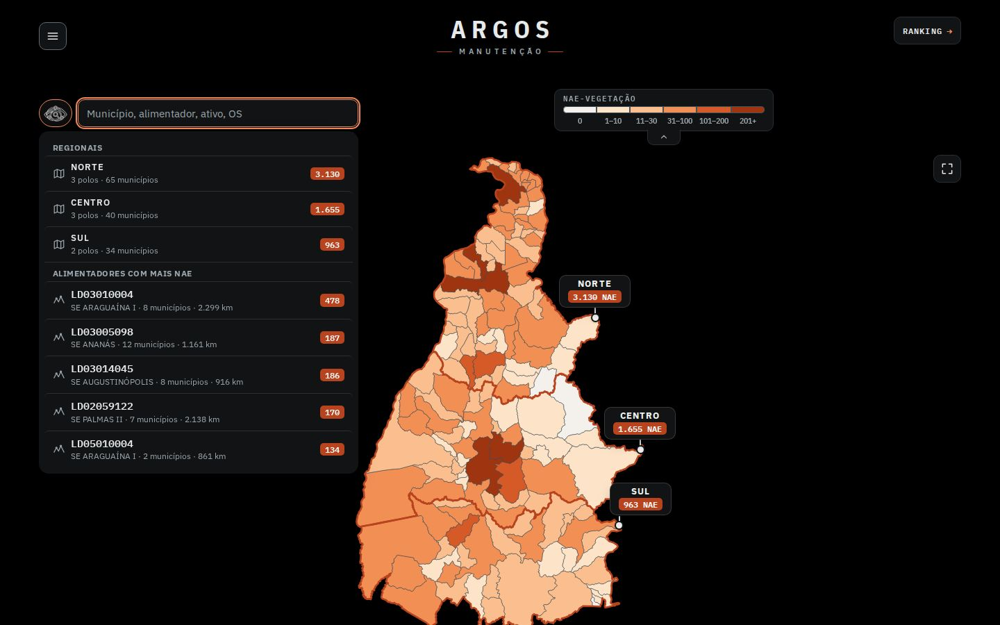
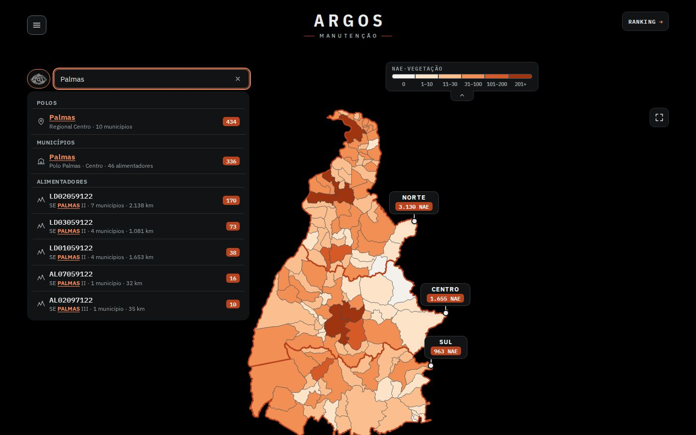
Prints: `prints/09-busca-aberta-d.jpg` · `prints/09b-busca-municipio-d.jpg` · `prints/09c-busca-alimentador-d.jpg` · celular: `-m`

### Slide 10. Ativo e OS
- Ativo: o código completo de chave, religador, transformador ou poste. Ex.: 7933799001 é um religador, T2-A do LD01072001 (SE Porto Nacional), "início do T2-A, fim do T2"
- OS no formato nº/ano: 943/2022 mostra 6 OS de equipes diferentes; com a equipe (ETO-RD-PO 000353/2026) sobram 2 registros no LD02047073
- Cada resultado traz base, data ou situação, alimentador e subestação; "Ver no mapa" ou "Abrir no mapa do alimentador"
- O alimentador abre centrado no ponto, com a etiqueta ATIVO; o endereço pode ser enviado a outra pessoa

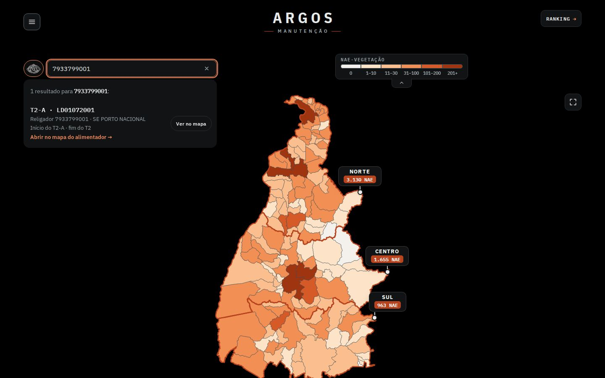
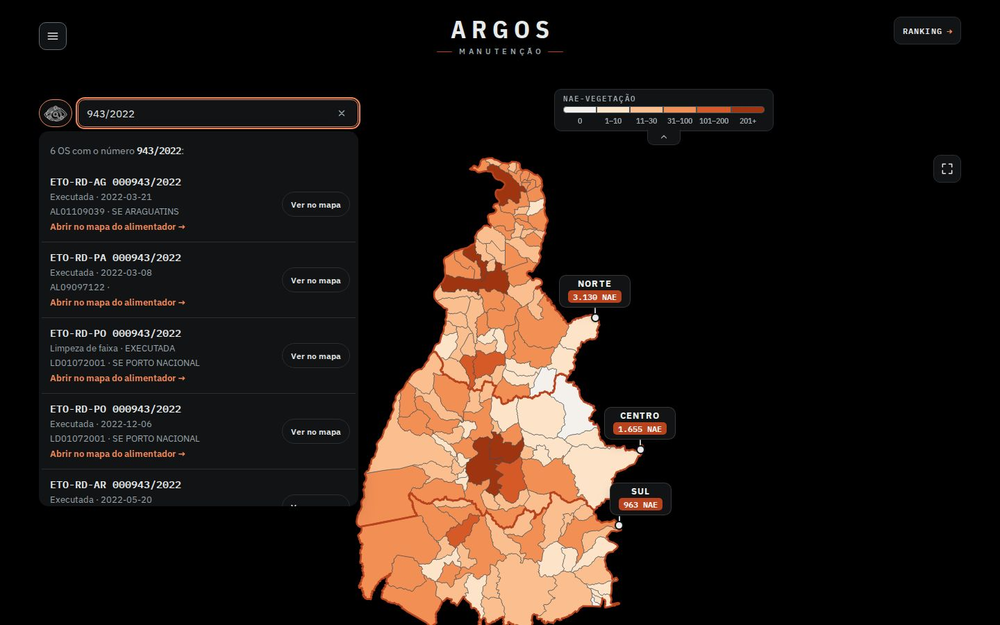
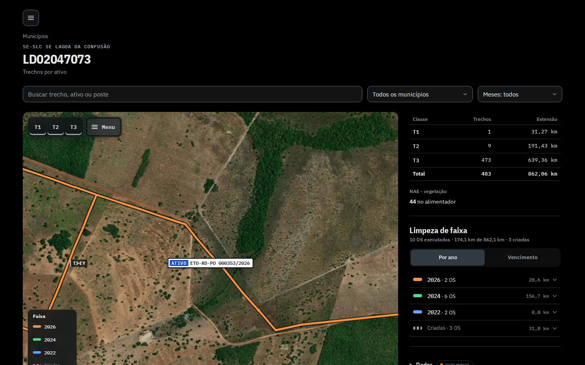
Prints: `prints/10-busca-ativo-sugestao-d.jpg` · `prints/10b-busca-ativo-resultado-d.jpg` · `prints/10c-busca-os-sugestao-d.jpg` · `prints/10d-busca-os-resultado-d.jpg` · `prints/10e-busca-os-equipe-d.jpg` · `prints/10f-abrir-no-mapa-d.jpg` · celular: `-m`

### Slide 11. Menu ☰ (se sobrar tempo)
- Menu no canto superior esquerdo de todas as páginas
- Atualização de dados: arrastar a base; mostra a data da última atualização de cada uma
- Night shift (Shift+K) e, em Relatórios: legenda T1/T2/T3, Relatório de validação e manifesto.json (municípios e alimentadores em JSON)
- Script KML → trechos (.zip), 94 KB, divide o KML no formato do Daimon em T1/T2/T3 e vem com LEIA-ME

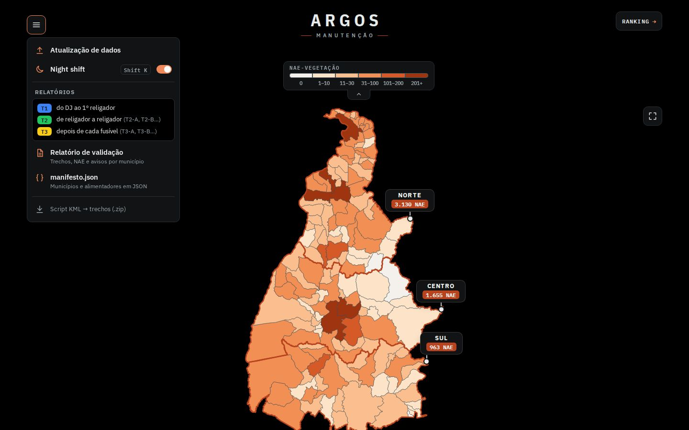
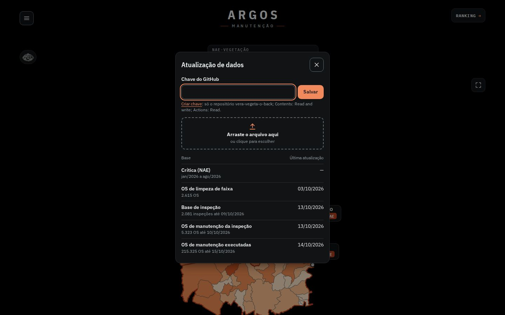
Prints: `prints/11-menu-d.jpg` · `prints/11b-menu-claro-d.jpg` · `prints/11c-atualizar-bases-d.jpg` · celular: `-m` (nada é enviado e nenhuma chave é digitada nesses prints)

## Alimentador (5:15 a 7:45)

### Slide 12. A página do alimentador (LD01072001)
- Cabeçalho com a subestação (SE-2PNA, SE Porto Nacional), busca de trecho, ativo ou poste, filtro de município e botão Meses
- Mapa de satélite com a rede em trechos; os botões T1, T2 e T3 ligam e desligam cada classe; o Menu liga as camadas
- Tabela: 199 trechos e 153,98 km (T1 1 com 13,02 km, T2 3 com 25,97 km, T3 195 com 114,99 km)
- NAE de vegetação: 23 no alimentador. Limpeza de faixa: 6 OS executadas, 24,2 km de 154,0 km, 3 criadas

Prints: `prints/12-visao-geral-d.jpg` · `prints/12-visao-geral-m.jpg`

### Slide 13. T1, T2 e T3, com chave de início e de fim
- T1: do disjuntor (DJ) ao 1º religador. T2: de religador a religador (T2-A, T2-B…). T3: cada fusível abre um T3 (T3-A, T3-B…); não existe T4
- T1 do LD01072001: DJ LD01072001 até 7927413001, 13,02 km, 256 vãos. T2-A: 7933799001 até 7954762001, 16,58 km, 265 vãos
- T3-BC: começa no fusível 0309785001 e termina no fim de linha (poste 31175389), 3,85 km
- Pinos INÍCIO (verde) e FIM (vermelho) no mapa; "Vem de" e "Derivações" navegam entre trechos; Ctrl (⌘) + clique soma trechos
- Sem religador não há T2: AL03037009 tem T1 de 29,71 km e 170 T3

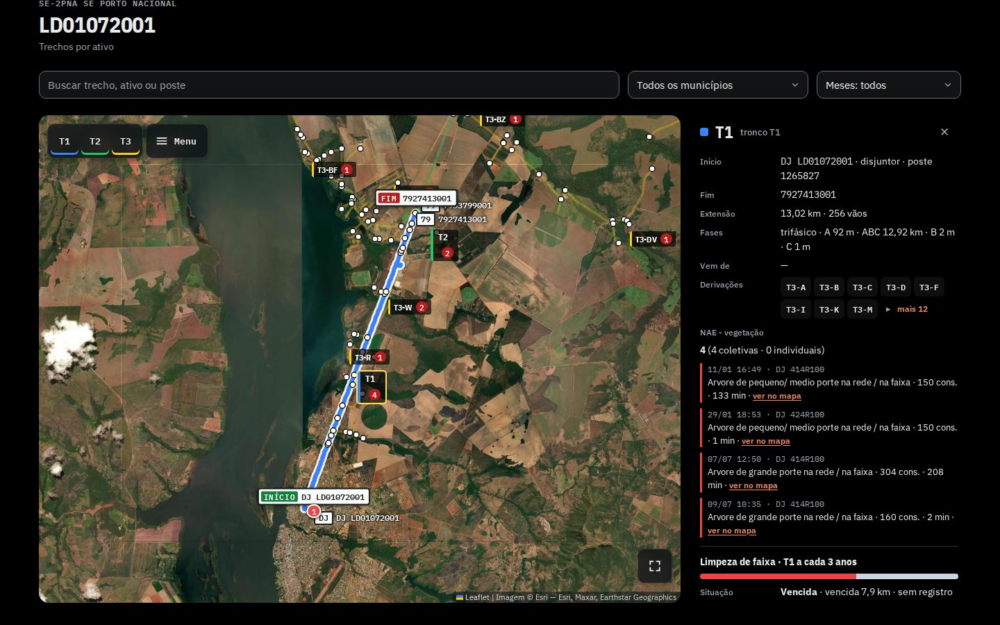
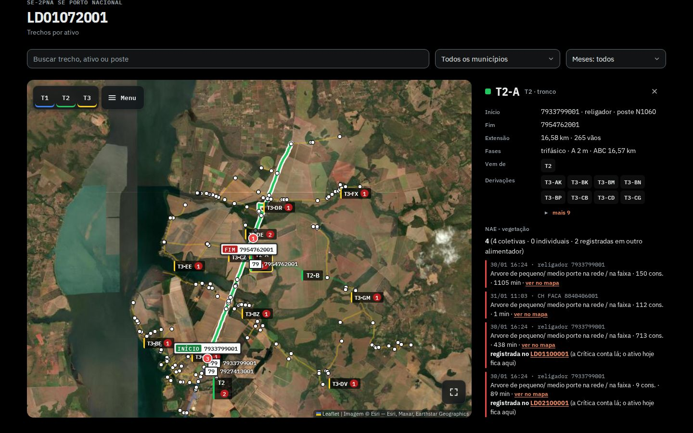
Prints: `prints/13-t1-d.jpg` · `prints/13b-t2a-d.jpg` · `prints/13c-t3-d.jpg` · `prints/13d-al03037009-d.jpg` · celular: `-m`

### Slide 14. NAE por trecho e por mês
- NAE de vegetação (Meio Ambiente, árvore ou eucalipto), da Crítica, cai no trecho do ativo que atuou; o número vermelho aparece no rótulo do trecho
- T1 do LD01072001: 4 desarmes do DJ por árvore (150, 150, 304 e 160 consumidores), cada um com data e hora
- Meses (jan a ago/2026): jan/2026 tem 9 das 23 NAE e o T2-A lidera (4)
- NAE registrada em outro alimentador é indicada com link (2 das 4 do T2-A)
- Lista por maior NAE, com início → fim, km e ano da última limpeza

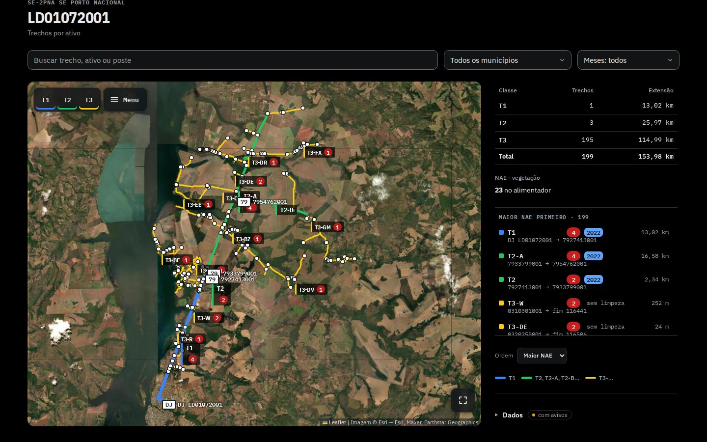
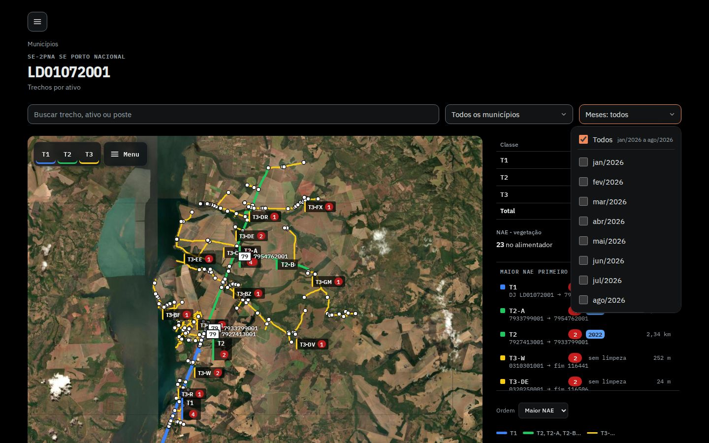
Prints: `prints/14-lista-nae-d.jpg` · `prints/14b-nae-meses-d.jpg` · `prints/14c-nae-janeiro-d.jpg` · celular: `-m`

### Slide 15. Camada Faixa: limpeza de faixa
- Menu do mapa › Faixa, em duas vistas: Por ano (uma cor por ano; cinza sem limpeza) e Vencimento (T1 a cada 3 anos, T2 a cada 4, T3 a cada 5)
- LD01072001, vencimento: em dia 3,9 km, vence em até 12 meses 12,4 km, vencida 7,9 km, sem registro 129,7 km
- Criadas (tracejado): 3 OS, 21,0 km. Pendentes (pontilhado), no LD02010004: 22 executadas, 4 criadas, 6 pendentes
- No T1 do LD01072001: 7,9 km vencidos e 5,1 km sem registro dos 13,02 km: candidato claro à limpeza de faixa

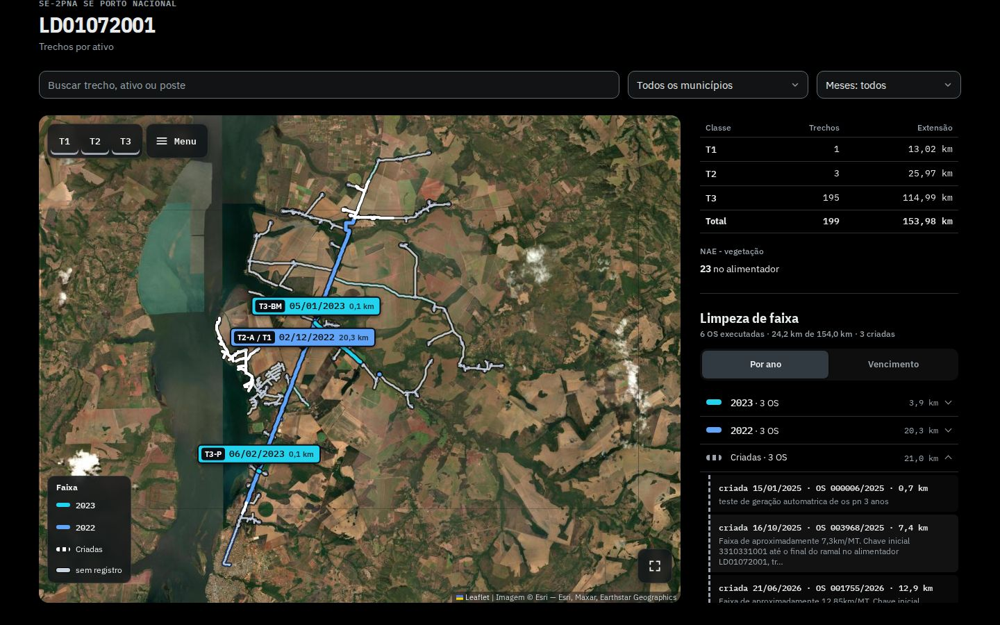
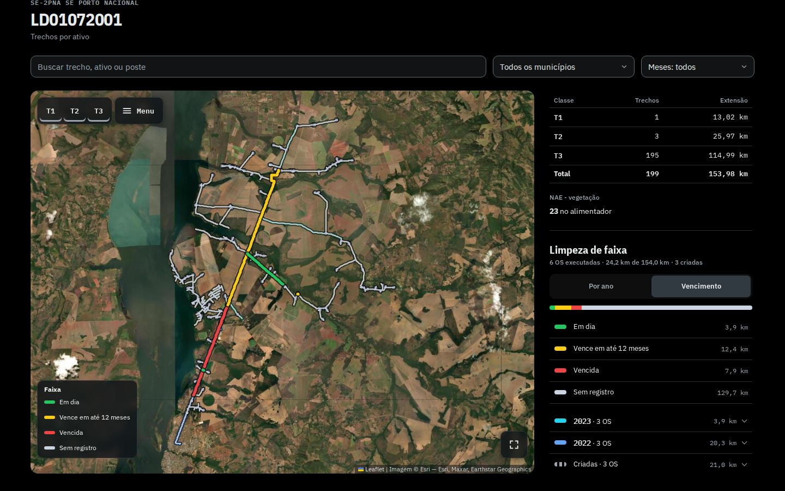
Prints: `prints/15-faixa-criadas-d.jpg` · `prints/15b-faixa-pendentes-d.jpg` · `prints/15c-faixa-vencimento-d.jpg` · celular: `-m`

### Slide 16. Camadas Inspeção, Insp→manut e Manutenção
- Menu do mapa: Faixa, Inspeção, Insp→manut e Manutenção, quantas quiser ao mesmo tempo, cada uma com legenda e bloco no painel
- Inspeção: rede inspecionada na cor do ano; LD01072001 tem 21 inspeções, 34,0 km de 154,0 km
- Manutenção executada: um losango por ativo, na cor do ano da última OS; 825 OS em 415 ativos
- Insp→manut: OS de manutenção geradas pela inspeção, por situação (153 no prazo); cada OS mostra "INSP 000071/2026 → MANUT 002375/2026"

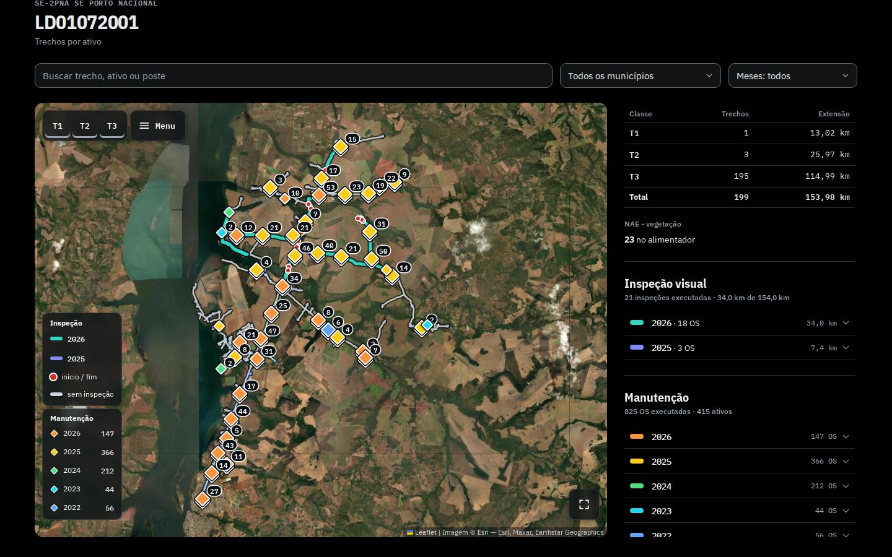
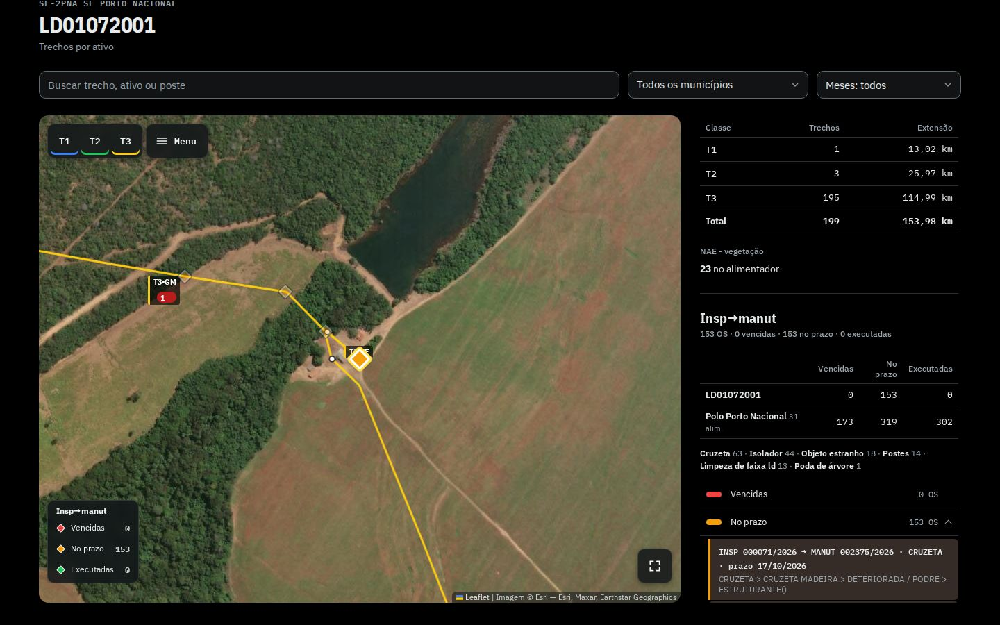
Prints: `prints/16-inspecao-manutencao-d.jpg` · `prints/16b-menu-camadas-d.jpg` · `prints/16c-insp-manut-d.jpg` · celular: `-m`

### Slide 17. Tela cheia, croqui em Excel e KMZ (se sobrar tempo)
- Tela cheia (botão no canto inferior direito do mapa; Esc sai): o painel vira gaveta e o satélite chega ao zoom 19
- Croqui da faixa (Dados › Downloads › Faixa): janela já preenchida com alimentador, trecho, extensão, município, chaves inicial e final em UTM e imagem; você completa tipo, OS, obra e deslocamento
- Baixa o Excel no modelo da Energisa; vale para o trecho selecionado, vários trechos ou o alimentador inteiro
- Downloads: Excel por camada (OS de faixa, inspeções, OS da inspeção, 825 OS de manutenção) e KMZ para o Google Earth

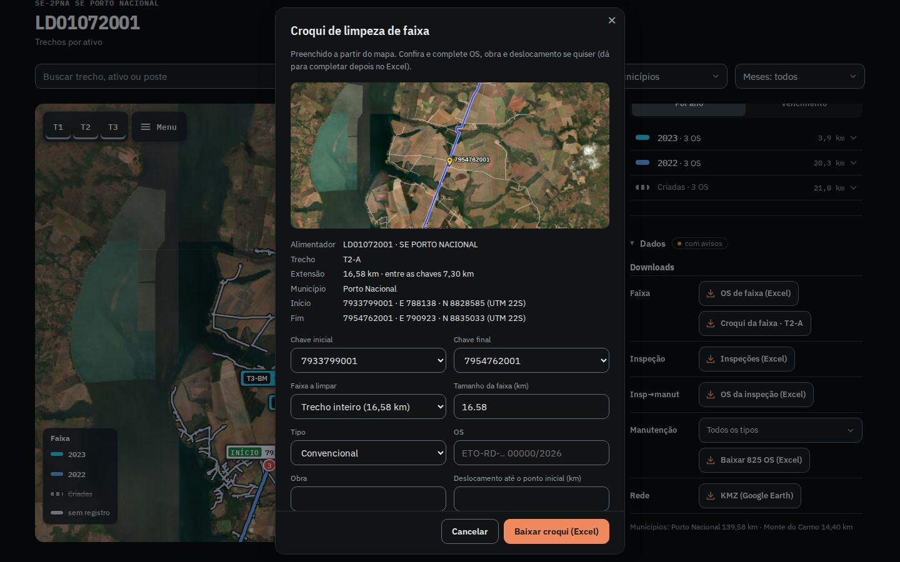
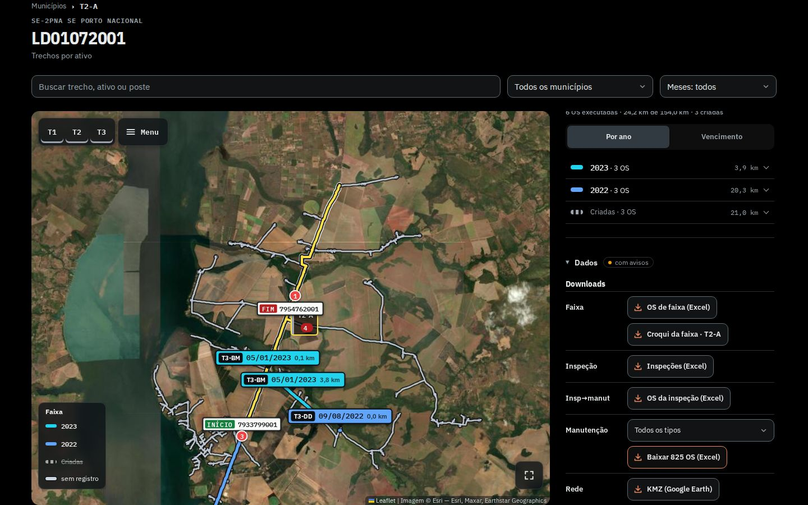
Prints: `prints/17-tela-cheia-d.jpg` · `prints/17b-croqui-d.jpg` · `prints/17c-downloads-d.jpg` · celular: `-m`

## Ranking (7:45 a 8:30)

### Slide 18. Ranking por polo
- Página `polos/` (botão Ranking): ETO (Tocantins), regionais e 8 polos; os números dos botões são os mesmos do mapa (5.748, Norte 3.130, Centro 1.655, Sul 963)
- ETO: 302 alimentadores, 3.908 trechos com NAE, 91.477,0 km, 139 municípios
- Colunas: NAE, consumidores, CHI (h), km, NAE/100 km, limpeza no prazo e última limpeza; abas Alimentadores e Trechos (T1 101, T2 257, T3 3.550)
- 1º LD03010004: 478 NAE, 17.002 consumidores, 34% da limpeza no prazo. Polo Araguaína: 1.235 NAE, 62 alimentadores, 814 trechos
- O endereço guarda a visão (`#araguaina`, `#eto/trechos/T3`)

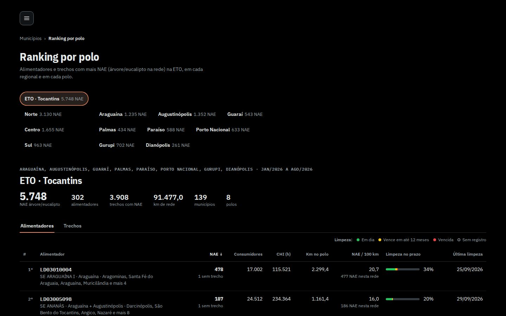
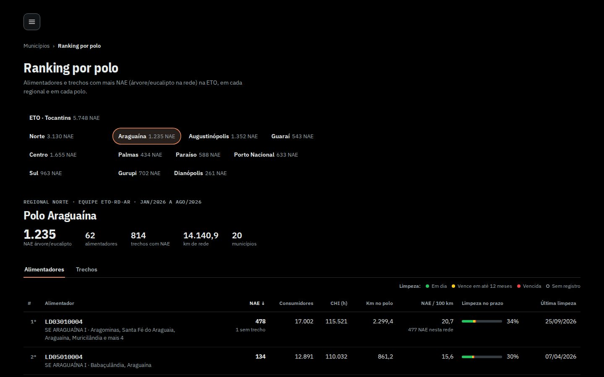
Prints: `prints/18-ranking-eto-d.jpg` · `prints/18b-polo-araguaina-d.jpg` · `prints/18c-trechos-t3-d.jpg` · celular: `-m` (cada linha vira um cartão)

### Slide 19. NAE e NAE/100 km
- NAE: ocorrências de vegetação da Crítica; NAE/100 km: NAE da mesma rede dividida pelos km, vezes 100
- "NAE nesta rede" ajusta a conta: sai a NAE cujo ativo hoje está em outro alimentador no GIS e entra a de outro alimentador cujo ativo está aqui
- Polo Araguaína: AL02096004 lidera com 28,0 (NAE 82, 74 nesta rede, 264,3 km); LD03010004 tem 478 NAE e 20,7 (2.299,4 km)
- Use o índice junto com a NAE absoluta; trecho muito curto distorce a taxa
- "Como contamos", no pé da página, traz o método e a regra de limpeza (T1 3 anos, T2 4, T3 5)

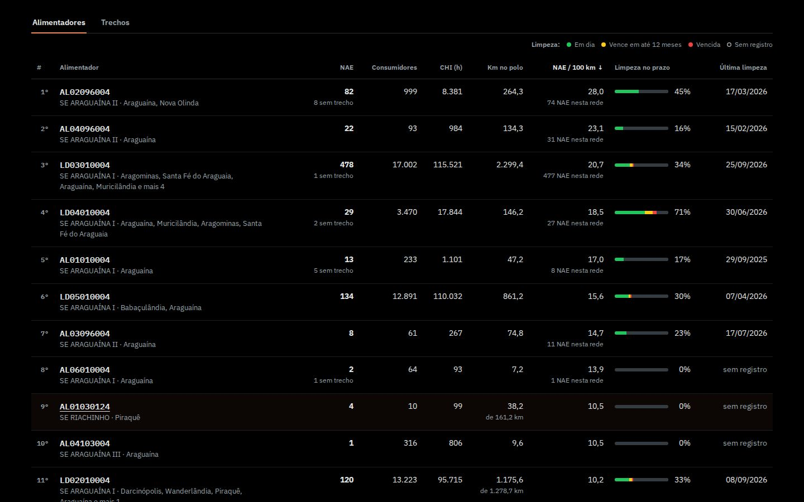
Prints: `prints/19-nae-por-100km-d.jpg` · `prints/19-nae-por-100km-m.jpg`

## Dados (8:30 a 9:00)

### Slide 20. Relatório de validação
- `relatorio.html` (menu ☰ › Relatórios): uma tabela por município com polo, SE, trechos, km, religadores, fusíveis, NAE associada e não associada, avisos e status
- 139 municípios; 319 alimentadores processados sem falha (91.534,6 km, 71.314 trechos)
- 306 alimentadores com aviso (revisar): vão na divisa entre municípios, alimentador sem 2º religador, seccionamento, trechos a revisar
- 3 falhas críticas (AL01102271, LD01414015, LD02424015: classificação colapsada, 1 trecho para centenas de km) e 18 sem município com 100 m ou mais de rede ficam de fora

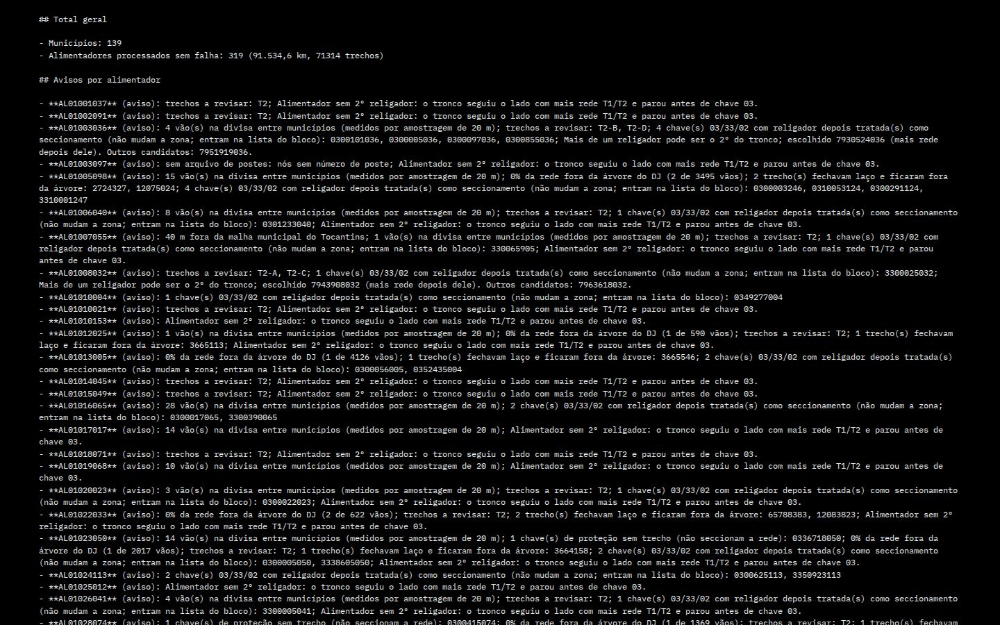
Prints: `prints/20-relatorio-topo-d.jpg` · `prints/20b-relatorio-total-d.jpg` · celular: `-m` (o relatório é texto corrido: no celular, prefira o computador)

### Slide 21. De onde vem cada número e como atualizar
- KML do GIS (rede e chaves, convertido por camadas; única fonte de T1/T2/T3; também os trafos e onde o ativo está hoje), Crítica (um arquivo por mês), planilha de polos (DCMD) e bases de OS
- Hoje: limpeza 2.615 OS (03/10), inspeção 2.081 (até 09/10), manutenção da inspeção 5.323 (até 10/10), executadas 215.325 (até 15/10), Crítica jan a ago/2026
- Atualizar: ☰ › Atualização de dados › arrastar o arquivo; a chave do GitHub é pedida uma vez e fica só no navegador
- A automação leva uns 5 minutos; se der erro, não publica nada

Prints: `prints/21-fluxo-dados-d.jpg` · `prints/21-fluxo-dados-m.jpg` (diagrama em `fluxo.html`) · `prints/11c-atualizar-bases-d.jpg`

## Fechamento (9:00 a 10:00)

### Slide 22. Benefícios
- Decisão por trecho, entre duas chaves, e não pelo alimentador inteiro
- NAE, limpeza, inspeção e manutenção no mesmo lugar
- Chave de início e fim e croqui Excel prontos para a equipe de campo
- Relatório de validação transparente e atualização mensal pelo menu

Print: `prints/17b-croqui-d.jpg` (o mesmo do slide 17)

### Slide 23. Próximos passos e perguntas
- Carregar a Crítica de setembro e manter a rotina mensal pelo menu
- Piloto com um polo: Augustinópolis (1.352 NAE) ou Araguaína (1.235)
- Validar com as equipes ETO-RD os trechos a revisar e a posição das OS
- Definir responsável e calendário de atualização
- Perguntas: o que falta para o uso diário da manutenção?

Print: `prints/11c-atualizar-bases-d.jpg` (o mesmo do slide 11)

---

# Glossário

| Termo | Significado no ARGOS |
|---|---|
| **NAE** | Ocorrência da Crítica contada por trecho. No site, "NAE-Vegetação": causa Meio Ambiente com subcausa Árvore (pequeno/médio ou grande porte) ou Eucalipto, na rede ou na faixa. Ficam fora árvore no ramal de entrada de serviço e poda de árvores. Conta coletivas e individuais; o detalhe do trecho mostra a divisão. O repositório não traz a expansão oficial da sigla: confirme com a área de indicadores antes de falar de cor. |
| **NAE/100 km** | NAE da mesma rede dividida pelos km, vezes 100. Permite comparar alimentadores de tamanhos diferentes. Está no ranking. |
| **NAE nesta rede** | Parte da NAE que a conta do NAE/100 km usa: tira a NAE cujo ativo hoje está em outro alimentador no GIS e põe a de outro alimentador cujo ativo está aqui. Aparece embaixo da NAE/100 km no ranking. |
| **T1, T2, T3** | Classes de trecho. T1: do disjuntor (DJ) ao 1º religador. T2: de um religador a outro; cada religador seguinte abre um novo T2 (T2-A, T2-B…). T3: cada fusível abre um T3 (T3-A, T3-B…), inclusive fusível depois de fusível: não existe T4. Exceção: o 1º fusível da linha principal a menos de 300 m depois de um religador não abre T3. Letras só nascem em ativo (chave). |
| **DJ** | Disjuntor do alimentador, na subestação. Começa o T1. |
| **Religador** | Equipamento de proteção que religa a linha após um desarme (código de chave 79). Abre o T2. |
| **Fusível** | Chave fusível (códigos 03, 33 e 02). Abre o T3. Fusível com religador depois dele é seccionamento e não muda a classe. |
| **Chave** | Equipamento de manobra e proteção na rede (DJ, religador, fusível, faca etc.). Cada trecho vai de uma chave a outra. Chaves 88, 80, 90, 31 e 68 não dividem trecho; aparecem no mapa de perto. |
| **OS** | Ordem de serviço. Número/ano com a equipe na frente, ex.: `ETO-RD-PO 000353/2026`. O ARGOS lê quatro bases: limpeza de faixa, inspeção, manutenção gerada pela inspeção (Insp→manut) e manutenção executada. |
| **Insp→manut** | OS de manutenção geradas por uma inspeção. No painel cada OS aparece como "INSP nº → MANUT nº", com a situação (vencida, no prazo, executada). |
| **Polo** | Grupo de municípios atendido por uma equipe ETO-RD. São 8: Augustinópolis, Araguaína, Guaraí, Palmas, Paraíso, Porto Nacional, Gurupi e Dianópolis. A NAE do polo é a soma dos municípios dele. |
| **Regional** | Agrupamento de polos: Norte (3 polos, 65 municípios), Centro (3 polos, 40) e Sul (2 polos, 34). |
| **Bandeirinha** | Cartão preto com o nome e a NAE de uma regional ou polo, ligado ao contorno por um traço curto. |
| **Legenda NAE** | Faixa de 6 cores com o título "NAE-Vegetação" no alto do mapa. A orelhinha recolhe a legenda e, com ela, os números de NAE do mapa (fica só a cor). |
| **Olho (busca)** | Botão com o olho do ARGOS, acima do mapa. Abre o campo de busca de regional, polo, município, alimentador, ativo ou OS. |
| **ETO** | Escopo do ranking que reúne os 8 polos (Tocantins inteiro). As equipes de campo são as ETO-RD de cada polo; só OS de limpeza executadas por elas contam no ranking. |
| **Crítica** | Base mensal de interrupções (arquivos `Critica-CHEIO_MM-AAAA.txt`). Alimenta a NAE, os consumidores e o CHI. No site: jan a ago/2026. |
| **GIS** | Fonte da rede de média tensão do site: o KML de cada alimentador (KMZ_GOOGLE_EARTH2) é convertido por camadas no formato do Daimon, com as chaves de isolação e um DJ na saída da SE. É a única fonte das chaves usadas para montar T1, T2 e T3. |
| **Daimon** | Sistema cujo export KML (SE-XXXX_Circ-ALxxx.kml) define o formato que o script de trechos lê. |
| **GIS** | Cadastro de ativos (transformadores e onde cada ativo está hoje). Usado no NAE/100 km. |
| **CHI (h)** | Consumidor-hora interrompido: consumidores atingidos vezes minutos de interrupção, divididos por 60. |
| **Faixa / limpeza de faixa** | Faixa de servidão da linha. A limpeza segue a regra T1 a cada 3 anos, T2 a cada 4 e T3 a cada 5; o ranking mostra o percentual no prazo. |
| **Alimentador** | Circuito de média tensão que sai de uma subestação (SE). Códigos `AL...` e `LD...`. |
| **Croqui** | Excel do modelo da Energisa de limpeza de faixa, já preenchido (chaves, coordenadas UTM, alimentador, extensão, município, figuras). |
| **Night shift** | Tema escuro (padrão, fundo preto) ou claro. Atalho Shift+K. |

# Perguntas frequentes

**1. Como o ARGOS ajuda a decidir onde agir primeiro?**
Ele ordena, não decide por você. Leitura sugerida: no Ranking, ordene por NAE (volume); confira consumidores e CHI (impacto) e NAE/100 km (concentração); veja "Limpeza no prazo" e a última limpeza; abra o alimentador e olhe os trechos. Exemplo real: no T1 do LD01072001 foram 4 desarmes do DJ por árvore e 7,9 km de limpeza vencida mais 5,1 km sem registro, dos 13,02 km. Esse é um candidato claro.

**2. O que entra na NAE do site?**
Só ocorrências de vegetação: causa Meio Ambiente com subcausa Árvore (pequeno/médio ou grande porte) ou Eucalipto, na rede ou na faixa. Árvore no ramal de entrada de serviço e poda de árvores ficam de fora. Cada ocorrência vem da Crítica e é associada a um trecho pela chave do problema ou pelo vão mais próximo do ativo. O período atual é jan a ago/2026.

**3. Como ler NAE/100 km?**
É a NAE da mesma rede dividida pelos km, vezes 100. Serve para comparar alimentadores de tamanhos diferentes, mas rede pequena infla o índice. No Polo Araguaína, o AL02096004 lidera com 28,0 (NAE 82, 74 nesta rede, em 264,3 km), enquanto o LD03010004, com 478 NAE em 2.299,4 km, tem 20,7. Use o índice junto com a NAE absoluta, nunca sozinho.

**4. O número de um polo é a soma de quê?**
Dos municípios dele. Exemplo: os 24 municípios do Polo Augustinópolis no mapa somam 1.352 (Araguatins 327, São Miguel do Tocantins 85, Sampaio 77…). As regionais somam os polos (Norte 1.352 + 1.235 + 543 = 3.130) e o estado soma as regionais (5.748). O botão do ranking e o mapa mostram os mesmos números.

**5. Por que um alimentador pode não ter T2?**
T2 só existe depois de um religador. O AL03037009, por exemplo, tem T1 de 29,71 km, nenhum T2 e 170 trechos T3: sem religador, o T1 vai até o fim do tronco e o resto abre em fusíveis. A explicação completa da regra está em "Como os trechos são divididos", em Dados, no fim do painel.

**6. Os dados estão atualizados? Como atualizar?**
Hoje: Crítica de jan a ago/2026 (setembro ainda não carregado); OS de manutenção executadas até 15/10/2026 (215.325 OS); inspeção até 09/10/2026 (2.081); manutenção gerada pela inspeção até 10/10/2026 (5.323); limpeza de faixa com 2.615 OS (processada em 03/10). A rede vem do KML do GIS, convertido no formato do Daimon. Para atualizar: menu ☰, Atualização de dados, arrastar o arquivo (o tipo sai do nome). Na primeira vez pede uma chave do GitHub, guardada só naquele navegador. A automação leva uns 5 minutos e, se der erro, não publica nada.

**7. A posição das OS e da limpeza no mapa é exata?**
É aproximada. A posição vem das chaves e ativos citados na OS e dos km da descrição. O vencimento da limpeza (em dia, vence em até 12 meses, vencida) é calculado contra a data do dia em que a página é aberta.

**8. O que significam "sem trecho" e "registrada em outro alimentador"?**
"Sem trecho": a ocorrência não pôde ser localizada num trecho (ativo fora do cadastro ou defeito na subestação). Ela conta no total, mas não no mapa do trecho. "Registrada em outro alimentador": a Crítica lançou a ocorrência num alimentador, mas o ativo hoje está em outro no GIS; o detalhe mostra isso e a coluna "NAE nesta rede" do ranking ajusta a conta do NAE/100 km. Exemplo: o LD03010004 tem 478 NAE (1 sem trecho) e 477 "nesta rede".

**9. Por que quase todos os alimentadores têm "aviso" e alguns ficaram de fora?**
Aviso não é erro: são conferências para revisar (vãos na divisa entre municípios, chave 03 tratada como seccionamento, alimentador sem 2º religador, sem arquivo de postes). No relatório de validação há 306 alimentadores com aviso. Ficam de fora 3 com falha crítica (AL01102271, LD01414015 e LD02424015: classificação colapsada, um trecho só para centenas de km) e 18 sem município com 100 m ou mais de rede.

**10. Quem pode ver o site? Tem dado de consumidor?**
É uma versão de teste no GitHub Pages: sem login, com `noindex` (não aparece em buscadores), mas qualquer pessoa com o link abre, e o repositório é público (arquivos enviados pelo menu ficam visíveis). O número da UC (consumidor) não é guardado; o detalhe mostra quantos consumidores foram atingidos, não quem. Combine com TI/segurança antes de divulgar o link fora do grupo.

**11. Os números de NAE sumiram do mapa. O que houve?**
A legenda NAE está recolhida: com ela escondida, os números saem do mapa em todos os níveis e fica só a cor. Clique na orelhinha "NAE" (ou puxe para baixo) para trazer a legenda e os números de volta. A escolha fica guardada no navegador.

**12. Dá para dar zoom no mapa inicial com Ctrl e a roda do mouse?**
Hoje não: o mapa inicial navega por cliques (estado, regional, polo, município, alimentador). O zoom livre existe no mapa de satélite da página do alimentador.

# Observações para quem apresenta

- Seja honesto sobre limites: posição das OS é aproximada, trechos marcados "a revisar" existem, a Crítica está até agosto.
- Não prometa funcionalidades que não vimos: o mapa inicial não tem zoom com Ctrl e roda do mouse, e o nível do mapa não fica no endereço do navegador.
- Se perguntarem por qualquer número que não está aqui, abra a página e mostre, em vez de estimar.
- O carregamento do alimentador grande (LD03010004) leva poucos segundos; abra a aba antes.
- Os números do mapa e do ranking por polo agora são os mesmos; se a plateia comparar, pode confiar nos dois.

# O que mudou em relação à versão das 23h45

- Busca: o campo fica escondido atrás do olho (tocar abre); sem digitar mostra as regionais e os alimentadores com mais NAE; encontra também regional e polo.
- Legenda NAE com título e orelhinha; recolhida, tira os números do mapa. Botão de tela cheia no mapa. Bandeirinhas saindo do contorno das regionais e polos. Rótulo em todos os municípios do polo.
- A lista de alimentadores do município abre embaixo do olho (miniatura, código e NAE; sem os km); um clique abre a página do alimentador.
- Rodapé substituído por "Relatórios" no menu ☰ (legenda T1/T2/T3, relatório de validação, manifesto.json).
- Painel com Insp→manut (INSP nº → MANUT nº).
- Ranking por polo igual ao mapa (Paraíso 588, Porto Nacional 633, Guaraí 543, Gurupi 702; total 5.748). A pergunta frequente sobre a diferença entre mapa e ranking foi removida.
- Removidos por não poderem ser conferidos de novo: "93% das OS de manutenção com posição", o ranking de NAE/100 km por polo e o exemplo LD02076103.

# Arquivos desta pasta

- `README.md` (este roteiro) e `prints/` (100 JPEG numerados por slide; `-d` 1440x900, `-m` 390x844).
- Scripts que geram os prints, nesta ordem: `mapa.js` (slides 4 a 8), `busca.js` (9 a 11), `alimentador.js` e `alim2.js` (12 a 17), `ranking.js` (18 a 22) e `numera.py` (passa os nomes crus `sNN-…` para a numeração final). `common.js` e `ponte.js` fazem a rede (o Chromium daqui não confia na CA do proxy: o `curl` busca e o `page.route` entrega). `fatos.js` imprime os números conferidos. `fluxo.html` é o diagrama do slide 21.
- Para refazer: `node mapa.js && node busca.js && node alimentador.js && node alim2.js && node ranking.js && python3 numera.py`.

# Como foi conferido

- Navegação no site ao vivo com Playwright em 1440x900 e 390x844: mapa (estado, regional, polo, município, foco, Esc, tela cheia, tema claro), busca (regional, polo, município, alimentador, religador, OS com e sem equipe, Abrir no mapa), menu, atualização de dados (sem enviar nada), alimentadores LD01072001, LD03010004, LD02010004 e AL03037009, ranking `#eto`, `#araguaina` e `#eto/trechos/T3`, relatório de validação.
- Números lidos do texto das páginas, de `relatorio.html` (contagem de avisos e não processados), de `dados/bases.json` e do pacote `assets/scripts/trechos-kml.zip` (94 KB).
- Leitura do código (`alimentador/site/mapa-municipios.js`, `busca-ativo.js`, `menu.js`) para o comportamento de clique na lista e na rede, Esc e atalho "/". O código local é idêntico ao do site ao vivo.
- Nenhum arquivo do site ou dos dados foi alterado; nada foi enviado ao repositório.
