# Tema 2 · Mapa: visualização, layout e zoom interativo (rodada 1)

Site analisado: https://lgrsv.github.io/vera-vegeta-o-back/teste/ (código lido em `alimentador/site/mapa-municipios.js` e `site.css`; nada foi alterado fora desta pasta, sem commit).

## Resumo (5 linhas)
1. Hoje o mapa só navega por clique (estado → regional → polo → município → alimentador): Ctrl + roda não faz nada e, no celular, a pinça dá zoom na **página inteira** (escala visual 5×, sem controle e sem nomes).
2. **Sugestão nº 1 (recomendada, protótipo completo e testado): zoom livre** com Ctrl/⌘ + roda (e pinça de trackpad), pinça de dois dedos, arrastar, botões + / ⤢ / −, teclas + − 0 e Esc; sem Ctrl a página rola normal e um aviso discreto ensina o atalho.
3. O zoom vive **dentro** do enquadramento de cada nível (`nivelVb`): qualquer clique de navegação, "←" ou Esc anima a partir do zoom atual e devolve o mapa ao enquadramento; clicar num município depois do zoom abre a regional/polo/município como antes (43 verificações automáticas passam, desktop e celular).
4. Ao aproximar, o mapa se explica: **nomes + NAE** dos municípios que já cabem na tela (sugestão 2) e **prévia das redes** dos alimentadores dentro dos municípios grandes na tela.
5. Achado de layout (sugestão 3, só CSS): no 1440×900 o mapa começa em y=285 e tem 730 px, então a base (Sul) fica abaixo da dobra; com o cabeçalho compacto ele cabe inteiro (y=125 a 888). Extras: "Maiores NAE" + voar até o município / busca (4) e mini-mapa (5).

| # | Sugestão | Esforço | Protótipo |
|---|---|---|---|
| 1 | Zoom livre (Ctrl+roda, pinça, arrastar, botões, Esc) | M | completo, testado |
| 2 | Zoom semântico: nomes + NAE e prévia das redes | P (já vem no código da 1) | completo |
| 3 | O mapa cabe na primeira tela (cabeçalho compacto) | P | CSS puro |
| 4 | "Voar até": lista Maiores NAE e busca que aproxima | M | funcional |
| 5 | Mini-mapa de orientação | P | funcional |

---

## Como o mapa funciona hoje (o que condiciona o zoom)
- O `viewBox` do `<svg>` é a única fonte de verdade. `voa(alvoVb)` anima o `viewBox` (650 ms, rAF) do valor atual até o alvo; `enquadra()` calcula o alvo de cada nível (regional/polo/município/alimentador), deixando livre a coluna da esquerda (`.mt-lado` + legenda) no computador e o topo/pé no celular.
- Armadilha 1: o `<svg>` tem `width:auto` e altura fixa, então a **largura do elemento acompanha a proporção do viewBox**. No estado inteiro ele tem só 442 px de largura (centralizado numa caixa de 1328 px). Zoom que muda a proporção redimensionaria o elemento a cada quadro, e o conteúdo aproximado vazaria pelos lados (`overflow:visible`).
- Armadilha 2: os cartões Norte/Centro/Sul (`poeCartoes`) e os selos de NAE dos polos são HTML posicionado por cima, calculados com o viewBox do estado inteiro; um `ResizeObserver` da caixa regrava o viewBox de `enquadra()` quando há regional aberta; Esc só funciona com regional aberta.
- Armadilha 3: o destaque de hover (`realca`/`realcaPolo`) escurece as outras regionais/polos, o que fica estranho com zoom.

### Como o zoom convive com o drill-down (decisão de projeto)
- `nivelVb` = último destino de `voa()` (o "enquadramento do nível"). Ao primeiro gesto de zoom o mapa passa a usar a **largura toda da caixa** (`svg` com `width:100%`, `overflow:hidden`), com `Z.base` = `nivelVb` alargado à proporção da caixa (mesmo centro, mesma escala: nada se mexe na tela). Todo zoom/arrasto preserva a proporção do viewBox.
- Limites: não afasta além do nível (zoom 1×) e no máximo 26 px de tela por unidade do mapa; arrastar não sai do enquadramento (folga que some em 1×). Voltar a 1× desliga o zoom sozinho (`fimZ`).
- Navegação: `voa()` parte do viewBox atual (aproximado ou não) e, ao chegar, chama `fimZ()` (devolve largura/altura do svg e o viewBox exato do nível). Mover o mouse sobre o mapa com zoom não escurece mais regionais; cartões/selos acompanham o mapa (posição pelo viewBox atual) e somem acima de 1,8×.
- Esc: com zoom, o 1º Esc "enquadra" (anima de volta); o seguinte sobe um nível, como hoje. "←" sobe um nível e já solta o zoom. Redimensionar a janela solta o zoom.
- Durante a interação a prévia das redes e os nomes saem de cena (`.mexe`) e voltam 110 ms depois de parar: tarefas curtas e nada de piscar por quadro.

---

## Sugestão 1 (recomendada) · Zoom livre antes de ir aos alimentadores

**Problema.** O usuário só consegue "aproximar" clicando. Ctrl + roda do mouse não faz nada no mapa; no celular a pinça amplia a página inteira (cabeçalho, botões, tudo borrado), sem nomes e sem como voltar.

Antes (desktop: Ctrl + roda ×5 simulada, o mapa não muda; e o Sul fica abaixo da dobra) · Antes (celular: pinça de dois dedos = `visualViewport.scale` 5, a página inteira ampliada):

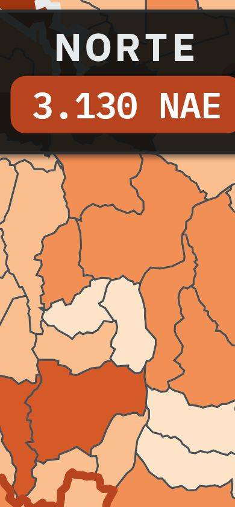

**Proposta.**
- Ctrl (⌘ no Mac) + roda dá zoom no ponto do cursor, com suavização; pinça de trackpad (chega como Ctrl + roda) funciona igual. **Sem Ctrl a roda rola a página normalmente** e aparece, por 1,7 s, o aviso "Use Ctrl + rolagem para dar zoom" (no celular: "Use dois dedos para aproximar o mapa").
- Arrastar com o mouse move o mapa (só com zoom; passou de 5 px é arrasto e o clique seguinte é ignorado, então não abre município sem querer).
- Celular: **um dedo continua rolando a página** (`touch-action: pan-x pan-y`); **dois dedos** fazem pinça + arrastar; com o mapa aproximado, um dedo arrasta o mapa.
- Controles no canto superior direito do mapa: + , fator ×N, − e ⤢ "enquadrar" (só aparecem com zoom). Teclas `+`, `−`, `0` (com foco no mapa) e Esc.
- `prefers-reduced-motion`: o zoom vira instantâneo.

**Como fica (depois).** Sequência no computador (o código do print é `prints.js`, Ctrl pressionada + `page.mouse.wheel`):

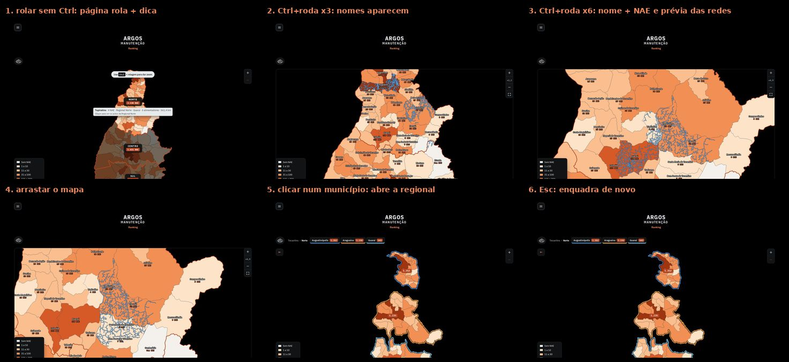

Quadros individuais: [aviso](prints/s1-depois-desk-1-dica.jpg) · [Ctrl+roda ×3](prints/s1-depois-desk-2-zoom2.jpg) · [Ctrl+roda ×6](prints/s1-depois-desk-3-zoom5.jpg) · [arrastar](prints/s1-depois-desk-4-arrastar.jpg) · [clique depois do zoom abre a regional](prints/s1-depois-desk-5-clique-regional.jpg) · [zoom dentro da regional](prints/s1-depois-desk-6-zoom-na-regional.jpg) · [Esc enquadra](prints/s1-depois-desk-7-esc-enquadra.jpg) · [tema claro](prints/s1-depois-desk-claro.jpg)

Celular (390×844; gesto simulado com toques reais via CDP `Input.dispatchTouchEvent`):

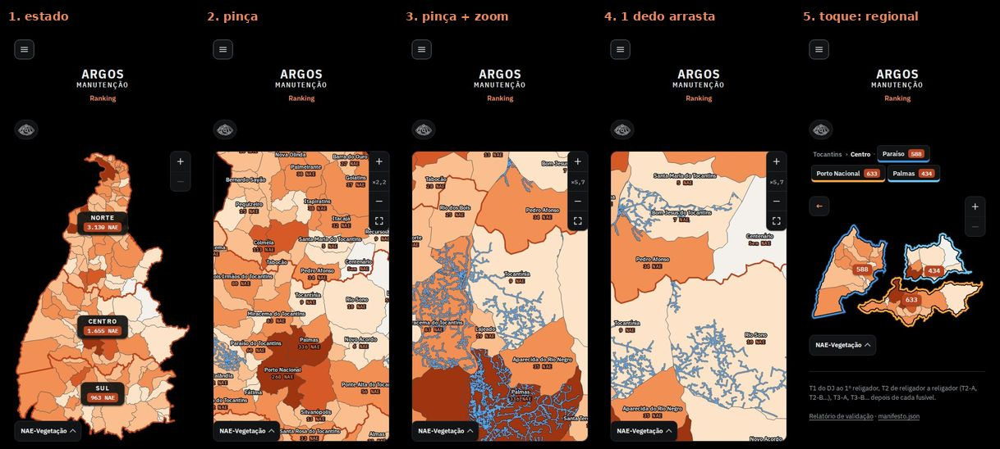

**Verificado (scripts na pasta, todos passam):**
- `teste-zoom.js` (desktop, 30 verificações): roda sem Ctrl rola a página e não dá zoom · Ctrl+roda aproxima, mostra nomes e prévia · arrastar move e **não** dispara clique · botões + / − · 1º Esc enquadra e o viewBox volta idêntico ao original · zoom e **clique num município abre a regional** · zoom na regional + 1º Esc só enquadra · zoom no polo + **clique abre o município (rede dos alimentadores)** · "←" e Esc sobem polo → regional → estado, restaurando o enquadramento original · afastar até 1× desliga o zoom · teclas + − 0 e movimento reduzido.
- `teste-zoom-celular.js` (390×844, toques reais, 13 verificações): um dedo rola a página (e mostra a dica) sem ligar o zoom · pinça liga o zoom sem rolar a página · um dedo arrasta o mapa aproximado · "enquadrar" · botão + · **toque num município depois do zoom abre a regional**.
- Fluidez (`medidas.js` → `medidas.json`; Chromium headless com render por software, serve para comparar): abrir a regional (`voa`) continua em ~57–59 fps nos dois (original 58,7; protótipo 56,2); Ctrl+roda ×10 ≈ 43 fps e arrastar ≈ 47 fps, com 4–6 tarefas > 50 ms (a maior, até ~240 ms, é o primeiro quadro, quando o mapa passa a usar a largura toda e é re-rasterizado). Sem esconder a prévia durante o movimento o arrastar caía para ~12 fps; por isso `.mexe`. Falta medir em celular real.

**Esforço:** M (cerca de 300 linhas em `mapa-municipios.js` + 36 de CSS; a lógica já está pronta e testada, falta teste em aparelho real, principalmente iOS Safari).
**Risco:** médio-baixo. (a) Gesto de dois dedos só foi validado em Chromium emulado; se o usuário já começou a rolar com um dedo e põe o segundo, o navegador não deixa cancelar o gesto. (b) Outros agentes mexem no mesmo arquivo (tela cheia, nomes/NAE por município): o `ResizeObserver` da caixa solta o zoom ao mudar a largura, o que já cobre a tela cheia, mas vale integrar `fimZ()` explicitamente. (c) O zoom usa a largura toda da caixa, então a lista/legenda da esquerda ficam por cima do mapa aproximado (aceitável, mas dá para recolher a legenda com zoom).
**Arquivos que mudariam:** `alimentador/site/mapa-municipios.js` (patch em `proto/mapa-municipios.diff`: +324/−11 linhas) e `alimentador/site/site.css` (`proto/zoom.css`, acrescentar ao fim; diff em `proto/site.css.diff`). Nenhuma mudança em `scripts/gera_trechos.py` (os botões e o aviso são criados pelo JS).

---

## Sugestão 2 · Zoom semântico: o mapa se explica ao aproximar (nomes, NAE e prévia das redes)

**Problema.** Para saber o nome e a NAE de um município o usuário precisa passar o mouse (tooltip) ou abrir polo por polo; no polo aberto os nomes se cruzam e somem (veja o antes). Não há como ver, no estado, **onde** estão as redes dos alimentadores.

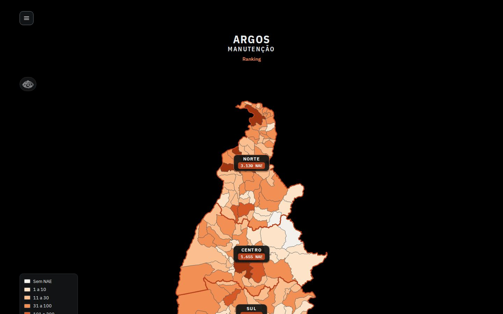

**Proposta.** Quanto mais o mapa aproxima, mais ele mostra (tudo calculado só com dados do site: `nome`, `nae`, `als`):
- Município que ocupa ≥ 40 px na tela ganha o **nome**; ≥ 70 px ganha também a **NAE** embaixo ("336 NAE", ou "Sem NAE"). Os maiores têm prioridade e os que se cruzam ou cujo nome não cabe somem; a letra tem sempre ~11,5 px (`--k` segue o viewBox).
- Município com ≥ 180 px na tela mostra, **dentro dele**, a prévia da rede dos alimentadores (mesmos `dados/redes/<AL>.json` do município aberto, recortados pelo contorno do município); no máximo 4 municípios por vez, os mais perto do centro, e os 16 maiores alimentadores de cada um (Palmas tem 46).
- Cartões das regionais e selos dos polos saem de cena acima de 1,8×; o hover de regional não escurece mais nada com zoom.

**Como fica.** Desktop: [~1,7×](prints/s2-depois-desk-1-zoom1_7.jpg) → nome e NAE → prévia em Palmas (`ARGOSMapa.voaPara`) → [tema claro](prints/s2-depois-desk-4-previa-palmas-claro.jpg). Celular: [nome e NAE](prints/s2-depois-mob-1-nomes-e-nae.jpg) e [prévia](prints/s2-depois-mob-2-previa.jpg).

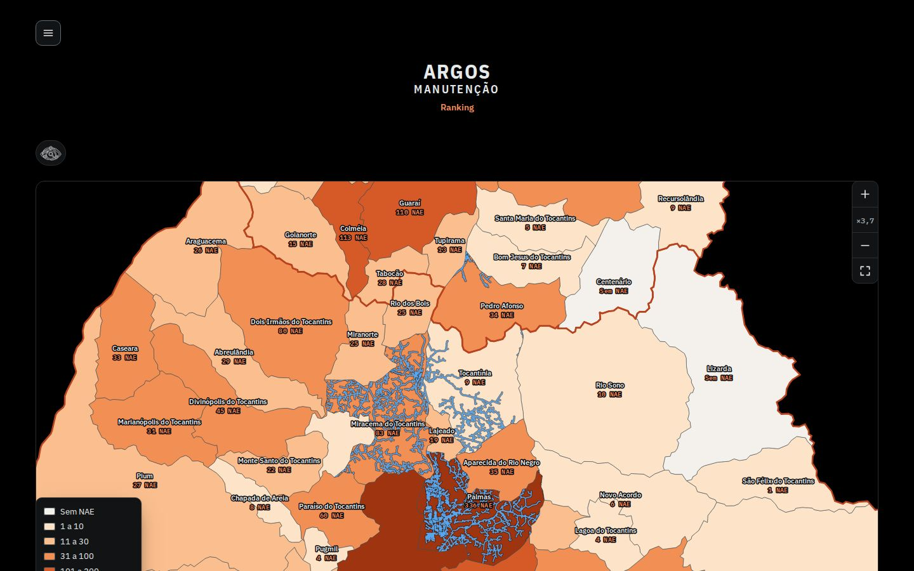
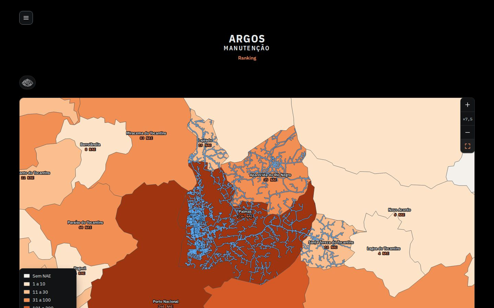

**Esforço:** P adicional (o código já está em `mapa-municipios.js` do protótipo 1; sem a 1 seria M). Para produção, vale gerar em `scripts/gera_trechos.py` um arquivo de rede **simplificada por município** (hoje a prévia baixa um JSON por alimentador: ~12 KB cada, até 16 por município) e reaproveitar o estilo dos nomes que o tema 3 definir para "NAE embaixo do nome" (classe `.mz-n`).
**Risco:** baixo-médio. Custo de rede/desenho da prévia (por isso só aparece depois de parar 110 ms); sobreposição com o que o tema 3 fizer com tipografia dos nomes.
**Arquivos:** `alimentador/site/mapa-municipios.js`, `site.css` (já no protótipo 1); opcional `scripts/gera_trechos.py` (rede simplificada por município).

---

## Sugestão 3 · O mapa cabe na primeira tela (cabeçalho compacto no computador)

**Problema.** No 1440×900 o mapa começa em y=285 (menu, título, "Ranking" e lupa empilhados) e tem 730 px (`min(100svh − 170px, 1100px)`, mas o topo real é 285): a base vai a y=1015, então o **Sul fica cortado** e a regional aberta também (cartão Sul meio escondido; o desenho da regional corta embaixo). No celular já cabe.

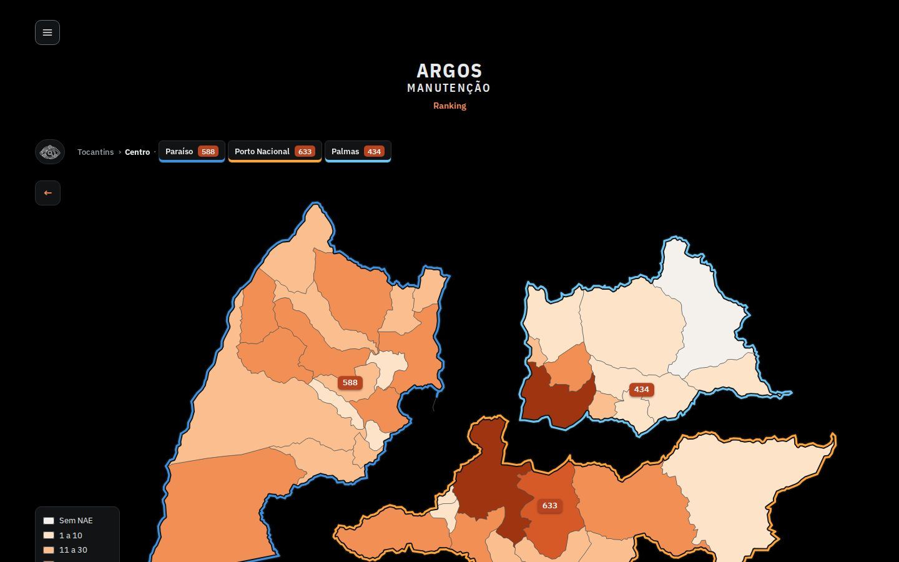

**Proposta (CSS puro, `proto/layout-cabe.css`, só ≥ 861 px).** Menu ☰ na mesma linha do título; "Ranking" no canto direito dessa linha; espaços entre blocos de 32/24 px para 8; altura do mapa = `100svh − 137px` (o topo real). Medido: mapa de y=285/730 px para y=125/763 px, base em 888 (tela 900).

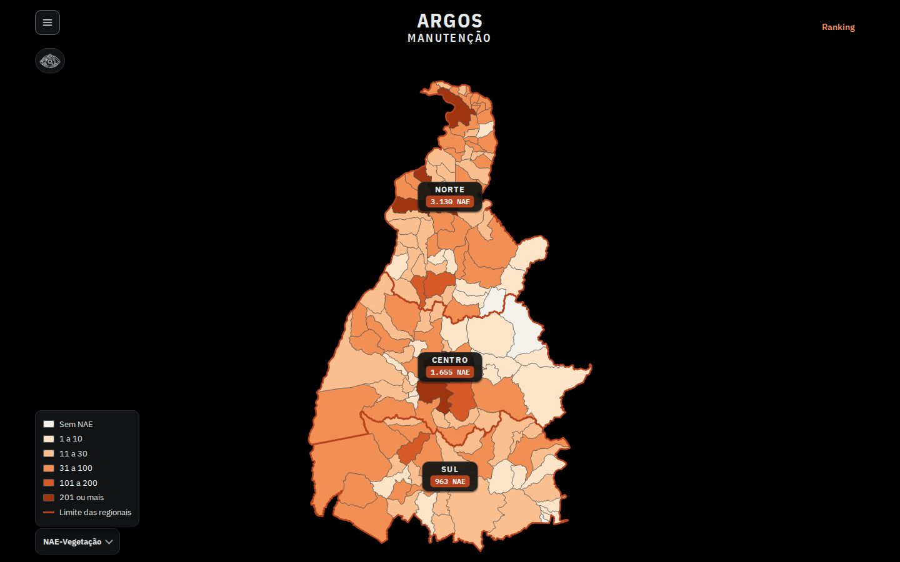
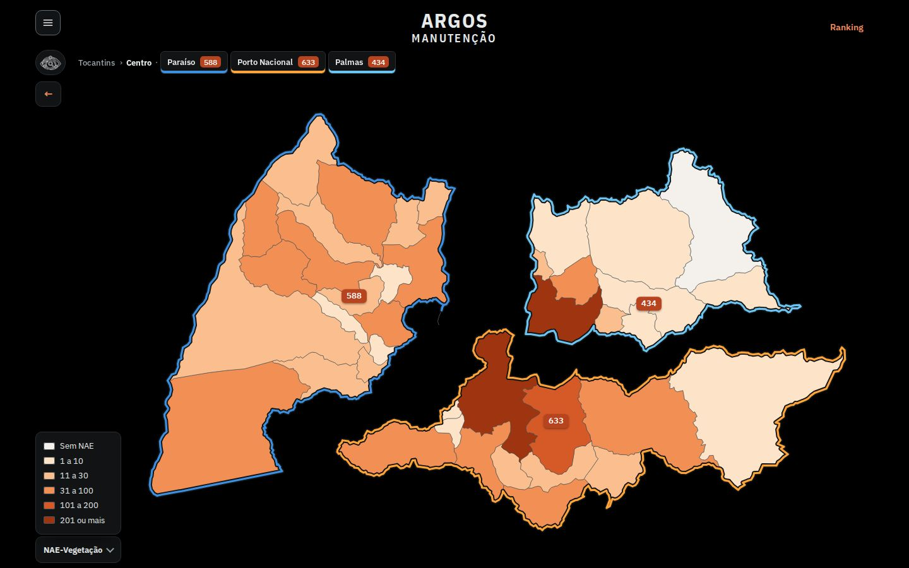

Celular, antes e depois (igual, já cabia): [antes](prints/s3-antes-mob.jpg) · [depois](prints/s3-depois-mob.jpg).

**Esforço:** P. **Risco:** baixo (regras só no desktop; conferir o menu aberto e o título em telas < 800 px de altura, onde o `min-height:560px` do svg volta a mandar). É a mais barata e pode sair antes das outras.
**Arquivos:** `alimentador/site/site.css` (regras do `.wrap`, `.mnu`, `header.cab`, `.mapa-to`, `.mt-mapa svg`).

---

## Sugestão 4 · "Voar até": lista Maiores NAE e busca que aproxima no município

**Problema.** Achar um município no mapa exige conhecer a geografia e clicar regional → polo → município. A busca da lupa já lista municípios, mas escolher um deles só abre a página dele; o mapa não ajuda a **situar** o município.

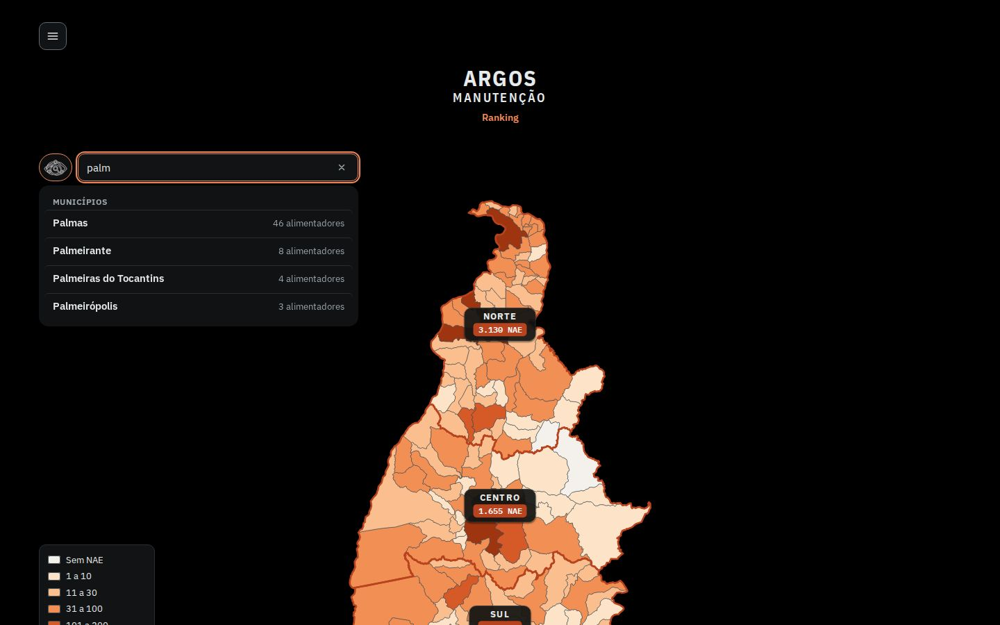

**Proposta (`proto/voar-ate.js`, usa `window.ARGOSMapa.voaPara(cod)` do protótipo 1).**
- Lista "Maiores NAE" (8 municípios, só dados do site) no lado esquerdo do mapa do estado: passar o mouse acende o município, clicar **aproxima nele** com zoom livre.
- Busca da lupa: ao digitar (ou marcar com as setas) um município, o mapa já voa até ele (Enter continua abrindo a página); limpar a busca enquadra de novo.

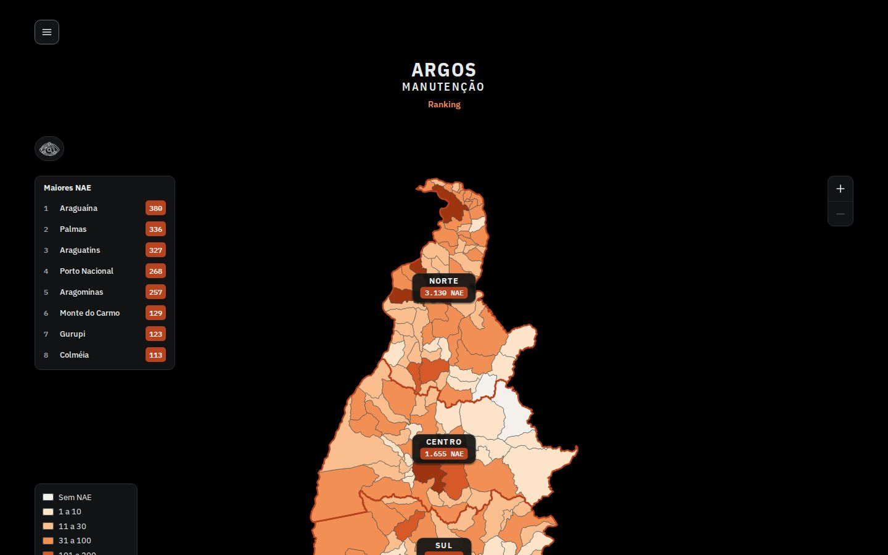
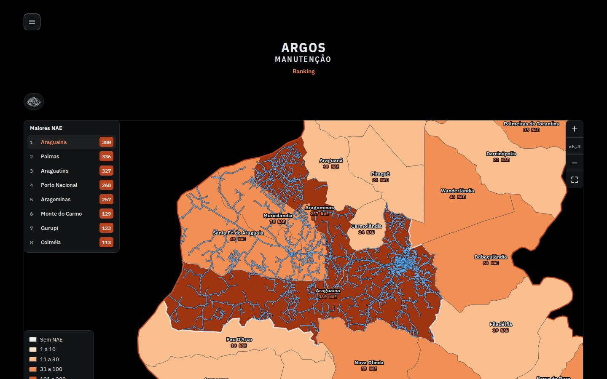
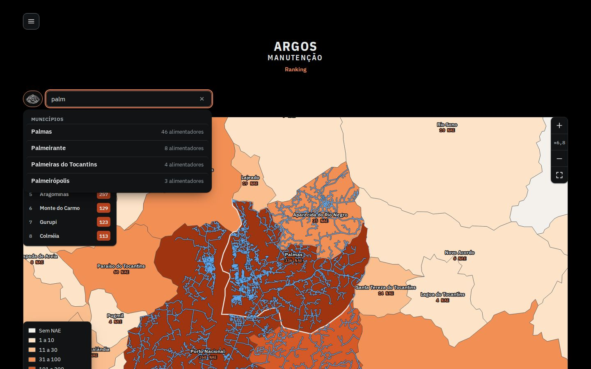

**Esforço:** M (a lista é simples; integrar com `busca-ativo.js` de forma limpa, em vez do `MutationObserver` do protótipo, e decidir o lugar da lista junto com o tema 1, que também quer a lista do município à esquerda). **Risco:** médio (conflito de espaço à esquerda com o tema 1; a lista é só desktop no protótipo).
**Arquivos:** novo `alimentador/site/voar-ate.js` (ou dentro de `mapa-municipios.js`), `busca-ativo.js` (evento "município marcado"), `site.css`.

---

## Sugestão 5 · Mini-mapa de orientação

**Problema.** Com zoom alto a pessoa perde a noção de onde está no estado.

**Proposta (`proto/minimapa.js`).** Com zoom ≥ 1,5× no estado inteiro aparece, sob os botões, o contorno das regionais com um retângulo do que está na tela; clicar ou arrastar nele leva o mapa até lá. Some quando uma regional é aberta (os polos se afastam e o retângulo deixaria de bater).

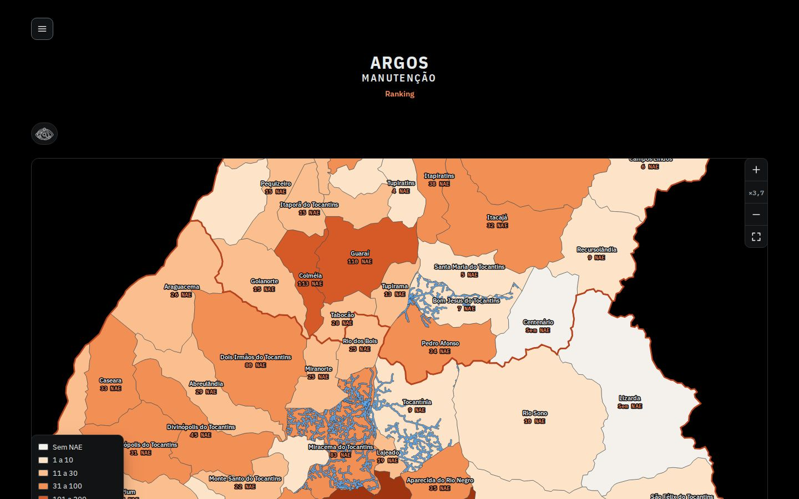
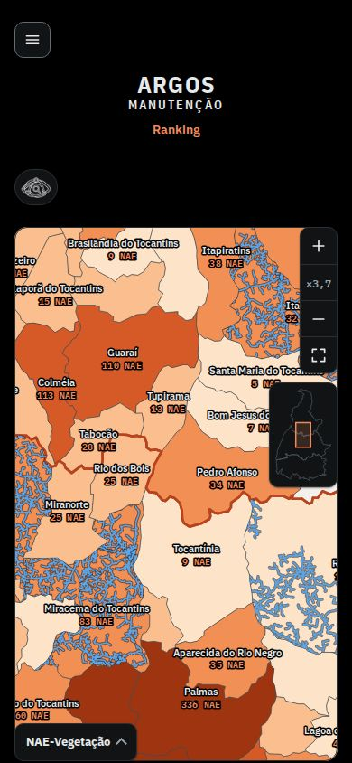

**Esforço:** P. **Risco:** baixo (cobre pouco espaço; no celular ocupa um canto do mapa). **Arquivos:** novo `minimapa.js` ou trecho em `mapa-municipios.js` + `site.css`.

---

## Reprodução
- `node prints.js [s1 s2 s3 s4 s5]` gera os prints (JPEG 80%, 1440×900 e 390×844, tema escuro; claro nos que fazem diferença). O Chromium do sandbox não confia na CA do proxy, então `lib.js` busca o site ao vivo por `curl` e injeta `proto/mapa-municipios.js` e `proto/site.css` com `page.route` (e `layout-cabe.css`, `voar-ate.js`, `minimapa.js` com `addStyleTag`/`addScriptTag`).
- `node teste-zoom.js`, `node teste-zoom-celular.js`, `node medidas.js`, `python3 folha-contato.py`.
- `orig/` guarda cópias do `mapa-municipios.js` e `site.css` ao vivo (idênticos aos de `alimentador/site/`) usadas para o diff; `proto/site.css` = `orig/site.css` + `proto/zoom.css`.

## O que falta validar
- Pinça e arrasto em aparelho real (iOS Safari e Chrome Android); aqui só toques CDP em Chromium emulado.
- Medir fluidez em celular real (FPS do arrasto com 4 prévias) e decidir se a prévia deve ser desligada em aparelho fraco.
- Combinar com os temas 1 (tela cheia e lista à esquerda), 3 (NAE embaixo do nome: reaproveitar `.mz-n`) e 5 (acessibilidade do gesto de pinça: os botões + / − e as teclas são a alternativa sem gesto).
