# Tema 3 · Tipografia e design do mapa (rodada 1)

**Resumo (5 linhas)**
1. O card preto das regionais virou a linguagem do mapa inteiro: município, polo, balão do mouse e botões da barra usam o mesmo cartão (nome em cima, NAE em selo vermelho embaixo), também no tema claro.
2. Pedido atendido: na visão de polo, cada município mostra o nome e a NAE EMBAIXO, sem sobreposição (3 níveis: cartão cheio, cartão compacto, só o número; sem espaço, some e o balão do mouse continua dando o nome).
3. Título refeito como "wordmark" (ARGOS espaçado, MANUTENÇÃO pequeno entre dois filetes) na mesma linha do menu, com "Ranking" como botão do outro lado: o mapa passa a caber na tela de 1440x900.
4. Legenda vira uma rampa horizontal de uma linha (não cobre mais a lista de alimentadores) e some no nível município; a lista de alimentadores ganha hierarquia (nome do município, selo de NAE, km em cinza).
5. Sem fonte nova: só IBM Plex que o site já carrega. Protótipo em `proto/` (injeção Playwright), prints antes/depois em `prints/` (1440x900 e 390x844, escuro e claro).

**Sugestão nº 1 recomendada: rótulos de município em mini-cartão com a NAE embaixo (sugestão 1 abaixo).** É o pedido explícito do usuário, usa a linguagem que ele aprovou e é onde o mapa mais perde legibilidade hoje.

Como reproduzir: `node prints.js antes` e `node prints.js depois` (opcional: filtro regex, ex. `node prints.js depois polo-dark`). O `rede.js` busca o site ao vivo com curl (o Chromium do sandbox não confia na CA do proxy) e troca `assets/site.css` e `assets/mapa-municipios.js` pelos de `proto/` no modo "depois". Diferenças exatas: `proto/mudancas.diff`.

Nomes dos prints: `antes|depois-<nível>-<tema>-<tamanho>.jpg`, com nível 1-estado, 2-regional, 3-polo (Araguaína), 3b-polo-denso (Augustinópolis, 24 municípios), 3c-polo-pequeno (Palmas), 4-municipio (Araguaína) e 4b-municipio-lista (celular com a lista aberta); tema `dark`/`light`; tamanho `desk` (1440x900) / `cel` (390x844).

---

## Diagnóstico do que existe hoje (tipografia)
- Rótulo de município: IBM Plex Sans 500, 11,5 px, cinza (`--muted`) com contorno da cor do fundo. Sobre laranja e marrom o contraste é fraco, os nomes se encostam (Araguanã, Piraquê, Xambioá) e **não mostra a NAE**.
- "MANUTENÇÃO" pede peso 400 em IBM Plex Sans Condensed, mas o site só carrega os pesos 600 e 700 dessa família: o navegador usa o 600, então o subtítulo sai quase tão pesado quanto "ARGOS" e a hierarquia do título se perde.
- O card preto só existe nas regionais. No tema claro ele vira card branco, e polo na barra, balão do mouse e selos são cada um de um jeito.
- Título + "Ranking" ocupam ~190 px verticais; o mapa começa em y≈285 e o rodapé do mapa (legenda) fica fora da tela em 1440x900.
- Legenda: 6 linhas verticais (~150 px) que, no nível município, cobrem a lista de alimentadores, e a escala de NAE nem se aplica ali (o mapa é monocromático).
- Lista de alimentadores: título "Araguaína · 33 alimentadores" no mesmo peso de qualquer texto; NAE e km na mesma linha cinza.

---

## Sugestão 1 · Município com mini-cartão e NAE embaixo (anti-colisão)  — prioridade 1 · esforço M
**Problema.** No nível polo os nomes são texto cinza pequeno, ilegíveis sobre as faixas escuras e sem a NAE. Antes: `prints/antes-3-polo-dark-desk.jpg`, `prints/antes-3b-polo-denso-dark-desk.jpg`, `prints/antes-3-polo-dark-cel.jpg`.

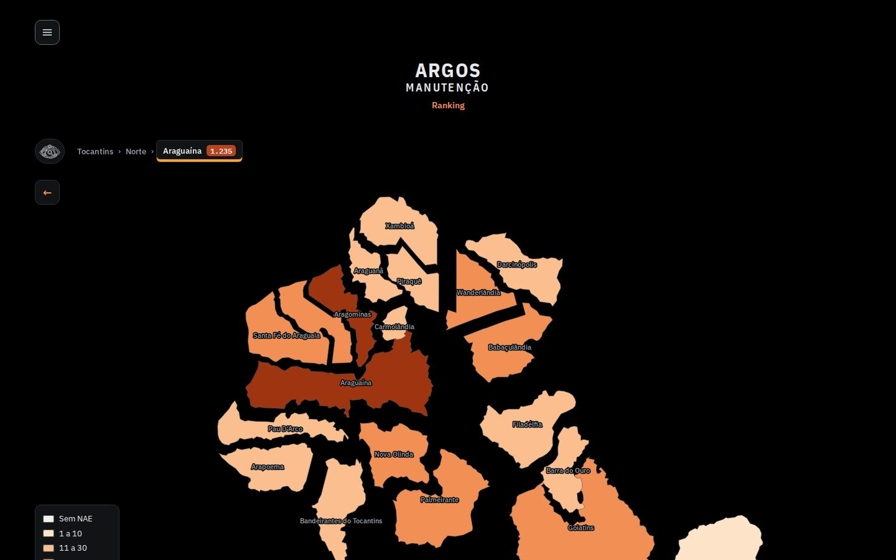

**Proposta.** Cada município do polo aberto recebe um cartão preto pequeno (o mesmo das regionais): nome em IBM Plex Sans 600 e, **embaixo**, selo vermelho em IBM Plex Mono 700 com a NAE ("380 NAE"). Os cartões entram do maior NAE para o menor e procuram um ponto livre **dentro do próprio município** (centro e anéis em volta, testados com `isPointInFill`). Se o cartão cheio não cabe, tenta o cartão compacto (letra menor); se ainda não cabe, só o selo com o número; se nem isso, sem rótulo (o balão do mouse continua dizendo o nome). A legenda e a seta de voltar entram na conta como obstáculos. NAE 0 sai em cinza (`0 NAE`), não em vermelho. No celular o cartão já começa compacto e só os 10 maiores levam nome.

**Como fica.**
| 1440x900 escuro | 1440x900 claro |
|---|---|
| 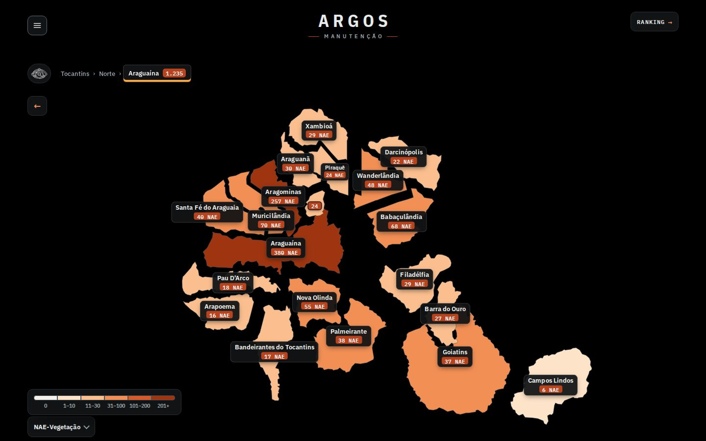 | 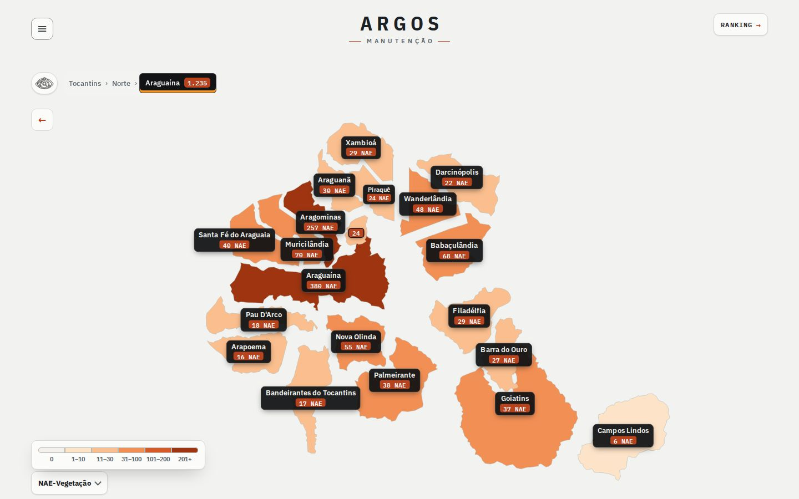 |

Polo denso (24 municípios) e polo pequeno:
| denso | pequeno (Palmas) |
|---|---|
| 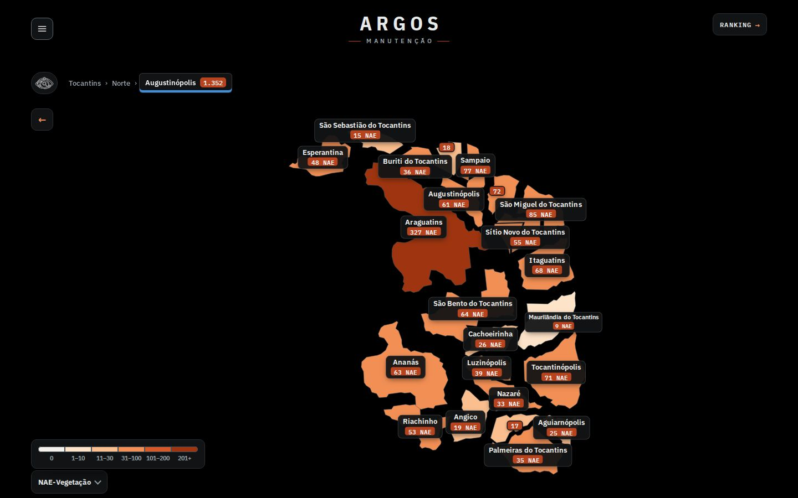 | 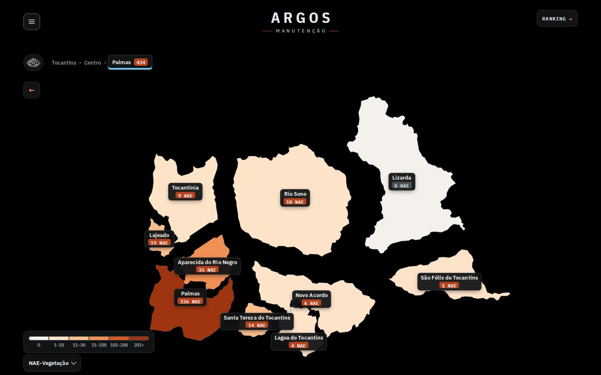 |

Celular (390x844), antes e depois:
| antes | depois | depois (claro, polo denso) |
|---|---|---|
| 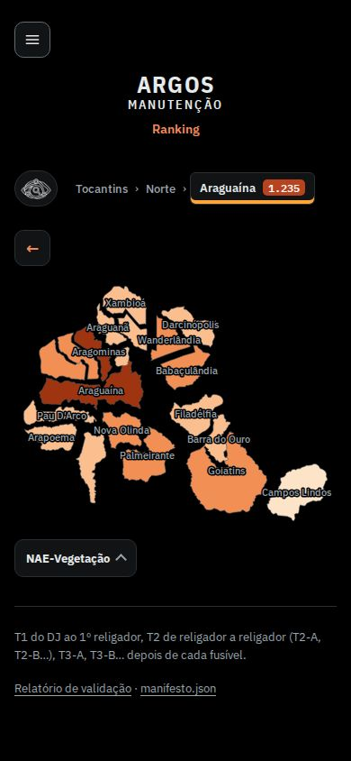 | 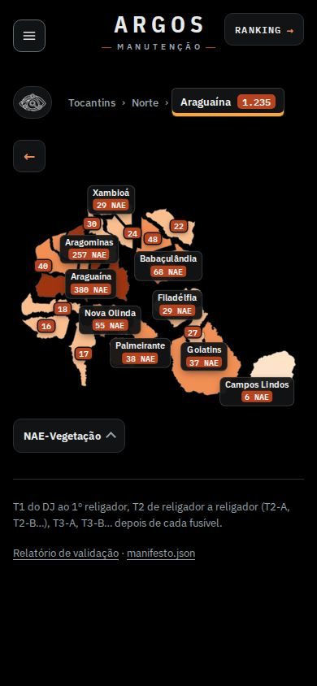 | 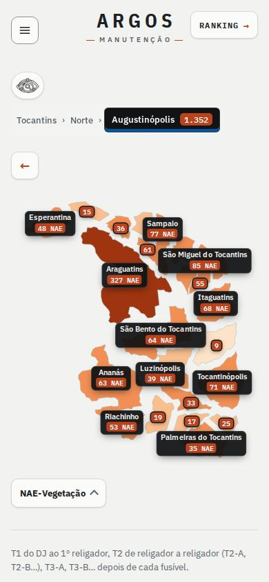 |

**Esforço:** M (função `poeNomes()` reescrita, ~70 linhas, mais ~20 de CSS). **Risco:** baixo a médio. O cálculo roda uma vez ao fim da animação e no redimensionamento: medi ~125 ms com a CPU 4x mais lenta no polo mais denso (≈30 ms normal), sem interferir na animação. Se o tema 2 liberar zoom/arrastar, `poeNomes()` precisa rodar de novo ao fim do gesto (já é chamada em `voa()` e no `ResizeObserver`). No celular o mapa é pequeno: com 24 municípios os cartões cobrem boa parte da forma, por isso o limite de 10 nomes. **Arquivos:** `alimentador/site/mapa-municipios.js` (função `poeNomes`, `nomes2` vira `div` HTML), `alimentador/site/site.css` (bloco "3) municípios do polo aberto").

---

## Sugestão 2 · Cartão preto como linguagem única, nos dois temas — prioridade 2 · esforço P
**Problema.** O que o usuário aprovou (card preto NORTE/CENTRO/SUL) é só um caso isolado; no tema claro ele nem é preto. Antes: `prints/antes-1-estado-light-desk.jpg`, `prints/antes-2-regional-dark-desk.jpg`.

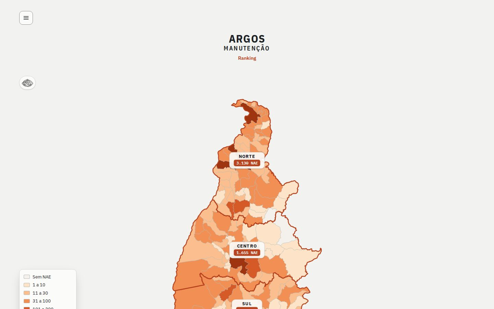

**Proposta.** Token `--cartao` (#111314, texto #f2f3f2, borda branca 16%) e `--selo` (#b8431f) usados em: cartões das regionais (preto também no claro), **cartão de cada polo no mapa com o NOME em maiúsculas e a NAE embaixo, filete na cor do polo**, chips de polo da barra, rótulos de município (sug. 1) e o balão do mouse (nome + selo de NAE em cima, detalhes em cinza embaixo, "clique para…" separado por filete). Dado repetido: como o cartão do polo no mapa já traz nome e NAE, os botões de polo da barra ficam só com o nome (a barra continua sendo a navegação e a cor do polo).

**Como fica.**
| regional escuro (antes) | regional escuro (depois) |
|---|---|
| 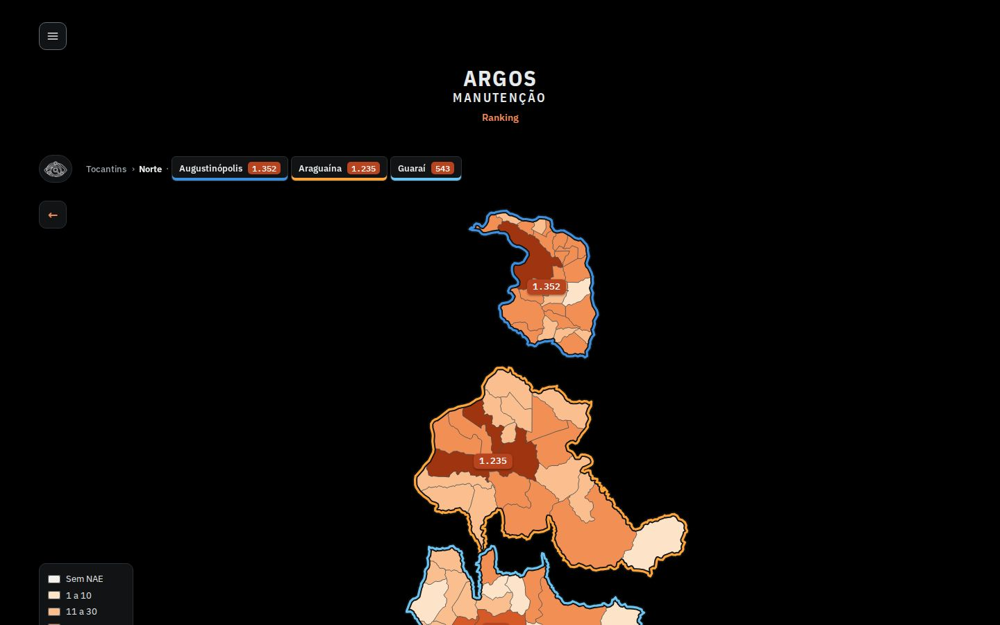 | 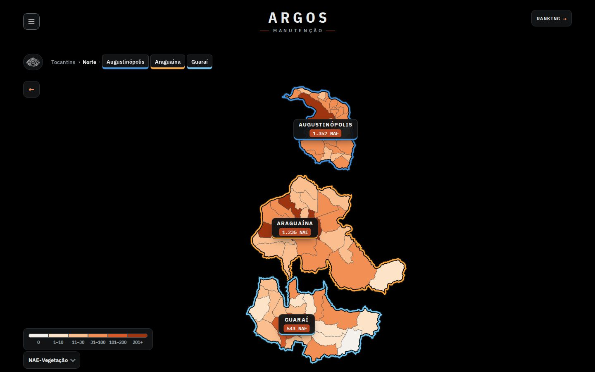 |

| estado claro (depois) | regional claro, celular (depois) |
|---|---|
| 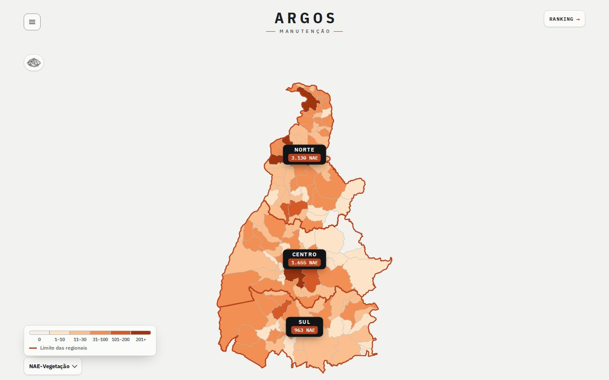 | 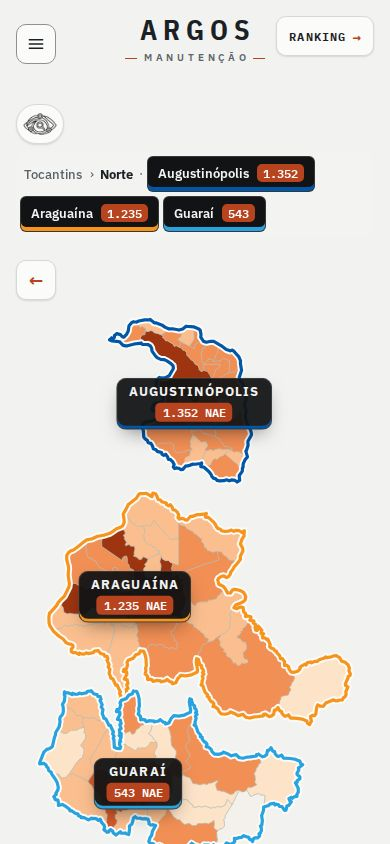 |

Estado, celular escuro: `prints/depois-1-estado-dark-cel.jpg`. **Esforço:** P (só CSS + um template de `poeSelos()` e do balão). **Risco:** baixo; um mapa claro com cartões pretos é mais "pesado", mas é o que dá consistência com o que o usuário aprovou (alternativa: manter o cartão claro no tema claro, trocando só `--cartao`). **Arquivos:** `site.css` (blocos 2 e o de `.mt-selos`), `mapa-municipios.js` (`poeSelos`, `dica.innerHTML`).

---

## Sugestão 3 · Título como wordmark e "Ranking" como botão, na linha do menu — prioridade 3 · esforço P
**Problema.** "MANUTENÇÃO" sai em peso 600 (a família Condensed só carrega 600/700) e disputa com "ARGOS"; o bloco título + link gasta ~190 px e empurra o mapa para fora da tela. Antes: `prints/antes-1-estado-dark-desk.jpg`, `prints/antes-1-estado-dark-cel.jpg`.

**Proposta.** ARGOS em Plex Sans Condensed 700, 36 px, espaçamento .22em (assinatura de marca). MANUTENÇÃO em Plex Sans 600, 10,5 px, espaçamento .46em, cinza, entre dois filetes vermelhos de 22 px (a cor do limite das regionais). Mantém "ARGOS" em cima e "MANUTENÇÃO" embaixo. O cabeçalho sobe para a linha do botão ☰ (margem negativa, `z-index` no menu) e "Ranking" vira botão no canto oposto, no mesmo estilo do ☰ (mono, caixa alta, seta em laranja). Ganho de ~97 px: com `height: calc(100svh - 204px)` o mapa e a legenda cabem em 1440x900.

**Como fica.**
| escuro | claro |
|---|---|
| 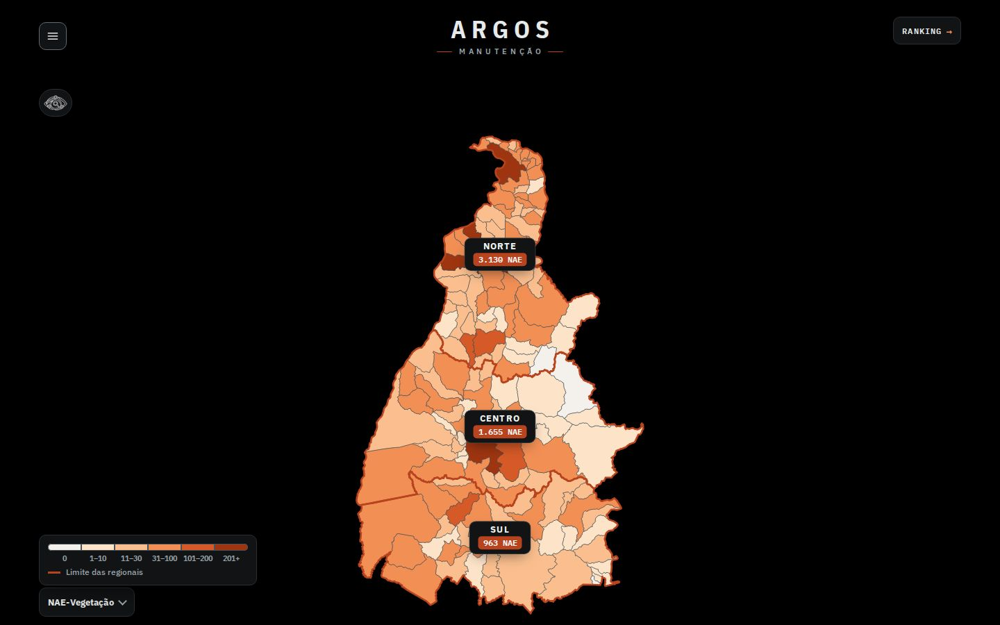 |  |

Celular: `prints/depois-1-estado-dark-cel.jpg` (filetes encurtam para 12 px abaixo de 480 px; o botão Ranking não encosta no título em 390 px). **Esforço:** P (só CSS; o HTML de `gera_trechos.py` não muda). **Risco:** baixo; a margem negativa depende da altura do menu (40 px) e do `gap` do `.wrap`, e o tema 2 (layout) pode mexer nessa faixa. **Arquivos:** `site.css` (blocos "título" e `.mt-mapa svg`).

---

## Sugestão 4 · Legenda em rampa horizontal e escondida no município — prioridade 4 · esforço P
**Problema.** A legenda ocupa 6 linhas e, no nível município, fica por cima da lista de alimentadores, mostrando uma escala de NAE que não se aplica (o mapa ali é monocromático). Antes: `prints/antes-4-municipio-dark-desk.jpg`.

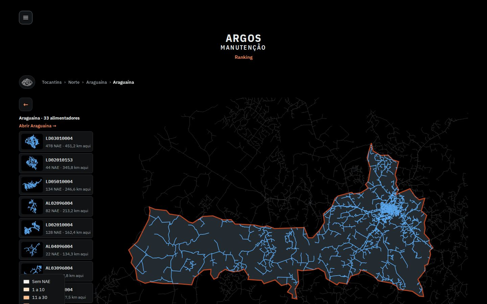

**Proposta.** Uma linha só: seis faixas coladas (as mesmas cores `--nae0..5`) com a faixa escrita embaixo ("0", "1–10", "11–30", "31–100", "101–200", "201+") em Plex Sans Condensed com números tabulares; o "NAE-Vegetação" do botão fica como título (sem repetir). O texto de acessibilidade completo continua (rótulo oculto por faixa). No nível município a legenda some.

**Como fica.** Ver rodapé de `prints/depois-3-polo-dark-desk.jpg`/`prints/depois-1-estado-light-desk.jpg` (com "Limite das regionais" embaixo) e `prints/depois-4-municipio-dark-desk.jpg` (sem legenda, lista livre).

| município, escuro (depois) | município, claro (depois) |
|---|---|
| 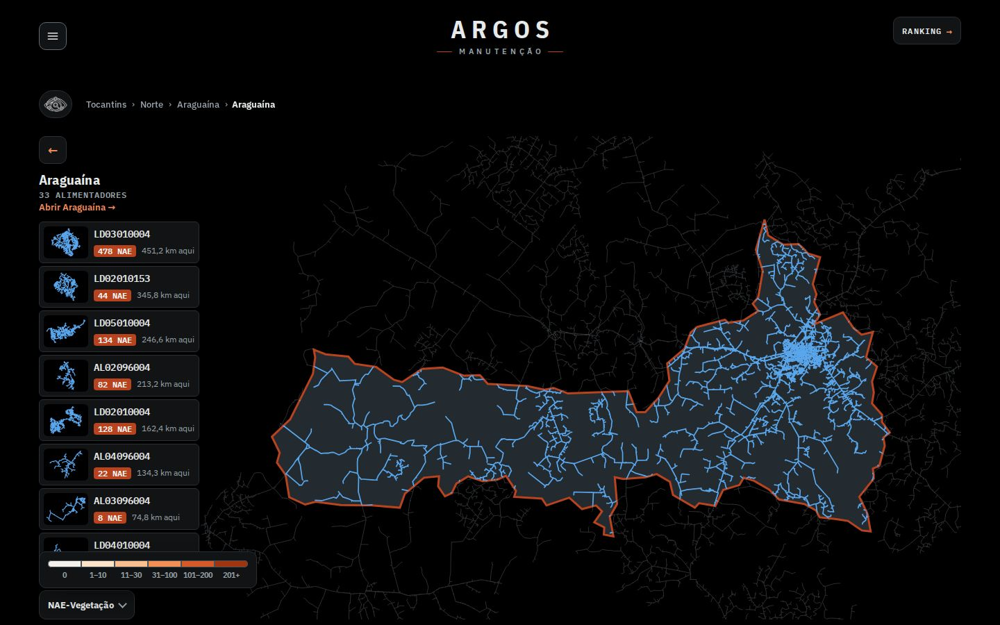 | 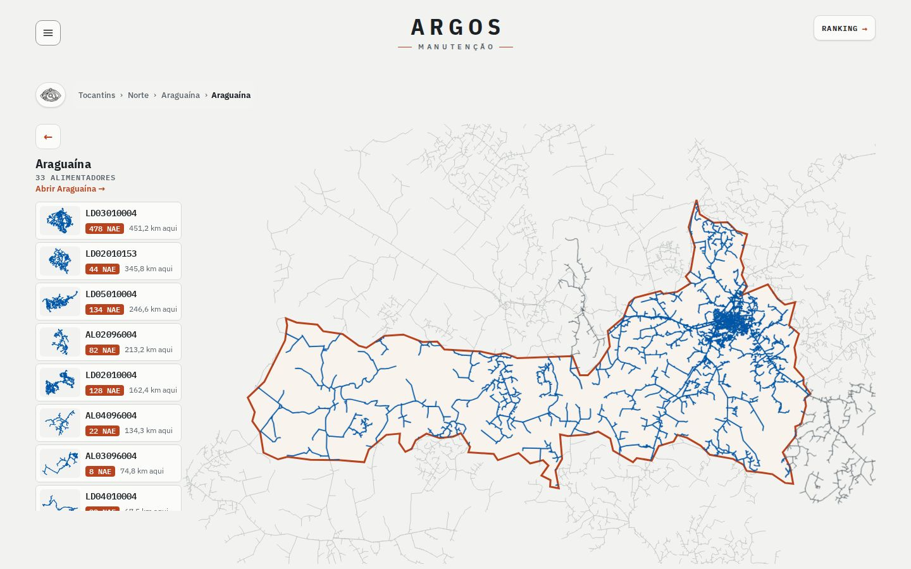 |

**Esforço:** P. **Risco:** baixo; os rótulos de faixa usam `FAIXAS` (derivados dos mesmos limites do mapa), então não há número novo. Se o tema 1 mover a legenda, a rampa funciona em qualquer lugar (largura ~290 px). **Arquivos:** `mapa-municipios.js` (HTML da legenda), `site.css` (bloco 4, `.nivel-mun .mt-regs{display:none}`).

---

## Sugestão 5 · Lista de alimentadores com hierarquia tipográfica — prioridade 5 · esforço P
**Problema.** Título, código, NAE e km têm quase o mesmo peso; o olho não acha a NAE. Antes: `prints/antes-4-municipio-dark-desk.jpg`, `prints/antes-4b-municipio-lista-dark-cel.jpg`.

**Proposta.** Cabeçalho com o nome do município em Plex Sans Condensed 700 (20 px) e, abaixo, "33 ALIMENTADORES" em Plex Mono caixa alta, espaçado. Cada linha: código em Plex Mono 600 (14 px); embaixo o selo vermelho com a NAE (mesmo selo do mapa) e o km "aqui" em cinza (Plex Sans 400, números tabulares). O balão do mouse sobre a rede segue o mesmo desenho (código + selo).

**Como fica.**
| celular, lista aberta (antes) | celular, lista aberta (depois) |
|---|---|
| 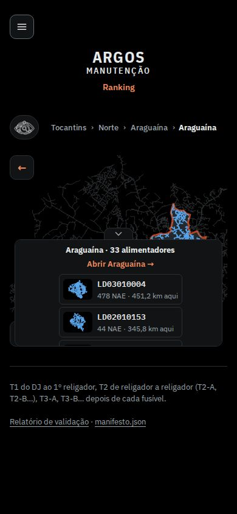 | 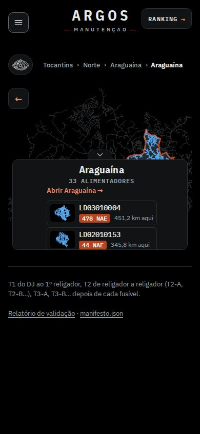 |

Computador: `prints/depois-4-municipio-dark-desk.jpg` (acima, nas duas versões de tema). **Esforço:** P (2 template strings + CSS). **Risco:** baixo; o tema 1 vai reposicionar essa lista à esquerda, e o estilo vale em qualquer posição. **Arquivos:** `mapa-municipios.js` (`entraMun`, `legAl.innerHTML`), `site.css` (bloco 5).

---

## Notas e limites
- Nenhuma fonte nova: tudo é IBM Plex Sans (400–700), Sans Condensed (600/700) e Mono (400/600) já carregados. IBM Plex Mono 700 nos selos usa o 600 carregado (faux bold leve, igual ao que o site já faz nos selos atuais); se quiser o peso real, incluir `IBM+Plex+Mono:wght@700` no link do Google Fonts (+~15 KB).
- Contraste: texto branco no selo #b8431f tem ~5,4:1; texto #f2f3f2 no cartão #111314 ~17:1 (passam AA). No claro o cartão preto mantém contraste alto sobre qualquer faixa de laranja.
- Os rótulos de busca do estado inteiro (`.mt-rot`, quando se busca um município) não foram alterados; podem herdar o mesmo cartão numa próxima rodada.
- Números nos prints vêm todos do site ao vivo (`mapa-municipios-dados.js`); nada foi inventado.
- Conflitos possíveis com outros temas: tema 1 (legenda e lista no lado esquerdo, dados repetidos) e tema 2 (zoom/arrastar). Os blocos CSS do protótipo estão no fim de `proto/site.css`, separados e comentados, para se aplicar à parte.
