# Tema 5 · Fluidez e acabamento (rodada 1)

## Resumo

1. O site já é leve (início: 253 KB, mapa em ~0,1 s no computador, 1,2 s com CPU 4x + 4G lenta, 0 erros de console, nenhuma tela presa: duplo clique, abre/Esc 10x, trocar de polo no meio do voo, Esc antes da rede chegar, menu, diálogo, Shift+K e tela cheia passaram).
2. O engasgo real está em **abrir município, dar zoom no alimentador e voltar**: 18 a 25 quadros/s no computador e 18 a 20 com CPU 4x (pior quadro de 100 a 120 ms; até 280 ms em rodadas com a máquina mais carregada). Causa: as redes dos alimentadores (até 9.455 vértices, traço `non-scaling-stroke`) são redesenhadas a cada quadro do voo. Esconder as redes durante o voo e trazê-las de volta com fade (6 linhas de CSS) leva a **53 a 58 fps** (CPU 4x: 44 a 46 fps).
3. Duas travas de verdade: o **botão Voltar do navegador / gesto de voltar do celular sai do mapa** em vez de subir um nível, e **os 3 cartões Norte/Centro/Sul ficam no Tab como paradas invisíveis** quando uma regional está aberta.
4. Acabamento: o cabeçalho **desce 64 px** logo depois do 1º quadro (menu.js monta o ☰ depois; CLS 0,046) e os cartões das regionais nascem em (0,0) e pulam para o lugar; alvos de toque de 36 a 40 px no celular (4 a 11 por nível, todos zerados no protótipo).
5. Fontes do Google atrasam o 1º conteúdo em rede lenta (FCP 830 ms contra ~190 ms com fontes próprias, modelado); é a sugestão mais discutível por causa do cache do GitHub Pages (10 min).

**Sugestão nº 1 recomendada: apagar as redes durante o voo (sugestão 1).** Esforço P, risco baixo, é a única que muda a sensação de "travado" que o usuário percebe.

Tudo medido em Chromium (Playwright + CDP) sobre um espelho local do site ao vivo de 15/10/2026 (ver "Como medi" no fim). Protótipos em `proto/`, injetados sem tocar no site.

---

## Medições (antes → depois do protótipo)

### FPS nas animações (mediana de 3 execuções, `requestAnimationFrame`)

| Etapa | Desktop 1440 normal | Desktop CPU 4x | Celular 390 normal | Celular CPU 4x |
|---|---|---|---|---|
| mouse varrendo o estado | 60 → 60 | 60 → 59 | – | – |
| abrir regional | 60 → 60 | 53 → 54 | 60 → 60 | 52 → 48 |
| abrir polo | 58 → 55 | 52 → 48 | 60 → 60 | 55 → 52 |
| **abrir município** | **39 → 58** | **34 → 44** | **47 → 60** | **39 → 54** |
| **zoom no alimentador** | **22 → 53** | **20 → 46** | **25 → 36** | **26 → 31** |
| **Esc (volta ao município)** | **23 → 57** | **18 → 46** | **26 → 35** | **25 → 30** |
| Esc (volta ao polo) | 60 → 60 | 59 → 59 | 60 → 60 | 60 → 59 |
| Esc (volta à regional) | 60 → 60 | 55 → 56 | 60 → 60 | 38 → 36 |
| Esc (volta ao Tocantins) | 51 → 51 | 47 → 46 | 60 → 57 | 51 → 46 |

Pior quadro, desktop CPU 4x: zoom no alimentador 117 → 100 ms, Esc volta ao município 100 → 67 ms (long tasks de ~110 ms antes, 70 a 95 ms depois). No celular o zoom no alimentador melhora menos (31 fps): o que sobra é o desenho da rede inteira em foco (traço mais grosso, sem corte). Gráfico: `prints/00-fps-antes-depois-1440.jpg`.

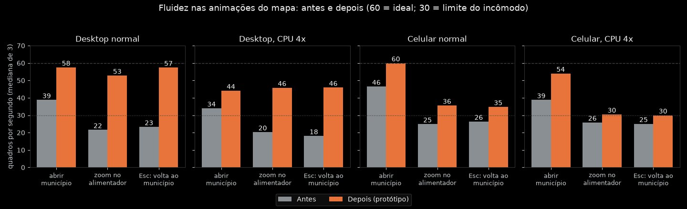

### Carga (mediana de 3 cargas a frio; ms)

| Página · dispositivo · perfil | Mapa aparece | 1º conteúdo (FCP) | Baixado KB | Requisições | Long tasks / TBT (antes) | CLS |
|---|---|---|---|---|---|---|
| início · desktop · normal | 96 → 84 | 84 → 76 | 253 → 239 | 12 → 11 | 0 / 0 | 0,046 → 0,000 |
| início · desktop · CPU 4x | 320 → 291 | 248 → 184 | 253 → 239 | 12 → 11 | 3 / 61 | 0,046 → 0,000 |
| início · desktop · CPU 4x + 4G lenta | 1193 → 963 | 828 → 196 | 253 → 239 | 12 → 11 | 3 / 101 | 0,046 → 0,000 |
| início · celular · normal | 103 → 81 | 96 → 68 | 253 → 239 | 12 → 11 | 0 / 0 | 0,000 → 0,000 |
| início · celular · CPU 4x | 374 → 256 | 212 → 360 (ruído) | 253 → 239 | 12 → 11 | 3 / 93 | 0,000 → 0,000 |
| início · celular · CPU 4x + 4G lenta | 1204 → 934 | 836 → 180 | 253 → 239 | 12 → 11 | 3 / 68 | 0,0002 → 0,0001 |
| polos · desktop · CPU 4x + 4G lenta | 1375 → 1219 | 836 → 144 | 233 → 238 | 9 → 8 | 5 / 507 | 0,049 → 0,0001 |
| polos · celular · CPU 4x + 4G lenta | 1442 → 1195 | 828 → 156 | 233 → 238 | 9 → 8 | 5 / 696 | 0,294 → 0,0007 |

Tabela completa (inclui polos em todos os perfis): `medicoes/tabelas.md`. Leitura: no computador sem limitação o mapa aparece em ~0,1 s e não há o que ganhar; o ganho de carga aparece só com rede lenta (fontes) e no CLS. O "depois" soma o gzip real do protótipo (o Playwright entrega os arquivos sem gzip) e as 4 fontes próprias (100,5 KB); como os arquivos do protótipo foram servidos sem gzip a 4G lenta, os tempos de "depois" são conservadores (~0,25 s pior do que seria).

### Página do alimentador LD01072001 (só medida; não prototipada)

| | Mapa + lista prontos | FCP | LCP | TBT | Long tasks | Baixado |
|---|---|---|---|---|---|---|
| desktop normal | 463 ms | 140 ms | 540 ms | 120 ms | 5 | 253 KB + tiles/fontes 409 KB, 23 + 29 requisições |
| desktop CPU 4x | 1423 ms | 252 ms | 2000 ms | 1492 ms | 12 | idem |
| celular CPU 4x + 4G lenta | 2585 ms | 832 ms | 3132 ms | 1462 ms | 11 | 253 KB + 203 KB |

É a página mais pesada: 14 `<script>` síncronos em fila, ~800 ms de JS e ~1.500 ms de layout/pintura com CPU 4x (perfil CDP: `leaflet.js` 390 ms, `alimentador.js` 143 ms, `limpeza.js` 69 ms), 1.593 nós só na lista `#lista` de 200 trechos que fica escondida na tela inicial. Fica como observação para o tema 4 (painel): montar a lista só quando aparecer e carregar `croqui.js`/`telacheia.js` sob demanda.

### Acessibilidade (alvos, foco, contraste)

| Verificação | Antes | Depois (protótipo) |
|---|---|---|
| Paradas do Tab em elementos invisíveis (regional ou polo aberto) | 3 (cartões Norte/Centro/Sul, `opacity:0`) | 0 |
| Alvos de toque < 44 px no celular (início; estado / regional / polo / município), sem contar os paths dos municípios | 4 / 11 / 7 / 10 | 0 / 0 / 0 / 0 |
| Alvos < 24 px no desktop (mínimo WCAG 2.2 AA) | 1 (`Abrir município →`, 23 px) | 0 |
| Contraste de texto < 4,5:1 (escuro e claro, 6 telas) | 0 | 0 |
| Foco visível ao Tab (contorno, sombra ou traço) | em todas as paradas visíveis | idem |
| Erros de console e requisições falhas | 0 | 0 |

Os 111 a 123 paths de municípios (11 a 69 px) continuam menores que 44 px no celular: é a área do tema 2 (zoom por pinça/Ctrl+roda). Na página do alimentador ficam 11 alvos de 40 px (T1/T2/T3, Menu, tela cheia, anos) e o link "Municípios" com 20 px de altura no computador: `alimentador.css`, fora do escopo do protótipo. O contraste foi checado por script (cor do texto contra o fundo efetivo, sem texto em SVG nem imagem).

---

## Sugestão 1 (prioridade 1) · Apagar as redes durante o voo do mapa

**Problema.** Ao abrir um município, dar zoom num alimentador ou voltar, a animação cai para 18 a 25 fps (18 a 20 com CPU 4x), com quadros de 100 a 120 ms (até 280 ms em rodadas mais carregadas). É o único trecho do site que "engasga". Antes: abrir município 39 fps, zoom 22, volta 23 (desktop normal).

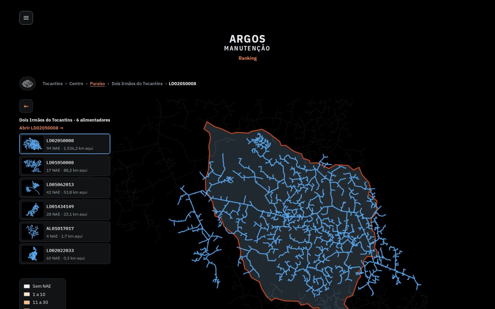
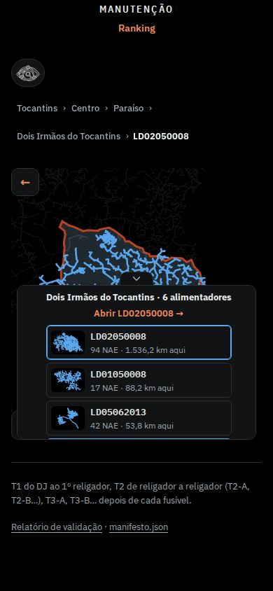

Experimento (CPU 4x, desktop, mediana de 4 rodadas intercaladas, fps de "abrir município / zoom / voltar"):

| Variante | fps |
|---|---|
| original | 25 / 18 / 18 (outra rodada: 32 / 16 / 14) |
| esconde as redes no voo (`visibility`) | 50 / 48 / 41 |
| `opacity:0` + fade de 250 ms ao pousar | 51 / 38 / 47 |
| `display:none` no voo | 45 / 37 / 39 |
| esconde só a camada de fundo e a de dentro (mantém a do alimentador em foco) | 46 / 23 / 39 |
| traço em unidades do mapa em vez de `non-scaling-stroke` | 17 / 14 / 13 (pior) |
| sem o fade por path (`animation:none`) | 26 / 15 / 12 (não ajuda) |

O custo está em desenhar as redes (3 camadas: fundo, dentro do município, alimentador em foco; até 9.455 vértices por alimentador com `vector-effect:non-scaling-stroke`) a cada quadro em que o `viewBox` muda. Simplificar a geometria não ajuda: os dados já vêm enxutos (RDP com tolerância de 0,02 unidade remove menos de 4 % dos vértices; juntar segmentos em polilinhas e cortar os de comprimento zero tira ~17 %).

**Proposta.** Enquanto a classe `.voando` está no mapa (já existe no `voa()`), as redes ficam com `opacity:0`; ao pousar, voltam com fade de 250 ms. Só CSS:

```css
.mt-redes{transition:opacity .25s .05s}
.voando .mt-redes{opacity:0;transition:none}
```

**Como fica.** Meio do voo sem a rede (o contorno do município aparece sozinho por 0,65 s) e, ao pousar, a rede entra suavemente:

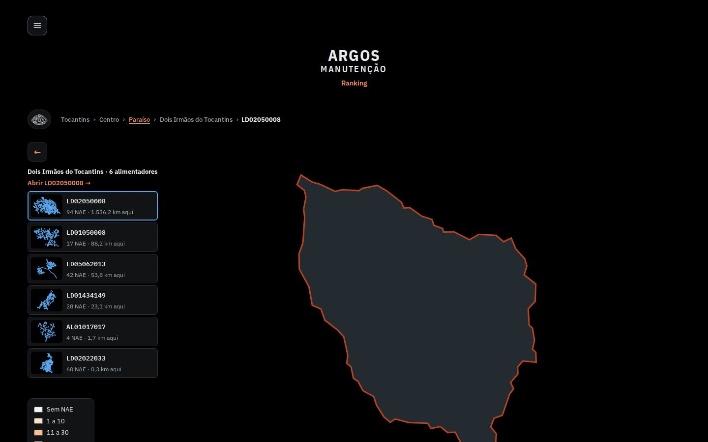
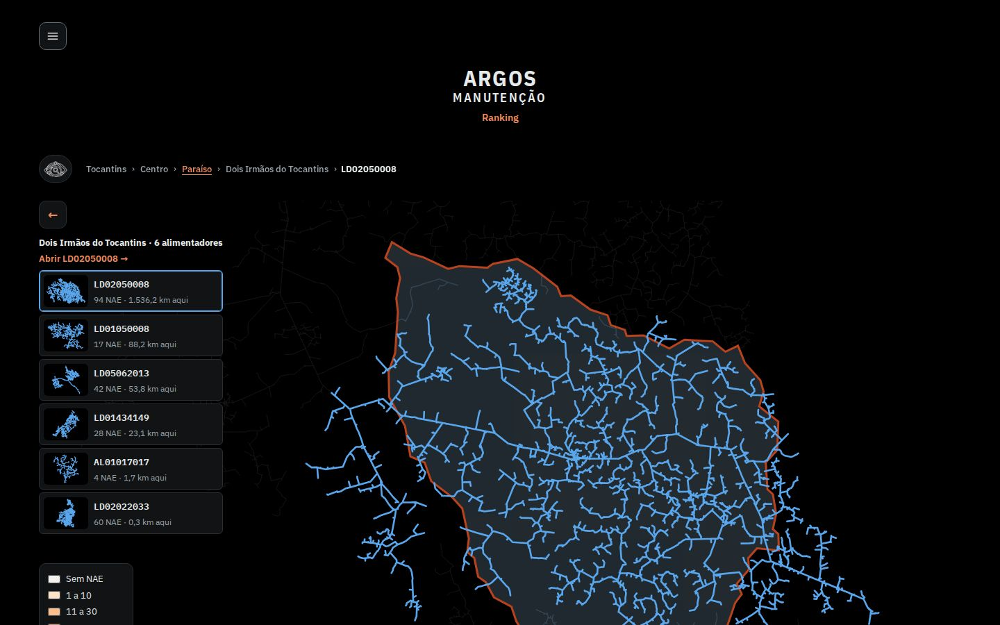
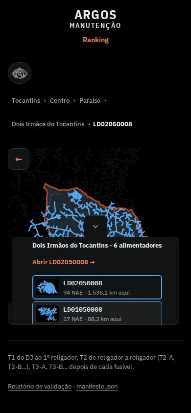

Efeito medido: ver tabela de FPS acima (desktop 22 → 53 fps no zoom, 23 → 57 na volta).

**Esforço** P (2 regras de CSS). **Risco** baixo: o alimentador que o usuário acabou de escolher também some por 0,65 s durante o zoom (alternativa testada: manter só a camada em foco, 23 fps no zoom: não compensa). **Arquivos:** `alimentador/site/site.css` (bloco `.mt-redes`, linha ~271-279).

---

## Sugestão 2 (prioridade 2) · O Voltar do navegador e o gesto de voltar do celular sobem um nível

**Problema.** Abrir regional, polo e município não cria entrada no histórico. Ao tocar em "voltar" (Android, gesto do iPhone, botão do navegador) o site inteiro fecha, em vez de subir um nível. Medido: `history.length` não muda ao abrir níveis; o Voltar vai direto para a página anterior (`about:blank` no teste).


**Proposta.** Cada nível aberto empilha uma entrada; subir pela interface (Esc, ←, trilha) desempilha; `popstate` sobe o que faltar. Trecho que entra em `assets/mapa-municipios.js`, antes do `voa()`, mais uma chamada `sinc()` no começo do `voa()` (diff completo em `proto/mapa-municipios.js.diff`):

```js
let hd = 0, emPop = false;
const fundura = () => (reg ? 1 : 0) + (pol ? 1 : 0) + (mun ? 1 : 0) + (alf ? 1 : 0);
try { history.replaceState({ argos: 0 }, ''); } catch (e) {}
function sinc() {
  if (emPop) return;
  const d = fundura();
  try {
    if (d > hd) for (let i = hd; i < d; i++) history.pushState({ argos: i + 1 }, '');
    else if (d < hd) history.go(d - hd);
  } catch (e) {}
  hd = d;
}
window.addEventListener('popstate', e => {
  const alvo = (e.state && e.state.argos) || 0;
  if (alvo > fundura()) { hd = fundura(); try { history.go(fundura() - alvo); } catch (e) {} return; } // Avançar: desfaz
  if (alvo === fundura()) { hd = alvo; return; }
  emPop = true;
  try { while (fundura() > alvo) sobe(); } finally { emPop = false; hd = fundura(); }
});
```

**Como fica.** Teste de sequência (`teste-historico.js`): clicar Centro → polo → município, Voltar → polo, Esc → regional, Voltar → estado, Avançar (não reabre, mantém o estado), abrir Sul, botão ← → estado, Voltar final → sai do site. Nenhum passo deixa o nível errado e sem erros de console. Depois do Voltar a regional continua aberta:

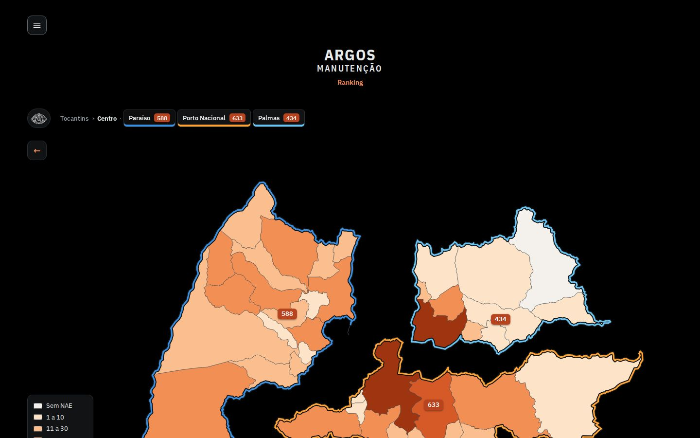
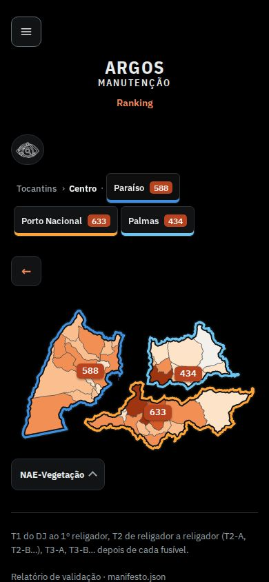

**Esforço** M (≈ 25 linhas e teste em Safari iOS e Chrome Android). **Risco** médio: `history.go()` é assíncrono; abrir um nível novo dentro de ~10 ms de um Esc pode deixar uma entrada sobrando (inofensivo: um Voltar a mais). Não resolve link compartilhável por nível (ficaria um passo seguinte: `#/centro/palmas`). Voltar de uma página de alimentador para o início continua restaurando pelo cache do navegador. **Arquivos:** `alimentador/site/mapa-municipios.js`.

---

## Sugestão 3 (prioridade 3) · Foco sem paradas invisíveis e alvos de toque de 44 px

**Problema.** (a) Com uma regional (ou polo) aberta, os cartões Norte/Centro/Sul ficam `opacity:0; pointer-events:none`, mas continuam no Tab: 3 paradas em que o foco "some" (quem navega por teclado ou leitor de tela cai em botões que não vê). (b) `--alvo` é 40 px: no celular o ☰ (40x40), "Ranking" (53x40), a lupa (48x40), a trilha (Tocantins › Centro, chips dos polos, 36 px de altura) e a legenda ficam abaixo dos 44 px recomendados; 4 alvos no estado, 11 na regional, 7 no polo, 10 no município.

Tab com a regional aberta, 10ª parada (nada tem contorno: o foco está num cartão invisível):

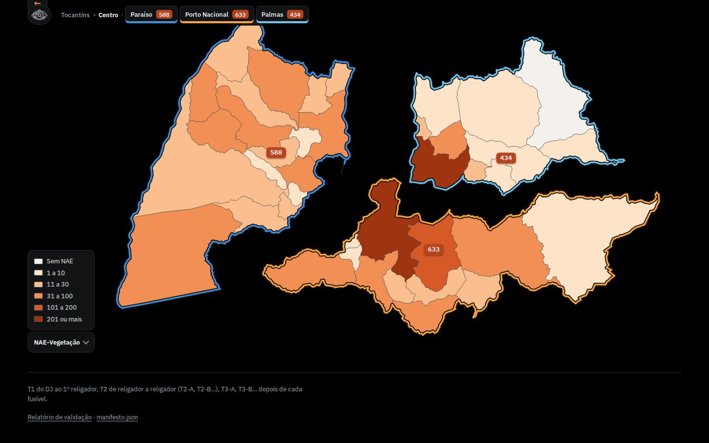
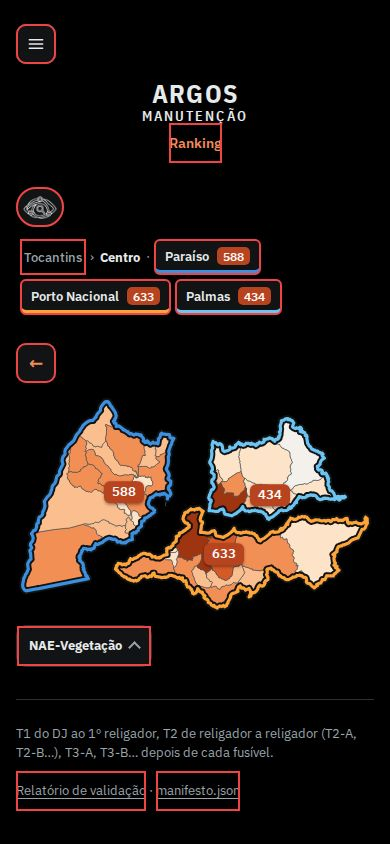

Sequência de paradas (`prints/03-antes-tab-1440.txt`): Menu, Ranking, Buscar, Tocantins, 3 polos, Porto Nacional, NAE-Vegetação, **Norte [invisível], Centro [invisível], Sul [invisível]**, ←.

**Proposta.** Esconder de verdade (`visibility`) depois do fade, e subir o alvo em telas de toque:

```css
.mt-regcards button{transition:opacity .3s,border-color .15s,visibility 0s}
.aberta .mt-regcards button,.voando .mt-regcards button{visibility:hidden;transition:opacity .3s,border-color .15s,visibility 0s .3s}
@media (pointer:coarse){
  :root{--alvo:44px}
  .mnu .mnu-btn,.mnu .mnu-x{width:44px;height:44px}
  .mt-barra .mt-pchip,.mt-passo{min-height:44px}
  .mt-amun{display:inline-flex;align-items:center;min-height:var(--alvo)}
  .mt-puxa{min-height:44px}
}
@media (pointer:fine){.mt-amun{min-height:28px;display:inline-flex;align-items:center}}
```

**Como fica.** Tab vai de "NAE-Vegetação" direto para o "←" (`prints/03-depois-tab-1440.txt`: ... NAE-Vegetação, Regional Centro. Voltar, Relatório). No celular todos os alvos do início ficam verdes (≥ 44 px):

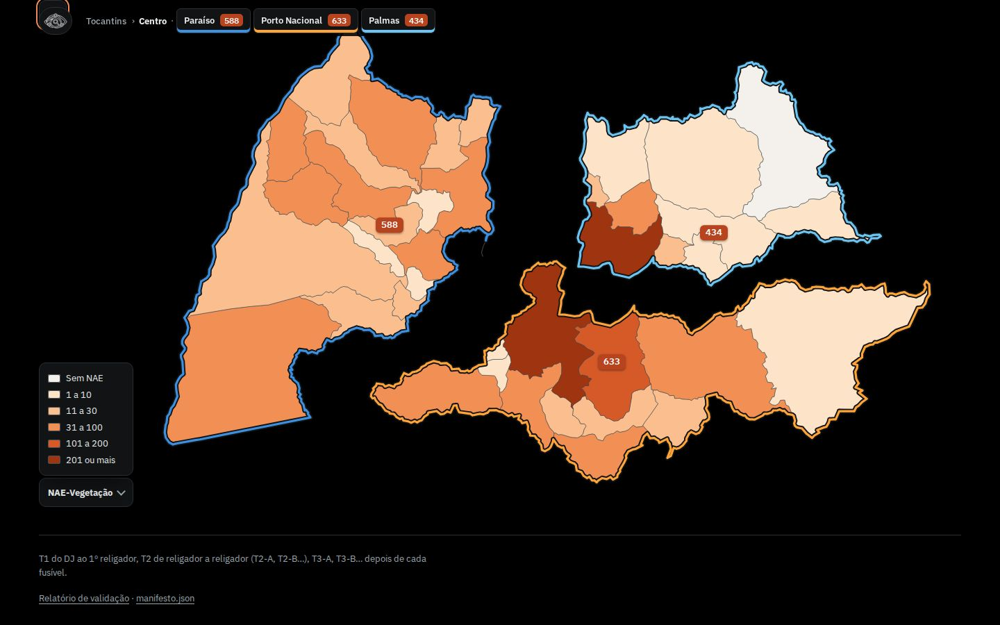
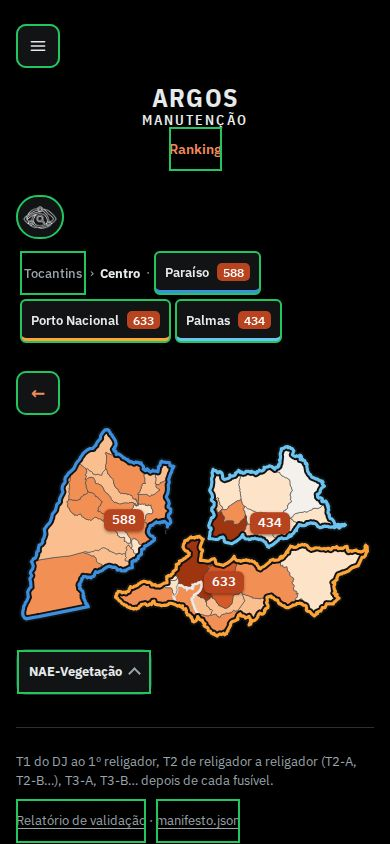

**Esforço** P. **Risco** baixo: o ☰ (de `menu.js`, 40 px fixos no CSS embutido) é sobrescrito por seletor mais específico; subir `--alvo` mexe em tudo que usa a variável (migalhas, rodapé, `cab-link`), conferir no celular. **Arquivos:** `alimentador/site/site.css` (e, se preferir resolver na origem, `menu.js` linha 52).

---

## Sugestão 4 (prioridade 4) · Sem saltos na abertura (cabeçalho e cartões)

**Problema.** Dois saltos nos primeiros 150 ms, medidos com `layout-shift`: (1) o `menu.js` monta a linha do ☰ depois do primeiro quadro e **todo o conteúdo desce 64 px** (cabeçalho de y=27 para y=91, mapa inteiro junto); (2) os cartões Norte/Centro/Sul nascem em (0,0) e pulam para o lugar quando o JS os posiciona. CLS 0,046 no computador (e até 0,059 no celular).

Quadro 1 (menu.js ainda não entrou) e quadro 2 (depois): o título e o mapa descem; no celular os cartões estão fora do lugar no primeiro:

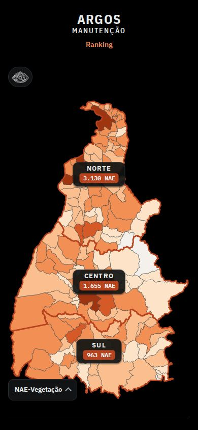


(Nos prints o `menu.js` foi atrasado 500 ms para o quadro intermediário poder ser fotografado; no site ele chega ~10 ms depois do primeiro desenho.)

**Proposta.** Reservar a linha do ☰ antes de o menu chegar e esconder os cartões até serem posicionados:

```css
.mt-regcards:not([data-ok]) button{visibility:hidden}
.wrap:not(:has(>.mnu))::before{content:"";display:block;min-height:40px;margin-bottom:calc(var(--s2) * -1)}
```
```js
// em poeCartoes(), logo depois de `if (!r.width) return;`
cartoes.dataset.ok = '1';
```

**Como fica.** O primeiro quadro já sai com o título no lugar final; CLS 0,046 → 0,0000 no início e 0,049/0,294 → 0,0001/0,0007 nos polos. 

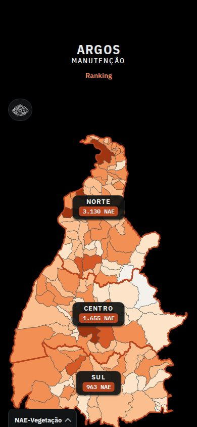
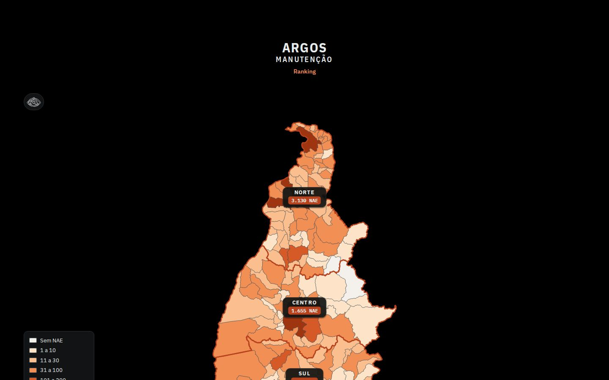

**Esforço** P. **Risco** baixo: `:has()` precisa de Chrome 105+, Safari 15.4+, Firefox 121+; sem ele o salto continua como hoje (degradação graciosa). O mesmo bloco serve para as páginas de município e polos (também têm o `.mnu`). **Arquivos:** `alimentador/site/site.css`, `alimentador/site/mapa-municipios.js`.

---

## Sugestão 5 (prioridade 5, discutível) · Fontes próprias com preload

**Problema.** O CSS das fontes vem do Google (2 hosts em cadeia: `fonts.googleapis.com` → `fonts.gstatic.com`) e é bloqueante: com 4G lenta o primeiro conteúdo só aparece depois dele (FCP ~830 ms, modelado com 150 ms de RTT e 3 RTT na 1ª conexão a cada host). O CSS pede 8 faces, a página usa 6 (e 4 arquivos, porque a Plex Sans é variável); o CSS ainda traz subconjuntos (latin-ext, cirílico, vietnamita) que o navegador não baixa.

**Proposta.** Hospedar os 4 arquivos `woff2` do subconjunto latin (100,5 KB: Sans variável 45,7; Condensed 600 e 700 ~19,5 cada; Mono 600 15,6) em `assets/fonts/`, `@font-face` embutido e dois `preload` (Condensed 700 do título e Sans variável). Protótipo: `proto/fonts/`, `proto/fontes.css` e `injeta.js` (reescreve o `<head>` da página inicial, polos e relatório).

```html
<link rel="preload" href="assets/fonts/ibm-plex-sans-condensed-700.woff2" as="font" type="font/woff2" crossorigin>
<link rel="preload" href="assets/fonts/ibm-plex-sans-var.woff2" as="font" type="font/woff2" crossorigin>
<style>@font-face{font-family:'IBM Plex Sans';font-weight:100 700;font-display:swap;src:url(assets/fonts/ibm-plex-sans-var.woff2) format('woff2');unicode-range:...latin...}/* + Condensed 600/700 e Mono 600 */</style>
```

**Como fica.** FCP em 4G lenta 828 → 196 ms (desktop) e 836 → 180 ms (celular), mapa 1193 → 963 ms; CLS dos polos sem o salto da troca de fonte (0,294 → 0,0007 no celular lento). Bytes equivalentes (253 → 239 KB) e 2 hosts externos a menos.

**Esforço** M (gerador `gera_trechos.py` + pasta `assets/fonts`). **Risco** médio e **não medido**: o GitHub Pages serve tudo com `cache-control: max-age=600`, enquanto o Google Fonts fica em cache por 1 ano; numa 2ª visita depois de 10 min o navegador revalida as 4 fontes (304) em vez de usá-las direto. Medi só carga a frio; antes de adotar, medir a 2ª visita (ou manter o Google Fonts e só acrescentar `preload` do CSS e `font-display:swap`, que já existe). A licença da IBM Plex (OFL) permite hospedar.

---

## O que testei e não achou problema (telas presas)

| Cenário | Resultado (desktop e celular) |
|---|---|
| Duplo clique (30 ms) no cartão da regional | abre uma vez, `voando` termina, sem erro |
| Abrir Sul e dar Esc 10x com 80 ms entre eles | termina fechado, viewBox do estado, sem erro |
| Abrir polo e clicar "Centro" na trilha no meio do voo | regional aberta, sem estado misto |
| Esc antes da rede do município chegar (4G lenta) | volta ao polo, 0 paths de rede órfãos, lista de alimentadores escondida |
| Teclado: Enter na regional/polo/município e Esc 5x | foco sempre num município (nunca cai no `body`) e volta nível a nível |
| Rolagem em cada nível | a página rola (a roda não é presa pelo mapa); no celular a regional cabe sem rolar |
| Menu ☰: Esc fecha e o foco volta ao botão | ok. Diálogo "Atualização de dados" é `<dialog>` nativo: Esc fecha, foco volta, rolagem ok |
| Shift+K troca o tema; dentro da busca não troca | ok |
| Tela cheia do alimentador: Esc, botão, `body{overflow:hidden}` | ok (em Chromium headless o Esc é do navegador; com `exitFullscreen()` e sem a API nativa, como no iPhone, a classe e a rolagem voltam) |
| Console | 0 erros e 0 avisos em início, alimentador e polos |

Pequenas arestas (não prototipadas): com a busca aberta e texto digitado, subir um nível pelo Esc leva até 3 toques (fecha resultados, fecha o campo, sobe); os cartões das regionais só respondem depois do voo (~0,7 s, `pointer-events:none` em `.voando`): um toque logo depois de voltar ao Tocantins é ignorado sem aviso; no 1440x900 o mapa começa em y=285 e termina em 1015, então o cartão "Sul" (cortado em 920) e a legenda ficam abaixo da dobra: é preciso rolar para ver o estado inteiro (tema 2/3: altura do mapa ou cabeçalho em uma linha).

---

## Como medi (e limites)

- **Espelho local.** O Chromium do Playwright não confia na CA do proxy do ambiente (`ERR_CERT_AUTHORITY_INVALID`), então `servidor-espelho.js` baixa o site ao vivo com `curl` na primeira requisição e serve em `http://localhost:18765/` com gzip (como o GitHub Pages). Fontes do Google e tiles do Esri passam por `route` + `curl` em cache. O CDP limita só o que o servidor local entrega; para os hosts externos `lib.js` modela a rede lenta (3 RTT na 1ª conexão ao host + 1 RTT + bytes/banda), por isso a coluna "ext" e o FCP em 4G lenta são **modelados**, não medidos na internet.
- **Perfis.** normal; CPU 4x (`Emulation.setCPUThrottlingRate`); CPU 4x + 4G lenta (`Network.emulateNetworkConditions`: 1,6 Mbps, 150 ms). Viewports 1440x900 e 390x844 (toque, DPR 2).
- **FPS:** `requestAnimationFrame` durante cada etapa; **long tasks:** `PerformanceObserver('longtask')`; **CLS:** `layout-shift`; bytes: `Network.loadingFinished.encodedDataLength`.
- **Ruído.** A máquina era compartilhada com outros 4 agentes e roda renderização por software (sem GPU), então os números absolutos são pessimistas e variam de uma rodada para outra (o "original" do experimento oscilou de 25 para 32 fps); cada valor é a mediana de 3 execuções e os "antes/depois" foram rodados em sequência. Em GPU real o desenho dos traços é mais barato, mas o refazer do `non-scaling-stroke` por quadro continua sendo o gargalo na thread principal.
- Os protótipos são injetados por `page.route` (nada foi alterado no site nem no repositório).

## Arquivos

- `proto/site.css` (cópia do `site.css` do site com o bloco novo no fim; diff em `proto/site.css.diff`), `proto/mapa-municipios.js` (+ `.diff`), `proto/fonts/*.woff2` (usados: `ibm-plex-sans-var`, `ibm-plex-sans-condensed-600/700`, `ibm-plex-mono-600`; os `ibm-plex-sans-400/600/700.woff2` são sobras de uma 1ª tentativa e podem ser ignorados), `proto/fontes.css`, `proto/rede-compacta.js` (teste de simplificação das redes, descartado).
- `prints.js` (todos os prints em `prints/`), `lib.js`, `injeta.js`, `servidor-espelho.js`.
- Medições: `medir-carga.js`, `medir-animacao.js`, `travas.js`, `travas-menu.js`, `tab-foco.js`, `a11y.js`, `perfil-carga.js`, `teste-historico.js`, experimentos `exp-voando.js` e `exp-voando2.js`, `tabelas.js`, `grafico-fps.py`, `roda-final.sh` / `roda-final2.sh`; resultados em `medicoes/*.json`.
- Reprodução: `node servidor-espelho.js &` e depois, por exemplo, `PROTO=1 PROTO_FONTES=1 node medir-carga.js depois-home` ou `node prints.js`.
