# Tema 2 · Mapa: zoom livre e interatividade (rodada 2)

Base: `alimentador/site/mapa-municipios.js` e `site.css` **atuais do repositório (commit da85625, 05:19)** (cartões `.mt-nomes2/.mt-mn` recalculados por `poeNomes()`, inclusive o cartão que não cabe no município indo para fora, ligado por um fio `.mt-fios`, e o botão de tela cheia `.mt-tc` no canto de cima do mapa; ponte `window.ARGOS_MAPA`; lista do município na busca; legenda NAE-Vegetação na barra, commit 7fe2ddc). O arquivo mudou várias vezes durante a rodada (inclusive com edições no meio, que um `cp` apanhou pela metade): o patch foi refeito por merge de três vias (`rebase.sh`, base = último commit) e testes, prints e medidas foram rodados de novo sobre a versão final. Nada foi alterado fora desta pasta e não houve commit. O zoom livre da rodada 1 foi **portado** para esse arquivo como um diff pequeno e validado com testes automáticos (desktop e celular com toques CDP).

## Resumo (5 linhas)
1. **Sugestão nº 1 (recomendada): zoom livre portado para o arquivo atual** — Ctrl/⌘ + roda (e pinça de trackpad), pinça de dois dedos, arrastar, botões + / − / ↺, teclas `+ − 0`, Esc e aviso "Use Ctrl + rolagem". Diff: `proto/mapa-municipios.diff` (+264/−27 linhas, 14 trechos) e `proto/zoom.css` (+31 linhas); nenhuma mudança em `gera_trechos.py`.
2. **Zoom semântico**: ao aproximar no estado ou na regional, cada município que já cabe na tela ganha o **mesmo cartão preto** (nome + NAE embaixo, em selo vermelho) que o polo aberto já usa; os cartões Norte/Centro/Sul e os dos polos cedem lugar acima de 1,8×. Ao fim de cada gesto (110 ms parado) `poeNomes()` recalcula tudo: **0 sobreposições** em todos os testes (entre cartões e com legenda, botões, seta, cartões de regional/polo) e cada cartão fica **dentro do próprio município**.
3. **Não briga com a busca nem com o drill-down**: `voa()` parte do zoom atual e, ao chegar, solta o zoom (`fimZ`); clique num município depois do zoom abre regional/polo/município como antes; `ARGOS_MAPA.vai()` (busca) solta o zoom e, se nada voou (já estava no nível), enquadra de volta; digitar na busca não derruba o zoom.
4. **Testes**: `teste-zoom.js` (desktop, 69 verificações, inclusive a convivência com o botão de tela cheia) e `teste-zoom-celular.js` (390×844, toques reais, 27 verificações) passam; 27 prints antes/depois (1440×900 e 390×844, escuro e claro) e 4 folhas de contato.
5. **Riscos principais**: gesto de pinça só validado em Chromium emulado (falta aparelho real, sobretudo iOS Safari); pinça de trackpad no Safari de desktop não chega como Ctrl+roda (não tratado); o mapa passa a bloquear a pinça nativa da página (`touch-action: pan-x pan-y`), com + / − e teclado como alternativa.

| # | Sugestão | Esforço | Protótipo |
|---|---|---|---|
| 1 | Zoom livre no mapa atual (Ctrl+roda, pinça, arrastar, botões, teclas, Esc) | M | portado e testado |
| 2 | Zoom semântico: cartão preto nome + NAE por município no estado/regional | P (já no diff da 1) | portado e testado |
| 3 | Integração com busca, drill-down e as outras frentes (`ARGOS_MAPA.zoom`) | P | portado e testado |

---

## Sugestão 1 (recomendada) · Zoom livre antes de ir aos alimentadores

**Problema.** Hoje só se aproxima clicando (estado → regional → polo → município). Ctrl + roda não faz nada no mapa e, no celular, a pinça amplia a **página inteira** (cabeçalho, botões, tudo borrado, `visualViewport.scale` = 5), sem nomes e sem como voltar.

| Antes (desktop): Ctrl + roda ×5 não muda o mapa | Antes (celular): a pinça amplia a página |
|---|---|
|  | 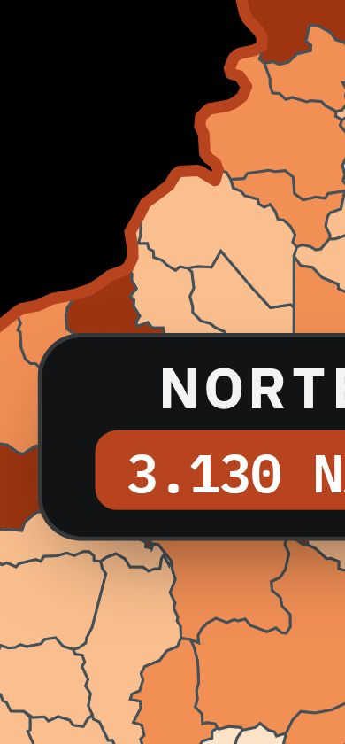 |

**Proposta.**
- **Ctrl (⌘ no Mac) + roda** dá zoom no ponto do cursor, com suavização; a pinça do trackpad (Chrome/Edge/Firefox) chega como Ctrl + roda e funciona igual. **Sem Ctrl a roda rola a página** e o aviso "Use Ctrl + rolagem para dar zoom" aparece por 1,7 s (no celular: "Use dois dedos para aproximar o mapa").
- **Arrastar** com o mouse move o mapa (só com zoom; passou de 5 px é arrasto e o clique seguinte é ignorado, então não abre município sem querer).
- **Celular**: um dedo continua rolando a página; **dois dedos** fazem pinça + arrastar; com o mapa aproximado, um dedo arrasta o mapa (exceto sobre a lista de alimentadores, a legenda e os botões, que rolam/clicam do jeito deles).
- **Controles** no canto superior direito do mapa, **logo abaixo do botão de tela cheia** (de outra frente): + , fator ×N, − e ↺ (enquadrar; só com zoom; o ícone é outro para não confundir com o da tela cheia). Teclas `+`, `−`, `0` (com foco no mapa) e Esc (1º Esc enquadra; o seguinte sobe um nível, como hoje).
- `prefers-reduced-motion`: o zoom vira instantâneo.

**Como fica (depois).**

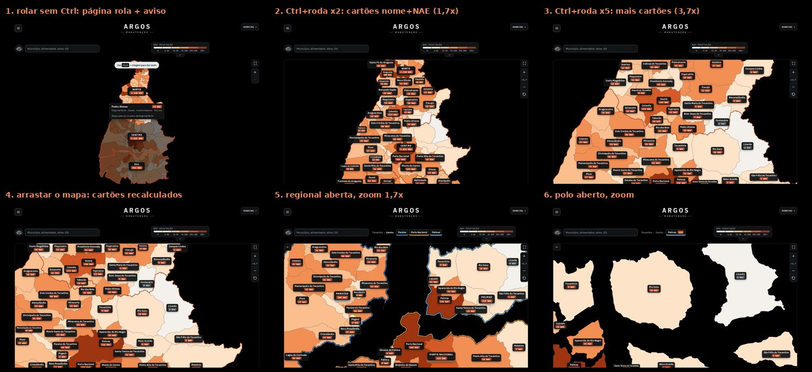

Quadros: [aviso](prints/z-depois-desk-1-aviso.jpg) · [×1,7](prints/z-depois-desk-2-estado-1x7.jpg) · [×3,7](prints/z-depois-desk-3-estado-3x7.jpg) · [arrastar](prints/z-depois-desk-4-arrastar.jpg) · [Esc enquadra](prints/z-depois-desk-5-esc-enquadra.jpg) · [regional ×1,7](prints/z-depois-desk-6-regional-1x7.jpg) · [regional ×3,7](prints/z-depois-desk-7-regional-3x7.jpg) · [polo com zoom](prints/z-depois-desk-8-polo-zoom.jpg) · [clique depois do zoom abre o município](prints/z-depois-desk-9-clique-abre-municipio.jpg) · [tema claro](prints/z-depois-desk-12-claro.jpg)

Celular (390×844, toques reais via CDP `Input.dispatchTouchEvent`):

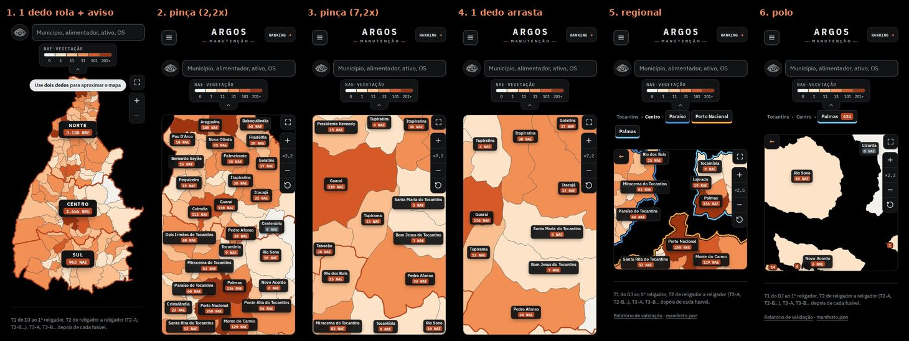

[aviso](prints/z-depois-mob-1-aviso.jpg) · [pinça](prints/z-depois-mob-2-pinca-1.jpg) · [pinça de novo](prints/z-depois-mob-3-pinca-2.jpg) · [um dedo arrasta](prints/z-depois-mob-4-arrastar.jpg) · [regional](prints/z-depois-mob-5-regional-pinca.jpg) · [polo](prints/z-depois-mob-6-polo-pinca.jpg) · [claro](prints/z-depois-mob-7-claro.jpg)

**Como foi portado (o que mudou em relação à rodada 1).** O `viewBox` continua sendo a única fonte de verdade; `nivelVb` guarda o enquadramento do nível (último destino de `voa()`); o zoom vive dentro dele (`Z.base` = `nivelVb` alargado à largura da caixa, para o mapa crescer para os lados sem nada se mexer na tela). Mudanças pontuais no arquivo atual, todas marcadas "ZOOM":
- `poeCartoes()` (cartões Norte/Centro/Sul) posiciona pelo `viewBox` atual; `escala()` usa a letra pelo `viewBox` atual; o hover de regional não escurece as outras com zoom; arrastar não mostra balão.
- `voa()`: registra `nivelVb`, limpa os cartões antes de voar (**efeito colateral bom**: os cartões do polo não ficam "voando parados" durante a animação, como ficavam) e, ao chegar, chama `fimZ()` se havia zoom.
- Esc e `ResizeObserver` da caixa: Esc enquadra primeiro; mudou a largura da caixa (girar o aparelho, tela cheia) → `fimZ()`, sem ficar preso a um tamanho antigo.
- `poeSelos()` ganhou o auxiliar `poSelo()` (o mesmo cálculo serve para os selos acompanharem o mapa durante o gesto).
- Bloco novo "ZOOM LIVRE" (~200 linhas): gestos, botões, aviso, limites (nunca afasta além do nível; no máximo 26 px de tela por unidade do mapa; arrastar não sai do enquadramento). Voltar a 1× desliga o zoom sozinho.
- Convivência com a **tela cheia** (`.mt-tc`, `telaCheia()`/`cobre()` do arquivo atual): os botões de zoom descem uma linha (`top: alvo + 8px`) e entram na conta de sobreposição dos cartões; entrar ou sair da tela cheia muda a largura da caixa e o `ResizeObserver` solta o zoom (testado, e o zoom funciona de novo dentro da tela cheia); no estado, Esc enquadra primeiro e só depois sai da tela cheia pelo caminho que já existia.
- Diferenças da rodada 1: os ouvintes de toque ficam na **caixa do mapa** (não só no `<svg>`), então a pinça começada sobre um cartão ou botão também é do mapa e não da página; `+/−` e o aviso ignoram a lista/legenda; sem a prévia das redes (veja "Não portado").

**Esforço:** M (já pronto; falta teste em aparelho real). **Risco:** médio-baixo (detalhes na seção Riscos).
**Arquivos:** `alimentador/site/mapa-municipios.js` (`proto/mapa-municipios.diff`) e `alimentador/site/site.css` (`proto/zoom.css` ao fim; `proto/site.css.diff`). Nenhuma mudança em `scripts/gera_trechos.py` (botões e aviso são criados pelo JS).

---

## Sugestão 2 · Zoom semântico: cartão preto com nome + NAE em cada município

**Problema.** Para saber nome e NAE de um município no estado ou na regional o usuário depende do balão do mouse; os nomes só aparecem com o polo aberto. Com o zoom livre isso ficaria sem sentido: aproximar e continuar sem saber que município é aquele.

| Antes: estado inteiro, só os cartões das regionais | Depois: Ctrl + roda, cartões nome + NAE por município |
|---|---|
| 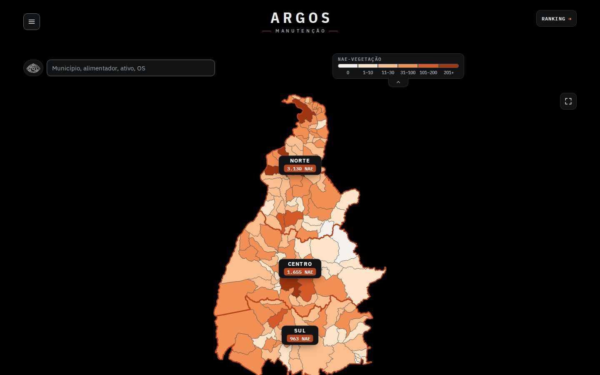 | 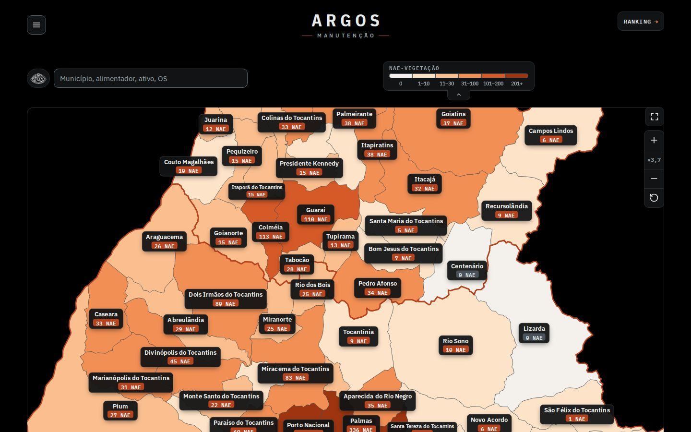 |

**Proposta.** Reaproveitar `poeNomes()` e o cartão `.mt-mn` (o de que o usuário gostou) também com o zoom ligado no estado e na regional:
- Entram os municípios do nível (ou da regional) que estão na tela e medem ≥ 40 px, **do maior NAE para o menor**, no máximo 70 por vez; **sempre nome + NAE** (nunca só o número); cartão completo, ou compacto (letra menor) se o completo não couber. Quem não coube dentro do município **fica sem cartão** no estado/regional (o cartão "fora, com fio" e o "só o número" continuam valendo só no polo aberto, onde são poucos municípios; com dezenas deles os fios virariam teia).
- Cada cartão procura um ponto livre **dentro do próprio município** (centro e anéis em volta; se o centro saiu da tela, procura perto do ponto visível), sem encostar em outro cartão, nos botões + / −, na seta, nos cartões das regionais/polos (enquanto aparecem) nem na borda da caixa.
- Acima de **1,8×** os cartões das regionais e dos polos saem de cena (os municípios já mostram os deles); a cor e o contorno dos polos continuam.
- Durante o gesto os cartões ficam escondidos (sem piscar por quadro) e voltam recalculados 110 ms depois de parar; os achados da busca (`achou`) mantêm o rótulo de texto de sempre (sem duplicar com o cartão).

**Como fica.** [estado ×1,7](prints/z-depois-desk-2-estado-1x7.jpg) → [×3,7](prints/z-depois-desk-3-estado-3x7.jpg) → [arrastar (recalcula)](prints/z-depois-desk-4-arrastar.jpg); regional e polo:

| Antes: regional (1×) | Depois: regional com zoom | Depois: polo com zoom |
|---|---|---|
| 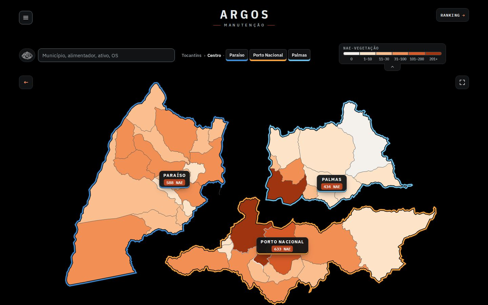 | 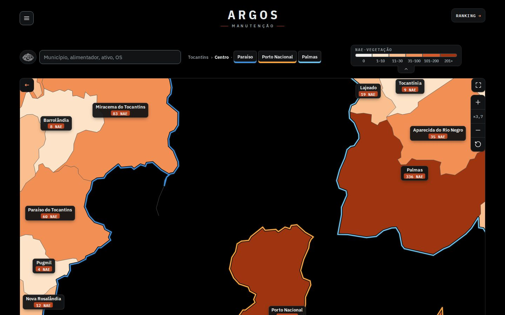 | 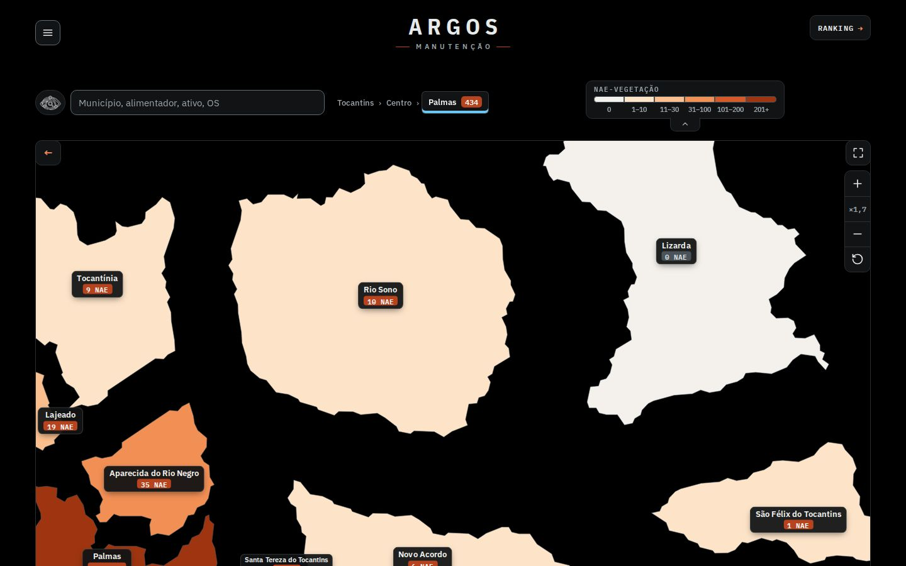 |

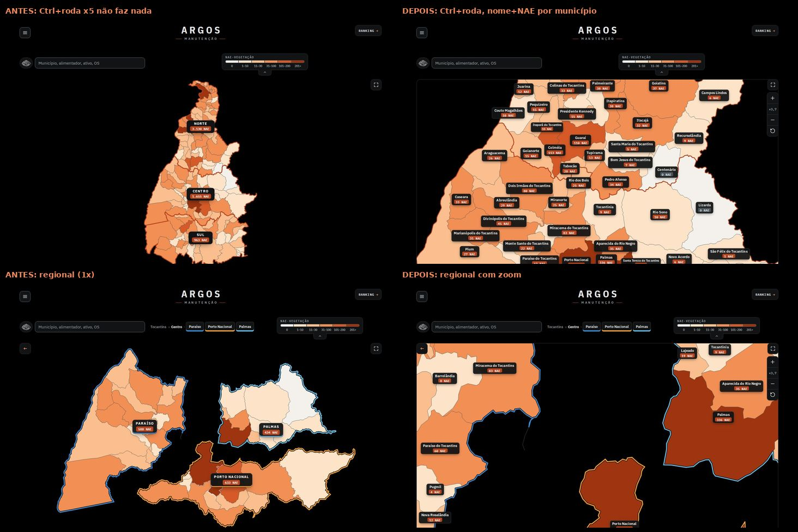

Celular: o mesmo cartão, compacto (letra de 10,5 px) — [antes e depois](prints/z-antes-depois-mob.jpg).

**Verificado.** `checaCartoes()` (em `lib.js`) roda depois de cada gesto: sem sobreposição entre cartões, sem sobreposição com legenda/botões/seta/cartões de regional e polo, cartões dentro da caixa e **o elemento sob o centro de cada cartão é o município do nome do cartão**. Resultado em todos os pontos testados (estado ×1,7/×3,7, depois de arrastar, botões, regional, polo, tema claro, celular): 0 falhas. Contagens típicas no 1440×900: 32–44 cartões no estado, 25–31 na regional ×1,7, 8–16 no polo.

**Custo.** Recalcular os cartões roda na thread principal depois do gesto: veja a seção Testes e medidas (números de uma execução com a máquina quieta e de outra sob carga). Otimizações já no código: município pequeno na tela não procura ponto longe do centro (anéis até 60% do tamanho dele); no estado/regional o teste caro `isPointInFill` fica por último (~3.000 → ~60 chamadas) e o tamanho de cada cartão é medido uma vez só (cache por município e nível, zerado quando a fonte termina de carregar). **Achado para quem mantém `poeNomes()`**: o valor padrão de `bate(a, b, f = matchMedia(...) ? 4 : 8)` chama `matchMedia` a cada comparação; com o zoom (centenas de milhares de comparações) isso custou ~120 ms por recálculo, então o protótipo calcula `folga` uma vez e passa pronta; vale levantar essa conta para fora em qualquer caso.

**Esforço:** P (está no mesmo diff da 1; só `poeNomes()` ganhou ~25 linhas). **Risco:** baixo-médio — o recálculo roda na thread principal; em celular fraco pode levar 100–200 ms após o gesto (os cartões só aparecem depois), então vale medir em aparelho e, se preciso, repartir o trabalho em duas passadas.
**Arquivos:** os mesmos da sugestão 1 (`poeNomes()`, `offDe`/`doNivel`/`bboxMun`, CSS `.zoom-longe`, `.mexe`).

---

## Sugestão 3 · Convivência com a busca, o drill-down e as outras frentes

**Problema.** O mapa já tem outras peças que mexem no enquadramento: a busca integrada (`ARGOS_MAPA.vai`, `previa`), a lista do município embaixo da busca e o botão Voltar/trilha; o tema 1 vai acrescentar tela cheia. O zoom não pode prender o mapa em um enquadramento antigo nem brigar com isso.

**Regras implementadas e testadas** (`teste-zoom.js`):
- Zoom + **clique num município** → abre a regional / o polo / o município e solta o zoom (os cartões do polo voltam depois do voo).
- Zoom + **← ou Esc**: 1º Esc (ou ↺) enquadra o nível; os seguintes sobem polo → regional → estado, voltando exatamente ao `viewBox` original.
- Zoom + **busca**: digitar não derruba o zoom; Enter/escolher leva o mapa ao resultado (`vai()` → `voa()` → solta o zoom). Se o resultado é o que já está aberto (nada voa), `vai()` termina com `enquadraZ()`. Com zoom e `vai({al})`, foca o alimentador normalmente.
- **Município e alimentador abertos**: o zoom também funciona lá (rede dos alimentadores), sem cartões; focar um alimentador solta o zoom.
- **Mudança de largura** (girar o aparelho, tela cheia): o `ResizeObserver` solta o zoom (testado com `setViewportSize`).
- **Tela cheia (tema 1)** já presente no arquivo atual: funciona sem integração extra (a largura da caixa muda e o `ResizeObserver` solta o zoom; botões lado a lado sem sobrepor; teste dedicado). Para quem precisar de mais controle há `ARGOS_MAPA.zoom = { ativo(), fator(), enquadra(), solta() }` — `solta()` volta ao enquadramento do nível sem animar.
- Durante um voo de nível, Ctrl+roda é consumida (sem zoom da página) mas ignorada.

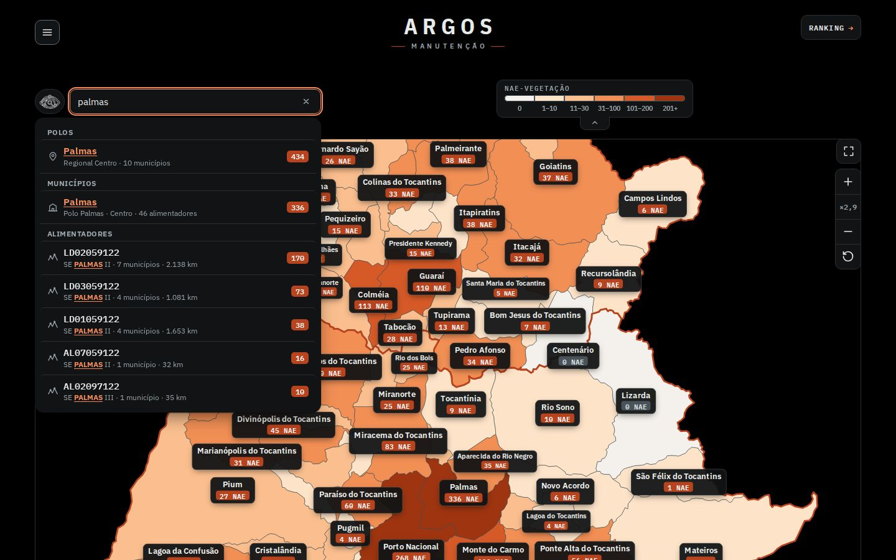
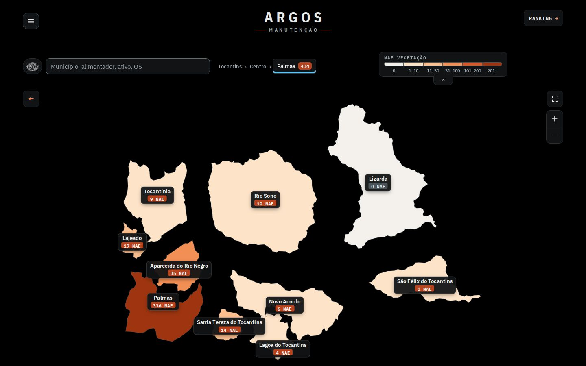

**Esforço:** P. **Risco:** baixo. **Arquivos:** os mesmos; opcional: `busca-ativo.js` chamar `ARGOS_MAPA.zoom.solta()` ao escolher um resultado se quiser evitar o `enquadraZ()` animado.

---

## Testes e medidas (reprodução)
- `node teste-zoom.js` (69 verificações): roda sem Ctrl rola a página + aviso · Ctrl+roda ×2 (×1,7) e ×5 (×3,7) · cartões Norte/Centro/Sul somem >1,8× e voltam · arrastar move, **não** clica e recalcula os cartões · botões + / − · 1º Esc volta ao `viewBox` original e remove os estilos inline · zoom + clique abre a regional · regional (zoom, arrastar, cartões dos polos acompanham, Esc em duas etapas) · polo (zoom, arrastar, clique abre o município) · zoom no município · `vai({al})` · ← e Esc nível a nível · busca (digitar, Enter, mesmo nível) · afastar até 1× desliga · mudar a largura da janela · teclas `+ − 0` e movimento reduzido · tema claro · nenhum erro de JS.
- `node teste-zoom-celular.js` (390×844, toques CDP, 27 verificações): um dedo rola a página e mostra o aviso, sem ligar o zoom · pinça liga o zoom sem rolar a página nem dar zoom na página (`visualViewport.scale` = 1) · um dedo arrasta o mapa · segunda pinça · pinça para fora · ↺ · botão + · toque num município abre a regional · pinça na regional e no polo com cartões sem sobreposição · toque abre o município.
- `node medidas.js` → `medidas.json` (Chromium headless, render por software: serve para comparar, não é FPS de usuário; a máquina é compartilhada com outras sessões e a medida só vale com a carga baixa — rodada final com load ≈ 2): abrir a regional (`voa`), 4 repetições alternadas: original 56–59 fps, protótipo 48–59 fps (uma repetição a 48 fps, com a máquina ocupada; mediana 57, igual ao original); Ctrl+roda ×10: 57 fps; arrastar 40 passos: 60 fps; nenhuma tarefa > 50 ms. Recalcular os cartões depois do gesto: 14 ms (zoom alto/arrastar) e ~55–62 ms (×1,7 no estado, 33 cartões).
- `node prints.js` regera os prints; `python3 folha-contato.py` as folhas. O Chromium daqui não confia na CA do proxy: `lib.js` busca o HTML ao vivo por `curl` (com cache) e entrega com `page.route`; o "antes" usa `orig/` (cópia do código atual do repositório) e o "depois" usa `proto/`. Como o `/teste/` ao vivo ainda não tem a legenda na barra (commit 7fe2ddc), `lib.js` aplica no HTML a mesma troca do gerador.
- `./rebase.sh`: o repositório muda enquanto outras sessões trabalham (já mudou duas vezes durante esta rodada); o script reaplica o delta sobre `orig/` e `proto/` e regera os diffs.

## Não portado e pendências
- **Prévia das redes dentro dos municípios grandes** (sugestão 2 da rodada 1): deixada de fora para manter o diff pequeno (colidia com o nome `previa` da ponte `ARGOS_MAPA` e baixava até 64 JSON por vista). Pode voltar depois, com rede simplificada por município gerada em `gera_trechos.py`.
- **Mini-mapa** e **"Voar até" (lista Maiores NAE)** da rodada 1: não pedidos nesta rodada; a busca integrada já cobre o segundo.
- **Safari de desktop**: a pinça do trackpad chega como `gesturechange`, não como Ctrl+roda; falta tratar (Ctrl+roda e os botões funcionam). **iOS/Android reais**: os toques CDP validam a lógica, não a sensação.
- **Dado repetido (tema 1)**: com zoom, o balão do mouse repete nome e NAE do cartão do município; sugiro, nesse caso, o balão mostrar só regional/polo/alimentadores/km e a dica de clique.
- **Acessibilidade (tema 5)**: pinça nativa da página fica bloqueada **só sobre o mapa** (`touch-action: pan-x pan-y`); as alternativas sem gesto são os botões + / − e as teclas `+ − 0`. Os cartões são `aria-hidden` (como já eram); o nome de cada município continua no `aria-label` dele (a NAE só aparece no balão do mouse e agora também no cartão, que não é lido por leitor de tela: vale incluir a NAE no `aria-label`).
- **Layout (fora do escopo)**: com a regional aberta a barra de polos quebra em duas linhas e empurra o mapa para baixo; no 1440×900 a base da regional passa da dobra (o zoom e os cartões funcionam do mesmo jeito).
