# Tema 3 · Tipografia e design do mapa (rodada 2)

**Resumo (5 linhas)**
1. Avaliei o espaçamento nos 8 polos em 4 telas (1440x900, 1280x720, tablet 820x1100 e celular 390x844): no computador está bom (134 de 139 municípios com nome), mas no celular **só 60 de 139 têm nome e 29 ficam sem rótulo nenhum** (sem mouse não há balão para descobrir quem é). O motivo não é falta de afastamento: o mapa usa só 30–45% da altura da tela no celular e o polo alto/largo deixa metade da tela vazia no computador.
2. **Afastamento adaptativo** (protótipo): depois do afastamento base (0,30), os municípios se espalham só no eixo em que sobra tela (polo alto em tela larga: horizontal; polo largo no celular: vertical), e o celular ganha uma moldura de altura fixa. Resultado: nomes no celular 60 → 86, no notebook 110 → 124, no tablet 79 → 133; sem sobreposição em nenhum caso.
3. **Município e foco no alimentador no mesmo cartão preto**: a lista que abre embaixo da busca vira cartão (município em Plex Condensed + selo "380 NAE" + "33 alimentadores"), e o alimentador em foco ganha um cartão no mapa (código, NAE, subestação, km e "Abrir a página →"). Achei e corrigi um corte: com o alimentador em foco o mapa encolhia e a rede era cortada numa borda reta.
4. **Acabamento**: o selo da NAE pedia Plex Mono 700, que o site não carrega (negrito sintético borrado) → 600 verdadeiro; fontes reserva com as métricas do Plex tiram o salto de layout da página de ranking no celular quando as fontes demoram (CLS 0,17 → 0,0007). Tema claro conferido nos 8 polos.
5. **Ranking (polos/)** com a mesma linguagem: marca ARGOS no alto, escolha de polo com nome + selo, o aberto vira cartão preto, NAE da linha no selo, cabeçalho de tabela em Plex Mono. Protótipos em `proto/` (injeção Playwright), prints em `prints/`, métricas em `metricas-*.json`.

**Sugestão nº 1 recomendada: afastamento adaptativo + moldura fixa do mapa no celular (sugestão 1).** É o que o usuário pediu ("espaça mais as cidades"), tem ganho medido em todos os polos e telas e custa uma função (`ajusta`) e três linhas em `enquadra`. Depois dela, a 3 (cartão do alimentador) é a que mais muda o uso.

**Como reproduzir:** `node prints.js antes|depois [filtro] [dark,light]`, `node metricas.js antes|depois [telas]`, `node perf.js`, `node fontes.js antes`, `node fontes-cls.js antes|depois`, `node selos.js`, `python3 folhas.py`. `rede.js` busca o site ao vivo por curl (o Chromium do sandbox não confia na CA do proxy) e entrega por `page.route`, trocando `assets/site.css`, `mapa-municipios.js`, `busca-ativo.js` e `ranking-polos.js` pelos de `proto/`. `orig/assets/` guarda os arquivos de hoje (iguais aos de `alimentador/site/`); `proto/mudancas.diff` tem a diferença exata.

Nomes dos prints: `antes|depois-<cenário>-<tema>-<desk|cel>.jpg`. Cenários: `1-estado`, `2-regional`, `polo-<araguaina|augustinopolis|guarai|palmas|porto|paraiso|gurupi|dianopolis>`, `mun-araguaina`, `mun-araguaina-lista` (campo da busca focado: abre a lista), `mun-palmas`, `al-foco`, `al-foco-lista`, `ranking`, `ranking-polo`. Folhas de comparação: `prints/folha-*.jpg`.

---

## Avaliação: o espaçamento atual (AFASTA_MUN 0,30, folga de 8 px) está bom?

Medido por `metricas.js` em cada polo aberto (município com rótulo = cartão com nome; "só número" = selo sem nome; "sem rótulo" = nem isso):

| Tela | municípios | com nome (antes) | só número (antes) | sem rótulo (antes) |
|---|---|---|---|---|
| computador 1440x900 | 139 | 128 | 8 | 3 |
| notebook 1280x720 | 139 | 110 | 18 | 11 |
| tablet 820x1100 | 139 | 79 | 59 | 1 |
| celular 390x844 | 139 | 60 | 50 | 29 |

Por polo no computador (nomes/total): Araguaína 19/20, Augustinópolis 20/24, Guaraí 21/21, Palmas 10/10, Porto Nacional 12/12, Paraíso 13/18, Gurupi 18/18, Dianópolis 15/16. **Apertados: Augustinópolis, Paraíso e Dianópolis**; no notebook Augustinópolis e Paraíso perdem 11 nomes. No celular nenhum polo passa de 10 nomes (Porto Nacional: 3 de 12).

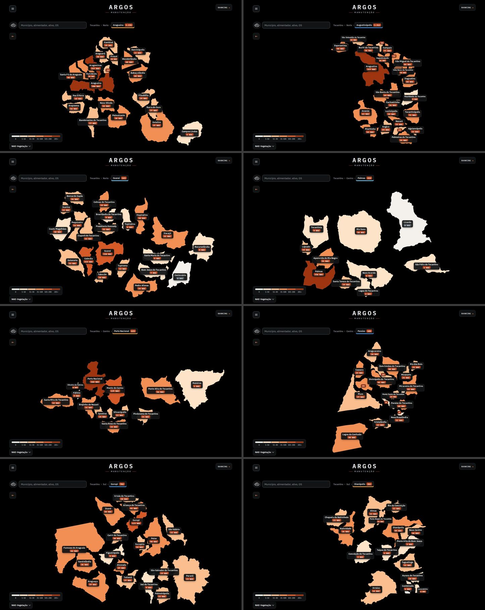
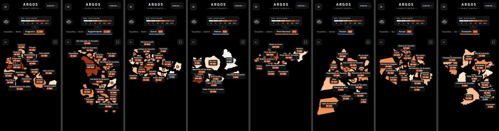

Três achados:
- **Afastar mais, sozinho, não adianta.** Se todos os municípios se afastam igual, o mapa inteiro encolhe para caber na tela e a distância em pixels entre os centros não muda; só os municípios ficam menores. O que dá espaço de verdade é usar a tela que sobra.
- **A tela sobra.** No computador o mapa do polo alto (Augustinópolis, Paraíso) ocupa ~570 px dos ~1000 px livres; no celular o SVG tem a altura justa dos municípios (Porto Nacional: ~150 px numa tela de 844) e a altura da página muda a cada polo.
- **Tablet (820 px) é tratado como celular** (mesmo corte de 860 px): só cartão compacto e no máximo 10 nomes, mesmo com 820x1100 de tela.

---

## Sugestão 1 · Afastamento adaptativo e moldura fixa no celular — prioridade 1 · esforço M
**Problema.** Ver a avaliação acima. Antes: `prints/antes-polo-augustinopolis-dark-desk.jpg`, `prints/antes-polo-porto-dark-cel.jpg`.

| computador, Augustinópolis (antes) | (depois) |
|---|---|
| 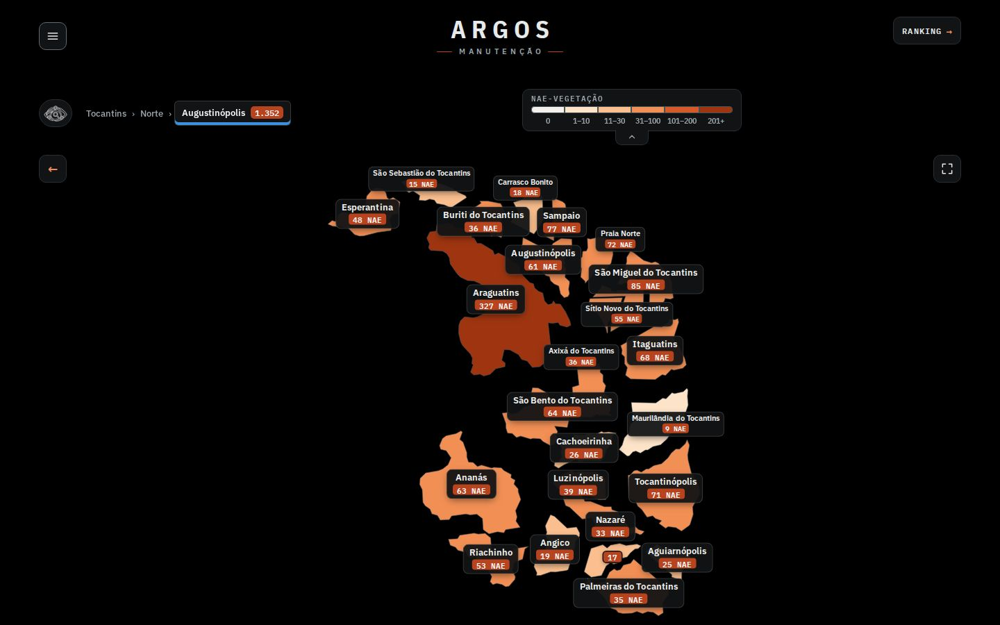 | 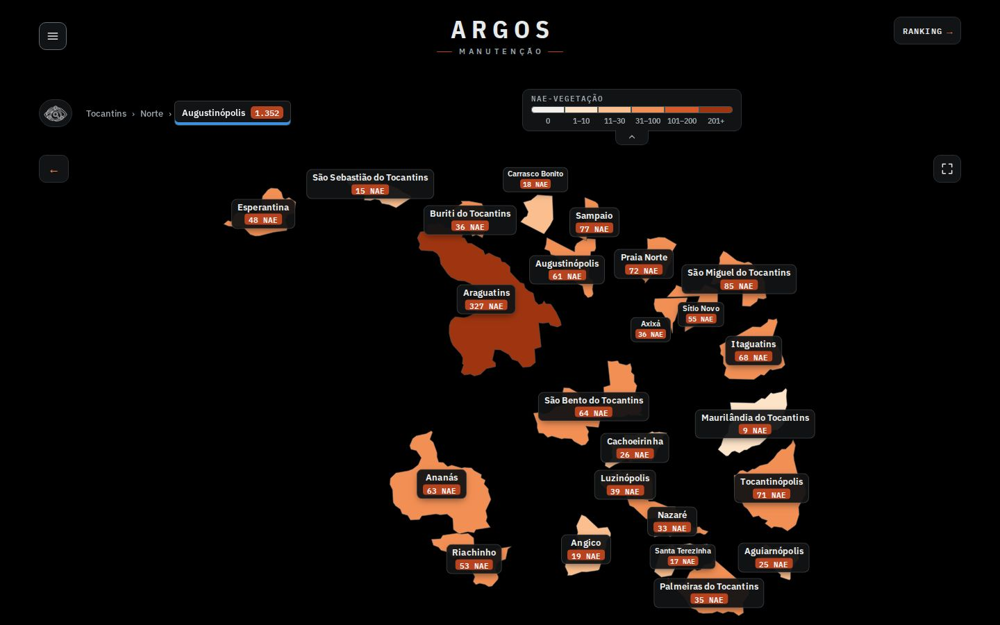 |

**Proposta.**
1. `entraPolo()` calcula o afastamento base como hoje (posição relativa ao centro do polo × (1 + AFASTA_MUN + folga)). Depois `ajusta()` compara a proporção do conjunto com a da área útil em pixels (a mesma conta do `enquadra`) e amplia a posição relativa **só no eixo que sobra**, por bissecção, até as proporções casarem (teto 1,7× no computador, 3× no celular, para o mapa continuar reconhecível). Como o eixo limitante não muda, o tamanho dos municípios também não muda; só ganha espaço para os cartões.
2. Celular: o SVG ganha moldura de **altura fixa** (`alturaCel()` = a altura do estado inteiro, sem passar de 78% da tela nem de `innerHeight − 300` px; 544 px em 390x844) e o conjunto é centralizado nela. A página deixa de pular de altura entre níveis (hoje: 590 px no estado, ~150–400 px no polo).
3. `enquadra()` passa a devolver sempre um viewBox com a proporção da caixa inteira (ver sugestão 3: era o que cortava a rede).

**Como fica.** 8 polos no computador (depois): `prints/folha-depois-8polos-dark-desk.jpg`. Celular, antes/depois lado a lado (Porto Nacional, Gurupi, Augustinópolis):

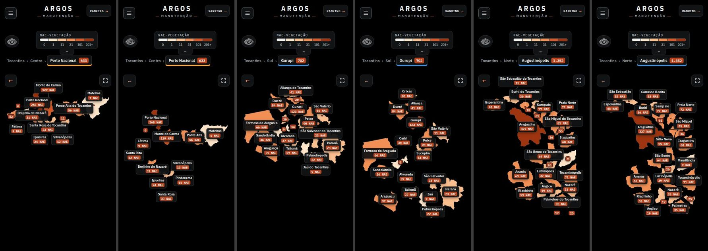

Resultado medido (nomes por tela, todos os 8 polos; sobreposição de cartões = 0 em todos os casos):

| Tela | com nome antes → depois | sem rótulo antes → depois |
|---|---|---|
| computador 1440x900 | 128 → 134 | 3 → 2 |
| notebook 1280x720 | 110 → 124 | 11 → 5 |
| tablet 820x1100 | 79 → 133 | 1 → 1 |
| celular 390x844 | 60 → 86 | 29 → 16 |

Por polo, celular (nomes antes → depois): Araguaína 8→14, Augustinópolis 10→12, Guaraí 7→12, Palmas 7→8, Porto Nacional 3→8, Paraíso 9→9, Gurupi 8→13, Dianópolis 8→10. Computador: Paraíso 13→16, Augustinópolis 20→22, Araguaína 19→20.

**Esforço:** M (`ajusta` ~25 linhas, `areaPx`/`alturaCel`/`lateral` ~15, `enquadra` reescrito). **Risco:** médio. (a) O espalhamento distorce a geografia (o polo vira um "mapa explodido" mais esticado); o teto limita isso e a posição relativa de cada município se mantém em cada eixo. (b) No celular o mapa passa a ter 544 px fixos: a legenda e o rodapé descem uns 100 px em polos que antes eram baixos. (c) Mexe no layout do mapa, que é do tema 2; se ele liberar zoom/arrastar, `ajusta` só deve rodar ao abrir o nível. (d) Porto Nacional no celular continua com 4 sem rótulo: a área útil (358x440 px) é o limite físico; ver "próximos passos". **Arquivos:** `alimentador/site/mapa-municipios.js` (`entraPolo`, `enquadra`, novas `ajusta`/`areaPx`).

---

## Sugestão 2 · Mais municípios com nome: nome curto, sem teto de 10 e medição em lote — prioridade 2 · esforço P
**Problema.** No celular só os 10 de maior NAE levavam nome (o resto, número ou nada), e nomes como "Palmeiras do Tocantins" (170 px) disputam o espaço com os vizinhos.

**Proposta.** (a) 4 níveis de rótulo: cartão cheio → compacto → **compacto com nome curto** (sem " do Tocantins": 37 nomes; conferi que nenhum nome se repete dentro do estado) → só o número; o nome completo continua no balão do mouse. (b) Sem teto de 10: o celular começa no compacto e o encaixe decide. (c) Celular: folga entre cartões 6 px (8 no computador). (d) `poeNomes()` cria e mede todos os cartões de uma vez (um layout) em vez de um layout por tentativa: com CPU 4x mais lenta a abertura de polo ficou equivalente à de hoje (maior tarefa longa 110 ms no computador e 180 ms no celular, contra 151 e 135 ms hoje; a primeira versão sem o lote chegava a 280 ms).

| antes | depois (celular, Guaraí) |
|---|---|
| 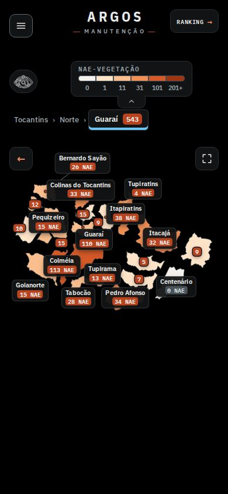 | 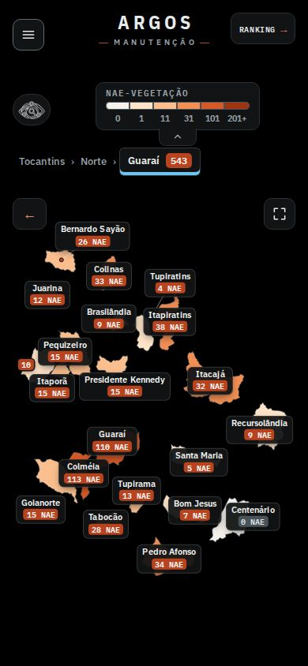 |

Exemplos de nome curto: "Santa Terezinha" em `prints/depois-polo-augustinopolis-dark-desk.jpg` e "Buriti", "Pindorama" no celular (`prints/depois-polo-porto-dark-cel.jpg`, `prints/depois-polo-augustinopolis-dark-cel.jpg`). **Esforço:** P (já está no mesmo `poeNomes`). **Risco:** baixo; o CSS troca `data-nv="2"` (era "só número") por `data-nv="3"`. **Arquivos:** `mapa-municipios.js` (`NIVEIS_ROT`, `poeNomes`), `site.css` (`.mt-mn[data-nv]`).

---

## Sugestão 3 · Município e foco no alimentador com a linguagem do cartão preto — prioridade 3 · esforço M
**Problema.** No nível município a lista era uma caixa clara com título pequeno e a NAE do município **sumia** (só ficava a dos alimentadores); com o alimentador em foco não havia nada no mapa dizendo qual era (só o último item da trilha) nem que o 2º clique abre a página. E um defeito: com o alimentador em foco o mapa encolhia (o SVG tem `width:auto` e seguia a proporção do viewBox, 803 px de 1328) e a rede e os municípios eram **cortados numa borda reta**. Antes: `prints/antes-mun-araguaina-lista-dark-desk.jpg`, `prints/antes-al-foco-dark-desk.jpg`, `prints/antes-al-foco-dark-cel.jpg`.

| antes | depois |
|---|---|
| 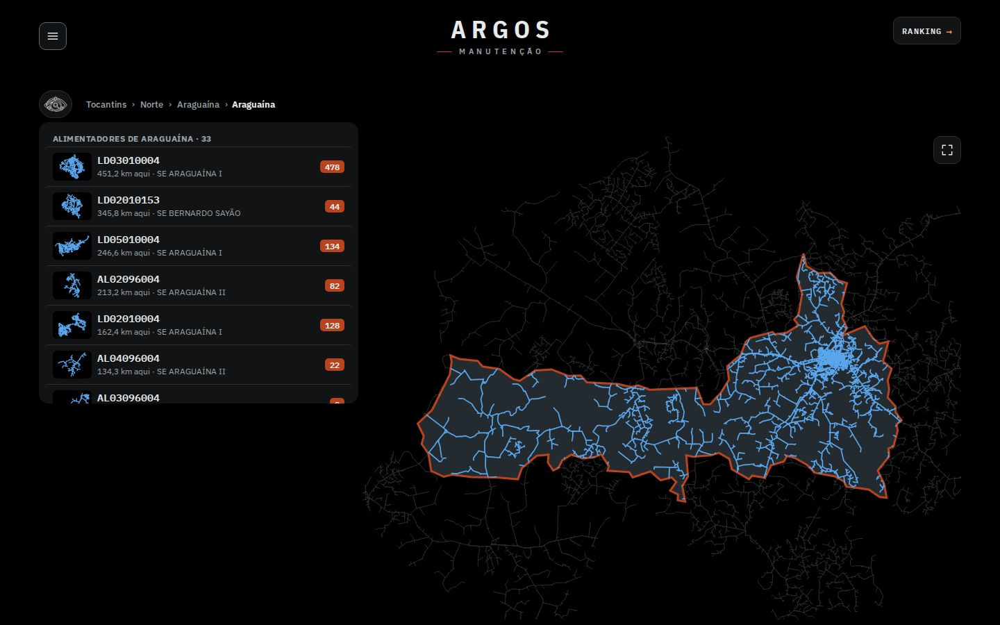 | 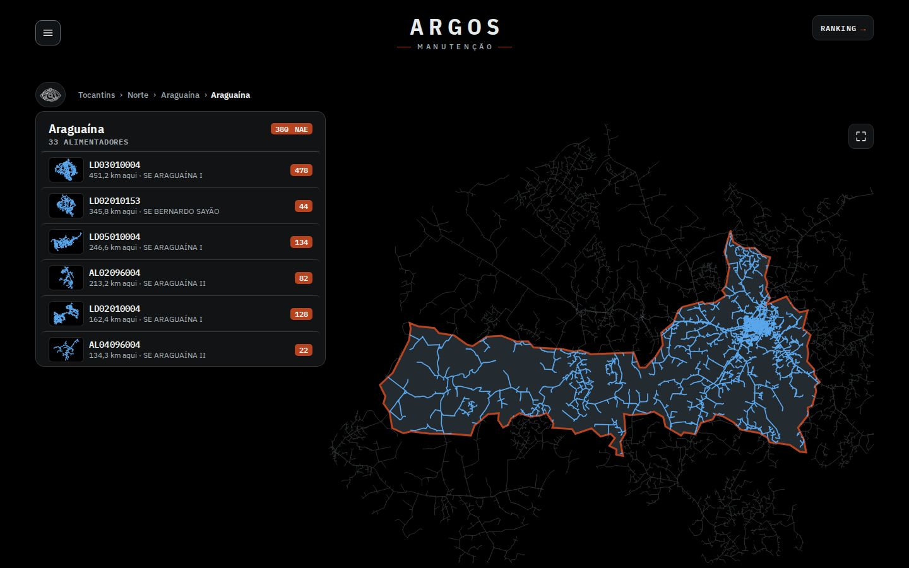 |
|  | 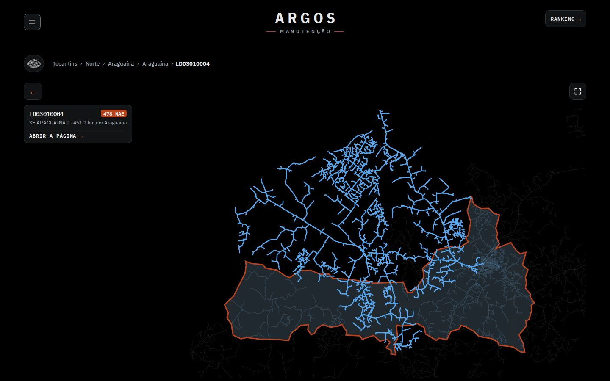 |

**Proposta.**
- **Lista embaixo da busca (`#ativo-res.lista-mun`)** vira cartão preto nos dois temas: cabeçalho fixo com o município em Plex Sans Condensed 700 (20 px), selo **"380 NAE"** (a NAE do município, que já estava nos dados) e "33 alimentadores · mais km primeiro" em Plex Mono caixa alta; linhas com código em Mono 600, km e subestação em cinza, selo da NAE à direita; a rede na miniatura em azul claro sobre preto (no claro, o azul escuro quase sumia). A ordem é por km no município; o texto agora diz isso (a NAE do selo não é a ordem).
- **Cartão do alimentador em foco (`.mt-ac`)**: código em mono, selo da NAE, "SE ARAGUAÍNA I · 451,2 km em Araguaína" e "ABRIR A PÁGINA →". No computador fica na coluna da esquerda, embaixo da seta de voltar (onde a lista saía); no celular fica preso embaixo do mapa. É um link: tocar nele é o "2º clique" e deixa de ser um segredo.
- **Corte da rede**: `enquadra()` sempre devolve viewBox com a proporção da caixa inteira (centraliza o alimentador na área livre), então o SVG ocupa a largura toda e o contexto (município, outras redes) não é cortado.
- Sem dado repetido: o município não ganhou cartão no mapa (nome e contagem já estão no cabeçalho da lista), só a NAE dele voltou a aparecer.

Celular (antes → depois): `prints/antes-mun-araguaina-lista-dark-cel.jpg` → `prints/depois-mun-araguaina-lista-dark-cel.jpg`; foco: `prints/depois-al-foco-dark-cel.jpg`; claro: `prints/depois-mun-araguaina-lista-light-desk.jpg`, `prints/depois-al-foco-light-cel.jpg`.

| celular, lista (depois) | celular, foco (depois) | celular, foco, claro |
|---|---|---|
| 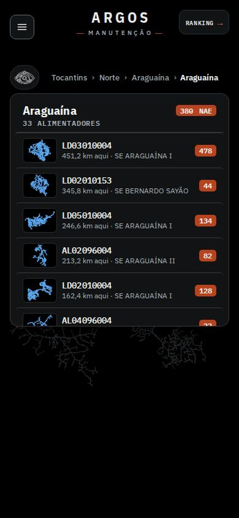 | 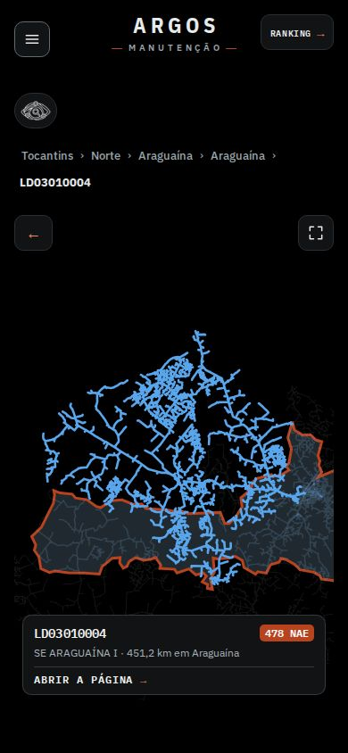 | 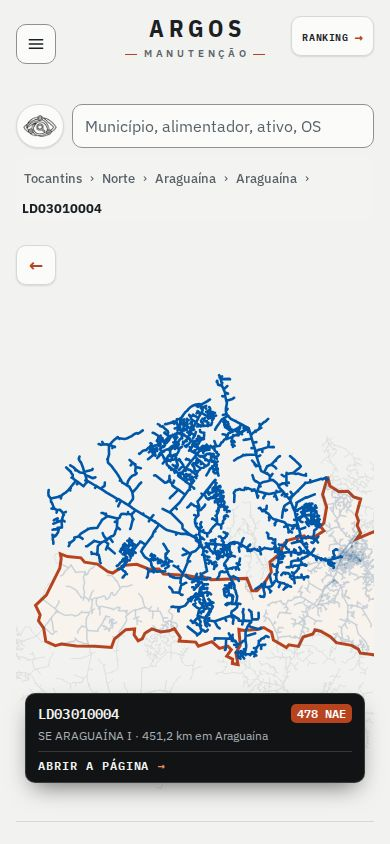 |

**Esforço:** M (CSS ~35 linhas, `cartaoAl` ~12, título HTML na `mostra()` de `busca-ativo.js`, `enquadra`). **Risco:** baixo a médio: o título da lista passou a aceitar HTML (`{html}`; os textos continuam escapados com `esc`), e o `enquadra` novo vale para todos os níveis, então confira o enquadramento de regional e município em telas muito largas (ultrawide). **Arquivos:** `mapa-municipios.js` (`cartaoAl`, `focaAl`, `saiAl`, `enquadra`), `busca-ativo.js` (`atalhos`, `mostra`), `site.css` (blocos `.mt-ac` e `#ativo-res.lista-mun`).

---

## Sugestão 4 · Página de ranking (polos/) com a mesma tipografia — prioridade 4 · esforço P
**Problema.** A página não tem a marca nem o cartão: a escolha de polo é uma nuvem de texto ("Araguaína 1.235 NAE" tudo no mesmo peso), a NAE da linha é só um número em negrito e o cabeçalho da tabela usa o mesmo cinza do corpo. Antes: `prints/antes-ranking-dark-desk.jpg`, `prints/antes-ranking-dark-cel.jpg`.

| antes | depois |
|---|---|
| 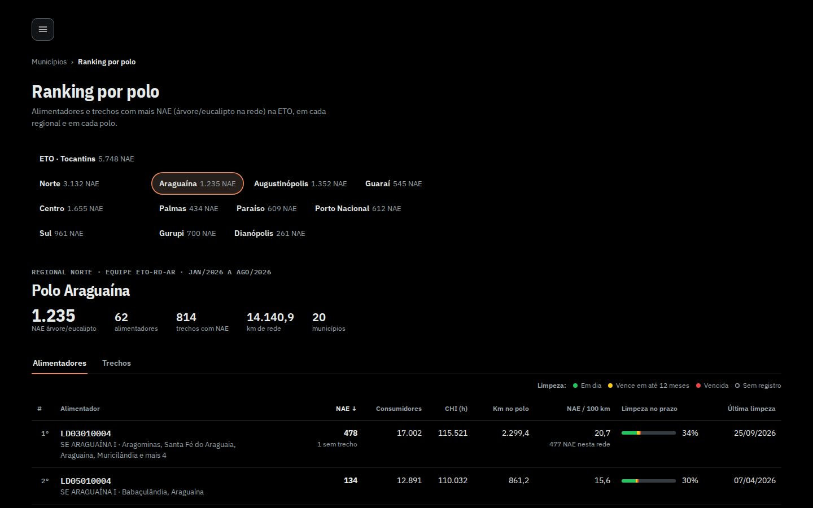 | 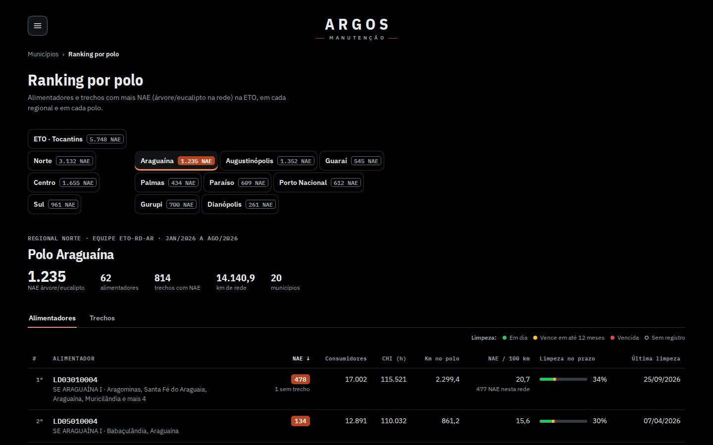 |

**Proposta.** (1) Marca ARGOS/MANUTENÇÃO (a mesma do início, menor) na linha do menu, como link para a página inicial. (2) Escolha de ETO/regional/polo: nome em Plex Sans 600 + selo da NAE; o escolhido vira **cartão preto** com selo vermelho e filete em laranja (como o polo aberto na barra do mapa), os demais ficam só com contorno e selo vazado (12 cartões pretos de uma vez pesariam demais, sobretudo no claro). No celular, ETO/Norte/Centro/Sul ganham o mesmo desenho (nome em caixa alta, selo embaixo). (3) NAE de cada linha no **selo vermelho** do mapa. (4) Cabeçalhos da tabela em Plex Mono 11 px caixa alta; KPIs em Plex Sans Condensed 700 (o primeiro já era).

| celular, escuro (depois) | celular, claro (depois) |
|---|---|
| 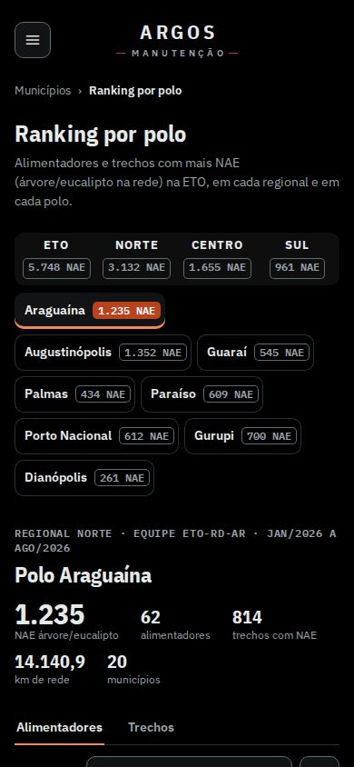 | 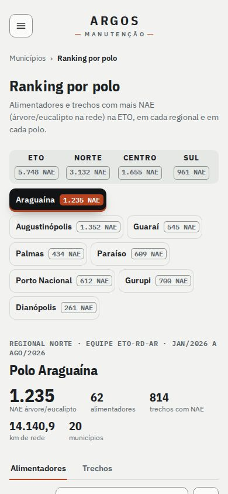 |

Computador, claro: `prints/depois-ranking-light-desk.jpg`; com o polo rolado: `prints/depois-ranking-polo-dark-desk.jpg`. **Esforço:** P (CSS dentro do `<style>` que o `ranking-polos.js` injeta + 3 templates; a marca no protótipo é inserida por JS, no real entra no HTML de `scripts/gera_trechos.py`). **Risco:** baixo; o selo da linha aumenta o peso visual da coluna NAE (60 selos): se incomodar, deixar só nos 10 primeiros. **Arquivos:** `ranking-polos.js` (`pil`, segmentado, célula NAE, bloco CSS), `scripts/gera_trechos.py` (link da marca).

---

## Sugestão 5 · Acabamento: pesos de fonte, fontes reserva e tema claro — prioridade 5 · esforço P
**Pesos (auditado por `fontes.js` em 4 telas do site).** Carregados: Plex Sans 400/500/600/700, Condensed 600/700, Mono 600 (e 400 só no ranking). Em uso sem peso carregado: **Plex Mono 700, em 30 textos (todos os selos da NAE)**: o navegador sintetiza um negrito em cima do 600, que borra nos 9–12 px. Comparação ampliada 3x (sintético atual, 600 verdadeiro, 700 verdadeiro): `prints/selo-comparacao.png`. **Proposta:** selos em 600 (zero custo, uma linha de CSS no protótipo); se quiser o 700 de verdade, incluir `IBM+Plex+Mono:wght@400;600;700` no link do Google Fonts (+1 arquivo, ~15 KB, no `index.html` e em `polos/` gerados por `gera_trechos.py`). O "MANUTENÇÃO" da rodada 1 já está certo.

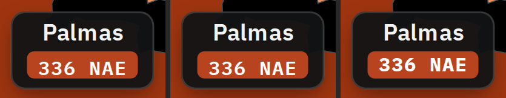

**Fontes reserva com as métricas do Plex.** Com os woff2 do Google demorando 1,5 s (simulado), a troca de fonte desloca o layout (`fontes-cls.js`): **página de ranking no celular CLS 0,172** (acima de 0,1, "ruim"), ranking no computador 0,011, início no celular 0,0009. Medi a largura e as alturas de linha do Plex contra Arial/Courier e declarei três `@font-face` locais (Plex Sans Fallback: `size-adjust` 98%, Plex Cond Fallback: 88,9%, Plex Mono Fallback: 100%, com `ascent/descent-override`), colocados depois do Plex nas variáveis `--f-body`, `--f-display` e `--f-mono`. **Depois: ranking no celular 0,0007, início no celular 0**, ranking no computador 0,0045. Quem não tem Arial/Courier (Android) cai no `system-ui` de sempre, sem piora. As variáveis `--f-display` também estão copiadas dentro do `ranking-polos.js` e precisam do mesmo ajuste.

**Tema claro.** Conferi os 8 polos, município, foco e ranking nos dois tamanhos (`prints/depois-*-light-*.jpg`, `prints/antes-*-light-*.jpg`): cartões pretos mantêm contraste sobre qualquer faixa de laranja; a lista e o cartão do alimentador são pretos também no claro (como as regionais aprovadas); nada ficou ilegível. Ajuste que o claro pediu: miniaturas da rede em azul claro dentro do cartão (o azul escuro `--rede` do claro sumia no preto).

**Esforço:** P. **Risco:** baixo (o `local()` só vale onde a fonte existe). **Arquivos:** `site.css` (tokens `--f-*`, `@font-face` reserva, peso dos selos), `ranking-polos.js` (`--f-display`), opcional `scripts/gera_trechos.py` (link do Google Fonts).

---

## Achados fora do escopo (para os outros temas e para você decidir)
- **Números por polo diferentes entre o mapa e o ranking** (mesmos dados, fontes diferentes): Paraíso 588 (mapa) × 609 (ranking), Porto Nacional 633 × 612, Guaraí 543 × 545, Gurupi 702 × 700; regionais Norte 3.130 × 3.132 e Sul 963 × 961 (Centro 1.655 e o total da ETO 5.748 batem). O mapa soma os municípios do `polo` de `mapa-municipios-dados.js`; o ranking usa `ranking-polos-dados.js`. Vale conferir a atribuição de município a polo nas duas fontes.
- **CLS do cabeçalho (tema 5):** na página inicial o `header.cab` e os cartões das regionais deslocam 0,059 aos ~200 ms (o botão do menu entra via `menu.js` e empurra a página 64 px; no ranking, 0,037 pelo mesmo motivo). Reservar o `.mnu` no HTML gerado resolve.
- **Trilha "Tocantins › Norte › Araguaína › Araguaína"**: quando o município tem o mesmo nome do polo a trilha parece repetida; poderia mostrar "Araguaína (polo)" ou omitir o passo.
- **Toque sem balão:** no celular, município sem rótulo só se identifica entrando nele. Um primeiro toque que mostre o balão (nome, NAE) e um segundo que abra seria o complemento natural (tema 2).

## Próximos passos sugeridos
1. Aplicar as sugestões 1 e 2 juntas (mesmo arquivo) e rodar `node metricas.js depois` contra o ao vivo.
2. Celular: se ainda faltar nome, testar rótulo sem caixa (só texto com contorno) nos municípios grandes e o balão no primeiro toque.
3. Decidir o 700 do Mono (+15 KB) ou ficar no 600.

## Limites do protótipo
- Os prints usam o Chromium do sandbox (Linux, sem Arial/Courier reais: o teste de fontes reserva usa Liberation Sans/Mono, métricas compatíveis).
- Métricas de CPU com throttle 4x do Playwright; a variância entre repetições é alta (±30%), por isso falo em "equivalente".
- Todos os números dos prints vêm do site ao vivo; nada foi inventado.
