# Tema 4 · Painel do alimentador: a lupa e o painel numa proposta só (rodada 2)

Parte da proposta de lupa que a outra sessão fez (`assets/lupa-painel.js`, Artifact F9h14JEhEqGMgZqPrZXV8W, só lida; nada publicado) e da rodada 1 deste tema (`../../rodada-1/tema-4-painel/README.md`). Testado ao vivo (site `/teste/`, 15/10/2026) em `LD01072001` (154 km), `AL03037009` (212 km), `LD02022033` (grande: 1.375 km, 1.019 trechos) e `AL01015049` (pequeno: 5,5 km, 11 trechos), 1440×900 e 390×844, escuro e claro. Nada foi editado no repositório: o protótipo é `proto/lupa-painel.js` + `proto/painel.css` + `proto/painel.js`, injetados por Playwright (`prints.js`).

## Resumo (5 linhas)
1. A lupa já resolveu a barra (olho · campo · Filtros, 40 px) e a busca, mas só **somou** ao que existia: com ela a tela continua com 276 px de cabeçalho, mapa de 924×702 que sai 78 px da janela e **os mesmos dados em dois lugares** (a tabela Classe/Trechos/Extensão e o "23 no alimentador" repetem a lupa; a lista de trechos do painel repete a classe aberta da lupa; os achados da busca caem soltos sobre o mapa).
2. Consolidado: **uma linha só no alto** (☰ · código + SE · resumo "199 trechos · 153,98 km · NAE 23" · lupa) e o **mapa na altura da tela: 992×814 (todo à vista) contra 924×702 (624 px visíveis) (+40% de área visível); no celular 366×629 contra 358×490**, sem rolar a página.
3. **Cada dado em um lugar só** (tabela do item "Dado → onde aparece"): sai do painel o que a lupa e o cabeçalho já dizem (tabela, bloco NAE, legenda de cores, lista de trechos, "Ordem"; nos subtítulos dos cartões "de 154,0 km" vira %); a busca passa a responder **dentro** da lupa (trechos e ativos), e ela ganha uma linha que fecha a conta da NAE (as classes somam 24, o alimentador tem 23).
4. O que a lupa não cobre ficou com o painel: camadas em acordeão (4 camadas cabem nos 814 px), legendas em linha (e recolhíveis no celular), trecho escolhido em ficha + abas (painel de 11.409 px → 1.158 px) e **gaveta inferior no celular**.
5. **Recomendação nº 1: Sugestões 1 e 2 juntas** (cabeçalho numa linha + painel sem repetição): quase tudo CSS, o resumo do cabeçalho são ~40 linhas de JS e a lupa muda em 2 pontos; devolve a maior área de mapa e dá o ganho de "nada se repete". Depois 4 (abas), 3 (camadas) e 5 (gaveta, depende da 1).

Medidas (`metricas.json`; `lupa` = site + proposta da lupa, `consolidado` = protótipo):

| `LD01072001` | com a lupa (antes) | consolidado (depois) |
|---|---|---|
| Topo da página até o mapa (desktop / celular) | 276 px / 294 px | 70 px / 147 px |
| Mapa, desktop (l × a; altura visível na 1ª tela) | 924×702; 624 px | 992×814; 814 px |
| Mapa, celular (l × a) | 358×490; 490 px | 366×629; 629 px |
| Rolagem da página (desktop / celular) | 110 px / 594 px | 0 px / 0 px |
| Painel com as 4 camadas ligadas (altura do conteúdo, desktop) | 1.528 px (o painel tem 626 px: rola) | cabe nos 814 px do painel, sem rolagem |
| Coluna de legendas sobre o mapa, 4 camadas (desktop / celular) | 598 px / 386 px | 156 px / 32 px (celular recolhida: botão "Legendas") |
| Painel com o T2-A escolhido e 4 camadas (desktop / celular) | 11.409 px / 11.965 px | 1.158 px / 1.310 px |

Os outros três alimentadores (mapa na 1ª tela; l × a visível; erros de JavaScript na carga em todos: nenhum):

| | desktop antes | desktop depois | celular antes | celular depois |
|---|---|---|---|---|
| `AL03037009` | 924×624 | 992×814 | 358×490 | 366×629 |
| `LD02022033` | 924×624 | 992×814 | 358×490 | 366×629 |
| `AL01015049` | 924×624 | 992×814 | 358×490 | 366×629 |

Testes de interação do protótipo (`testes.js`): 212 verificações ok e 0 com falha, em `AL01015049`, `AL03037009`, `LD01072001`, `LD02022033`, desktop e celular. Cobrem: carga sem erro de JS, resumo igual aos dados, lupa (classe → trecho → ficha), abas, cartões recolhidos com trecho, camada pela lupa abre o cartão, Esc, busca (resultado, vazio, Enter), mês muda o NAE do cabeçalho, selo do NAE abre os Filtros, município enquadra o mapa, aviso "sem camada", tela cheia (resumo vai e volta), mapa inteiro sem rolagem (`testes-*.json`).

Custo da lupa no maior alimentador (`LD02022033`, 1.019 trechos; medição grosseira, máquina compartilhada com outros 5 agentes): abrir a lupa 29 ms, abrir o T3 (150 linhas) 57 ms, "Mostrar mais" 135 ms, resultado de busca de 1 letra (1.019 trechos → 150 linhas) 112 ms; busca por "T3-A" 530 ms, dos quais a maior parte é o `selecionar()` da própria página (o nome exato escolhe o trecho e enquadra o mapa), não a lupa.

---

## O que a lupa já faz (e o protótipo NÃO refaz)
- Barra única no alto do mapa: olho do ARGOS · campo "Trecho, ativo ou poste" · **Filtros** (município e meses do NAE, com o nº de filtros ligados).
- Lista suspensa do olho: **classes** T1/T2/T3 (nº de trechos, km, NAE no período, olho liga/desliga a classe no mapa) → **trechos** da classe (maior NAE primeiro, 150 por vez) → escolher o trecho no mapa; **camadas** (Faixa, Inspeção, Insp→manut, Manutenção) com caixas de marcar. Os botões T1/T2/T3 e o Menu saem do mapa (voltam só na tela cheia).
- Tudo isso usa os botões originais (escondidos): nenhuma lógica nova de dados.

## O que o protótipo acrescenta (e onde cada coisa mora)
Cada sugestão mostra **antes = site + lupa** (`antes/lupa-*`) e **depois = consolidado** (`depois/*`).

### Sugestão 1 · Uma linha só no alto, com o resumo do alimentador; mapa na altura da tela  (recomendada nº 1, esforço M, risco baixo)
**Problema.** Com a lupa, a barra ficou fina, mas o cabeçalho (☰, caminho, SE, código, subtítulo) continua em 3 linhas e empurra o mapa para y=276: o mapa tem 924×702, só 624 px aparecem, a página rola 110 px e a legenda e o botão de tela cheia ficam cortados. No celular o mapa começa em y=294. Antes: `antes/lupa-LD01072001-d-inicial.jpg`, `antes/lupa-LD01072001-m-inicial.jpg`, `antes/lupa-LD02022033-d-inicial.jpg`, `antes/lupa-AL01015049-d-inicial.jpg`.

**Proposta.** Grade de uma linha: ☰ · [caminho em cima, código + SE embaixo] · **resumo** · lupa (olho, campo, Filtros). O resumo é a "casa" do que era a linha Total da tabela e o bloco "NAE - vegetação" do painel:
`199 trechos · 153,98 km · [NAE 23] vegetação · todos os meses`.
O selo vermelho do NAE é o mesmo das pílulas da lista e **acompanha o filtro de meses** (jan/2026 → 9) e "Contar individuais"; tocar nele abre os Filtros (onde se muda o período). A subestação fica ao lado do código; o subtítulo "Trechos por ativo" sai (a aba já diz); o trecho escolhido sai do caminho (já está na ficha). A página tem a altura da janela (`100dvh`): mapa e painel preenchem o resto e o painel rola por dentro. Janela entre 981 e 1280 px: a SE desce para baixo do código. Celular: ☰ + código/SE à esquerda e o resumo em 3 linhas curtas à direita; barra da lupa embaixo; o mapa começa em y=147.

**Como fica.** `depois/LD01072001-d-inicial.jpg`, `depois/LD01072001-m-inicial.jpg`, `depois/AL03037009-d-inicial.jpg`, `depois/LD02022033-d-inicial.jpg` (1.019 trechos · 1.375,19 km), `depois/AL01015049-d-inicial.jpg` (11 trechos · 5,46 km); claro: `depois/claro-LD01072001-d-inicial.jpg`, `depois/claro-LD01072001-m-inicial.jpg`. Larguras de conferência: `depois/LD01072001-n-inicial.jpg` (1280), `depois/LD01072001-t-inicial.jpg` (1024), `depois/LD01072001-p-inicial.jpg` (360×640).

| antes (site + lupa) | depois (consolidado) |
|---|---|
| 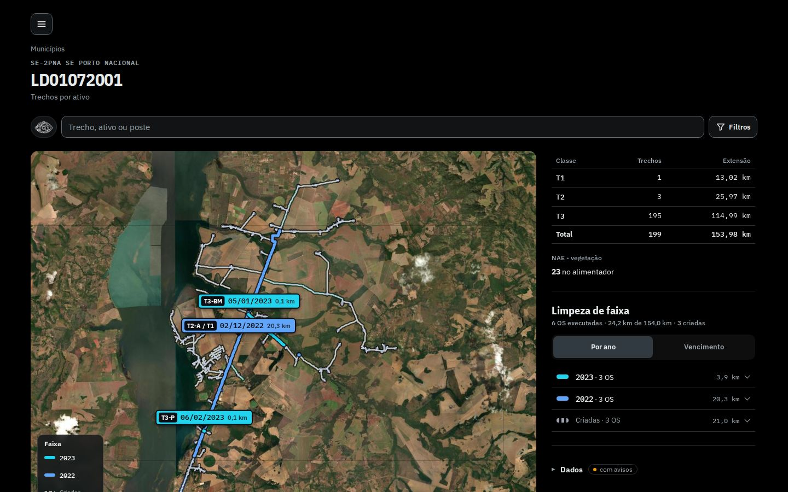 | 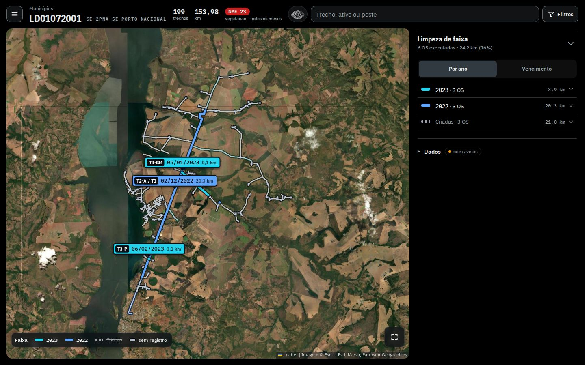 |
| 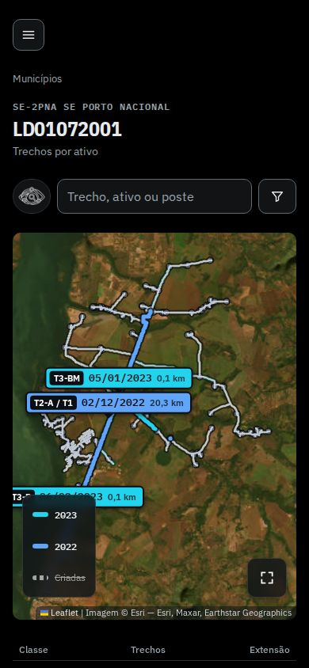 | 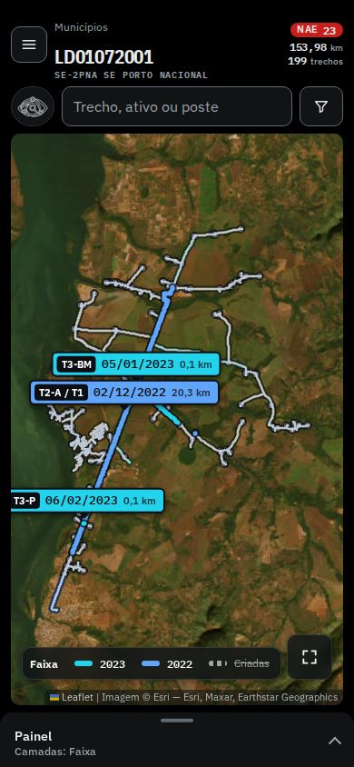 |

**Arquivos que mudariam.** CSS de `alimentador/mapa_trechos.html` (grade do `.wrap`, `header`, `.stage`, `#map`, `.panel`); `alimentador/site/extras.js` (monta o `.al-res` junto do `.eyebrow`; o selo usa `doMes()` e o texto do botão dos meses, que já existem); `alimentador/site/telacheia.js` (o resumo vai para o alto da gaveta, depois da barra, e volta ao sair).
**Risco.** O mapa muda de tamanho antes da primeira pintura: aplicar no CSS (não depois do Leaflet). Janela baixa (<600 px) cai para rolagem normal (`min-height:600px`). O total do cabeçalho é do alimentador inteiro e **não** acompanha o filtro de município (as classes da lupa acompanham).

### Sugestão 2 · Painel só com dados: sai o que a lupa e o cabeçalho já dizem; a busca responde dentro da lupa  (esforço M, risco médio)
**Problema.** Com a lupa, três coisas continuam duplicadas no painel: (a) a tabela Classe/Trechos/Extensão e o "23 no alimentador" (a lupa mostra nº, km e NAE por classe); (b) a **lista de trechos** (a mesma da classe aberta na lupa, com o "Ordem" e a legenda de cores embaixo); (c) os achados de ativo da busca, que caem soltos entre a barra e o mapa. Além disso, a lupa mostra NAE por classe 4 + 6 + 14 = **24** enquanto o alimentador tem **23**: quem soma vê um erro que não existe. Antes: `antes/lupa-LD01072001-d-inicial.jpg`, `antes/lupa-LD01072001-d-sem-faixa.jpg`, `antes/lupa-LD01072001-d-lupa.jpg`.

**Proposta.**
- O painel perde: tabela de classes, bloco NAE do alimentador, `#lista`, "Ordem" e achados soltos. A legenda de cores vai para o mapa (Sugestão 3). Com nenhuma camada ligada o painel diz "Nenhuma camada ligada" e o botão **Escolher camadas** abre a lupa.
- **R2-a (em `lupa-painel.js`)**: com texto no campo a lista suspensa passa a ser o **resultado da busca**: "Ativos" (chave, trafo… achados por `extras.js`) e "Trechos" (a lista da página, já filtrada por texto, classe escondida e município), mesma linha de trecho da classe aberta. Enter escolhe o 1º; ↓ entra na lista e ↑ no 1º volta ao campo; busca vazia diz o que digitar. Os botões originais seguem fazendo o trabalho (clicar no achado aciona o botão de `extras.js`).
- **R2-b (em `lupa-painel.js`)**: uma linha embaixo das classes fecha a conta, sem repetir o número do selo: "A soma das classes não é o NAE do alimentador (o selo no alto): entram 3 ocorrências de outros alimentadores que hoje estão em trechos daqui; ficam de fora 2 sem trecho." (os números vêm de `doExt()` e das ocorrências de `doMes()` sem trecho; some quando não há diferença). Nos 4 alimentadores: LD01072001 23 → 24 (+3, −2), AL03037009 37 → 32 (+1, −6), LD02022033 60 → 61 (+1), AL01015049 3 = 3 (sem nota).
- O seletor **Município** dos Filtros passa a enquadrar o mapa no município (antes só mexia numa lista que quase nunca aparecia): LD01072001 → Monte do Carmo (14,40 km).

**Como fica.** `depois/LD01072001-d-lupa.jpg` (a nota da NAE), `depois/LD01072001-d-busca.jpg` e `depois/LD01072001-m-busca.jpg` (busca "T3-A": 27 trechos na lupa; o painel não muda), `depois/LD01072001-d-sem-faixa.jpg` (aviso + legenda das classes no mapa), `depois/LD01072001-d-municipio.jpg`, `depois/LD01072001-m-municipio.jpg`; grande: `depois/LD02022033-d-busca.jpg`, `depois/LD02022033-d-lupa.jpg`.

| antes (site + lupa) | depois (consolidado) |
|---|---|
| 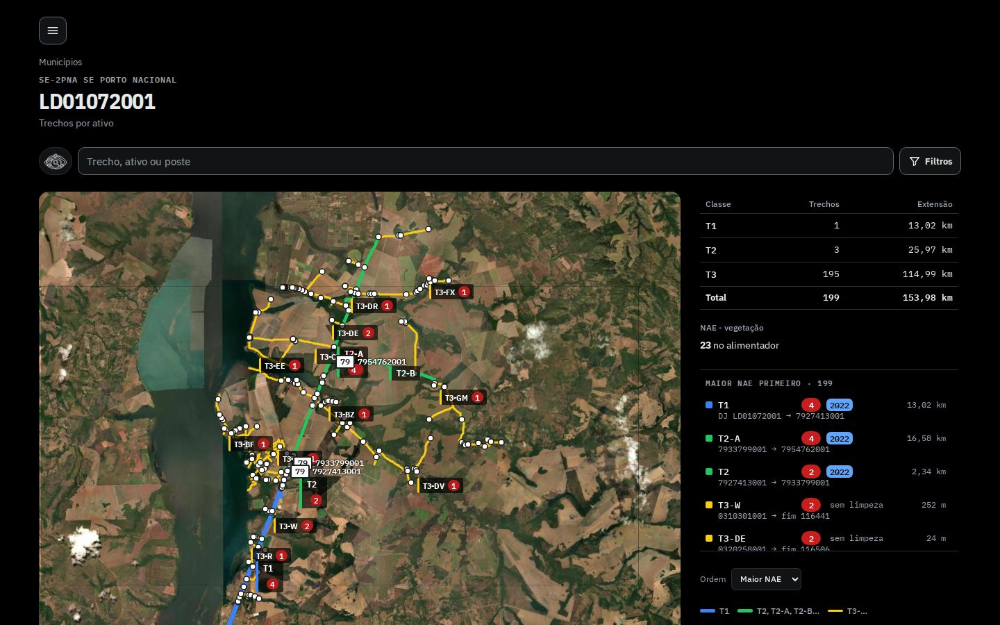 | 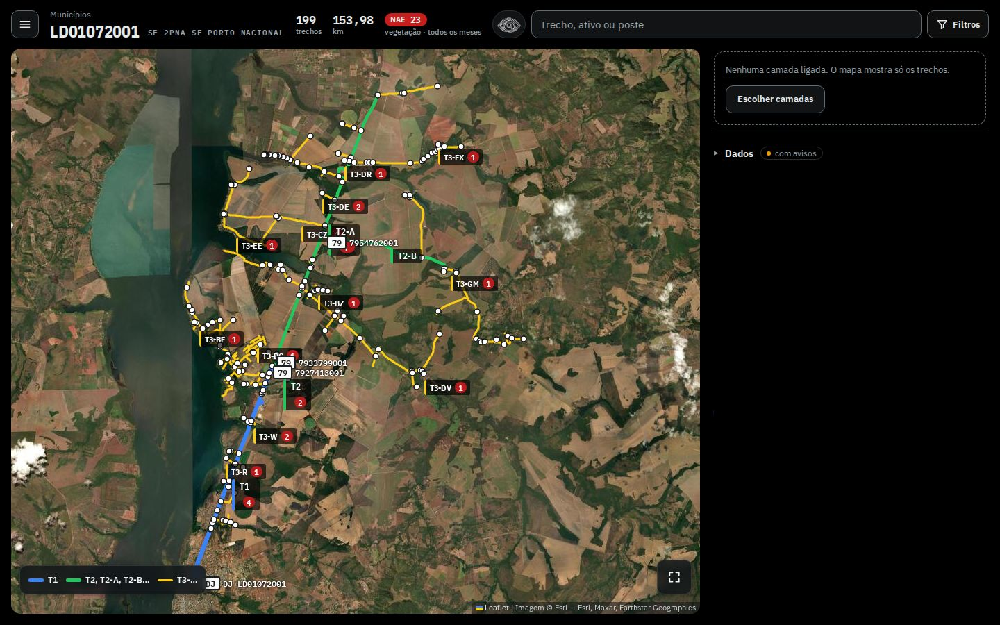 |
| 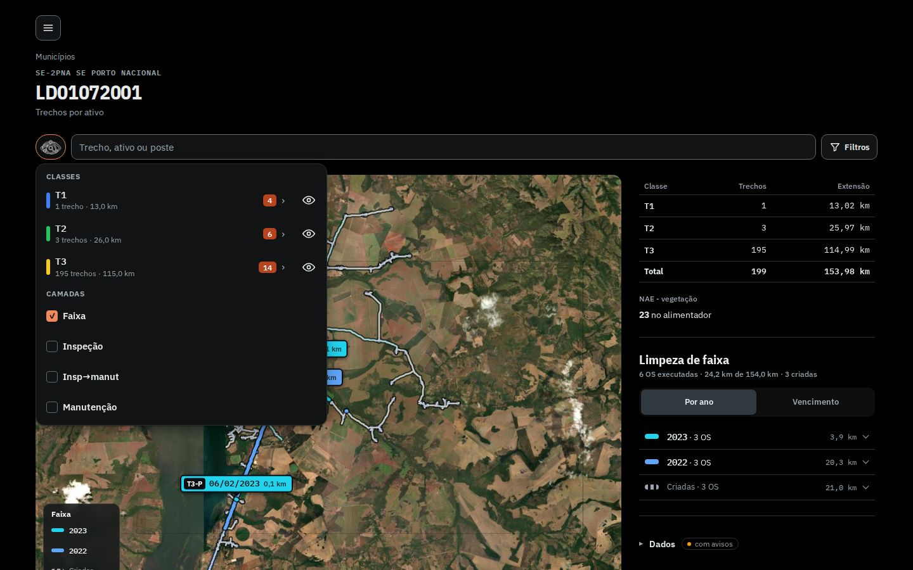 | 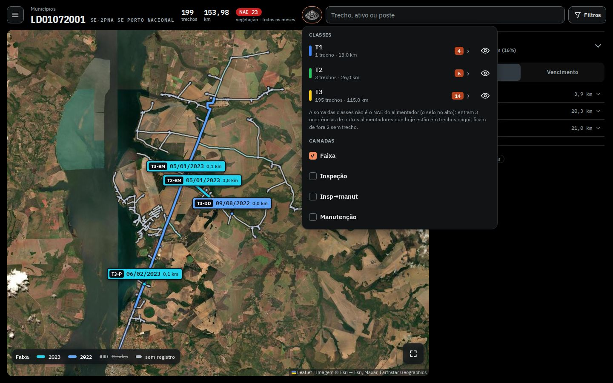 |
| 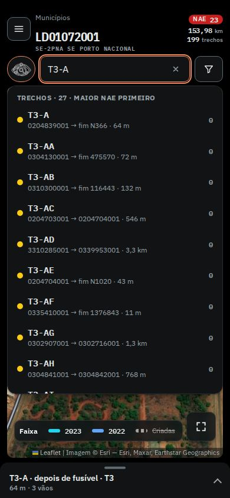 | 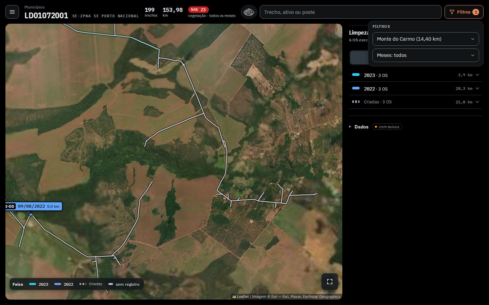 |

**Arquivos.** `alimentador/site/lupa-painel.js` (R2-a e R2-b: `proto/lupa-painel.diff`, cerca de 80 linhas); `alimentador/site/extras.js` (`ordena()`: o painel não monta mais `#lista` nem "Ordem"; o `.ativo-hit` vira só a fonte dos achados); CSS.
**Risco.** Sai a escolha de ordem da lista (Maior NAE / Menor NAE / T1›T2›T3): a classe aberta da lupa é sempre "maior NAE primeiro" e o resultado da busca segue a ordem guardada no navegador; se fizer falta, vai como opção dentro dos Filtros. `aria-live` do resultado (hoje o `.ativo-hit` anunciava os achados) ainda não foi feito: na lupa ele precisa de `role="listbox"` ou região viva com cuidado para não ler a lista toda a cada tecla.

### Sugestão 3 · Camadas em acordeão; legendas em linha, recolhíveis no celular; legenda das classes só quando aparece  (esforço M, risco médio)
**Problema.** Com a lupa ligando as camadas, o painel com as 4 ligadas passa a ter **1.528 px** (4 cartões abertos) e a coluna de legendas sobre o mapa tem **598 px** no desktop e **386 px** no celular; cada ano/situação aparece na legenda e de novo no cartão. Insp→manut repete 3 vezes os mesmos números (subtítulo, linha do alimentador na tabela e as 3 linhas Vencidas/No prazo/Executadas). A legenda de cores das classes (T1/T2/T3) agora só existe dentro do painel, escondido pela lupa. Antes: `antes/lupa-LD01072001-d-camadas.jpg`, `antes/lupa-LD01072001-m-camadas.jpg`.

**Proposta.**
- Cada cartão vira uma linha de acordeão (título + o resumo que já existe); abre um por vez, e **ligar a camada na lupa abre o cartão dela** (e fecha o outro). O painel mostra as 4 camadas e o "Dados" de uma vez.
- Insp→manut aberto: o subtítulo some e a tabela vira **só a linha do polo** ("No polo Porto Nacional (30 alimentadores): 107 vencidas · 316 no prazo · 264 executadas"), o único dado novo; as 3 linhas (que também ligam e desligam no mapa) ficam.
- Subtítulo dos cartões sem repetir o cabeçalho: "24,2 km de 154,0 km" (a extensão total do cabeçalho em outra precisão) vira **"24,2 km (16%)"** (aritmética dos dois números que a página já mostra) e o "· 3 criadas" só aparece com o cartão fechado (aberto, a linha "Criadas · 3 OS" já diz). Em `limpeza.js`/`inspecao.js` seria trocar o texto na origem.
- Legendas do mapa em linha (cor + nome, sem números; os números ficam no cartão): 598 → 156 px. No celular, com 2 ou mais legendas, um botão **"Legendas (4)"** recolhe a coluna (≈ 215 px do mapa de volta); com 1 legenda não aparece.
- A **legenda das classes** (a original do painel, `#legenda`) sobe para o canto do mapa e só aparece quando nenhuma camada de linha (Faixa, Inspeção) pinta o trecho de outra cor: sem camada ou só com Insp→manut/Manutenção.

**Como fica.** `depois/LD01072001-d-camadas.jpg`, `depois/LD01072001-m-camadas.jpg` (legendas recolhidas: "Legendas 4"), `depois/LD01072001-d-insp-manut.jpg`, `depois/LD01072001-d-sem-faixa.jpg`, `depois/AL03037009-d-camadas.jpg` (4 cartões num painel de 814 px), `depois/LD01072001-d-lupa.jpg` (camadas na lupa).

| antes (site + lupa) | depois (consolidado) |
|---|---|
| 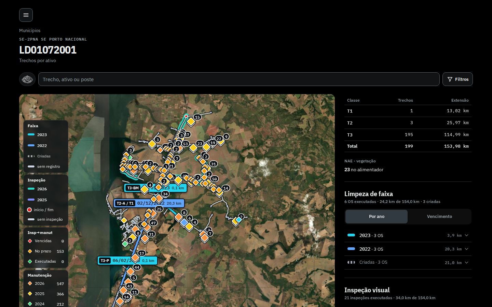 | 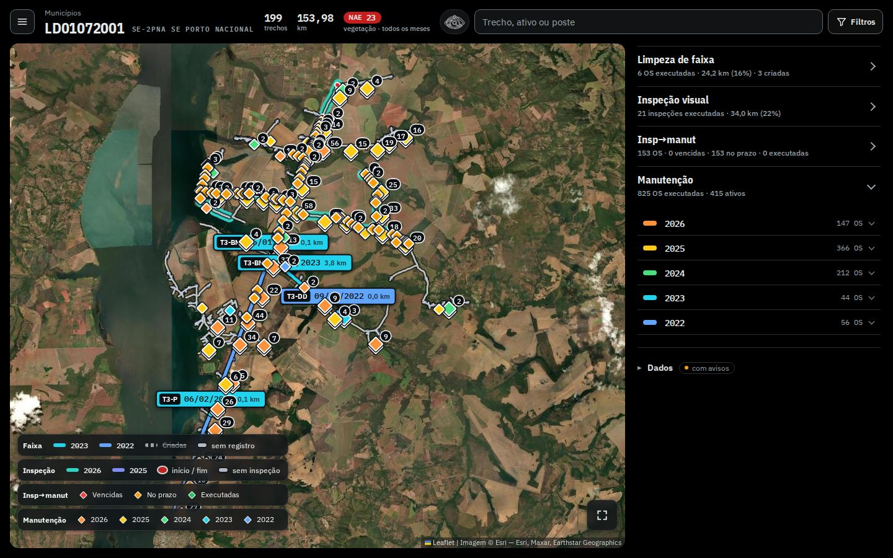 |
| 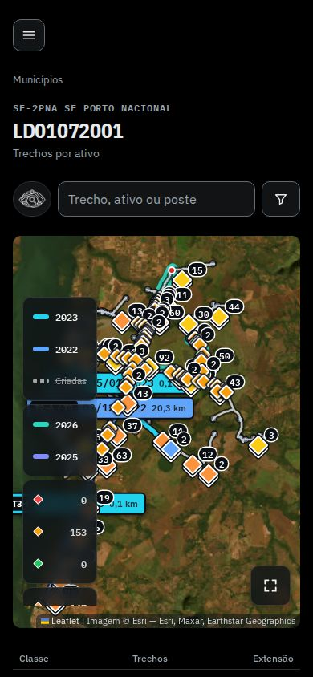 | 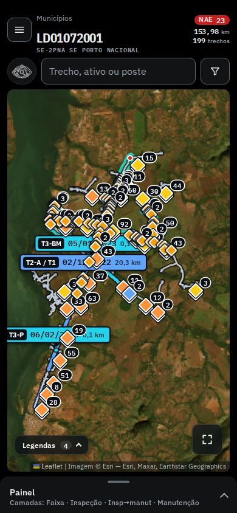 |
| 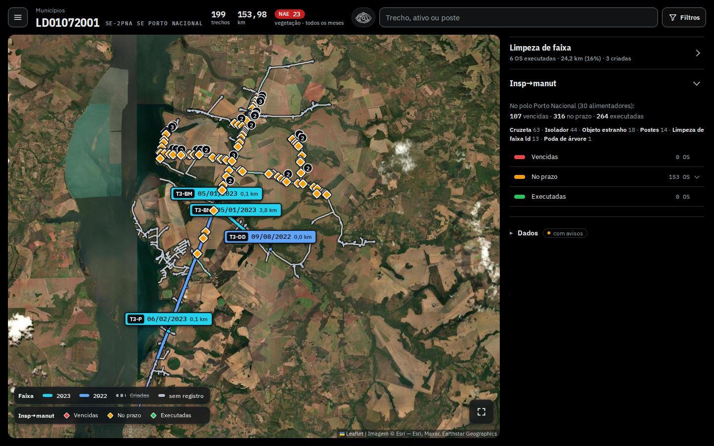 | 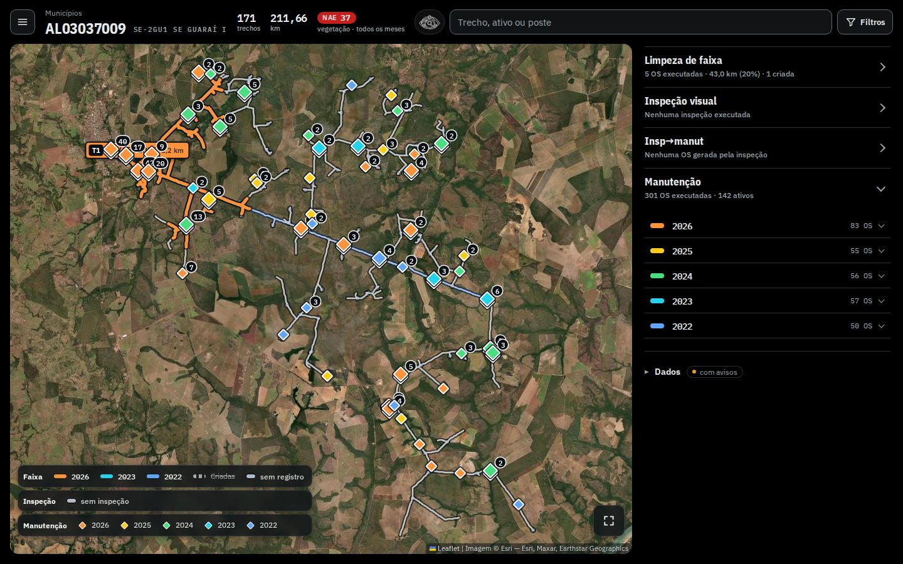 |

**Arquivos.** CSS; `alimentador/site/limpeza.js`, `inspecao.js`, `manutencao.js`, `executadas.js` (a marcação `.limp-top` e o gancho do acordeão; o subtítulo do Insp→manut); `extras.js` (coluna `.ctl-lgs`, `#legenda`).
**Risco.** O cartão refaz o próprio HTML: o protótipo reaplica o gancho com `MutationObserver`; na versão real, melhor cada camada já entregar o cartão com `role=button`. Os títulos dos cartões ("Limpeza de faixa", "Inspeção visual") ainda diferem dos nomes do Menu/lupa ("Faixa", "Inspeção"); unificar fica para quando se mexer nos 4 scripts.

### Sugestão 4 · Trecho escolhido: ficha curta + abas (NAE · Faixa · Inspeção · Insp→manut · Manutenção); cartões do alimentador recolhidos embaixo  (esforço M, risco baixo)
**Problema.** Escolhendo o T2-A com as camadas ligadas, o painel passa a ter **11.409 px** de conteúdo (NAE, Insp→manut e Manutenção empilhadas) e, depois dela, ainda vêm os cartões do alimentador inteiro, que dizem coisa diferente (alimentador × trecho). Antes: `antes/lupa-LD01072001-d-trecho.jpg`, `antes/lupa-LD01072001-m-trecho.jpg`.

**Proposta.** Ficha fixa (nome, tipo, início, fim, extensão, fases, vem de, derivações) e, embaixo, uma fileira de abas com contagem: **NAE 4 · Faixa 2 · Inspeção 5 · Insp→manut 46 · Manutenção 60**; a aba aberta mostra a lista que já existe, só ela (← → trocam; a escolhida é lembrada ao trocar de trecho; abas vazias ficam apagadas, NAE 0 sem pílula vermelha). O título "NAE - vegetação" some dentro da aba NAE (a aba já diz). Com trecho escolhido os cartões das camadas ficam **recolhidos sob o título "Camadas · alimentador inteiro"** e voltam como estavam ao limpar o trecho.

**Como fica.** `depois/LD01072001-d-trecho.jpg`, `depois/LD01072001-m-trecho.jpg`, `depois/LD02022033-d-trecho.jpg`, `depois/AL01015049-d-trecho.jpg`, `depois/AL03037009-d-trecho.jpg`; claro: `depois/claro-LD01072001-d-trecho.jpg`, `depois/claro-LD02022033-m-trecho.jpg`. 11.409 px → 1.158 px.

| antes (site + lupa) | depois (consolidado) |
|---|---|
| 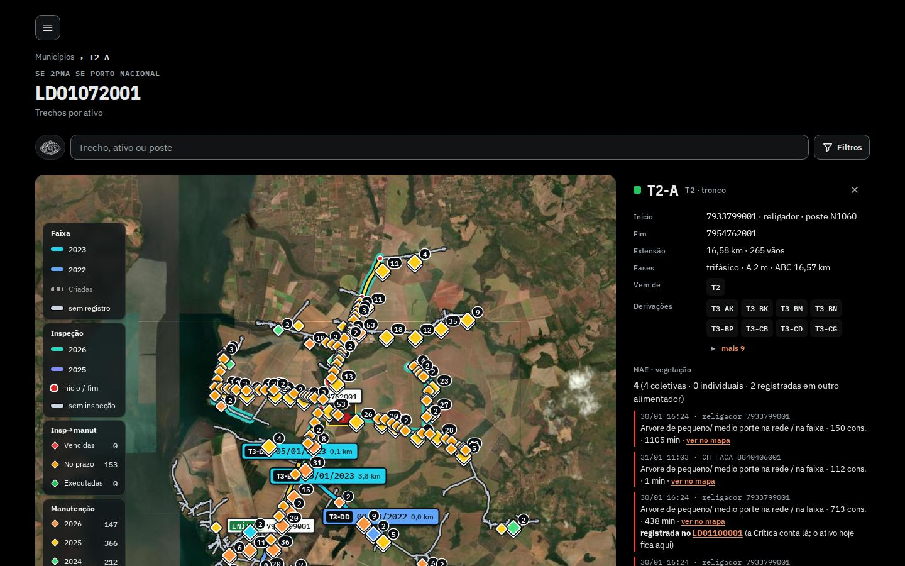 | 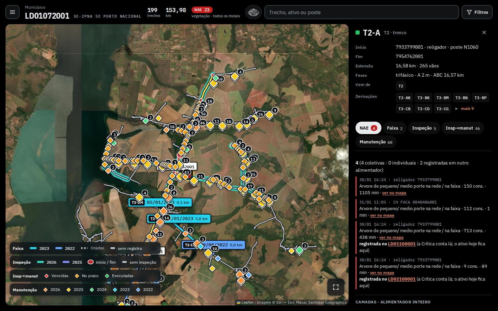 |
| 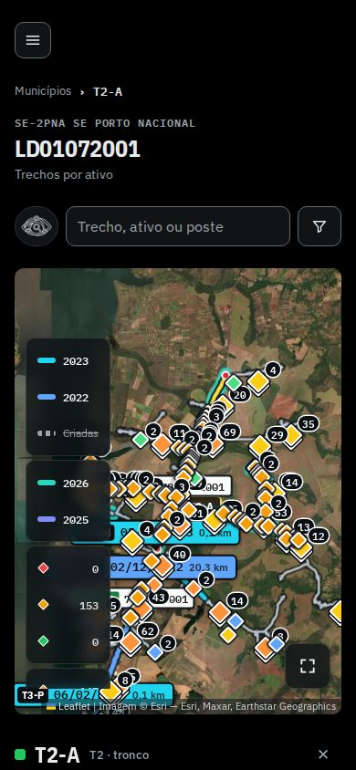 | 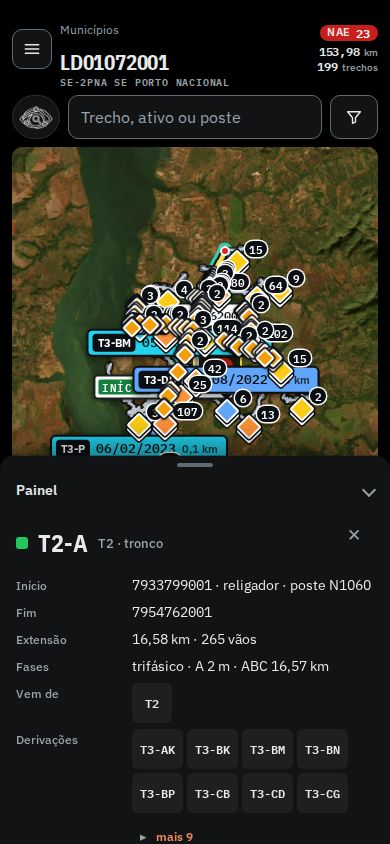 |

**Arquivos.** `alimentador/mapa_trechos.html` (`detalhe()`/`detalheVarios()`: separar o bloco NAE do `<dl>`); `limpeza.js`, `inspecao.js`, `manutencao.js`, `executadas.js` (cada `section.limp-sec` já é um grupo); `extras.js` (`ordena()`).
**Risco.** As seções de camada entram depois da primeira pintura do detalhe: o protótipo reconstrói as abas ao notar (MutationObserver); na versão real, melhor as camadas entregarem a seção a uma função única.

### Sugestão 5 · Celular: mapa na tela quase inteira e painel numa gaveta inferior  (esforço G, risco médio; depende da 1)
**Problema.** No celular, com a lupa, a primeira tela ainda é cabeçalho de 3 linhas + barra + mapa de 490 px; o resumo, as camadas e o detalhe ficam abaixo (a página rola 594 px; com um trecho escolhido, o painel passa de 11.965 px) e só se veem rolando. Antes: `antes/lupa-LD01072001-m-inicial.jpg`, `antes/lupa-LD01072001-m-trecho.jpg`, `antes/lupa-LD01072001-m-camadas.jpg`.

**Proposta.** A página tem a altura da tela; o mapa ocupa tudo entre a barra da lupa e uma faixa de 60 px no pé: a **gaveta**. Fechada, a faixa diz "Painel · Camadas: Faixa" (ou, com trecho escolhido, "T2-A · T2 · tronco · 16,58 km · 265 vãos"); aberta, diz só "Painel" (a ficha está logo embaixo: nada repetido). Toque ou arraste a abre em 46% ou 88% da altura. **Escolher um trecho** no resultado da lupa (ou no mapa) sobe a gaveta sozinha até a ficha, **menos enquanto o campo de busca está em foco** (digitar não abre a gaveta por baixo da lista); o mapa **enquadra o trecho na parte que a gaveta não cobre** (`fitBounds` com folga embaixo). A lupa abre por cima da gaveta. Tela cheia continua com a gaveta lateral atual (com a barra e o resumo no alto dela).

**Como fica.** `depois/LD01072001-m-inicial.jpg`, `depois/LD01072001-m-gaveta.jpg`, `depois/LD01072001-m-trecho.jpg`, `depois/LD01072001-m-camadas.jpg`, `depois/LD01072001-m-lupa.jpg`, `depois/LD01072001-m-classe.jpg`, `depois/LD01072001-m-busca.jpg`, `depois/LD01072001-m-filtros.jpg`, `depois/LD01072001-m-tela-cheia-gaveta.jpg`; grande: `depois/LD02022033-m-trecho.jpg`; pequeno: `depois/AL01015049-m-inicial.jpg`; claro: `depois/claro-LD01072001-m-lupa.jpg`, `depois/claro-LD01072001-m-trecho.jpg`.

| fechada | aberta (46%) | trecho escolhido | lupa por cima |
|---|---|---|---|
|  | 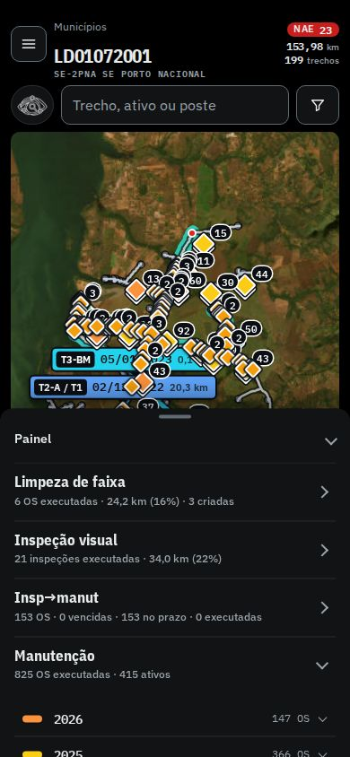 | 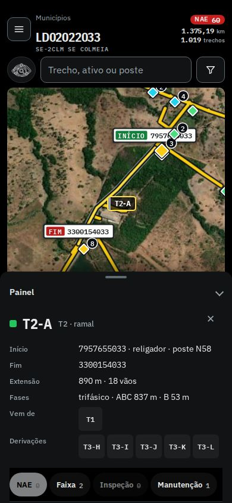 | 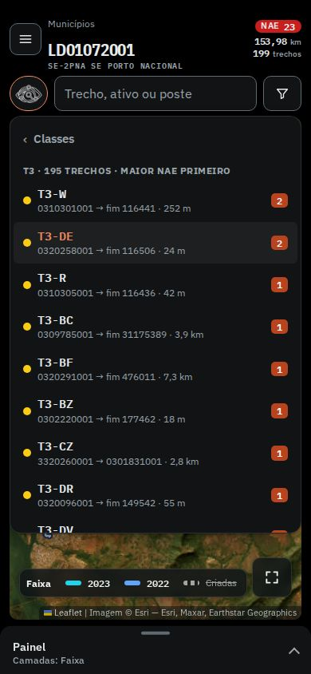 |

**Arquivos.** CSS de `mapa_trechos.html` (`.panel` fixo, `.sheet-h`); trecho novo em `extras.js` (estado peek/meio/cheio, arrastar, rótulo, `fitBounds`); `telacheia.js` (a gaveta lateral continua; o `.panel` precisa de uma regra para não acumular os dois comportamentos).
**Risco.** **Não testado em aparelho real:** o arrastar por dedo (usa pointer events) e a barra de endereço do iOS (por isso `dvh`). O foco por teclado precisa abrir a gaveta (o protótipo marca o conteúdo fechado como `inert`). A legenda com um só item e sem anos (AL01015049) fica só com o título "Faixa": melhor esconder a legenda sem linhas.

---

## Dado → onde aparece (zero repetição)

"Hoje" = site ao vivo; "Com a lupa" = site + proposta da lupa; "Consolidado" = protótipo. Valores de `LD01072001`. **Negrito** = o único lugar do dado no consolidado.

| # | Dado | Hoje (site ao vivo) | Com a lupa | **Consolidado: único lugar** |
|---|---|---|---|---|
| 1 | Código do alimentador | título (h1) · `<title>` · 1ª linha da tabela do Insp→manut | igual | **cabeçalho (h1)** · `<title>`; a tabela do Insp→manut perde a linha do alimentador (eram as mesmas 3 linhas) |
| 2 | Subestação (SE-2PNA…) | sobretítulo | igual | **cabeçalho**, ao lado do código |
| 3 | Caminho Municípios › município | cabeçalho | igual | **cabeçalho** (o trecho escolhido sai do caminho: está na ficha) |
| 4 | "Trechos por ativo" | subtítulo · `<title>` | igual | **só `<title>`** |
| 5 | Nº total de trechos (199) | tabela (linha Total) | tabela | **resumo do cabeçalho** |
| 6 | Extensão total (153,98 km) | tabela (Total) · "x de 154,0 km" em Faixa e Inspeção · Dados › municípios · seletor Município | igual | **resumo do cabeçalho**; os subtítulos dos cartões passam de "24,2 km de 154,0 km" para "24,2 km (16%)" |
| 7 | Trechos e km por classe (T1 1 · 13,02 km…) | tabela · botões T1/T2/T3 no mapa (sem números) | tabela **e** lupa (nº · km) | **lupa (classes)**; na tela cheia, onde a lupa vai para a gaveta, os botões T1/T2/T3 voltam ao mapa com nº · km |
| 8 | NAE do alimentador (23) | bloco "23 no alimentador" no painel | bloco **e** lupa (pílulas por classe: soma 24) | **selo do cabeçalho**; a lupa só explica a diferença (nota R2-b) |
| 9 | Período do NAE (meses) e "Contar individuais" | botão Meses (barra) | Filtros | **Filtros** (o controle); o selo do cabeçalho mostra o período atual |
| 10 | Município (filtro) | seletor (barra) | Filtros | **Filtros**; agora também enquadra o mapa |
| 11 | NAE por classe | — | lupa | **lupa** |
| 12 | Cores das classes | legenda (painel, junto da lista) · botões coloridos no mapa | barra colorida na lupa · legenda (painel) | **legenda no mapa** (só sem Faixa/Inspeção) · a barra colorida da lupa marca a linha de controle |
| 13 | Lista de trechos (nome, início → fim, km, NAE) | painel (`#lista` + "Ordem") | painel **e** lupa (classe aberta) | **lupa** (classe aberta e resultado da busca) |
| 14 | Achados da busca (ativo, trecho) | caixa solta entre a barra e o mapa · lista do painel | igual | **lupa** (resultado) |
| 15 | Camadas ligadas (liga/desliga) | Menu do mapa · legenda · cartões | lupa (caixas) · legenda · cartões | **lupa** (liga a camada, abre o cartão dela); o cartão só tem dados |
| 16 | Anos e situações de cada camada (cor, nome) | legenda do mapa (com contagens) **e** linhas do cartão (com contagens) | igual | legenda (cor + nome, **sem números**) e **linhas do cartão** (OS e km) |
| 17 | Contagens da camada (OS, km, "3 criadas") | legenda · subtítulo · linhas | igual | **subtítulo (cartão fechado) ou linhas (aberto)**; legenda sem números |
| 18 | Insp→manut: 153 no prazo / 0 / 0 | legenda · subtítulo · tabela (alimentador) · 3 linhas | igual | **as 3 linhas**; a tabela vira só a linha do polo (107 / 316 / 264) |
| 19 | Nome das camadas | 4 nomes (Menu, cartão, ficha, Downloads) | igual | Menu = lupa = abas = legendas; o cartão ainda usa o nome longo (**pendente**) |
| 20 | Trecho escolhido (T2-A) | caminho · h2 · linha da lista · rótulo no mapa | caminho · h2 · rótulo | **ficha (h2)** e rótulo no mapa; no celular, também o rótulo da gaveta fechada |
| 21 | Início e Fim do trecho | ficha **e** marcadores no mapa | igual | **ficha (texto)** e **mapa (lugar)** |
| 22 | NAE do trecho (4) | rótulo no mapa · pílula na lista · ficha | rótulo · pílula (lupa) · ficha | rótulo (lugar) · pílula da lupa (índice para escolher) · **aba NAE** (as ocorrências) |
| 23 | OS por camada do trecho (Faixa 2, Inspeção 5, Insp→manut 46, Manutenção 60) | seções empilhadas na ficha | igual | **abas** (uma por vez, com a contagem) |
| 24 | Controles de busca, município e meses | painel + barra | barra | **lupa** (olho · campo · Filtros) |
| 25 | Regra T1/T2/T3 · "Fim do trecho" · Croqui · KMZ · Downloads · procedência | Dados | igual | **Dados** (sem mudança) |


### Contagem automática
`repeticoes.js` junta o texto visível na janela (sem o que está rolado para fora do painel nem os rótulos do próprio mapa) e conta em quantos blocos cada dado aparece ao mesmo tempo, em 4 estados (inicial, lupa aberta, 4 camadas, trecho escolhido), no site com a lupa e no consolidado, desktop e celular. Resultado completo: `repeticoes.json`.

Formato "com a lupa → **consolidado**" (desktop; entre parênteses, celular). **Máximo de vezes que um mesmo dado aparece ao mesmo tempo: 3 com a lupa, 1 no consolidado** (em todos os estados e nos dois tamanhos de tela). No celular, 0 = fora da janela: na base os totais ficam na tabela, abaixo da dobra; no consolidado estão no cabeçalho.

| dado (vezes visível ao mesmo tempo) | inicial (Faixa ligada) | lupa aberta | 4 camadas | T2-A escolhido | sem camada + classe T1 aberta |
|---|---|---|---|---|---|
| extensão total do alimentador (153,98 km, ou 154,0 km nos subtítulos) | 2 → **1** (cel.: 0 → **1**) | 2 → **1** (cel.: 0 → **1**) | 3 → **1** (cel.: 0 → **1**) | 0 → **1** (cel.: 0 → **1**) | 1 → **1** (cel.: 0 → **1**) |
| nº total de trechos (199) | 1 → **1** (cel.: 0 → **1**) | 1 → **1** (cel.: 0 → **1**) | 1 → **1** (cel.: 0 → **1**) | 0 → **1** (cel.: 0 → **1**) | 2 → **1** (cel.: 0 → **1**) |
| subestação (SE-… NOME) | 1 → **1** (cel.: 1 → **1**) | 1 → **1** (cel.: 1 → **1**) | 1 → **1** (cel.: 1 → **1**) | 0 → **1** (cel.: 0 → **1**) | 1 → **1** (cel.: 1 → **1**) |
| código do alimentador (título, ou célula da tabela) | 1 → **1** (cel.: 1 → **1**) | 1 → **1** (cel.: 1 → **1**) | 1 → **1** (cel.: 1 → **1**) | 1 → **1** (cel.: 1 → **1**) | 1 → **1** (cel.: 1 → **1**) |
| "Trechos por ativo" | 1 → **0** (cel.: 1 → **0**) | 1 → **0** (cel.: 1 → **0**) | 1 → **0** (cel.: 1 → **0**) | 1 → **0** (cel.: 1 → **0**) | 1 → **0** (cel.: 1 → **0**) |
| T1: extensão (13,02 km / 13,0 km) | 1 → **0** (cel.: 1 → **0**) | 2 → **1** (cel.: 2 → **1**) | 1 → **0** (cel.: 1 → **0**) | 0 → **0** (cel.: 0 → **0**) | 3 → **1** (cel.: 2 → **1**) |
| T2: extensão (25,97 km / 26,0 km) | 1 → **0** (cel.: 0 → **0**) | 2 → **1** (cel.: 1 → **1**) | 1 → **0** (cel.: 0 → **0**) | 0 → **0** (cel.: 0 → **0**) | 1 → **0** (cel.: 0 → **0**) |
| T3: nº de trechos (195) | 1 → **0** (cel.: 0 → **0**) | 2 → **1** (cel.: 1 → **1**) | 1 → **0** (cel.: 0 → **0**) | 0 → **0** (cel.: 0 → **0**) | 1 → **0** (cel.: 0 → **0**) |
| T3: extensão (114,99 km / 115,0 km) | 1 → **0** (cel.: 0 → **0**) | 2 → **1** (cel.: 1 → **1**) | 1 → **0** (cel.: 0 → **0**) | 0 → **0** (cel.: 0 → **0**) | 1 → **0** (cel.: 0 → **0**) |
| linha do trecho T1 (nome … → fim) | 0 → **0** (cel.: 0 → **0**) | 0 → **0** (cel.: 0 → **0**) | 0 → **0** (cel.: 0 → **0**) | 0 → **0** (cel.: 0 → **0**) | 2 → **1** (cel.: 1 → **1**) |
| NAE do alimentador (23) | 1 → **1** (cel.: 0 → **1**) | 1 → **1** (cel.: 0 → **1**) | 1 → **1** (cel.: 0 → **1**) | 0 → **1** (cel.: 0 → **1**) | 1 → **1** (cel.: 0 → **1**) |


### O que ainda repete (e por quê)
Resolvido no protótipo: o "154,0 km" dos subtítulos (vira %), o "3 criadas" (some com o cartão aberto), a tripla repetição do Insp→manut (3 linhas + polo), a tabela de classes, o NAE do painel, a lista de trechos, a legenda de cores e os achados soltos. Sobra só o que tem função diferente:
- **Cor de cada classe**: a barra colorida da linha na lupa e a legenda no mapa (identificar a linha de controle × decifrar o mapa).
- **Anos/situações das camadas ligam e desligam em dois lugares** (legenda do mapa e linha do cartão): a mesma ação em dois pontos de uso; a legenda ficou sem números.
- **NAE por trecho** no rótulo do mapa (lugar), na pílula da lupa (índice para escolher) e na aba NAE da ficha (as ocorrências): três funções.
- **Início/Fim do trecho** na ficha (texto) e nos marcadores do mapa (lugar).
- **Nome do DJ** (`DJ LD01072001`) na linha do trecho T1 da lupa e no código do alimentador: é o nome do ativo, que por acaso é igual ao do alimentador.
- **Nomes das camadas**: lupa, abas e legendas usam os do Menu; os títulos dos cartões ("Limpeza de faixa", "Inspeção visual") continuam longos (os cartões refazem o próprio HTML; unificar quando se mexer nos 4 scripts).

## Achados fora das sugestões
- A conta da NAE por classe não fecha com o total em 3 dos 4 alimentadores (ver Sugestão 2). A causa é a definição: `contagem()` soma `doExt()` (ocorrências de outro alimentador que hoje caem aqui) e deixa de fora as sem trecho. A nota explica; um dia vale decidir se as classes devem somar o mesmo total.
- A lupa mostra "NAE" por classe com o filtro de município e o de meses; o resumo do cabeçalho só com o de meses. Intencional (o cabeçalho é do alimentador), mas precisa estar escrito em algum lugar (título do selo já diz "no alimentador").
- A **Croqui da faixa** continua em Dados › Downloads (3 cliques). Fora do escopo desta rodada; candidato a botão ao lado do cartão da Faixa.
- Camadas sem dado (Inspeção em `AL03037009`, Faixa em `AL01015049`): o cartão aparece com "0"/"Nenhuma…"; melhor esconder a camada vazia da lupa ou marcá-la "sem dados".

## O que foi mudado em `lupa-painel.js`
Duas partes, marcadas com `R2-a` e `R2-b` no código (`proto/lupa-painel.diff`; original em `proto/original/lupa-painel.orig.js`): modo busca da lista suspensa (+ teclado) e a nota da NAE. Nada mais: classes, camadas, Filtros e tela cheia são o código da outra sessão.

## Como reproduzir
```
cd /home/user/smartled/melhorias-noite/rodada-2/tema-4-painel
export NODE_USE_ENV_PROXY=1 NODE_EXTRA_CA_CERTS=/root/.ccr/ca-bundle.crt
node prints.js lupa        --alim=LD01072001 --estados=inicial,lupa,camadas,trecho   # antes/  (site + lupa da outra sessão)
node prints.js consolidado --alim=LD01072001 --estados=inicial,lupa,classe,filtros,camadas,sem-faixa,insp-manut,busca,trecho,tela-cheia,tela-cheia-gaveta,municipio,gaveta
node prints.js claro       --alim=LD01072001 --estados=inicial,trecho                 # tema claro
node prints.js consolidado --alim=LD01072001 --vp=t,n,p --estados=inicial,trecho      # 1024, 1280 e 360×640 (só conferem o cabeçalho)
node metricas.js           # metricas.json (lupa × consolidado, 4 alimentadores)
node repeticoes.js         # repeticoes.json (contagem de dados repetidos na tela)
node testes.js --alim=LD01072001 --out=testes-LD01072001.json   # interações, desktop e celular (um arquivo por alimentador)
```
O HTML da página do alimentador é reescrito na resposta (`page.route`): ganha `<style>` e `<script>` do protótipo e `lupa-painel.js` (que o site ao vivo ainda não publica). As respostas de rede passam pelo `fetch` do Node porque o Chromium daqui não confia na CA do proxy. Flags de teste: `window.__PROTO = {a:0, …}` desliga um bloco do `painel.js` (a resumo, b botões da tela cheia, c painel enxuto, d legendas, e acordeão, f abas, g gaveta, h município).

Arquivos: `antes/` (site + lupa), `depois/` (consolidado; prefixo `claro-` = tema claro), `proto/lupa-painel.js`, `proto/painel.css`, `proto/painel.js`, `proto/lupa-painel.diff`, `proto/original/`, `prints.js`, `metricas.js`/`metricas.json`, `repeticoes.js`/`repeticoes.json`, `testes.js`/`testes-*.json`, `resumo.json`.
