# Tema 5 · Fluidez e acabamento (rodada 2)

## Resumo

1. Medido de novo sobre o /teste/ de hoje (design novo + busca integrada). A animação da página inicial ficou com a outra sessão e não foi tocada. Foco: Tab/leitor de tela, CLS, alvos de toque e a **página do alimentador** (LD02022033, a maior: 1.019 trechos, 16.184 vãos, dados.js de 1,8 MB).
2. **Página do alimentador é a mais pesada do site**: TBT de 1,0 s (computador) a 7 s (celular lento), 9.096 nós (8.153 só na lista de trechos), 3 camadas de 16 mil vãos redesenhadas a cada zoom (52.548 anéis no canvas). Protótipo: estilo+layout da carga **714 → 426 ms** (CPU 4x: 4.313 → 2.349 ms), TBT **6,7 s → 3,8 s** (CPU 4x), redesenho a cada zoom **149 → 56 ms** (CPU 4x), pinça no celular 30 → 44 fps.
3. **CLS**: o ☰ do menu.js ainda empurra a página 64 px depois do 1º quadro em **todas** as páginas, e os cartões Norte/Centro/Sul nascem em (0,0). Com 2 regras de CSS e 1 linha de JS: início **0,059 → 0,0002**, ranking **0,037 → 0,0001**, alimentador **0,058 → 0**.
4. **Tab/leitor de tela**: 3 cartões invisíveis ainda no Tab, a lupa duplica o campo de busca, o Tab dentro da busca para na caixa de resultados (área rolável) e **nenhum nível do mapa é anunciado** (ao abrir um município o leitor lê 1.112 caracteres da lista inteira). Protótipo: 0 paradas invisíveis, 1 a 5 paradas a menos por nível, aviso curto (73 a 108 caracteres) a cada nível. **Alvos de toque**: 5 a 10 abaixo de 44 px por nível no celular (30 na página do alimentador) → 0 (1 exceção: o link "Leaflet" da atribuição).
5. Não era problema: console limpo; o ranking já carrega em 0,2 s (só 5 requisições); foco visível presente em todas as paradas do Tab.

**Sugestão nº 1 recomendada: página do alimentador (sugestão 1).** É onde o usuário realmente espera e vê engasgo (zoom, carga em celular). A sugestão 2 (CLS) é a de melhor custo-benefício (3 linhas) e pode sair no mesmo dia.

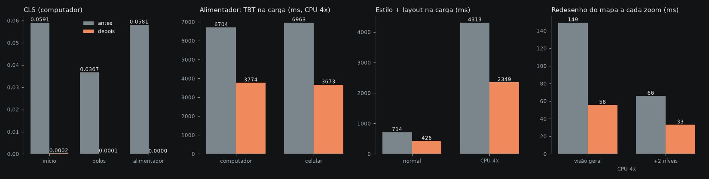

---

## Medições (antes → depois do protótipo)

Detalhe completo em `medicoes/tabelas.md`. Mediana de 3 execuções, Chromium + CDP sobre espelho local (ver "Como medi"). Perfis: normal, CPU 4x, CPU 4x + 4G lenta.

### CLS por página (computador / celular)

| Página · perfil | CLS antes | CLS depois |
|---|---|---|
| início · computador (qualquer perfil) | 0,0591 | 0,0001 a 0,0003 |
| início · celular | 0 a 0,0006 | 0 a 0,0006 |
| ranking (polos/) · computador, normal e CPU 4x | 0,037 a 0,038 | 0,0001 |
| ranking · computador, 4G lenta | 0,049 | 0,0105 |
| ranking · celular, CPU 4x | 0,0585 | 0,0002 |
| ranking · celular, 4G lenta | 0,294 | 0,144 (troca de fonte, ver limites) |
| alimentador · computador (qualquer perfil) | 0,055 a 0,058 | 0 a 0,0009 |
| alimentador · celular, normal e CPU 4x | 0,059 a 0,062 | 0 |
| alimentador · celular, 4G lenta | 0,062 | 0,036 |

### Página do alimentador LD02022033 (carga)

| Dispositivo · perfil | Mapa e lista prontos (ms) | LCP (ms) | TBT (ms) | Maior long task (ms) |
|---|---|---|---|---|
| computador · normal | 753 → 616 | 1.524 → 1.036 | 966 → 469 | 345 → 239 |
| computador · CPU 4x | 3.924 → 2.211 | 4.016 → 2.632 | 6.704 → 3.774 | 1.791 → 795 |
| computador · CPU 4x + 4G lenta | 6.522 → 5.307 | 7.856 → 5.736 | 6.814 → 4.134 | 1.837 → 901 |
| celular · normal | 712 → 537 | 1.532 → 896 | 1.013 → 386 | 390 → 182 |
| celular · CPU 4x | 3.173 → 2.197 | 4.332 → 2.328 | 6.963 → 3.673 | 2.185 → 752 |
| celular · CPU 4x + 4G lenta | 6.773 → 5.118 | 8.008 → 5.708 | 7.434 → 3.607 | 2.088 → 836 |

Estilo + layout durante a carga (trace, só a thread principal): **714 → 426 ms** (normal), **4.313 → 2.349 ms** (CPU 4x); Commit 178 → 70 ms. O número de nós do DOM não muda (9.096): o ganho vem de pular o layout do que está fora da vista. O TBT oscila bastante entre rodadas com a máquina compartilhada (o "antes" em CPU 4x deu 4,4 s, 6,4 s e 6,7 s em três rodadas); o tempo de estilo+layout do trace é a medida mais estável. Não comparei bytes: o protótipo é entregue sem gzip pelo Playwright (689 a 757 KB contra 634 KB).

### Página do alimentador: interação com o mapa (Leaflet), mediana de 3

| Gesto | fps antes → depois | Pior quadro (ms) |
|---|---|---|
| computador · normal · arrastar | 56,2 → 57,9 | 167 → 83 |
| computador · normal · zoom (8 cliques de roda de 100 px, dentro e fora) | 40,7 → 44,0 | 200 → 83 |
| computador · CPU 4x · zoom | 28,1 → 28,2 | 300 → 283 |
| celular · normal · pinça | 50,1 → 56,7 | 267 → 83 |
| celular · CPU 4x · pinça | 29,8 → 44,0 | 850 → 350 |
| arrastar no celular, hover nas linhas | 58 a 60 → 58 a 60 | sem mudança (já está bom) |

Redesenho da camada de linhas (o que roda a cada fim de zoom ou arrasto, `renderer._update()`, mediana de 7): normal **~37 → ~13 ms** na visão geral, **~18 → ~5 ms** a +2 níveis; CPU 4x **~145 → ~50 ms** e **~70 → ~30 ms**. Anéis (polilinhas de 2 pontos) no canvas: **52.548 → 8.104**. O zoom com CPU 4x continua em 28 fps no computador: o resto é carga de tiles e animação do navegador, não achei o que cortar só no site.

### Ranking por polos (polos/)

Carga já era boa: mapa e tabela prontos em 206 ms (normal), 755 ms (CPU 4x), 1,5 s (CPU 4x + 4G lenta); TBT de 9 a 66 ms (normal) e 426 a 706 ms (CPU 4x e CPU 4x + 4G lenta). O protótipo (formatador de números em cache) mexe pouco na carga (TBT 533 → 484 ms no celular CPU 4x, sem mudança no computador). Onde pega é a **interação**: com CPU 4x, clicar num polo, na aba ou na ordenação leva **584 ms (computador) / 496 ms (celular) → 360 / 464 ms** (Event Timing, só 6 eventos por perfil: indicativo, não definitivo).

### Teclado e leitor de tela (Tab em cada nível, computador; celular igual)

| Nível | Paradas do Tab antes → depois | Paradas invisíveis ou sem sentido antes → depois | Anúncio ao entrar antes → depois |
|---|---|---|---|
| Tocantins | 11 → 10 | 1 (lupa duplicada) → 0 | nada → "Tocantins inteiro. Regionais: Norte 3.130 NAE, Centro 1.655 NAE, Sul 963 NAE." |
| regional | 16 → 12 | 4 → 0 | nada → 82 caracteres |
| polo | 15 → 10 | 5 → 0 | nada → 73 caracteres |
| município | 15 → 10 | 4 → 0 | 1.112 caracteres (a lista de 23 alimentadores lida inteira) → 82 caracteres |
| alimentador em foco | 16 → 11 | 5 → 0 | nada → 108 caracteres |

Sequência de Tab em cada nível: `medicoes/tab-antes.log` e `medicoes/tab-depois.log`. Os números do celular são os mesmos (alguns níveis com 1 parada a mais).

### Alvos de toque no celular (390 px), elementos < 44 px, sem contar os paths de município

| Tela | Antes | Depois |
|---|---|---|
| Tocantins / regional / polo / município / alimentador em foco | 5 / 10 / 8 / 8 / 9 | 0 / 0 / 0 / 0 / 0 |
| menu aberto | 8 | 0 |
| ranking (polos/) | 12 (☰, "Municípios", 8 botões de polo, abas) | 0 |
| página do alimentador | 30 | 1 (link "Leaflet" da atribuição, texto em linha, exigido pela licença) |

Os 111 a 139 paths de município continuam menores que 44 px no estado: é a área do tema 2 (zoom por pinça). No ranking os links de alimentador têm 25 px, mas o `::after` estica o clique para a linha inteira, então não contam.

---

## Sugestão 1 (prioridade 1) · Página do alimentador: carga e zoom mais leves

**Problema.** A LD02022033 monta 1.019 linhas de trecho (8.153 nós) numa lista que mostra 7 por vez, e o layout dessa lista é refeito várias vezes durante a carga (13.700 objetos de layout nas duas primeiras passadas: 172 + 180 ms, mais 96 ms na terceira, no trace normal). Além disso, a camada Faixa desenha a rede inteira de novo (contorno escuro + cor) sobre a rede base: ao todo 52.548 anéis de 2 pontos no canvas, redesenhados a cada fim de zoom. Dois laços quadráticos pequenos (`papel()` varre os 1.019 trechos para cada um dos 1.022 fusíveis) e ~2 chamadas de `toLocaleString` com opções por linha da lista (cada uma cria um `Intl.NumberFormat`) completam. No celular com CPU 4x o TBT passa de 7 s e a pinça cai a 30 fps com quadros de 850 ms.

Antes (computador; o `menu.js` foi atrasado 4 s só para fotografar o 1º quadro, no site ele chega no fim dos 14 scripts, ~1,3 s): o ☰ entra depois e empurra tudo; o painel só aparece quando todos os scripts rodaram:


**Proposta.** Quatro ajustes pequenos, todos no código que já gera a página (`alimentador/mapa_trechos.html` para o `alimentador.js`/`.css`; `alimentador/site/limpeza.js`, `inspecao.js`, `extras.js`):

```css
/* alimentador.css: linhas fora da vista não entram no layout (a lista rola por dentro de .lista) */
.lista>.row,.lista>.grp{content-visibility:auto;contain-intrinsic-size:auto 48px}
.lista>.grp{contain-intrinsic-size:auto 32px}
```

```js
// 1) vãos em sequência (o fim de um é o começo do próximo: 13.773 de 16.184) viram UMA polilinha
//    (alimentador.js, no laço que cria as linhas; o mesmo em linhaDupla() de limpeza.js e inspecao.js)
const aneis = []; let cur = null;
vs.forEach(v => { if (cur && cur[cur.length - 1][0] === v[0] && cur[cur.length - 1][1] === v[1]) cur.push([v[2], v[3]]);
                  else aneis.push(cur = [[v[0], v[1]], [v[2], v[3]]]); });
const l = L.polyline(aneis, {color: t.cor, weight: t.peso, opacity: 1, lineCap: 'round', lineJoin: 'round'}).addTo(map);

// 2) papel() com índice por início (igual ao fimDe que já existe)
const inicioDe = {}; D.trechos.forEach(t => (inicioDe[t.inicio] = inicioDe[t.inicio] || []).push(t.nome));
const papel = nome => [...(inicioDe[nome] || []).map(n => 'início do ' + n), ...(fimDe[nome] || []).map(n => 'fim do ' + n)].join(' · ');

// 3) formatador criado uma vez (alimentador.js km/mil, limpeza.js km, extras.js km/mil, ranking-polos.js nf)
const __nf2 = new Intl.NumberFormat('pt-BR', {minimumFractionDigits: 2, maximumFractionDigits: 2});
const km = m => m < 1000 ? Math.round(m) + ' m' : __nf2.format(m / 1000) + ' km';
```

**Como fica.** Mesma imagem (conferi pixel a pixel: 0,6 a 2 % dos pixels diferem por simplificação de menos de 1 px nas linhas, nada visível), 0 erros de console, e a carga e o zoom das tabelas acima. Depois, mesmo enquadramento (1º quadro já com o lugar do ☰ guardado):


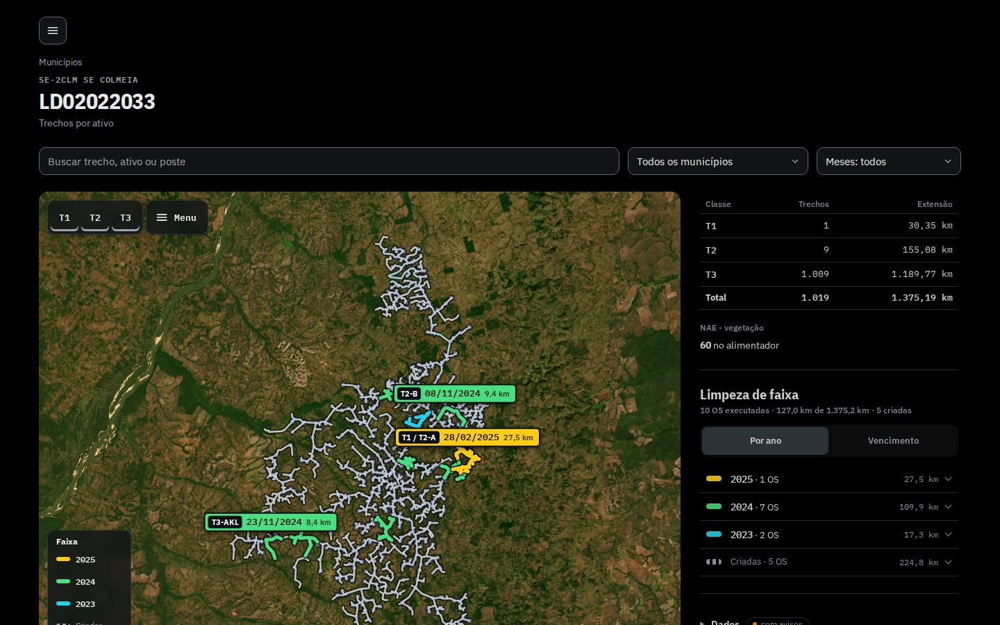

**Esforço** M (~30 linhas em 5 arquivos, mais conferir o desenho das camadas Faixa/Inspeção). **Risco** baixo a médio: `content-visibility` só tem efeito em Chrome 85+, Safari 18+ e Firefox 125+ (os outros seguem como hoje); a rolagem por `scrollIntoView` até uma linha que ainda não foi medida usa a altura estimada de 48 px (testei só a lista e a rolagem, não o foco por teclado em 1.000 linhas); a simplificação do Leaflet é de 1 px. **Não fiz:** codificar `D.vaos` em deltas (dados.js cairia só de 320 KB para ~232 KB gzip nos vãos, ~22 % do arquivo, e exige mexer no gerador) nem diferir o desenho das camadas Faixa/Inspeção/Manutenção para depois do 1º quadro: é onde está o resto do TBT (limpeza.js 120 a 180 ms, alimentador.js ~320 ms em CPU normal) e o `al-pronto` espera todos os scripts. Ficam para o tema 4 (painel).

**Arquivos:** `alimentador/mapa_trechos.html` (blocos `<style>` e `<script>` que o `gera_trechos.py` publica como `assets/alimentador.css`/`.js`), `alimentador/site/limpeza.js`, `inspecao.js`, `extras.js`. Protótipo: `proto/alimentador.js`, `limpeza.js`, `inspecao.js`, `extras.js` (cada um com `.diff`) e `proto/al-lista.css`.

---

## Sugestão 2 (prioridade 2) · Sem salto de 64 px em nenhuma página

**Problema.** O `menu.js` é o último script e monta a linha do ☰ depois do 1º quadro. Em todas as páginas o conteúdo desce 64 px (no alimentador isso é depois de ~1,3 s de página já visível). Na página inicial, os 3 cartões das regionais nascem em (0,0) e pulam para o lugar. A página inicial do celular já estava limpa; o computador, o ranking e o alimentador não.

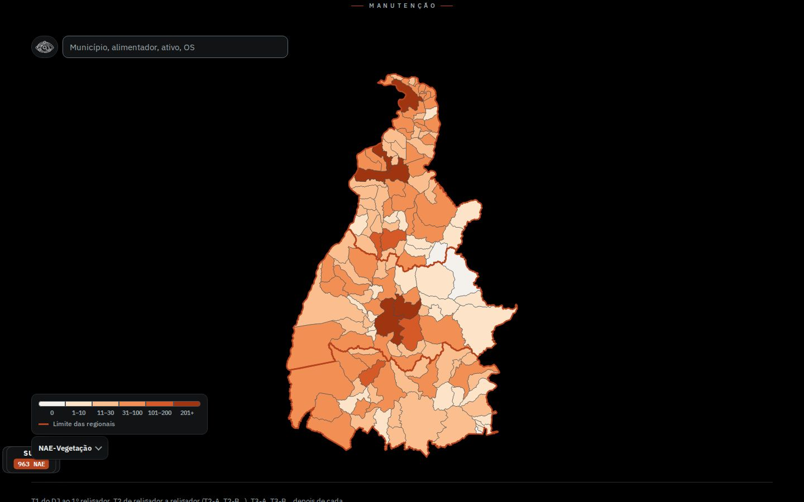
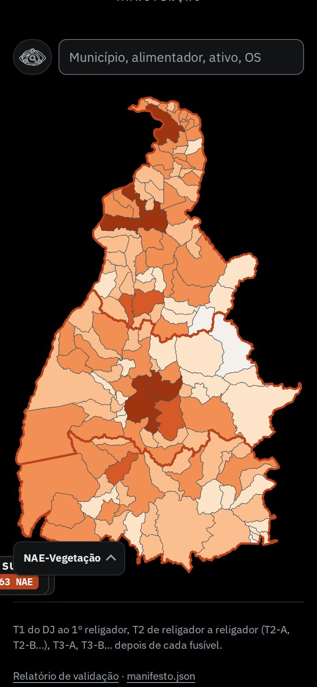
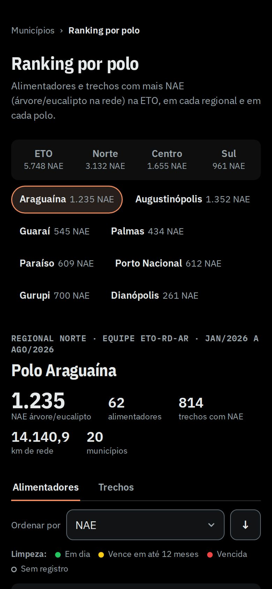
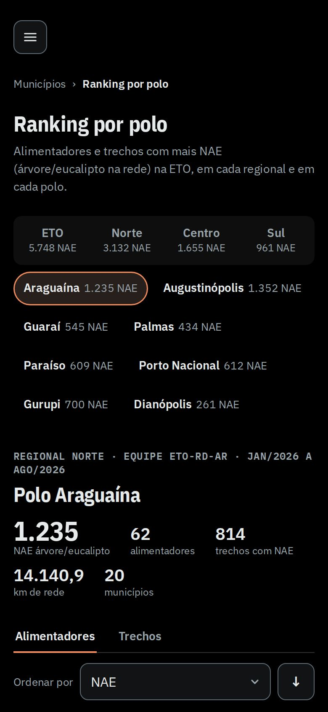

**Proposta.** Reservar a linha do ☰ com uma pseudo-linha da mesma geometria (altura do alvo, margem -8 px, mais o gap da grade) e esconder os cartões até serem posicionados:

```css
/* site.css e alimentador.css */
.wrap:not(:has(>.mnu))::before{content:"";display:block;min-height:var(--alvo);margin-bottom:calc(var(--s2) * -1)}
/* site.css */
.mt-regcards:not([data-ok]) button{visibility:hidden}
/* alimentador.css: o "Como os trechos são divididos" sai do cabeçalho quando o extras.js monta a barra */
.al-site:not(.al-pronto) header>details.regra{display:none}
```
```js
// mapa-municipios.js, em poeCartoes(), logo depois de `if (!r.width) return;`
cartoes.dataset.ok = '1';
```

**Como fica.** Título e mapa já no lugar no 1º quadro, nenhuma página muda de altura ao chegar o ☰:

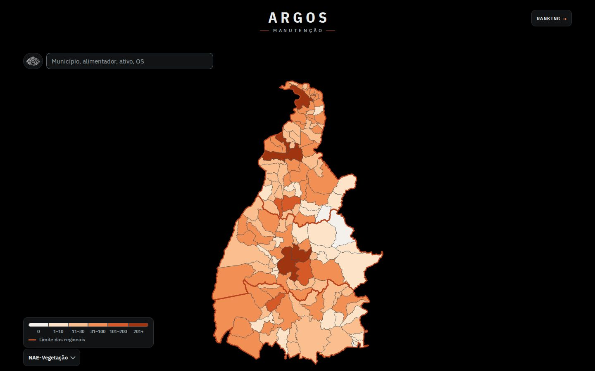
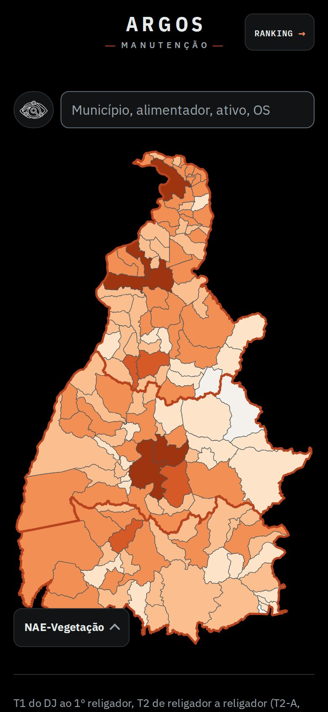
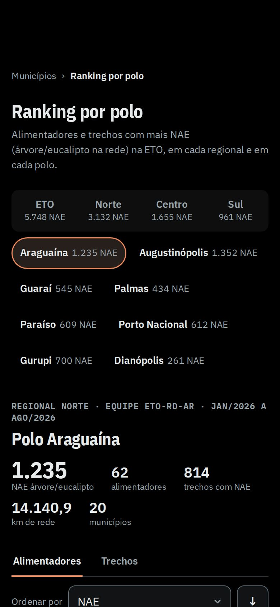


CLS na tabela do topo. **Esforço** P. **Risco** baixo: `:has()` precisa de Chrome 105+, Safari 15.4+, Firefox 121+ (sem ele o salto continua como hoje); se o `menu.js` falhar, sobra uma faixa vazia de 40 px. Limite honesto: em 4G lenta no celular o ranking ainda tem CLS 0,14 (a tabela troca de fonte quando o Google Fonts chega e a altura do cabeçalho muda 50 px); a proposta 5 da rodada 1 (fontes próprias) resolve isso, e o alimentador no celular lento ficou em 0,036 (< 0,1, "bom"). **Arquivos:** `alimentador/site/site.css`, `alimentador/mapa_trechos.html` (CSS), `alimentador/site/mapa-municipios.js`. Protótipo: `proto/cls.css`, `proto/al-cls.css`, `proto/mapa-municipios.js`.

---

## Sugestão 3 (prioridade 3) · Tab coerente e leitor de tela que sabe onde o mapa está

**Problema.** (a) Com uma regional, polo ou município aberto, os cartões Norte/Centro/Sul (`opacity:0`) continuam no Tab: 3 paradas em que o foco some. (b) A lupa é um botão no Tab que só leva o foco ao campo, que agora fica sempre à vista: parada duplicada. (c) Tab saindo do campo de busca cai na caixa de resultados (o Chromium põe área rolável no Tab), com um contorno gigante, e o Tab seguinte fecha a lista. (d) No estado inteiro, as regionais (a ação principal) vêm depois de "Palmas" e da legenda na ordem do Tab. (e) Nenhum nível é anunciado: abrir regional ou polo não diz nada ao leitor de tela, e abrir um município faz a região `aria-live` do `#ativo-res` ler os 1.112 caracteres da lista inteira.

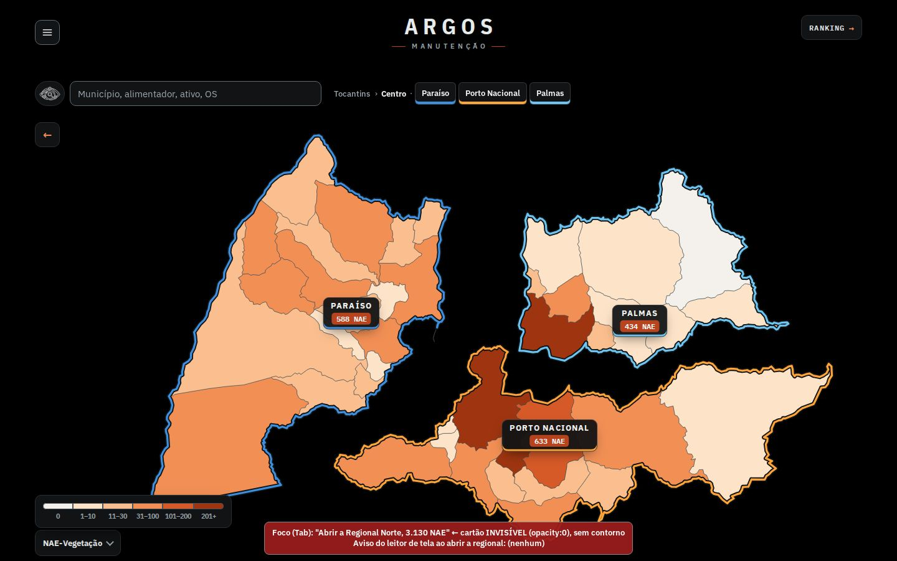
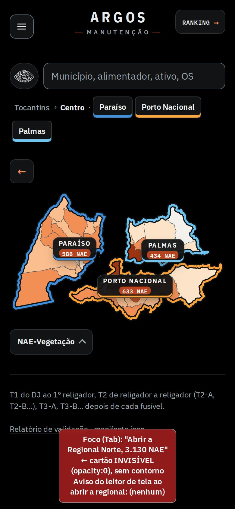
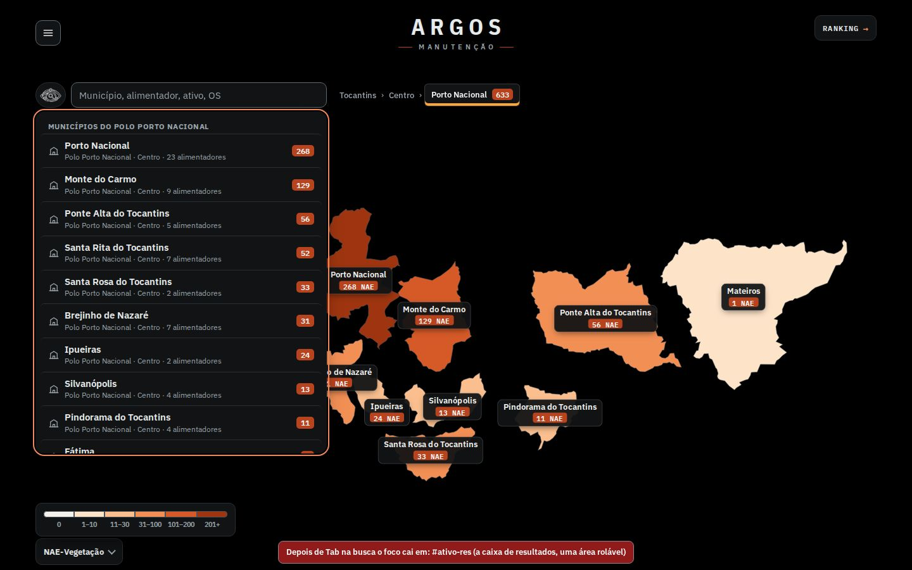

(A faixa vermelha/verde no rodapé dos prints é uma legenda desenhada só no print para mostrar o que não aparece na tela; não faz parte do site.)

**Proposta.** Quatro mudanças de 1 a 3 linhas e uma região de aviso:

```css
/* site.css: some de verdade (e sai do Tab) depois do fade */
.mt-regcards button{transition:opacity .3s,border-color .15s,background-color .15s,visibility 0s}
.aberta .mt-regcards button,.voando .mt-regcards button{visibility:hidden;transition:opacity .3s,border-color .15s,background-color .15s,visibility 0s .3s}
```
```js
// mapa-municipios.js
caixa.prepend(cartoes);                       // antes do svg: no estado inteiro as regionais são a 1ª parada do mapa
const aviso = document.createElement('p');    // região de aviso, só para leitor de tela
aviso.className = 'vh'; aviso.id = 'mt-aviso'; aviso.setAttribute('role', 'status'); aviso.setAttribute('aria-live', 'polite'); aviso.setAttribute('aria-atomic', 'true');
alvo.append(aviso);
document.addEventListener('argos-nivel', e => fala(textoNivel(e.detail)));   // evento que o voa() já dispara; texto curto do nível final

// busca-ativo.js
res.tabIndex = -1;                            // área rolável fora do Tab
res.removeAttribute('aria-live');             // a lista não é mais lida inteira; o resumo vai no aviso ("12 opções. Use as setas...")
lupa.tabIndex = -1; lupa.setAttribute('aria-hidden', 'true');
```

Textos do aviso (`proto/mapa-municipios.js`): "Regional Centro: 3 polos, Paraíso, Porto Nacional, Palmas. Esc volta ao Tocantins." · "Polo Porto Nacional: 12 municípios, 633 NAE. Esc volta à regional Centro." · "Porto Nacional: 23 alimentadores, 268 NAE. Esc volta ao polo." · "Alimentador AL02057189 em foco, em Porto Nacional: 44 NAE. Enter abre a página dele. Esc volta ao município." Todos vêm dos dados do mapa (`window.MUN`), nada inventado.

**Como fica.** Tab com a regional aberta passa de "Menu, Ranking, Lupa, Busca, Tocantins, 3 polos, Município, Legenda, 3 cartões invisíveis, ←, links" para "Menu, Ranking, Busca, Tocantins, 3 polos, Município, Legenda, ←, links"; do campo de busca o Tab vai direto para "Tocantins":

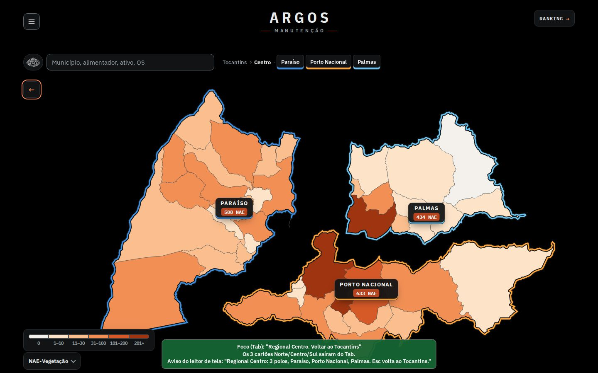
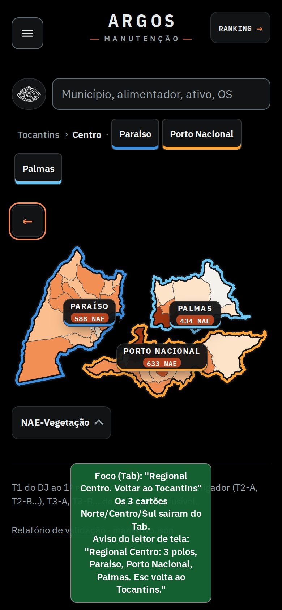
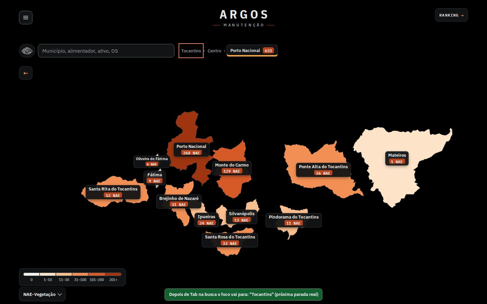

**Esforço** P. **Risco** baixo: verifiquei as paradas do Tab e o texto das regiões `aria-live` por script (MutationObserver), **não** testei com NVDA, VoiceOver ou TalkBack; a lupa com `aria-hidden` deixa de existir para quem navega por leitor (o campo ao lado tem o mesmo rótulo); anunciar a cada abertura da lista de busca ("N opções") pode ser repetitivo para quem abre e fecha muito. Antes de publicar vale uma volta com NVDA ou VoiceOver. **Arquivos:** `alimentador/site/site.css`, `mapa-municipios.js`, `busca-ativo.js`. Protótipo: `proto/foco.css`, `proto/mapa-municipios.js`, `proto/busca-ativo.js`.

---

## Sugestão 4 (prioridade 4) · Alvos de toque de 44 px em todas as telas

**Problema.** `--alvo` é 40 px em `site.css`, em `alimentador.css` e (de novo) dentro do CSS embutido do `ranking-polos.js`, e o ☰ (`menu.js`) tem 40 px fixos. No celular: ☰, Ranking, legenda, ←, trilha e chips dos polos (36 px), rodapé; no ranking os 8 botões de polo e as abas; na página do alimentador T1/T2/T3, camadas, tela cheia, anos, botões de download, 30 alvos em 40 px.

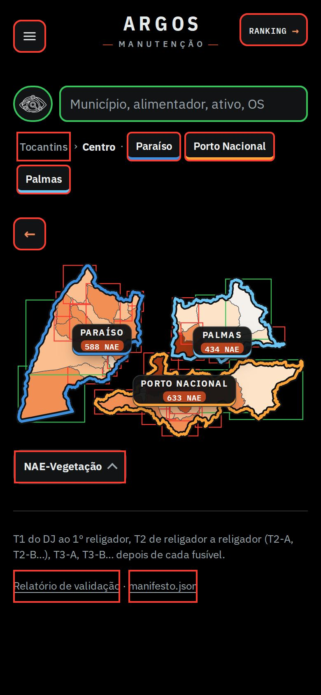
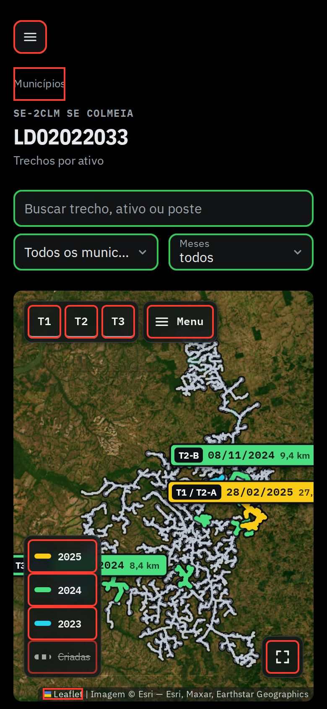
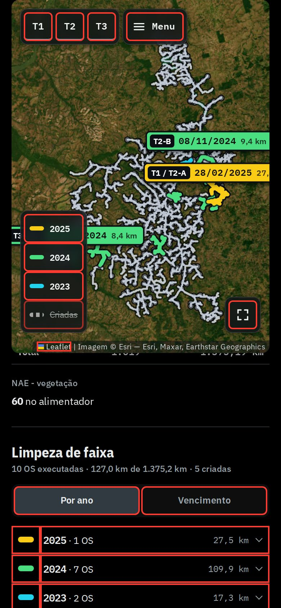
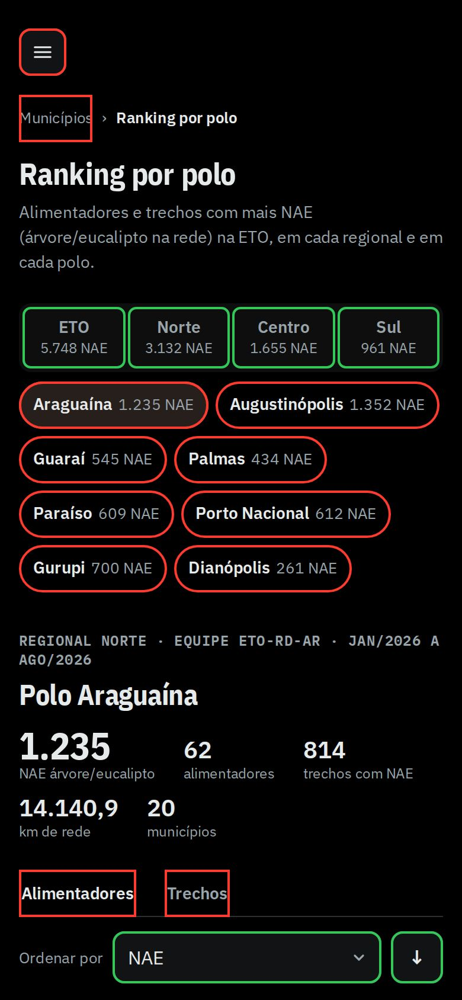

**Proposta.** Só em tela de toque (`pointer:coarse`; no mouse nada muda):

```css
@media (pointer:coarse){
  :root{--alvo:44px}                                     /* site.css, alimentador.css e o bloco :root do ranking-polos.js */
  .mt-barra .mt-pchip,.mt-passo,.mt-puxa,.ativo .ir-mapa{min-height:44px}
  .mt-volta{min-width:44px} .mt-amun{display:inline-flex;align-items:center;min-height:44px}
}
/* menu.js (CSS embutido): .mnu{min-height:44px} .mnu .mnu-btn,.mnu .mnu-x{width:44px;height:44px} .mnu-lista a,.mnu-lista button{min-height:44px} */
/* alimentador.css: html body na frente porque limpeza.js/extras.js/telacheia.js injetam <style> depois */
@media (pointer:coarse){
  html body .migalhas a{min-height:44px}
  html body .mapbox .classes button{min-width:44px;min-height:44px}
  html body .leaflet-container .leaflet-bar a{width:44px;height:44px;line-height:44px}
  html body :is(.ctl-cam-b,.tc-btn){min-height:44px;min-width:44px}
  html body :is(.limp-maplg,.limp-seg) button,html body .limp-ano-l button{min-height:44px}
  html body .limp-ano-l .liga{min-width:44px}
  html body :is(.dados,.regra,.mais)>summary{min-height:44px}
  html body :is(.dl-btn,.exe-tipos-b,.fecha){min-height:44px} html body .fecha{width:44px}
}
```

**Como fica.** Verde = 44 px ou mais, vermelho = menor:

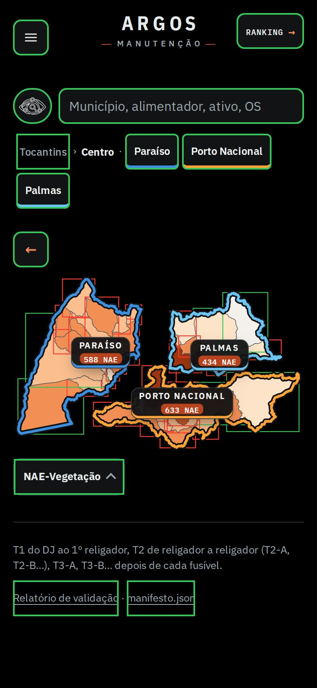

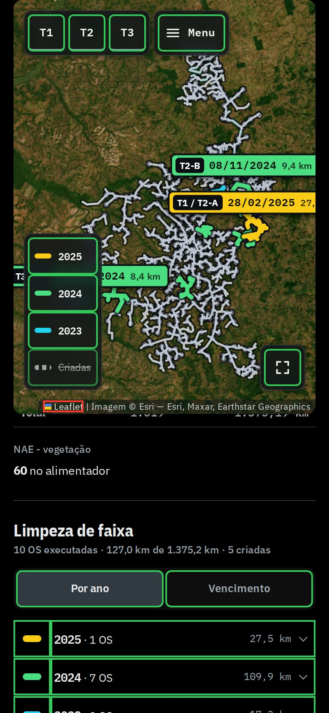
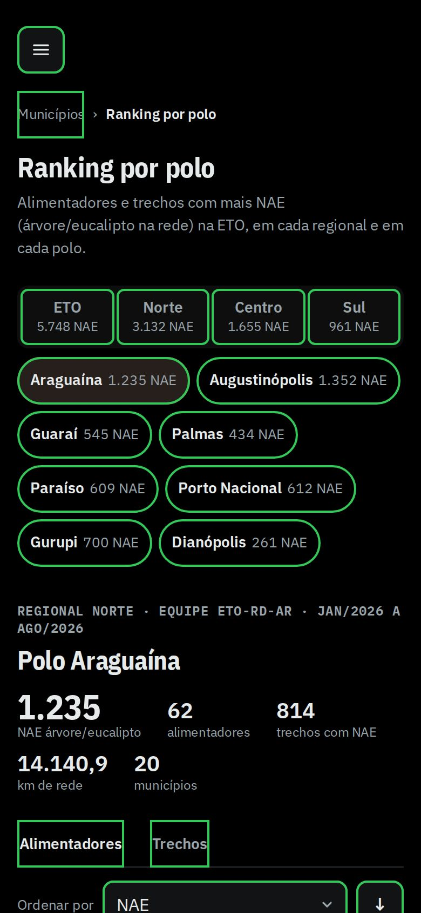

A trilha da barra já quebrava em duas linhas no celular e continua; os chips ficam um pouco mais altos. Olhei regional, alimentador e ranking e nada ficou cortado; os outros níveis só passaram pela contagem de alvos. **Esforço** P. **Risco** baixo; trocar `--alvo` mexe em tudo que usa a variável (migalhas, rodapé, `.cab-link`, opções da busca), conferido nas telas acima, mas não em tablet. **Arquivos:** `alimentador/site/site.css`, `menu.js`, `ranking-polos.js`, `alimentador/mapa_trechos.html` (CSS). Protótipo: `proto/toque.css`, `proto/al-toque.css`, `proto/menu.js`, `proto/ranking-polos.js`.

---

## Sugestão 5 (prioridade 5, ganho pequeno) · Ranking por polos: formatador de números em cache

`nf()` do `ranking-polos.js` chama `toLocaleString` com opções para cada número da tabela (cada chamada cria um `Intl.NumberFormat`): 186 ms de CPU própria no perfil com CPU 4x, 73 ms com um formatador por nº de casas. Efeito medido: latência de clique (CPU 4x) 584 → 360 ms no computador e 496 → 464 ms no celular; carga praticamente igual. É a mesma correção do item 3 da sugestão 1; o mesmo padrão aparece 11 vezes em `mapa-municipios.js` e 4 em `busca-ativo.js`, mas ali roda poucas vezes e não medi. **Esforço** P, **risco** baixo. **Arquivo:** `alimentador/site/ranking-polos.js`. Protótipo: `proto/ranking-polos.js`.

---

## O que testei e não achei problema

| Verificação | Resultado |
|---|---|
| Console e requisições falhas em início, ranking e alimentador (protótipo e original) | 0 erros e 0 avisos |
| Foco visível: contorno ou traço em todas as paradas visíveis (início, 5 níveis) | sim |
| Escopo da rodada 1 já resolvido pela outra sessão ou pelo site: cabeçalho do ☰ e lista de municípios na página do alimentador (`al-pronto`, `barra-busca`) | funcionando; sobrou só a reserva do ☰ (sugestão 2) |
| Ranking: carga (206 ms normal, 755 ms CPU 4x), 5 requisições, 140 KB | boa |

## Como medi (e limites)

- **Espelho local.** O Chromium daqui não confia na CA do proxy: `servidor-espelho.js` (porta 18766) baixa o /teste/ ao vivo com `curl` na 1ª requisição, guarda em cache e serve com gzip; os tiles do Esri e as fontes do Google passam por `route` + `curl`. O CDP limita só o que o servidor local entrega; para os hosts externos `lib.js` modela a rede lenta (3 RTT na 1ª conexão, depois 1 RTT + bytes/banda): a coluna "4G lenta" é parcialmente **modelada**.
- **Protótipos.** `gera-proto.js` copia os arquivos do espelho, aplica cada alteração por substituição exata (para se o trecho não casar uma vez) e grava `.diff`. `injeta.js` entrega o resultado por `page.route`; `PROTO=1` liga tudo, `PROTO_ITENS=cls,foco,live,toque,lista,vaos,fmt` liga só alguns. Nada no site nem no repositório foi alterado.
- **Medidas.** CLS: `layout-shift` com `sources`; FPS e pior quadro: `requestAnimationFrame` durante cada gesto; long tasks e TBT (depois do FCP): `PerformanceObserver`; estilo e layout: trace do Chromium (`layout-carga.js`); redesenho: `renderer._update()` (API privada do Leaflet, só para medir); gestos: mouse e roda no computador, `Input.synthesizeScrollGesture`/`PinchGesture` no celular. Perfis: normal, CPU 4x (`Emulation.setCPUThrottlingRate`), CPU 4x + 1,6 Mbps/150 ms. Viewports 1440x900 e 390x844 (toque, DPR 2), tema escuro. O tema claro não mudou nada nestas propostas, por isso não gerei prints dele.
- **Ruído.** A máquina é compartilhada e renderiza por software (sem GPU): os números absolutos são pessimistas e o TBT em CPU 4x varia até 50 % de uma rodada para outra. As colunas "antes" e "depois" rodaram em sequência, mas só confio em diferenças grandes (CLS, estilo+layout, redesenho, paradas do Tab). A ablação só da lista (`content-visibility`, `medicoes/alimentador-so-lista.log`) não mostrou queda clara de TBT sozinha; o ganho de layout aparece no trace, não no TBT. O Event Timing do ranking tem só 6 eventos por perfil.
- **Não coberto:** leitor de tela real, Safari/Firefox, tablet, tema claro, rolagem por teclado nas 1.000 linhas com `content-visibility`.

## Arquivos

- `proto/`: `cls.css`, `foco.css`, `toque.css`, `al-cls.css`, `al-lista.css`, `al-toque.css` (acrescentados ao final de `site.css`/`alimentador.css`) e `mapa-municipios.js`, `busca-ativo.js`, `menu.js`, `ranking-polos.js`, `alimentador.js`, `limpeza.js`, `inspecao.js`, `extras.js` (cópias alteradas, cada uma com `.diff`).
- Scripts: `prints.js` (todos os prints), `gera-proto.js`, `injeta.js`, `lib.js`, `servidor-espelho.js`, `medir-cls.js`, `medir-alim.js`, `tab-foco.js`, `alvos.js`, `layout-carga.js`, `redesenho.js`, `polos-inp.js`, `perfil-alim.js`, `tarefas-longas.js`, `equivale.js`, `tabelas.js`, `grafico.py`, `roda-tudo.sh`.
- Resultados: `medicoes/*.json` e `*.log`, `medicoes/tabelas.md`.
- Reprodução: `node servidor-espelho.js &`, depois `node gera-proto.js`, `node prints.js`, `./roda-tudo.sh`.
