# Tema 2 · Mapa: zoom e interatividade (rodada 3, consolidação)

Base: `alimentador/site/mapa-municipios.js` e `site.css` do **commit 8ab7caf (06:22 UTC)**, idênticos aos assets do `/teste/` ao vivo (conferido com `cmp`). Já traz bandeirinhas `.mt-bandeiras/.mt-fio/.mt-pino`, rótulos com fio `.mt-fios`, `folgaRot`, legenda que esconde os números (`.sem-nae`), tela cheia `.mt-tc`, busca só no olho e "1 clique na rede abre o painel". Nada foi alterado fora desta pasta; não houve commit, push nem Artifact.

## Resumo (5 linhas)
1. **Sugestão nº 1 (recomendada): aplicar o zoom consolidado.** Um diff limpo sobre a base atual: `proto/mapa-municipios.diff` (+274/−21 linhas, 16 trechos) e `proto/zoom.css` (31 linhas, `proto/site.css.diff`). Ctrl/⌘ + roda, pinça (trackpad e dedos), arrastar, botões + − ↺, teclas `+ − 0`, Esc, aviso "Use Ctrl + rolagem" e zoom semântico (cartão preto com nome e NAE em cada município). Nenhuma mudança em `gera_trechos.py`.
2. **Rebase de três vias feito** (`rebase.sh`): 4 conflitos resolvidos à mão (`poeCartoes`, fim de `voa`, folga dos rótulos, selos dos polos) e 1 colisão silenciosa de nome (`const meio` duplicado, que o merge não acusa e o `node --check` pega). O repositório mudou de novo no meio da rodada (8ab7caf) e o script reaplicou sem conflito.
3. **Convivência validada por teste automático**: bandeirinhas (somem durante o gesto, voltam recalculadas até ×1,8 e saem de cena acima disso, sem cobrir botões nem cartões), rótulos, legenda recolhida (cartões só com o nome), tela cheia (solta o zoom e funciona dentro dela), busca (`ARGOS_MAPA.vai`) e o novo clique na rede (arrastar a partir de um alimentador não abre o painel).
4. **Testes**: desktop (`teste-zoom.js`, 71 verificações) e celular com toques CDP (`teste-zoom-celular.js`, 390×844, 37 verificações) passam; 33 prints 1440×900 e 390×844, escuro e claro, mais 5 folhas de contato. **Zero sobreposição** entre cartões, legenda, botões, fios e tela cheia em todos os pontos testados.
5. **Medidas** (Chromium headless por software, máquina compartilhada com carga 7 a 15 em 4 núcleos, então vale para comparar, não como FPS de aparelho): o protótipo não piora a animação existente; recalcular tudo depois do gesto leva 38 ms (mínimo, estado ×1,7) a 59 ms (mediana) no desktop e 31 a 108 ms no celular com CPU 4× mais lenta; um cache de 12 linhas dos pontos do contorno cortou o custo das bandeirinhas de ~38 ms para ~6 ms por recálculo. **Falta teste em aparelho real** (sobretudo iOS Safari).

## O que implementar primeiro (lista priorizada)
| # | O quê | Esforço | Risco | Estado |
|---|---|---|---|---|
| 1 | **Zoom livre + zoom semântico** (o patch inteiro) | M | médio-baixo | pronto, testado |
| 2 | **Cache dos pontos do contorno em `contorno()`** (bandeirinhas): pode sair antes e sozinho, melhora a base mesmo sem zoom (abrir regional/voltar: 75 a 120 ms em `getPointAtLength` caem para 23 a 44 ms) | P | baixo | pronto no diff (hunk de `contorno`) |
| 3 | Teste em aparelho real (iPhone Safari, Android Chrome) e a pinça do Safari de desktop (`gesturechange`) | P a M | médio | pendente |
| 4 | Balão do mouse sem repetir nome e NAE quando o cartão do município já está na tela (tema 1: dado repetido) | P | baixo | proposta |
| 5 | NAE dentro do `aria-label` de cada município (os cartões são `aria-hidden`) (tema 5) | P | baixo | proposta |
| 6 | Mini-mapa de orientação (rodada 1, sugestão 5) | P | baixo | adiado |
| 7 | Prévia das redes dentro dos municípios grandes (rodada 1, sugestão 2); precisa de rede simplificada por município em `gera_trechos.py` | G | médio | adiado |
| 8 | Mapa cabe na primeira tela (no 1440×900 a base do mapa fica em y=918; página com 919 px) | P | baixo | CSS, fica com a outra sessão |

---

## 1. O patch

```sh
cd /home/user/smartled/alimentador/site
patch -p1 < /home/user/smartled/melhorias-noite/rodada-3/tema-2-mapa-zoom/proto/mapa-municipios.diff
patch -p1 < /home/user/smartled/melhorias-noite/rodada-3/tema-2-mapa-zoom/proto/site.css.diff   # = acrescentar proto/zoom.css ao fim de site.css
```
Conferido: os dois `patch` aplicam sobre uma cópia do commit 8ab7caf e reproduzem `proto/mapa-municipios.js` e `proto/site.css` byte a byte.

**Pontos de contato com o código da outra sessão** (para quando ela mexer no mesmo arquivo; todos marcados "ZOOM" no código):
- `bandeiras()`: o botão do zoom (`ctl`) entra na lista de obstáculos; com zoom, cartão sem lugar no contorno fica escondido em vez de cair no meio do grupo; guarda onde ficaram os fios (`bandFios`) para os cartões dos municípios desviarem; `contorno()` passa a guardar os pontos (cache).
- `voa()`, fim da animação: `if (Z) fimZ(); else { if (!reg) poeCartoes(); poeNomes(); poeSelos(); }`. `voa()` também registra `nivelVb` (enquadramento do nível) e chama `zLimpa()`.
- `escala()`: com zoom não refaz as bandeirinhas (quem faz é `recalcZ()`, depois do gesto).
- `poeNomes()`: ramo novo para estado/regional com zoom (só município com ≥ 40 px, do maior NAE para o menor, até 70, sempre nome + NAE, sem fio); a chave do cache de tamanho agora inclui "legenda aberta/recolhida", porque o cartão encolhe sem o número.
- `poeSelos()` e as bandeirinhas **não foram alteradas**; o selo do polo não acompanha o mapa durante o gesto (some e volta recalculado), então foi removido o `moveSelos` da rodada 2.
- `ResizeObserver` da caixa e Esc: o zoom solta quando a caixa muda de **largura ou altura**; o 1º Esc enquadra, o seguinte sobe um nível ou sai da tela cheia como já era.
- `ARGOS_MAPA.zoom = { ativo, fator, enquadra, solta, refaz, medidas }` (opcional: `busca-ativo.js` pode chamar `zoom.solta()` ao escolher um resultado em vez do `enquadra` animado).

**Como o rebase foi resolvido** (`rebase.sh`; `node --check` roda antes de aceitar o merge):
| Conflito | Resolução |
|---|---|
| `poeCartoes` (rodada 2 posicionava pelo `viewBox`; a base agora pendura bandeirinhas no contorno) | fica o da base; com zoom as bandeirinhas somem durante o gesto e são recalculadas 110 ms depois de parar (e até ×1,8) |
| fim de `voa` | junta os dois: `if (Z) fimZ(); else {...}` |
| folga entre rótulos | fica o `folgaRot` da base; removi a folga local que o zoom tinha criado para o mesmo fim |
| `poeSelos` / `poSelo` | fica o `poeSelos` da base com bandeirinha; `poSelo` e `moveSelos` saem |
| `const meio` declarado duas vezes (sem marca de conflito) | o dos dois dedos virou `meioDedos` |

Depois do segundo commit da outra sessão (8ab7caf, painel abre com 1 clique) o `rebase.sh` reaplicou sem conflito.

## 2. Antes e depois

**Desktop, estado inteiro** (antes: Ctrl + roda ×5 e nada acontece · depois: ×3,7 com um cartão preto nome + NAE por município):

| Antes | Depois |
|---|---|
| 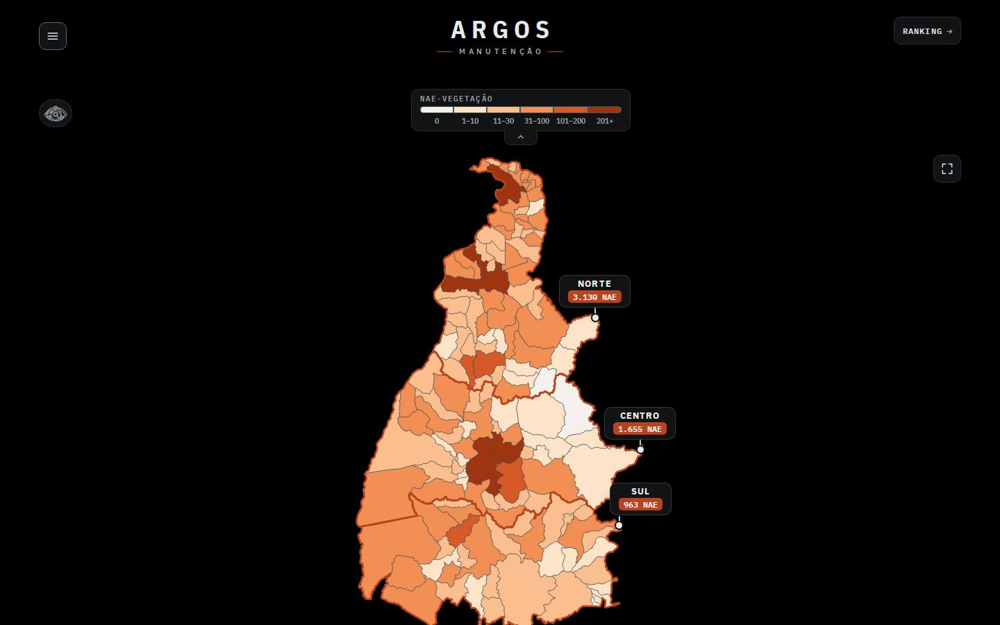 | 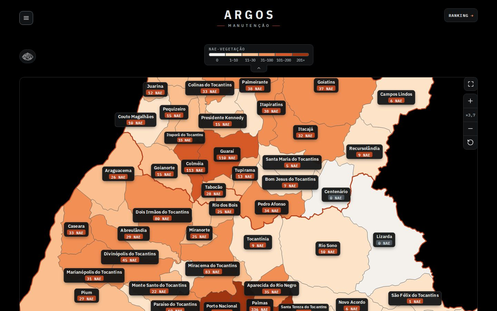 |

Zoom pequeno (×1,7): as bandeirinhas Norte/Centro/Sul voltam recalculadas junto ao contorno e convivem com os cartões dos municípios ([estado ×1,7](prints/d-desk-02-estado-1x7.jpg)). Sequência:

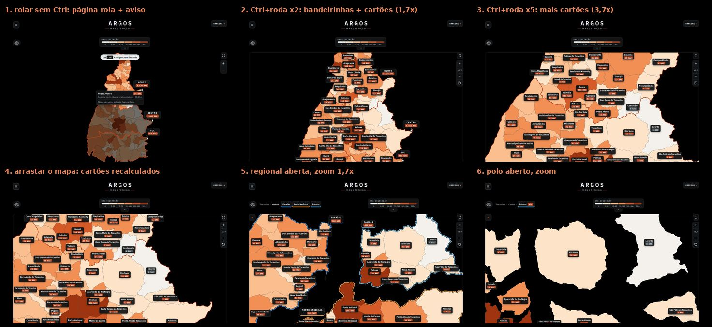

Quadros: [aviso](prints/d-desk-01-aviso.jpg) · [×1,7](prints/d-desk-02-estado-1x7.jpg) · [×3,7](prints/d-desk-03-estado-3x7.jpg) · [arrastar](prints/d-desk-04-arrastar.jpg) · [Esc enquadra](prints/d-desk-05-esc-enquadra.jpg) · [regional ×1,7](prints/d-desk-06-regional-1x7.jpg) · [regional ×3,7](prints/d-desk-07-regional-3x7.jpg) · [polo com zoom](prints/d-desk-08-polo-zoom.jpg) · [clique depois do zoom abre o município](prints/d-desk-09-clique-abre-municipio.jpg)

**Regional e polo** (antes: 1×; depois: bandeirinhas dos polos acompanham o contorno e cada município ganha o cartão):

| Antes: regional | Depois: regional ×1,7 | Antes: polo | Depois: polo com zoom |
|---|---|---|---|
| 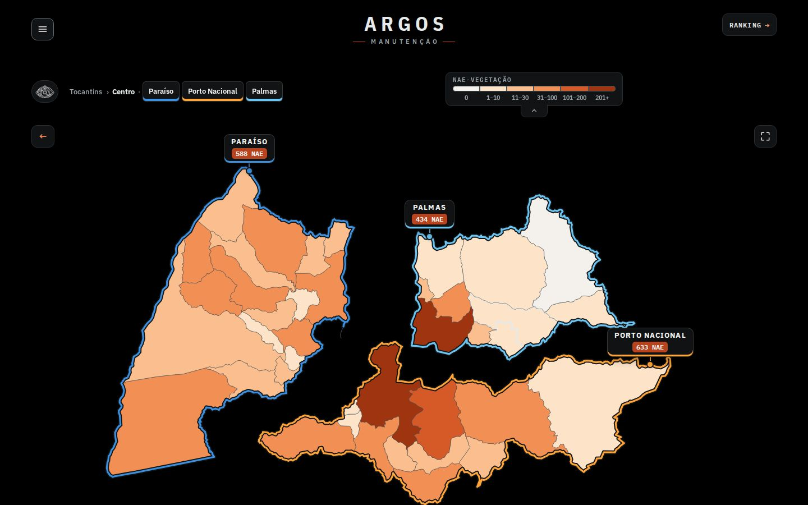 | 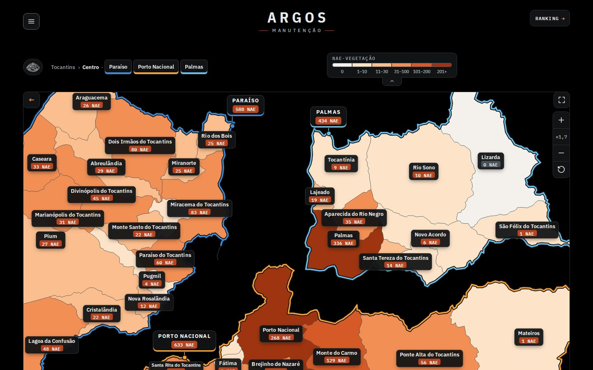 | 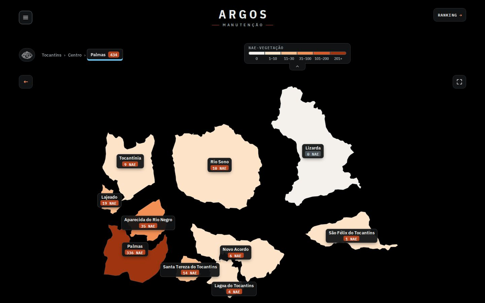 | 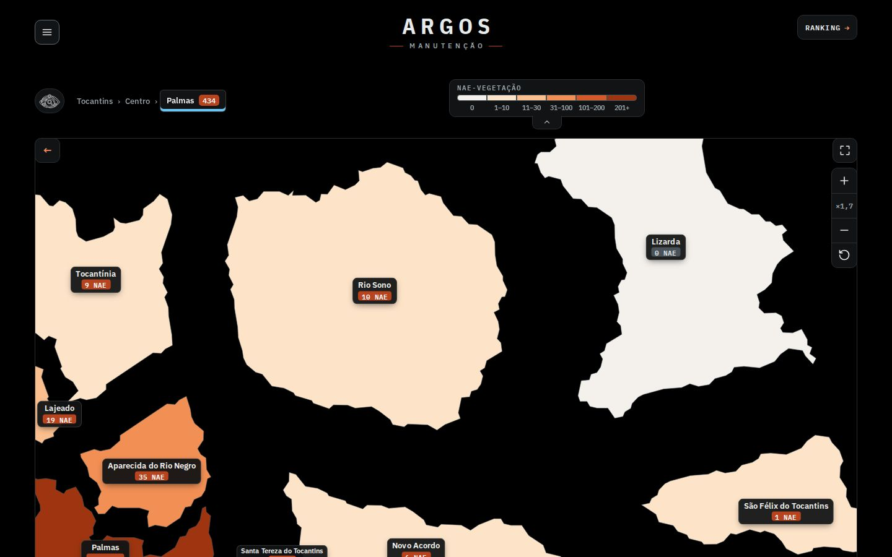 |

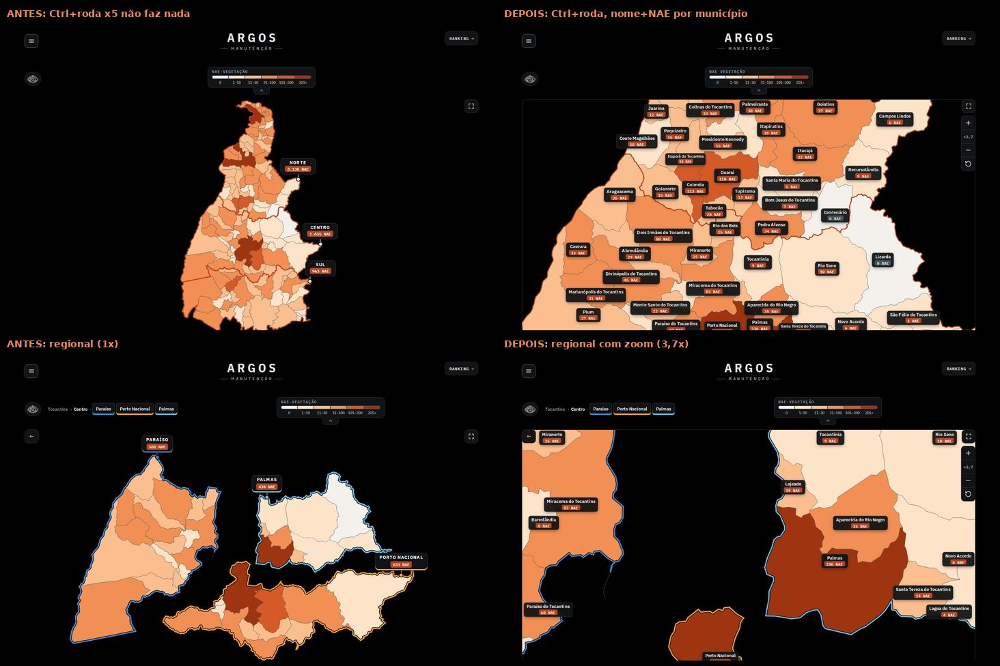

**Celular (390×844, toques reais por CDP).** Antes a pinça amplia a **página inteira** (`visualViewport.scale` = 5). Depois a pinça amplia o mapa, um dedo arrasta e os botões ficam no canto:

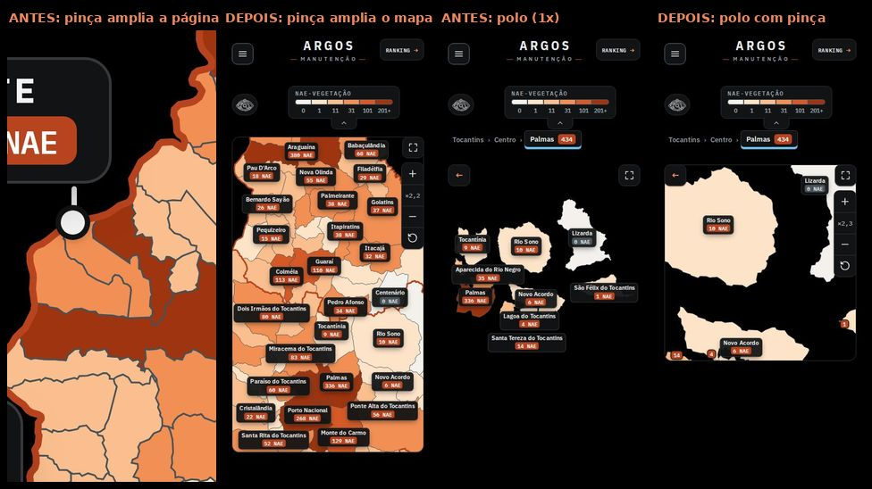
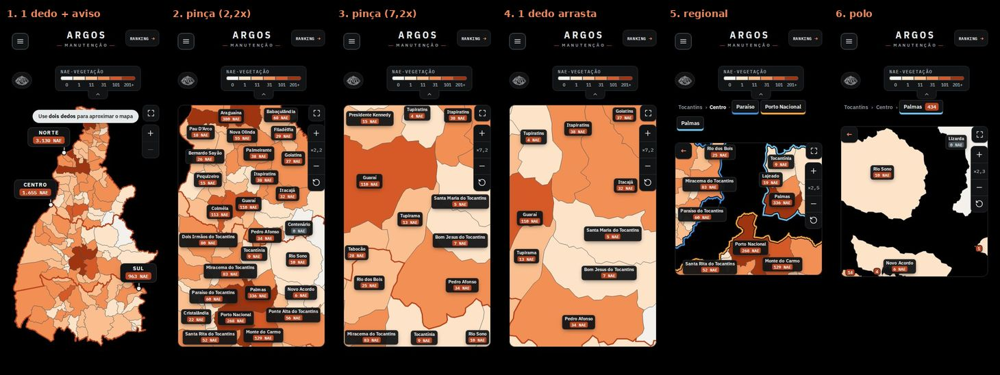

Quadros: [antes: pinça amplia a página](prints/a-mob-2-pinca.jpg) · [aviso "dois dedos"](prints/d-mob-1-aviso.jpg) · [pinça ×2,2](prints/d-mob-2-pinca-1.jpg) · [pinça ×7,2](prints/d-mob-3-pinca-2.jpg) · [um dedo arrasta](prints/d-mob-4-arrastar.jpg) · [regional](prints/d-mob-5-regional-pinca.jpg) · [polo](prints/d-mob-6-polo-pinca.jpg)

**Tema claro**: [estado ×1,7](prints/d-desk-14-claro-estado.jpg) · [regional ×1,7](prints/d-desk-15-claro-regional.jpg) · [celular](prints/d-mob-9-claro.jpg) · (antes: [estado](prints/a-desk-5-estado-claro.jpg)).

## 3. Convivência com as outras frentes (o pedido desta rodada)

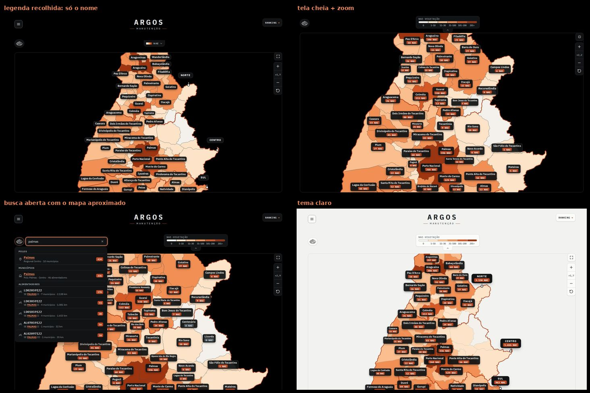

- **Bandeirinhas**: durante o gesto somem (`.mexe`); 110 ms depois de parar são recalculadas pela mesma rotina da base (`bandeiras()`), olhando o contorno que está na tela, sem cobrir o botão de tela cheia nem os de zoom; acima de ×1,8 saem de cena de vez (cada município já mostra o cartão dele); cartão sem lugar no contorno visível fica escondido. Os fios entram na conta dos cartões dos municípios (teste: nenhum cruzamento).
- **Rótulos do polo e fios `.mt-fios`**: com zoom no polo o mesmo cálculo da base roda sobre a vista atual (centro e anéis dentro do município, cartão ao lado com fio quando não cabe). Com zoom no estado/regional não há fios (dezenas de municípios fariam uma teia): quem não cabe dentro fica sem cartão.
- **Legenda recolhida (`.sem-nae`)**: os cartões ficam só com o nome, o tamanho em cache é separado por legenda aberta/recolhida e cabem mais nomes (teste: 33 cartões com NAE, mais sem NAE, zero sobreposição). [print](prints/d-desk-12-legenda-recolhida.jpg) · [celular](prints/d-mob-7-legenda-recolhida.jpg)
- **Tela cheia (`.mt-tc`)**: o botão de zoom desce uma linha e não se sobrepõe ao `.mt-tc`; entrar ou sair da tela cheia solta o zoom (a caixa muda de tamanho) e o zoom funciona de novo lá dentro. [desktop](prints/d-desk-13-tela-cheia-zoom.jpg) · [celular](prints/d-mob-8-tela-cheia-zoom.jpg). **Bug achado e corrigido**: no celular a tela cheia muda só a **altura** da caixa; o `ResizeObserver` olhava só a largura e o mapa ficava com 591 px dentro de uma caixa de 738 px. Agora compara largura e altura.
- **Busca (`ARGOS_MAPA.vai`)**: com o mapa aproximado, abrir o olho e digitar não derruba o zoom; Enter/escolher leva o mapa ao resultado e solta o zoom; se o resultado é o nível que já está aberto (nada voa), a busca enquadra de volta. [busca com zoom](prints/d-desk-10-busca-com-zoom.jpg) · [resultado](prints/d-desk-11-busca-resultado.jpg)
- **Clique na rede abre o painel (novo na base)**: arrastar o mapa a partir de cima da rede de um alimentador **não** abre o painel (o clique depois do arrasto é engolido); teste dedicado.
- **Página inicial no celular não rola mais** (cabe em 844 px): o gesto de um dedo sobre o mapa só mostra o aviso "Use dois dedos para aproximar o mapa"; o teste foi adaptado.

## 4. Testes e medidas

Reprodução: `node teste-zoom.js` · `node teste-zoom-celular.js` · `node medidas.js` e `node medidas-gestos.js` (→ `medidas.json`) · `node prints.js` · `python3 folha-contato.py` · `./rebase.sh`. O Chromium daqui não confia na CA do proxy: `lib.js` busca o HTML ao vivo por `curl` e entrega com `page.route`; o "antes" usa `orig/` (cópia do commit 8ab7caf) e o "depois" usa `proto/`.

**Testes automáticos** (todos passam; como a máquina é compartilhada, as esperas visuais usam `waitForFunction`):
- `teste-zoom.js` (desktop): roda sem Ctrl rola a página e mostra o aviso · Ctrl+roda ×2 e ×5 · bandeirinhas e cartões das regionais com pouco zoom e fora de cena acima de ×1,8 · legenda recolhida e reaberta · arrastar move, não clica e recalcula · botões + − · Esc enquadra · clique depois do zoom abre regional, polo e município · regional e polo com zoom e arrasto (zero sobreposição, cada cartão dentro do próprio município) · arrastar a partir da rede de um alimentador · `vai({al})` · ← e Esc nível a nível · busca (digitar, Enter, mesmo nível) · afastar até 1× desliga · mudar a janela · teclas `+ − 0` com movimento reduzido · tela cheia · tema claro · nenhum erro de JavaScript.
- `teste-zoom-celular.js` (390×844, toques CDP, 37 verificações): um dedo não liga o zoom e mostra o aviso · pinça liga o zoom sem rolar a página nem ampliar a página (`visualViewport.scale` = 1) · um dedo arrasta · segunda pinça · pinça para fora · ↺ · botão + · toque num município abre a regional · pinça na regional e no polo · bandeirinhas com ×1,6 · legenda recolhida · tela cheia (solta o zoom, pinça lá dentro, sair) · busca com zoom.

**Fluidez** (`medidas.json`; Chromium headless com render por software, carga da máquina 7 a 15 em 4 núcleos: **compara base e protótipo na mesma janela, não é FPS de usuário**):
| Medida | Base (orig) | Protótipo |
|---|---|---|
| Abrir a regional (`voa`), 4 repetições alternadas, fps | 37,9 (37 a 44) | 46 (43 a 51) |
| Abrir a regional, celular com CPU 4× mais lenta, fps | 44,6 / 46,5 | 41,7 / 52,5 (duas rodadas: sem diferença além do ruído) |
| Ctrl+roda ×10, fps (4 repetições) | n/a | 42 a 46, 3 a 7 tarefas > 50 ms |
| Arrastar 40 passos, fps (4 repetições) | n/a | 50 a 59 |
| Tempo em `getPointAtLength` abrindo regional, voltando e abrindo outra | 74 a 120 ms (720 a 990 chamadas) | 23 a 44 ms (450 chamadas) |

**Tempo de recálculo depois de cada gesto** (bandeirinhas + cartões dos municípios, `recalcZ`; 15 repetições, mínimo / mediana em ms):
| Nível | Desktop | Celular (CPU 4×) |
|---|---|---|
| Estado ×1,7 (33 cartões no desktop) | 38 / 59 (bandeirinhas 6 / 9, cartões 30 / 49) | 31 / 108 |
| Estado, zoom alto (39 cartões) | 11 / 17 | 9 / 72 |
| Regional ×1,7 | 20 / 29 | 35 / 62 |
| Regional, zoom alto | 4 / 7 | 3 / 6 |
| Polo ×1,7 | 8 / 14 | 15 / 51 |

Leitura: o recálculo roda uma vez, 110 ms depois do gesto (os cartões ficam escondidos nesse intervalo), nunca por quadro. O pior caso medido (celular lento, estado ×1,7, mediana 108 ms) é um recálculo único e não trava a pinça; a rodada 2 media 55 a 62 ms no desktop sem as bandeirinhas. Otimizações que entraram nesta rodada: cache dos pontos do contorno (era o maior custo das bandeirinhas: 18 ms caiu para 5 ms no mínimo) e cache de "o centro do município está dentro do município" (`isPointInFill`: de ~27 ms para ~17 ms por recálculo, 62 para 51 chamadas).

## 5. Riscos e pendências
- **Aparelho real**: a pinça foi validada com toques CDP em Chromium emulado; falta iOS Safari (inclui o gesto de dois dedos começar depois de o navegador já ter iniciado a rolagem). No Safari de desktop a pinça do trackpad chega como `gesturechange`, não como Ctrl+roda: não tratado (Ctrl+roda e os botões funcionam).
- O mapa passa a bloquear a pinça nativa da página **só sobre o mapa** (`touch-action: pan-x pan-y`); alternativas sem gesto: botões + − e teclas `+ − 0`.
- O recálculo roda na thread principal; em celular fraco os cartões demoram até ~0,1 a 0,2 s para voltar depois de parar. Se incomodar, dividir em duas passadas (maiores NAE primeiro).
- Com zoom ligado, o balão do mouse repete nome e NAE do cartão (proposta 4).
- Layout (fora do escopo, com a outra sessão): no 1440×900 o mapa termina em y=918 (a base passa da dobra) e a legenda recolhida sobe o mapa 30 px.
- Não portado: prévia das redes nos municípios grandes, mini-mapa e "Voar até" (a busca integrada já cobre).

## Arquivos
- `proto/mapa-municipios.diff`, `proto/site.css.diff`, `proto/zoom.css` (o que entregar); `proto/mapa-municipios.js` e `proto/site.css` (versões completas para injetar); `orig/` (base 8ab7caf, usada pelo diff e pelo `rebase.sh`).
- `teste-zoom.js`, `teste-zoom-celular.js`, `medidas.js`, `medidas-gestos.js`, `medidas.json`, `prints.js`, `folha-contato.py`, `lib.js`, `rebase.sh`, `prints/` (a-* antes, d-* depois, z-* folhas), `resumo.json`.
