# Tema 3 · Tipografia, cartão preto e espaçamento dos rótulos (rodada 3: consolidação)

**Base:** `alimentador/site/` no commit `8ab7caf` (HEAD às 06:50 UTC). Às 06:08 conferi que os 4 arquivos do `/teste/` ao vivo eram idênticos à cópia do repositório; o commit das 06:22 ("1 clique abre o painel") mexeu em `mapa-municipios.js` e `busca-ativo.js`, e o protótipo foi refeito em cima dele (`git apply --check` passa contra o HEAD). Os "antes" são essa base injetada no navegador (`orig/`); nenhum arquivo do repositório foi tocado.

**Resumo (5 linhas)**
1. **Um patch só** (`proto/tema-3-rodada-3.diff`, 5 arquivos, 487 linhas) junta o melhor das rodadas 1 e 2 sobre a base atual: rótulos adaptativos, cartão preto no município aberto e no alimentador em foco, selo Mono 600, fontes reserva e ranking na mesma linguagem. Validado em 1440x900 e 390x844, escuro e claro; as telas notebook (1280x720) e tablet (820x1100) entraram só nas medições.
2. **Rótulos nos 8 polos (139 municípios):** no celular, sem rótulo **1 → 0**, só número **35 → 4**, nome dentro da forma **72 → 98**; no computador, só número **2 → 0** e nome dentro **128 → 134**; notebook só número 5 → 0. Sobreposição de cartões, cartão sobre controle e cartão cortado: **0 em todas as telas**, antes e depois.
3. **Defeito achado e corrigido:** com o alimentador em foco o SVG encolhia (36–84% da largura da caixa em **8 de 8 polos** no computador e no notebook) e cortava a rede numa borda reta; agora fica em 100% nas 4 telas.
4. **Acabamento:** o selo da NAE usava Plex Mono 700, que o site não carrega (32 textos com negrito sintético) → 600 verdadeiro; fontes reserva com as métricas do Plex levam o CLS do ranking no celular de **0,172 para 0,0004**.
5. Custo: `poeNomes` ganhou cache de geometria (chamada repetida custa ~1 ms) e orçamento de 45 ms para as tentativas extras; com CPU 4x mais lenta, tarefas longas por abertura de polo no celular 702 → 460 ms (soma), maior 319 → 168 ms.

**Sugestão nº 1 recomendada: enquadramento corrigido + afastamento adaptativo + moldura fixa no celular (sugestão 1).** É o pedido do usuário ("espaçar mais onde está apertado") com ganho medido em todas as telas, e o conserto do corte da rede vem no mesmo trecho de código (`enquadra`).

## O que implementar primeiro

| # | O quê | Esforço | Risco | Arquivos | Por quê nessa ordem |
|---|---|---|---|---|---|
| 1 | `enquadra` corrigido + afastamento adaptativo (`ajusta`) + moldura de altura fixa no celular | M | médio | `mapa-municipios.js` | O pedido direto do usuário e um defeito visível (rede cortada em 8 de 8 polos no computador). Tudo no mesmo trecho. |
| 2 | Nome curto no cartão compacto + ordem de colocação dos rótulos com cache e orçamento de tempo | P | baixo | `mapa-municipios.js` (`poeNomes`) | Tira os últimos "só número" do celular (35 → 4) sem piorar o tempo. Depende da 1 só para o ganho completo; funciona sozinha. |
| 3 | Cartão preto no município aberto (cabeçalho com NAE do município) e no alimentador em foco | M | baixo a médio | `site.css`, `busca-ativo.js`, `mapa-municipios.js` | Linguagem única e o 2º clique deixa de ser segredo. A NAE do município estava sumida nesse nível. |
| 4 | Selo Mono 600 + fontes reserva com métricas do Plex | P | baixo | `site.css`, `ranking-polos.js` (uma linha de `--f-display`) | Zero custo de download; CLS do ranking no celular de 0,172 a 0,0004. |
| 5 | Ranking (`polos/`) com a mesma linguagem (marca, escolha de polo com selo, cartão preto no escolhido, NAE em selo) | P | baixo | `ranking-polos.js`, `scripts/gera_trechos.py` (3 linhas) | Acabamento; pode ir por último. |

## Como reproduzir

`node prints.js antes|depois [filtro] [dark,light]` · `node metricas.js antes|depois [telas]` · `python3 resume-metricas.py` · `node foco.js antes|depois` · `node perf.js` · `node fontes.js antes|depois` · `node fontes-cls.js antes|depois` · `node selos.js` · `node cheia.js antes|depois` · `node ranking-html.js` · `python3 folhas.py`. `rede.js` busca o site ao vivo por curl (o Chromium do sandbox não confia na CA do proxy) e entrega por `page.route`, trocando `assets/site.css`, `mapa-municipios.js`, `busca-ativo.js` e `ranking-polos.js` por `orig/` ("antes") ou `proto/` ("depois").

Nomes dos prints: `antes|depois-<cenário>-<dark|light>-<desk|cel>.jpg`. Cenários: `1-estado`, `2-regional`, `polo-<araguaina|augustinopolis|guarai|palmas|porto|paraiso|gurupi|dianopolis>`, `mun-araguaina`, `mun-araguaina-lista`, `mun-palmas`, `al-foco`, `al-foco-lista`, `ranking`, `ranking-polo`. Folhas de contato: `prints/folha-*.jpg`. Observação: os "antes" foram tirados na base das 06:07; o commit das 06:22 não muda nenhuma dessas telas, exceto `al-foco*` (texto da lista), que refiz na base nova.

## Medição: os 8 polos, antes e depois

`metricas.js` abre cada polo (Araguaína, Augustinópolis, Guaraí, Palmas, Porto Nacional, Paraíso, Gurupi, Dianópolis) em cada tela e conta, entre os rótulos desenhados: **nome dentro** da forma, **nome ao lado** (cartão com fio), **só número**, **sem rótulo** (município sem nenhum rótulo) e **sobreposições** (cartão sobre cartão + cartão sobre a seta/tela cheia/lista + cartão cortado pela borda do mapa). Resultado em `metricas-antes.json` e `metricas-depois.json` (por polo).

| Tela | municípios | nome dentro | nome ao lado (fio) | só número | sem rótulo | sobreposições |
|---|---|---|---|---|---|---|
| computador 1440x900 | 139 | 128 → **134** | 9 → 5 | 2 → **0** | 0 → 0 | 0 → 0 |
| notebook 1280x720 | 139 | 112 → **127** | 22 → 12 | 5 → **0** | 0 → 0 | 0 → 0 |
| tablet 820x1100 | 139 | 130 → **135** | 8 → 4 | 1 → **0** | 0 → 0 | 0 → 0 |
| celular 390x844 | 139 | 72 → **98** | 31 → 37 | 35 → **4** | 1 → **0** | 0 → 0 |

Celular por polo (antes → depois):

| Polo (municípios) | dentro | ao lado | só número | sem rótulo |
|---|---|---|---|---|
| Araguaína (20) | 11 → 15 | 6 → 3 | 3 → 2 | 0 → 0 |
| Augustinópolis (24) | 12 → 14 | 4 → 10 | 8 → 0 | 0 → 0 |
| Guaraí (21) | 8 → 14 | 5 → 6 | 8 → 1 | 0 → 0 |
| Palmas (10) | 8 → 8 | 1 → 2 | 0 → 0 | 1 → 0 |
| Porto Nacional (12) | 4 → 9 | 5 → 3 | 3 → 0 | 0 → 0 |
| Paraíso (18) | 9 → 10 | 4 → 7 | 5 → 1 | 0 → 0 |
| Gurupi (18) | 10 → 14 | 4 → 4 | 4 → 0 | 0 → 0 |
| Dianópolis (16) | 10 → 14 | 2 → 2 | 4 → 0 | 0 → 0 |

Os 4 "só número" que sobram no celular são Araguaína (2), Guaraí (1) e Paraíso (1). Meus números da base diferem um pouco dos do pedido (computador 3 só número, celular 2 sem rótulo e 43 só número; aqui 2, 1 e 35): a conta muda com o instante da medição (espero 2 s após abrir o polo) e com a carga da máquina; o script e os JSON estão aqui para repetir. A tendência é a mesma.

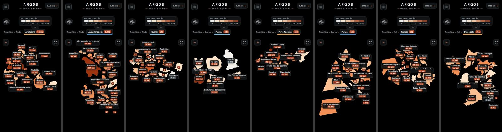
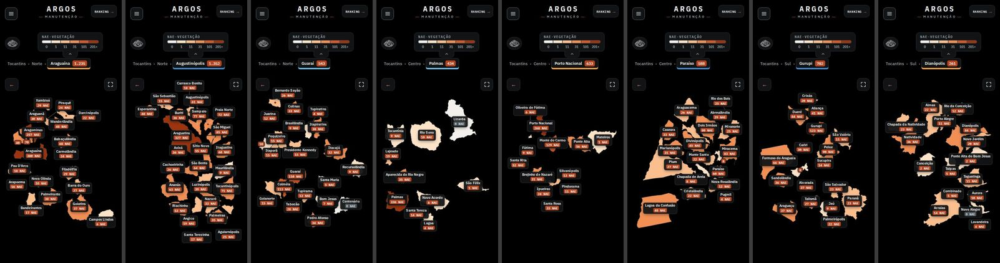

Computador, antes e depois, escuro e claro: `prints/folha-antes-8polos-dark-desk.jpg`, `prints/folha-depois-8polos-dark-desk.jpg`, `prints/folha-antes-8polos-light-desk.jpg`, `prints/folha-depois-8polos-light-desk.jpg`; celular claro: `prints/folha-antes-8polos-light-cel.jpg` e `prints/folha-depois-8polos-light-cel.jpg`.

---

## Sugestão 1 · Enquadramento corrigido, afastamento adaptativo e moldura fixa no celular — prioridade 1 · esforço M

**Problema.** (a) Afastar os municípios igualmente em todo o polo não dá lugar aos cartões: o mapa encolhe para caber e a distância em pixels fica a mesma. No computador, um polo alto (Augustinópolis, Paraíso) usa só uma faixa da largura; no celular o mapa tinha a altura justa dos municípios (253 a 553 px conforme o polo) e a página pulava de altura a cada nível. (b) Com o alimentador em foco o `viewBox` ficava mais estreito que a caixa e o SVG (`width:auto`) **encolhia** e cortava a rede e os municípios numa borda reta.

| computador, Augustinópolis, antes | depois |
|---|---|
| 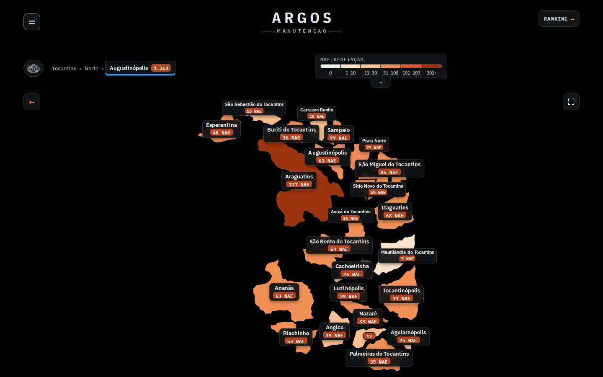 | 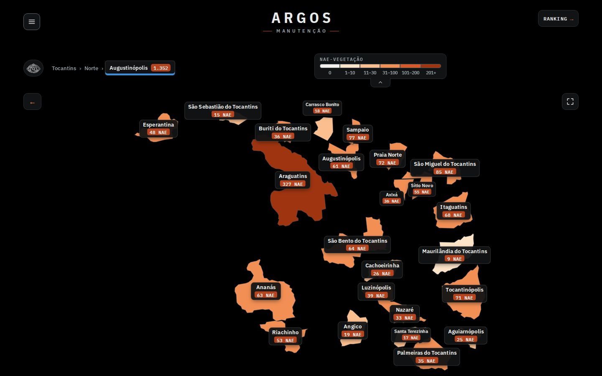 |

| computador, claro, antes | depois |
|---|---|
| 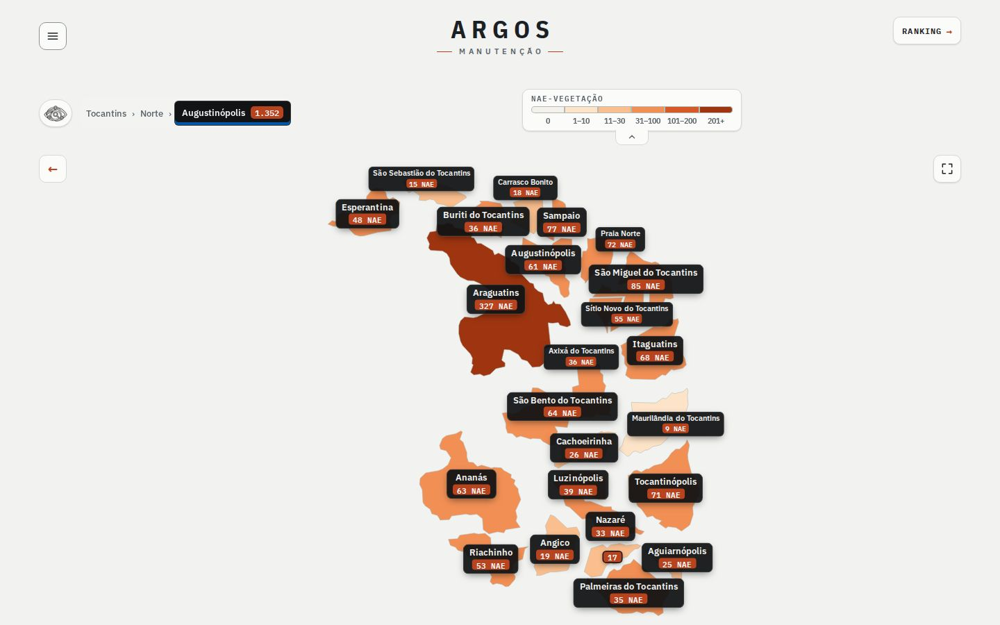 | 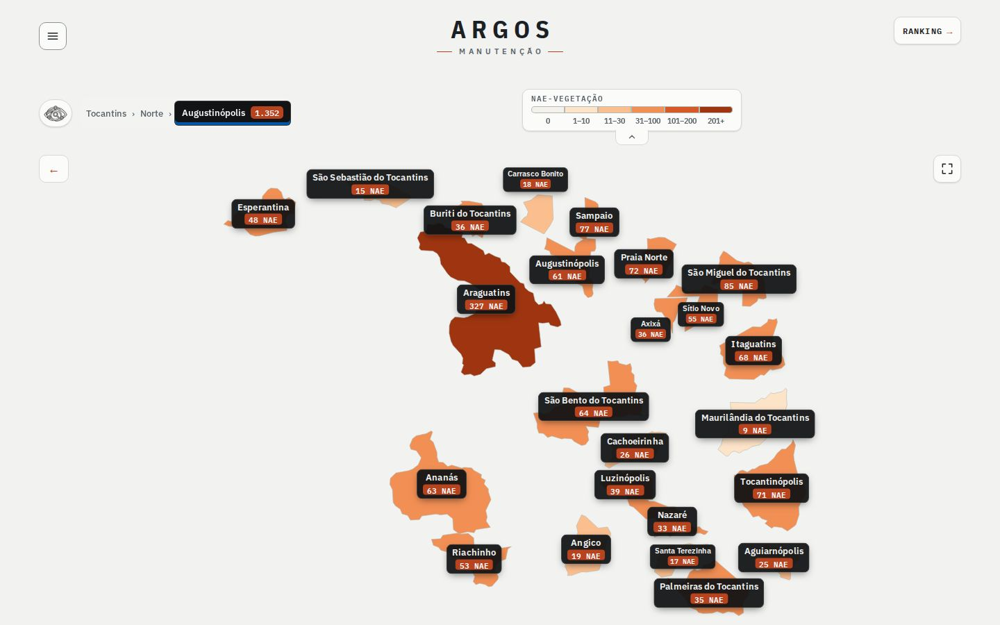 |

**Proposta.**
1. `entraPolo()` calcula o afastamento base de hoje e `ajusta()` espalha os centros **só no eixo que sobra tela**, por bissecção, até a proporção do conjunto casar com a da área útil (teto 1,7x no computador, 3x no celular). O eixo limitante não muda, então o tamanho das formas também não.
2. Celular: o SVG ganha moldura de **altura fixa** (`alturaCel()`: a altura do estado inteiro, no máximo 78% da tela e `innerHeight − 300` px; 544 px em 390x844) com o conjunto centralizado. Acabam os saltos de altura entre os níveis (antes: 253–553 px conforme o polo; depois: 544 px sempre).
3. `enquadra()` devolve sempre um `viewBox` com a proporção da caixa inteira e mantém a faixa em cima e à direita que a base já reserva para as bandeirinhas dos polos.

**Defeito do corte (medido por `foco.js`):** razão largura do SVG / largura da caixa com o alimentador em foco, o de mais km do município de maior NAE de cada polo.

| Tela | antes (8 polos) | depois |
|---|---|---|
| computador | 0,56 0,60 0,40 0,51 0,49 0,67 0,84 0,76 (8 de 8 cortados) | 1,00 em todos |
| notebook | 0,50 0,53 0,36 0,45 0,43 0,59 0,73 0,66 (8 de 8) | 1,00 em todos |
| tablet e celular | 1,00 | 1,00 |

| computador, alimentador em foco, antes (rede cortada em x≈1120) | depois |
|---|---|
| 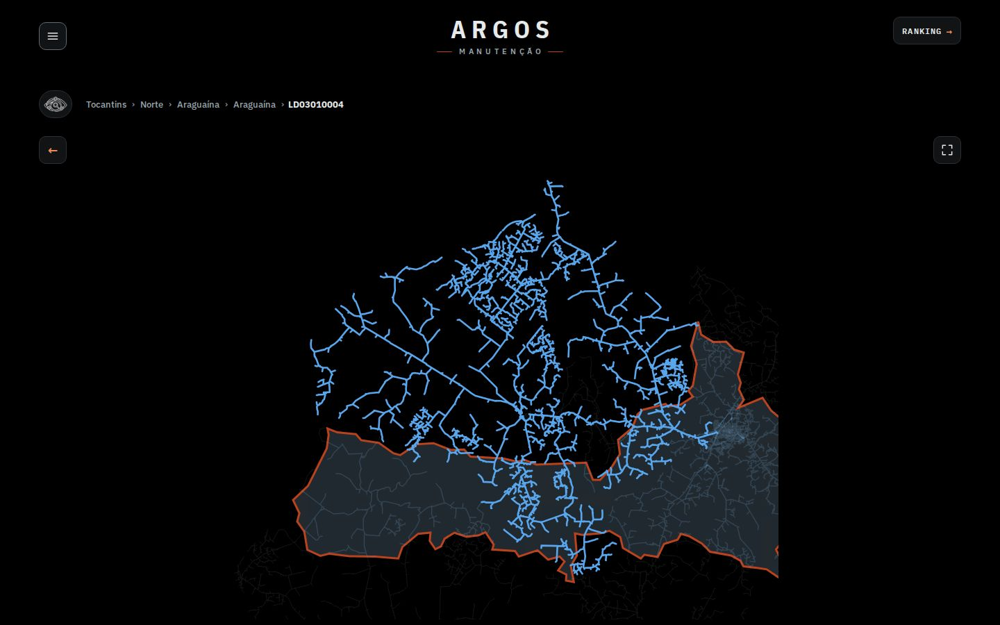 | 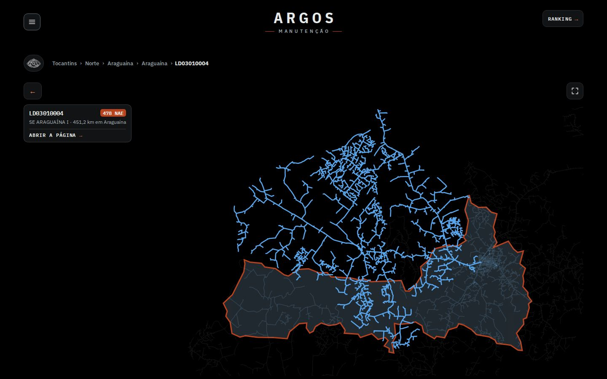 |

Celular, antes e depois, polos mais densos (escuro e claro): 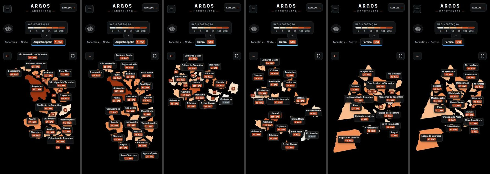 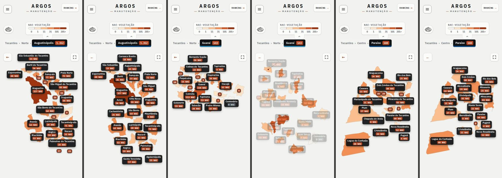

Tela cheia no celular com o polo aberto (a tela cheia é da outra sessão; conferi que continua funcionando e ganha com o afastamento): 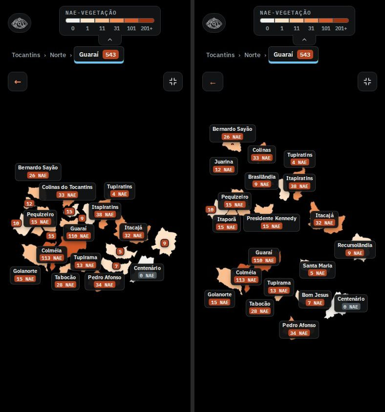

**Esforço:** M (`ajusta` ~25 linhas, `areaPx`/`alturaCel`/`lateral` ~15, `enquadra` reescrito). **Risco:** médio. (a) O espalhamento distorce a geografia (um "mapa explodido" mais esticado); o teto limita. (b) No celular o mapa passa a ter 544 px fixos: o que vem abaixo (rodapé) desce em polos que antes eram baixos. A regional também ficou menor no celular que na base (cabe inteira na moldura, sem rolar). (c) Se o tema 2 trouxer zoom/arrastar, `ajusta` deve rodar só ao abrir o nível (hoje roda em `entraPolo`). (d) Porto Nacional no celular continua limitado fisicamente pela área útil (358x440 px). **Arquivos:** `alimentador/site/mapa-municipios.js` (`entraPolo`, `enquadra`, novas `ajusta`/`areaPx`/`alturaCel`/`lateral`).

---

## Sugestão 2 · Nome curto e ordem de colocação dos rótulos — prioridade 2 · esforço P

**Problema.** Mesmo com mais lugar, nomes como "Palmeiras do Tocantins" (170 px) não cabem dentro de municípios pequenos; e o algoritmo guloso (do maior NAE ao menor) pode deixar um município pequeno sem lugar enquanto sobra espaço que outra ordem aproveitaria.

**Proposta.**
- O cartão compacto usa o nome curto, sem " do Tocantins" (37 municípios; nenhum nome se repete no estado). O cartão cheio e o balão do mouse seguem com o nome completo. `const curto = n => n.replace(/ do Tocantins$/, '')`.
- `poeNomes` passou a tentar até 8 ordens de colocação (maior NAE, menores primeiro, nome mais longo, mais apertados por letra, NAE ao contrário, de cima para baixo e 2 embaralhadas com semente fixa) **só quando a primeira deixa município só com o número ou sem rótulo**, e fica com a melhor. No celular, afastamento adaptativo + nome curto + raio de busca do cartão ao lado maior (até 136 px, antes 90) com a 1ª ordem deixam 6 "só número" (de 139; antes 35); as ordens extras tiram mais 2 e ficam 4 (Araguaína 2, Guaraí 1, Paraíso 1). No computador a primeira ordem já basta, então nada roda a mais.
- Duas proteções de custo, achadas ao medir: **(i)** orçamento de 45 ms para as tentativas extras (em máquina lenta só a 1ª ordem roda); **(ii)** cache da geometria (`chaveNomes`): `poeNomes` é chamada ao fim da animação, pelo `ResizeObserver` e ao recolher a legenda, e antes refazia tudo mesmo sem mudança; agora a chamada repetida custa ~1 ms. Sem essas duas, uma versão inicial deste protótipo chegava a ~190 ms por chamada no celular, e três chamadas por abertura.

**Custo medido** (`perf.js`: CPU 4x mais lenta, 3 polos densos x 4 aberturas, alternando antes/depois; a máquina estava compartilhada, então leia como "não piora"):

| Tela | parte síncrona ao abrir (mediana) | maior tarefa longa | soma das tarefas longas por abertura |
|---|---|---|---|
| computador | 53 → 50 ms | 260 → 190 ms | 627 → 620 ms |
| celular | 52 → 40 ms | 319 → 168 ms | 702 → 460 ms |

Chamada de `poeNomes` isolada, CPU normal: computador ~11–38 ms; celular ~10–66 ms na primeira chamada (o teto é o orçamento de 45 ms mais a refação da melhor ordem), ~1 ms nas repetidas.

**Esforço:** P (~35 linhas em `poeNomes`: função `tenta(ms)`, `nota`, `chaveNomes`). **Risco:** baixo a médio: `tenta` refaz o `ocupado` a partir de uma cópia (`base`) e esvazia `nomes2` a cada tentativa; se outra sessão mexer em `poeNomes` (legenda, tela cheia, balão), conflito no mesmo bloco. **Arquivos:** `mapa-municipios.js` (`NIVEIS_ROT`, `poeNomes`).

---

## Sugestão 3 · Cartão preto no município aberto e no alimentador em foco — prioridade 3 · esforço M

**Problema.** No nível município a lista embaixo da busca tinha título em caixa alta pequena e a NAE do município **não aparecia** (só a dos alimentadores). Com o alimentador em foco o mapa não dizia qual era nem como abrir a página dele.

| município, lista, antes | depois |
|---|---|
| 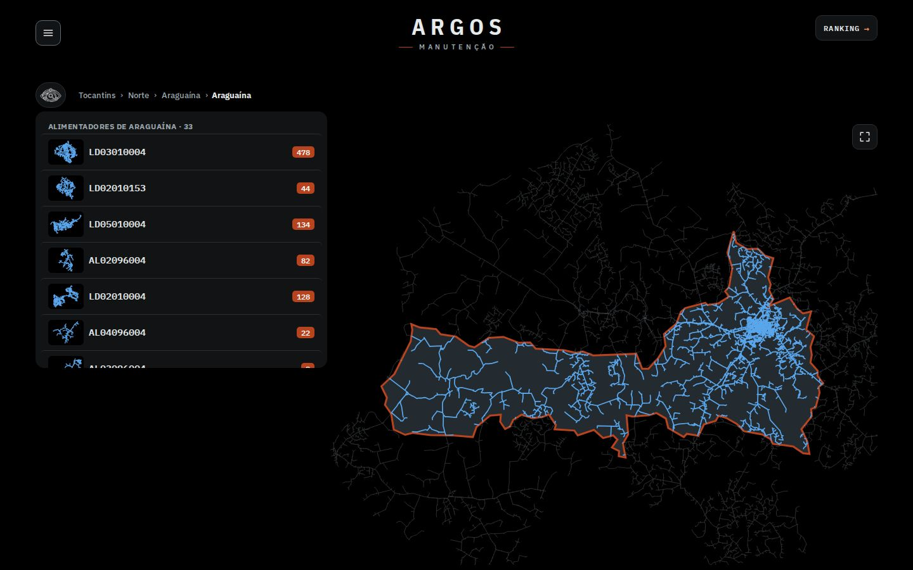 |  |

| alimentador em foco, antes | depois |
|---|---|
|  |  |

**Proposta.**
- **Lista do município (`#ativo-res.lista-mun`)** vira cartão preto nos dois temas: município em Plex Sans Condensed 700 (20 px), selo "380 NAE" (a NAE do município, que já está nos dados) e "33 ALIMENTADORES" em Plex Mono caixa alta; linhas com código em Mono 600 e o selo da NAE à direita; miniatura da rede em azul claro sobre preto (no claro o azul escuro `--rede` quase sumia). O título aceita `{html}` em `busca-ativo.js` (texto continua escapado com `esc`).
- **Cartão do alimentador em foco (`.mt-ac`)**: código em mono, selo da NAE, "SE ARAGUAÍNA I · 451,2 km em Araguaína" e "ABRIR A PÁGINA →". No computador fica na coluna da esquerda, embaixo da seta de voltar; no celular, preso embaixo do mapa. É um link: com o commit das 06:22 (1 clique abre o painel) ele passa a ser o caminho explícito para quem chegou ao foco pela busca ou por "Ver no mapa". O km e a subestação aparecem só aqui, uma vez.
- Sem dado repetido: o município não ganhou cartão no mapa (nome e contagem já estão no cabeçalho da lista).

| celular, lista (depois) | celular, foco (depois) | celular, foco, claro (depois) |
|---|---|---|
| 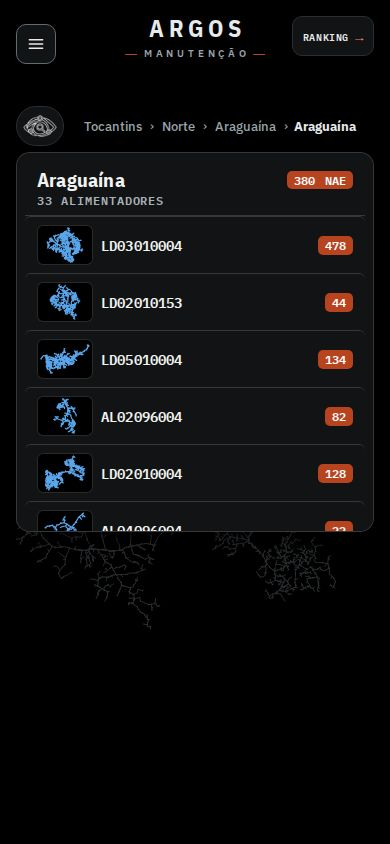 | 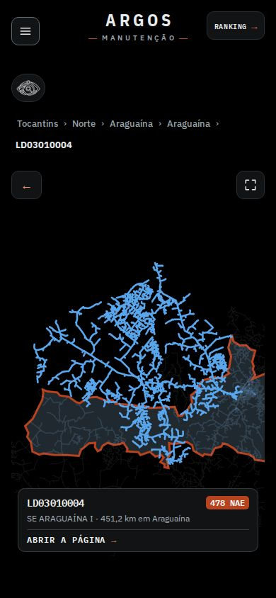 | 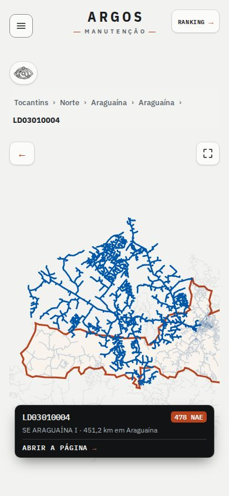 |

Claro, computador: `prints/depois-mun-araguaina-lista-light-desk.jpg`, `prints/depois-al-foco-light-desk.jpg`. Antes no celular: `prints/antes-mun-araguaina-lista-dark-cel.jpg`, `prints/antes-al-foco-dark-cel.jpg`.

**Esforço:** M (CSS ~35 linhas, `cartaoAl` ~12 linhas, título HTML em `busca-ativo.js`). **Risco:** baixo a médio: a lista e a busca são da outra sessão ("Argos design improvements"), então o que mexo ali é só o título (`{html}`) e o CSS do cartão; o `cartaoAl` entra em `.mt-lado`, ao lado da seta e da lista antigas, sem tocar no resto. **Arquivos:** `mapa-municipios.js` (`cartaoAl`, `focaAl`, `saiAl`), `busca-ativo.js` (`mostra`, `atalhos`), `site.css` (blocos `.mt-ac` e `#ativo-res.lista-mun`).

---

## Sugestão 4 · Selo Mono 600 e fontes reserva com as métricas do Plex — prioridade 4 · esforço P

**Pesos (auditado por `fontes.js` em início, polo, município e ranking).** Carregados: Plex Sans 400/500/600/700, Condensed 600/700, Mono 600. Em uso sem peso carregado: **Plex Mono 700 em 32 textos** (todos os selos da NAE e o título "NAE-Vegetação" da legenda): o navegador sintetiza negrito em cima do 600, que borra em 9–12 px. Depois: 0 textos sem peso carregado. Comparação ampliada 3x (sintético atual, 600 verdadeiro, 700 verdadeiro):

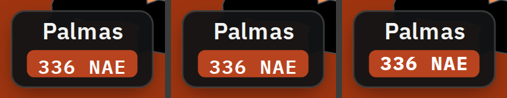

**Proposta:** 600, que já está carregado (zero custo): uma regra de CSS lista os componentes (`.mt-mn i`, `.mt-regcards i`, `.mt-pchip i`, `.mt-ac i`, `.so-n`, `.pl-nae`, `.mt-regs-t` ...). Se quiserem o 700 de verdade: acrescentar `IBM+Plex+Mono:wght@400;600;700` ao link do Google Fonts (+~15 KB, em `scripts/gera_trechos.py`, constante `FONTES`).

**Fontes reserva.** Com os woff2 do Google demorando 1,5 s (simulado, `fontes-cls.js`), a troca de fonte desloca o layout. Declarei três `@font-face` locais com as métricas do Plex (Plex Sans Fallback: `size-adjust` 98%; Plex Cond Fallback: 88,9%; Plex Mono Fallback: 100%; com `ascent/descent-override`), colocados depois do Plex em `--f-body`, `--f-display` e `--f-mono`; `--f-display` também aparece dentro de `ranking-polos.js` e leva o mesmo ajuste.

| CLS com fonte lenta | antes | depois |
|---|---|---|
| ranking, celular | **0,1724** | **0,0004** |
| início, celular | 0,0011 | 0 |
| ranking, computador | 0,0473 | 0,0409 |
| início, computador | 0,0643 | 0,0637 (o que sobra vem do `menu.js`, tema 5) |

Prints: `prints/fonte-antes-ranking-cel-reserva.jpg` / `...-final.jpg` e os `fonte-depois-...` correspondentes. **Esforço:** P. **Risco:** baixo (`local()` só vale onde a fonte existe; onde não há Arial/Courier cai no `system-ui` de sempre). **Arquivos:** `site.css` (tokens `--f-*`, `@font-face`, peso dos selos), `ranking-polos.js` (`--f-display`).

---

## Sugestão 5 · Ranking (`polos/`) com a mesma linguagem — prioridade 5 · esforço P

**Problema.** A página não tem a marca nem o cartão: a escolha de polo é uma nuvem de texto ("Araguaína 1.235 NAE" no mesmo peso), a NAE da linha é só um número em negrito e o cabeçalho da tabela usa o mesmo cinza do corpo.

| computador, antes | depois |
|---|---|
| 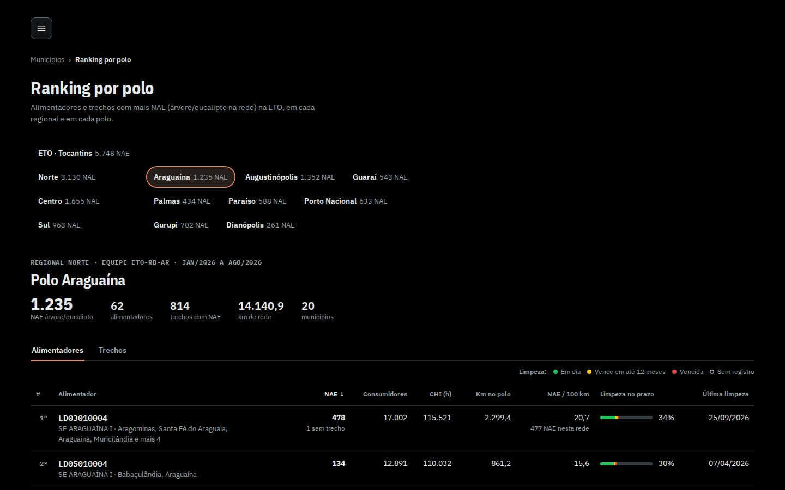 | 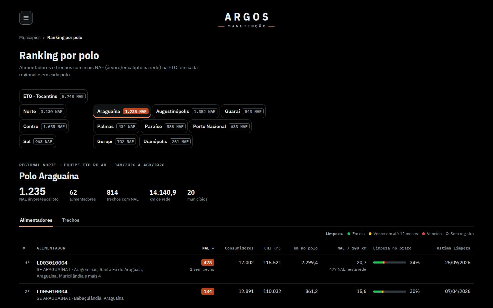 |

**Proposta.** (1) Marca ARGOS/MANUTENÇÃO na linha do menu, como link para a página inicial (HTML gerado por `gera_trechos.py`; o `ranking-polos.js` só cria a marca se a página não trouxer, para cópias antigas). (2) Escolha de ETO/regional/polo: nome em Plex Sans 600 + selo da NAE; o escolhido vira **cartão preto** com selo vermelho e filete laranja (como o polo aberto na barra do mapa); os demais ficam só com contorno e selo vazado (12 cartões pretos de uma vez pesariam, sobretudo no claro). No celular, ETO/Norte/Centro/Sul têm o mesmo desenho (nome em caixa alta, selo embaixo). (3) NAE da linha no **selo vermelho** do mapa. (4) Cabeçalho da tabela em Plex Mono 11 px caixa alta; KPIs em Plex Sans Condensed 700.

| celular, escuro (depois) | celular, claro (depois) |
|---|---|
| 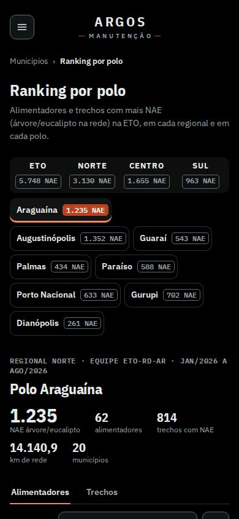 | 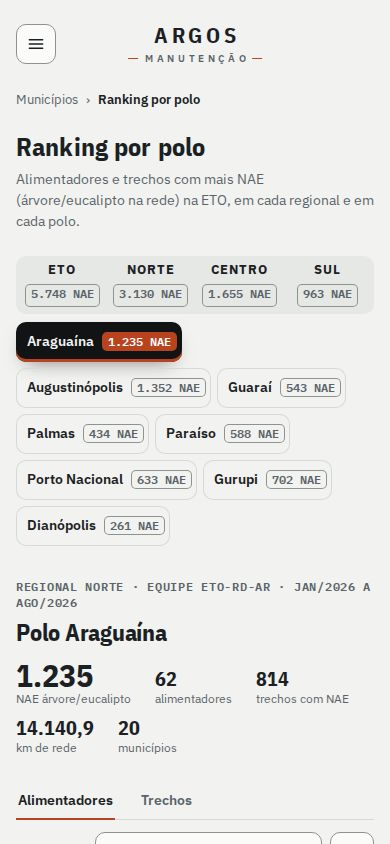 |

Antes no celular: `prints/antes-ranking-dark-cel.jpg`. Claro, computador: `prints/depois-ranking-light-desk.jpg`; polo rolado: `prints/depois-ranking-polo-dark-desk.jpg`. A versão com a marca no HTML (o patch de `gera_trechos.py`, simulado por `ranking-html.js`) renderiza **idêntica** à da marca criada por JS (0 pixels de diferença nos dois tamanhos).

**Esforço:** P (CSS no `<style>` que o `ranking-polos.js` injeta + 3 templates + 3 linhas no gerador). **Risco:** baixo; o selo em 60 linhas pesa na coluna NAE: se incomodar, só nos 10 primeiros. Os números por polo do ranking agora batem com os do mapa (Araguaína 1.235, Augustinópolis 1.352, Guaraí 543, Palmas 434, Paraíso 588, Porto Nacional 633, Gurupi 702, Dianópolis 261): a divergência que a rodada 2 achou saiu com o commit `9d433d2`. **Arquivos:** `ranking-polos.js`, `scripts/gera_trechos.py` (`marca` antes de `migalhas` na página `polos/`).

---

## Como aplicar

```
cd /home/user/smartled
git apply --check melhorias-noite/rodada-3/tema-3-tipografia/proto/tema-3-rodada-3.diff   # passou contra o HEAD 8ab7caf
git apply melhorias-noite/rodada-3/tema-3-tipografia/proto/tema-3-rodada-3.diff
```
Diffs por arquivo: `proto/site.css.diff`, `proto/mapa-municipios.js.diff`, `proto/busca-ativo.js.diff`, `proto/ranking-polos.js.diff`, `proto/gera_trechos.py.diff`. Os arquivos inteiros estão em `proto/` e a base de comparação em `orig/`. Não há arquivo novo: tudo é alteração. Para aplicar por partes, as sugestões estão em funções/blocos separados: 1 e 2 em `mapa-municipios.js` (`enquadra`/`ajusta`/`entraPolo` e `poeNomes`/`NIVEIS_ROT`), 3 em blocos `.mt-ac` e `#ativo-res.lista-mun` do CSS mais `cartaoAl` e o título da lista, 4 nos `@font-face`/`--f-*` e na regra do peso dos selos, 5 no bloco "tema 3" do `ranking-polos.js`. Depois de aplicar, regenere o site com `scripts/gera_trechos.py` (copia os assets).

**Interação com a outra sessão ("Argos design improvements"):** não toquei em legenda, busca (lupa), tela cheia nem bandeirinhas. O `enquadra` novo mantém a faixa de 56 px em cima e 120 px à direita que as bandeirinhas dos polos usam na regional; o `poeNomes` continua tratando `leg`, `volta` e `tc` como obstáculos (0 cartões sobre controles nas 32 medições).

## Limites e notas
- Chromium do sandbox (Linux): sem Arial/Courier reais, o teste das fontes reserva usa Liberation Sans/Mono (métricas compatíveis). Tempos com CPU 4x mais lenta e máquina compartilhada com outras sessões: variância alta (±30%), por isso falo em "não piora".
- O orçamento de 45 ms do `poeNomes` faz o resultado depender da velocidade da máquina: em aparelho lento vale só a 1ª ordem (a medição "depois" do celular, 4 só número, é a de CPU normal; com orçamento 0, só a 1ª ordem, ficam 6 "só número" e 96 nomes dentro, ainda longe dos 35 e 72 de antes).
- Os 4 "só número" do celular (Araguaína 2, Guaraí 1, Paraíso 1) só se identificam entrando no município; um primeiro toque que mostre o balão (nome e NAE) e um segundo que abra seria o complemento natural (tema 2).
- Todos os números e prints vêm do site; nada foi inventado. As páginas do alimentador (`mapa_trechos.html`) têm CSS próprio e não receberam as fontes reserva; ficam para uma próxima rodada (tema 4/5).
