# Tema 4 · Painel do alimentador: um protótipo só, sobre a lupa atual (rodada 3)

Consolida as sugestões 1+2 da rodada 2 (cabeçalho e lupa numa linha, mapa na altura da tela, painel sem dados repetidos) e as 4, 3 e 5 (abas, camadas em acordeão, gaveta no celular), **rebaseadas** em:
- a **lupa ATUAL** da outra sessão (Artifact `F9h14JEhEqGMgZqPrZXV8W`, lida em 15/10/2026, `assets/lupa-painel.js` de 68.066 bytes, sha256 `7bd7c62e…`; guardada em `proto/original/lupa-painel.artifact.js`): agora ela mora **dentro do mapa** (só o olho; tocar abre o campo + Filtros), a busca com resultados em grupos é dela e há uma seta ← no começo do caminho;
- o **painel ATUAL** do `/teste/` (= `alimentador/site/`, gh-pages 5cdff04f), que já traz o **Insp→manut** com "INSP nº → MANUT nº".

Nada foi editado no repositório, nada foi publicado, nenhum Artifact criado: o protótipo é `proto/painel.css` + `proto/painel.js` + um acréscimo de cerca de 10 linhas na lupa (`proto/lupa-painel.js`), injetados por Playwright (`prints.js`). Testado ao vivo em `LD01072001` (154 km), `AL03037009` (212 km), `LD02022033` (grande: 1.375 km, 1.019 trechos) e `AL01015049` (pequeno: 5,5 km, 11 trechos), em 1440×900 e 390×844, escuro e claro.

## Resumo (5 linhas)
1. **A base mudou e o protótipo da rodada 2 foi refeito em cima dela.** Com a lupa dentro do mapa a barra saiu do cabeçalho, mas o resto ficou: 5 linhas empilhadas (☰, ← Municípios, SE, código, "Trechos por ativo") = 224 px; mapa de 924×702 que passa 26 px da janela e faz a página rolar 58 px (celular: mapa 358×490 a partir de y=226, página rola 526 px). A busca com resultados dentro da lupa, que a rodada 2 teve de acrescentar, agora é nativa e saiu do protótipo.
2. **Cabeçalho numa faixa só (64 px) e mapa na altura da tela**: desktop 924×702 → **992×820, todo à vista, sem rolar** (área visível 624.624 → 813.440 px², **+30%**, 48% → 63% da janela); celular 358×490 → **366×710** (175.420 → 259.860 px², **+48%**, 53% → 79%). O resumo "199 trechos · 153,98 km · NAE 23" mora no cabeçalho; a tabela Classe/Trechos/Extensão, o bloco "NAE - vegetação", a lista de trechos e a legenda de cores saem do painel (a lupa já diz tudo isso).
3. **Contagem automática de repetições** (`repeticoes.js`, 4 alimentadores × desktop/celular × 5 estados da tela): dados mostrados em mais de um lugar ao mesmo tempo, somando os 4 alimentadores, **de 4 → 0 (estado inicial), 6 → 0 (4 camadas), 17 → 3 (lupa aberta) e 13 → 0 (classe T1 aberta)** no desktop; no celular 13 → 3 (lupa aberta) e 3 → 0 (classe aberta). As 3 que sobram são a nota da NAE (de propósito, ver abaixo); as outras 2 do "depois" são uma coincidência numérica no `LD02022033` ("1.019 ativos" na Manutenção = 1.019 trechos).
4. **Nota da NAE por classe × total** (única mudança na lupa): "Soma das classes 24 = NAE do alimentador 23 + 3 de outros alimentadores que estão em trechos daqui − 2 sem trecho." Confere com os dados nos 4 alimentadores (LD01072001 24 = 23 + 3 − 2; AL03037009 32 = 37 + 1 − 6; LD02022033 61 = 60 + 1; AL01015049 3 = 3, sem nota). Com o trecho escolhido, abas **NAE 4 · Faixa 2 · Inspeção 5 · Insp→manut 46 · Manutenção 60** (painel de 11.409 px → 1.158 px); camadas em acordeão (4 cartões + Dados cabem nos 820 px; legendas 598 → 156 px); no celular, gaveta inferior.
5. **Recomendação nº 1: Sugestões 1 + 2 juntas (cabeçalho numa faixa, mapa na altura da tela, painel sem repetição)**: quase só CSS, devolve a maior área de mapa nos dois formatos e não toca em dado nenhum. Depois 3 (abas), 4 (acordeão e legendas) e 5 (gaveta). Lista completa em "O que implementar primeiro".

## Medidas (`metricas.json`, `metricas.js`)
"Antes" = `/teste/` ao vivo + lupa atual. "Depois" = protótipo. `LD01072001`; os outros três alimentadores têm exatamente a mesma geometria (ver 2ª tabela). Erros de JavaScript na carga: nenhum nos 16 casos.

| | antes | depois |
|---|---|---|
| Topo da página até o mapa (desktop / celular) | 224 px / 226 px | 64 px / 66 px |
| Mapa, desktop (l × a; parte que cabe na janela) | 924×702; 676 px | 992×820; 820 px |
| Mapa, celular | 358×490 | 366×710 |
| **Área visível do mapa, desktop** | 624.624 px² (48,2% da janela) | **813.440 px² (62,8%), +30%** |
| **Área visível do mapa, celular** | 175.420 px² (53,3%) | **259.860 px² (78,9%), +48%** |
| Rolagem da página (desktop / celular) | 58 px / 526 px | 0 / 0 |
| Painel com as 4 camadas ligadas (altura do conteúdo) | 1.528 px (a caixa tem 626: rola) | cabe nos 820 px (acordeão) |
| Coluna de legendas sobre o mapa, 4 camadas (desktop / celular) | 598 px / 386 px | 156 px / 32 px (celular: botão "Legendas 4") |
| Painel com o T2-A escolhido e as 4 camadas (desktop / celular) | 11.409 px / 11.965 px | 1.158 px / 1.310 px |

| Alimentador | mapa antes (d) → depois (d) | área visível | mapa antes (m) → depois (m) | área visível |
|---|---|---|---|---|
| `LD01072001` | 924×702 → 992×820 | 624.624 → 813.440 (+30%) | 358×490 → 366×710 | 175.420 → 259.860 (+48%) |
| `AL03037009` | 924×702 → 992×820 | idem | 358×490 → 366×710 | idem |
| `LD02022033` | 924×702 → 992×820 | idem | 358×490 → 366×710 | idem |
| `AL01015049` | 924×702 → 992×820 | idem | 358×490 → 366×710 | idem |

## Repetições (`repeticoes.json`, `repeticoes.js`)
Conta, no texto **visível na janela** (fora de `<details>` fechado e do que está rolado para fora do painel), quantas vezes cada dado aparece ao mesmo tempo: extensão total, nº de trechos, SE, código, "Trechos por ativo", nº e km de cada classe, linha de trecho, NAE do alimentador. Os números vêm de `window.D` da própria página. Cada célula é a soma de "vezes − 1" nos 4 alimentadores.

| estado da tela | desktop antes | desktop depois | celular antes | celular depois |
|---|---|---|---|---|
| inicial (Faixa ligada) | 4 | 0 | 0 | 0 |
| 4 camadas ligadas | 6 | 1 * | 0 | 0 |
| lupa aberta (classes e camadas) | 17 | 3 ** | 13 | 3 ** |
| classe T1 aberta na lupa | 13 | 0 | 3 | 0 |
| trecho T2-A escolhido, 4 camadas | 0 *** | 1 * | 0 | 0 |

\* Falso positivo do contador no `LD02022033`: "1.019 ativos" (Manutenção) tem o mesmo número de "1.019 trechos" (cabeçalho).
\** É a nota da NAE (um dado do cabeçalho dito de novo na lupa, **de propósito**: é a conta que fecha 24 com 23). Só aparece com a lupa aberta e só quando as classes não somam o total (3 dos 4 alimentadores).
\*** No "antes" a página rola para mostrar o trecho e o cabeçalho sai da janela (por isso 0): é um defeito, não uma vantagem.

O que ainda repete no "depois" e é aceito: o código do alimentador está no cabeçalho e na aba do navegador; o selo da NAE de cada trecho está no mapa, na lupa e na aba (são o mesmo dado em três escalas: lugar, lista, detalhe).

## O que mudou na base desde a rodada 2 e como o protótipo foi rebaseado
| Na base | Efeito no protótipo |
|---|---|
| A **barra da lupa** deixou o cabeçalho e foi para o canto do mapa (`.mapbox > .barra-busca`, de primeira só o olho) | Saíram do CSS a coluna da barra no cabeçalho e a linha da barra no celular. O cabeçalho ganhou espaço: virou **uma faixa só** (antes eram 2 linhas + barra). A lista dos resultados da busca é dela (`.lp-sug`). |
| **Busca com resultados em grupos** (trechos, chaves, ativos, postes, OS) | A "R2-a" (busca dentro da lupa) **sai do protótipo**; o painel só esconde a lista de trechos que ela substitui. O clique num resultado (`.lp-so`) sobe a gaveta no celular. |
| **Seta ←** no começo do caminho (`.lp-voltar`) | O texto "Municípios" fica no desktop largo e sai abaixo de 1280 px e no celular (a seta e o `title` já dizem para onde vai); o link continua no DOM para leitor de tela. |
| **Insp→manut com "INSP nº → MANUT nº"** | Entra como aba (46 linhas do T2-A, cada uma "INSP 000886/2026 → MANUT 002397/2026 · POSTES · prazo 17/10/2026") e como cartão em acordeão (a tabela alimentador × polo continua virando uma linha do polo). Não alterei o texto das linhas. |
| A **barra antiga** (extras.js) só sai da grade quando a lupa a leva para o mapa | Uma regra a esconde até lá (senão ela ocupa uma célula e empurra o mapa: 0,59 de deslocamento medido); se a lupa não carregar, o `painel.js` põe `p-sem-lupa` e ela volta a aparecer. |
| Lupa sem a nota da NAE | **Único acréscimo na lupa: cerca de 10 linhas + 1 de CSS** (`proto/lupa-painel.diff`). |
| O olho agora abre a barra | O selo da NAE do cabeçalho abre a barra e depois os Filtros (senão ficavam escondidos); no celular a gaveta desce para a faixa ao abrir a lupa (a lupa vive no mapa, por baixo da gaveta). |

Contrato com a lupa (o que o `painel.js` usa dela; peço à outra sessão que não renomeie): `.lp-lupa`, `.lp-fbt`, `.barra-busca` e a classe `lp-fechada`, `.lp-tr`, `.lp-so`, `#f-mun`, `window.__sel / __selecao / __limpar / __map`, e as globais `doMes()` / `doExt()` da página (a nota usa as duas).

## Dado → onde aparece (zero repetição)
Valores de `LD01072001`. **Negrito** = o único lugar do dado no protótipo.

| Dado | Hoje (`/teste/` + lupa atual) | **Protótipo** |
|---|---|---|
| Código do alimentador | h1 · `<title>` · 1ª linha da tabela do Insp→manut | **cabeçalho** · `<title>` · (a linha da tabela some, ver nota 1) |
| Subestação (SE-2PNA…) | sobretítulo | **cabeçalho**, ao lado do código |
| "Trechos por ativo" | subtítulo · `<title>` | **só `<title>`** |
| Nº de trechos (199) e extensão (153,98 km) | tabela Classe/Trechos/Extensão (Total) · "24,2 km de 154,0 km" em Faixa e Inspeção · Dados › municípios | **resumo do cabeçalho**; nos cartões "24,2 km (16%)" |
| Nº e km por classe | tabela · lista de classes da lupa · botões T1/T2/T3 (só tela cheia) | **lista de classes da lupa**; botões da tela cheia ganham "nº · km" |
| NAE do alimentador (23) | "23 no alimentador" no painel; o filtro de meses fica na lupa, do outro lado | **selo no cabeçalho**, que acompanha os meses (jan/2026 → 9); toque abre os Filtros |
| NAE por classe (4 · 6 · 14) × total | só os números por classe; quem soma vê 24 ≠ 23 | **lista de classes da lupa** + **a nota da conta** (única repetição aceita do total) |
| NAE por trecho | rótulo no mapa · pílula na lista · bloco do detalhe | rótulo no mapa · pílula na lupa · **aba NAE** do trecho (sem o título "NAE - vegetação") |
| Lista de trechos (com "Ordem") | painel (escondida com camada ligada) **e** lista da classe aberta na lupa | **lupa** (maior NAE primeiro; resultado da busca com a ordem de relevância) |
| Cor e nome de cada camada | legenda do mapa **e** botões de ano do cartão | legenda do mapa em linha (cor + nome); o cartão fica com OS, km e a lista |
| Contagens da Manutenção / Insp→manut | legenda do mapa **e** linhas do cartão **e** subtítulo | **só no cartão** (a legenda perde os números; aberto, o subtítulo some) |
| Nome da camada | Menu: Faixa / Inspeção / Insp→manut / Manutenção · cartões: Limpeza de faixa / Inspeção visual / Insp→manut / Manutenção · detalhe: "Manutenção executada" | abas e legendas com o nome do Menu; o `h3` das seções Inspeção/Insp→manut/Manutenção fica só para leitor de tela |
| Legenda de cores T1/T2/T3 | painel (escondida pela lupa) | **canto do mapa, só quando nenhuma camada de linha (Faixa, Inspeção) pinta o trecho de outra cor** |
| Croqui da faixa | Dados › Downloads › Faixa (3 cliques) | igual (sugestão 6, não prototipada) |

Nota 1: a tabela alimentador × polo do Insp→manut tem 3 linhas (alimentador, polo, e as 3 de situação); a 1ª repete o resumo do cartão e o código. Viraria só a linha do polo ("No polo Porto Nacional (31 alimentadores): 173 vencidas · 319 no prazo · 302 executadas"). Os números vêm da própria tabela; nada é calculado.

---

## Sugestão 1 · Cabeçalho numa faixa só, resumo ao lado, mapa na altura da tela  (recomendada nº 1)
**Esforço P · Risco baixo** (junto com a 2: M)

**Problema.** A barra já saiu do cabeçalho (a lupa está no mapa), mas ficaram ☰, "← Municípios", SE, código e "Trechos por ativo" em 5 linhas: o mapa começa em y=224, mede 924×702 e passa 26 px da janela; a página rola 58 px; a legenda, o botão de tela cheia e o crédito ficam cortados. No celular o mapa começa em y=226, mede 358×490 e a página rola 526 px.
Antes: `antes/lupa-LD01072001-d-inicial.jpg`, `antes/lupa-LD01072001-m-inicial.jpg`, `antes/claro-lupa-LD01072001-d-inicial.jpg`.

**Proposta.** Desktop: uma faixa de 64 px, `☰ · ← Municípios · LD01072001 · SE-2PNA SE PORTO NACIONAL | 199 trechos · 153,98 km · NAE 23 (vegetação · todos os meses)`. O selo vermelho é o mesmo das pílulas, acompanha o filtro de meses e abre os Filtros. A página passa a ter a altura da janela (`100dvh`); mapa e painel preenchem o resto; o painel rola por dentro. Abaixo de 1280 px o texto "Municípios" sai (a seta fica). Celular: duas linhas, `☰ · [←] código / SE · resumo em 3 linhas curtas à direita`; mapa a partir de y=66.

**Como fica.** `depois/LD01072001-d-inicial.jpg`, `depois/LD01072001-m-inicial.jpg`, `depois/AL03037009-d-inicial.jpg`, `depois/LD02022033-d-inicial.jpg` (1.019 trechos · 1.375,19 km), `depois/AL01015049-d-inicial.jpg` (11 trechos · 5,46 km); claro: `depois/claro-LD01072001-d-inicial.jpg`, `depois/claro-LD01072001-m-inicial.jpg`.

| antes | depois |
|---|---|
| 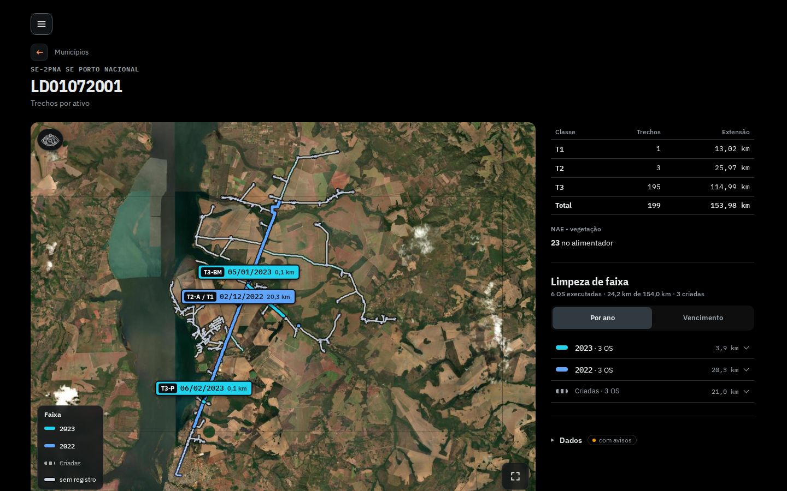 | 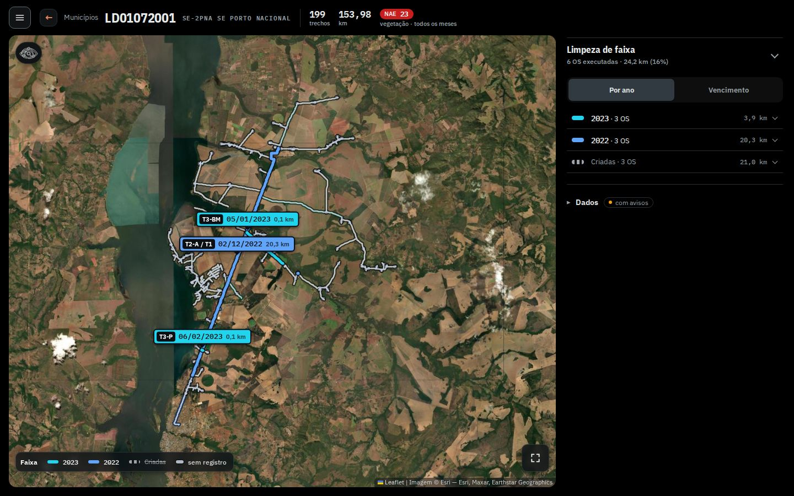 |
| 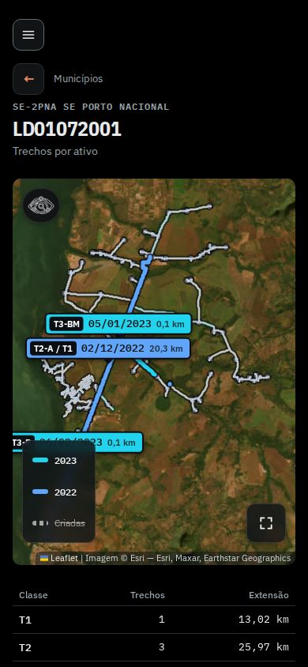 | 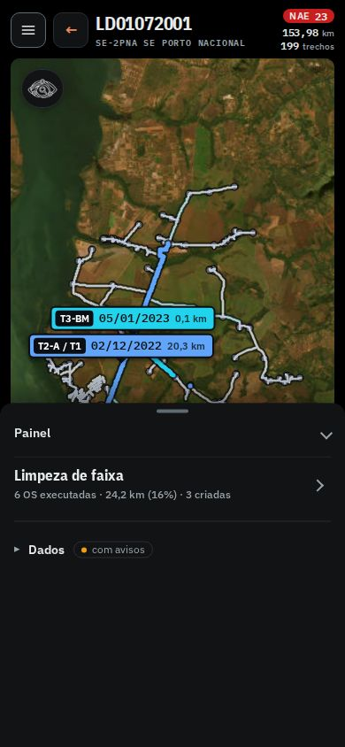 |
| 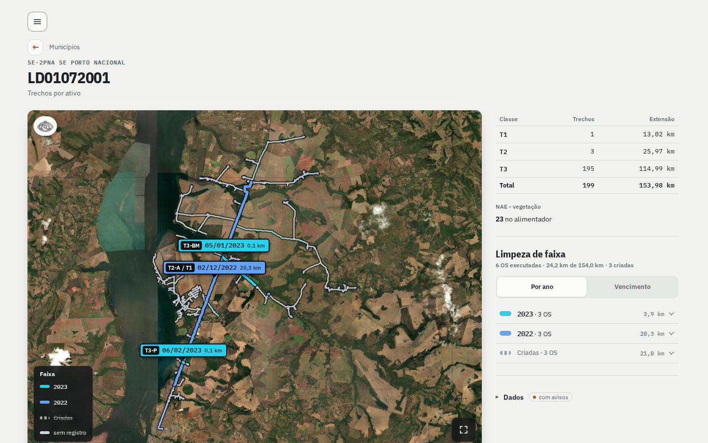 | 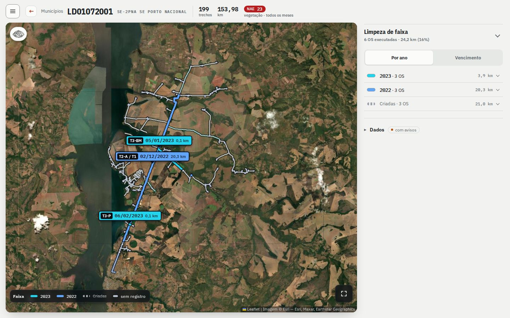 |

**Arquivos que mudariam.** CSS do `.wrap`, `header`, `.stage`, `#map`, `.panel` (`proto/painel.css`, seções 1 e 7); `alimentador/site/extras.js` ou o `painel.js` novo (monta o `.al-res` depois do `header`: bloco A, ~40 linhas); `telacheia.js` não muda (as regras valem só fora da tela cheia; o resumo vai para o alto da gaveta e volta).
**Risco.** (a) **Deslocamento de leiaute (CLS)**: o protótipo põe a classe `html.p-r3` no fim da carga e injeta o resumo e o ← no cabeçalho depois dos dados, então a página "pula". Medido com `cls-teste.js` (Layout Shift, 1 carga por caso, ruído de ±0,05 entre rodadas): antes 0,06 (desktop) e 0,07 (celular); protótipo como está 0,25 e 0,13; com a classe já em `<html class="p-r3">` desde o HTML 0,16 e 0,08. O que sobra vem do próprio cabeçalho trocando de texto e do resumo entrando. **Na versão real**: o gerador escreve a classe no `<html>`, o resumo (nº de trechos e km, que ele já sabe; o NAE entra pelo JS) e a seta ←; e o 1º script do cabeçalho não troca mais o texto do `h1`/`eyebrow`. A expectativa é voltar perto do 0,06 de hoje; isso não foi medido. (b) Janela com menos de 600 px de altura cai para rolagem normal (`min-height:600px`). (c) O total do cabeçalho é do alimentador inteiro e **não** acompanha o filtro de município (as classes da lupa acompanham). (d) Se o município aparecer no caminho (`.mig-mun`, hoje vazio nos 4 alimentadores testados), no celular só a seta o carrega (o `title` diz o destino).

## Sugestão 2 · Painel só com dados + a nota da NAE (classes × total)  (junto com a 1)
**Esforço M · Risco baixo** (a nota: P)

**Problema.** Mesmo com a lupa: a tabela Classe/Trechos/Extensão (166 px) e o "23 no alimentador" repetem a lista de classes da lupa; a lista de trechos do painel repete a classe aberta; a legenda de cores do painel fica escondida atrás da lupa. E a lupa mostra NAE por classe 4 + 6 + 14 = **24** num alimentador cuja NAE é **23**: quem soma vê um erro que não existe. Antes: `antes/lupa-LD01072001-d-inicial.jpg` (tabela e NAE no painel), `antes/lupa-LD01072001-d-lupa.jpg`.

**Proposta.**
- O painel perde a tabela de classes, o bloco NAE, `#lista` e "Ordem"; sem camada ligada diz "Nenhuma camada ligada" com o botão **Escolher camadas** (abre a lupa); a legenda de cores vai para o canto do mapa (Sugestão 4).
- **A nota da NAE** (cerca de 10 linhas na lupa, `proto/lupa-painel.diff`), embaixo das classes: `Soma das classes 24 = NAE do alimentador 23 + 3 de outros alimentadores que estão em trechos daqui − 2 sem trecho.` Os termos são `doExt()` (NAE de outro alimentador cujo ativo hoje está num trecho daqui) e as ocorrências de `doMes()` sem trecho; **só aparece quando a conta fecha** (`soma = total + de − sem`), some quando as classes já somam o total ou quando há filtro de município/classe escondida. Nos 4 alimentadores: 24 = 23 + 3 − 2 · 32 = 37 + 1 − 6 · 61 = 60 + 1 · 3 = 3 (sem nota). Os testes conferem a conta em cada um.
- A busca responde dentro da lupa (já é dela). O seletor Município dos Filtros passa a enquadrar o mapa no município (antes só mexia numa lista escondida): `LD01072001` → Monte do Carmo (14,40 km).
- Aviso "sem camada" e legenda de classes: `depois/LD01072001-d-sem-faixa.jpg`.

**Como fica.** `depois/LD01072001-d-lupa.jpg` (a nota), `depois/AL03037009-d-lupa.jpg`, `depois/LD01072001-d-classe.jpg`, `depois/LD01072001-d-busca.jpg` e `depois/LD01072001-m-busca.jpg` (busca "T3-A"), `depois/LD01072001-d-filtros.jpg`, `depois/LD01072001-m-municipio.jpg`; claro: `depois/claro-LD01072001-d-lupa.jpg`.

| antes | depois |
|---|---|
| 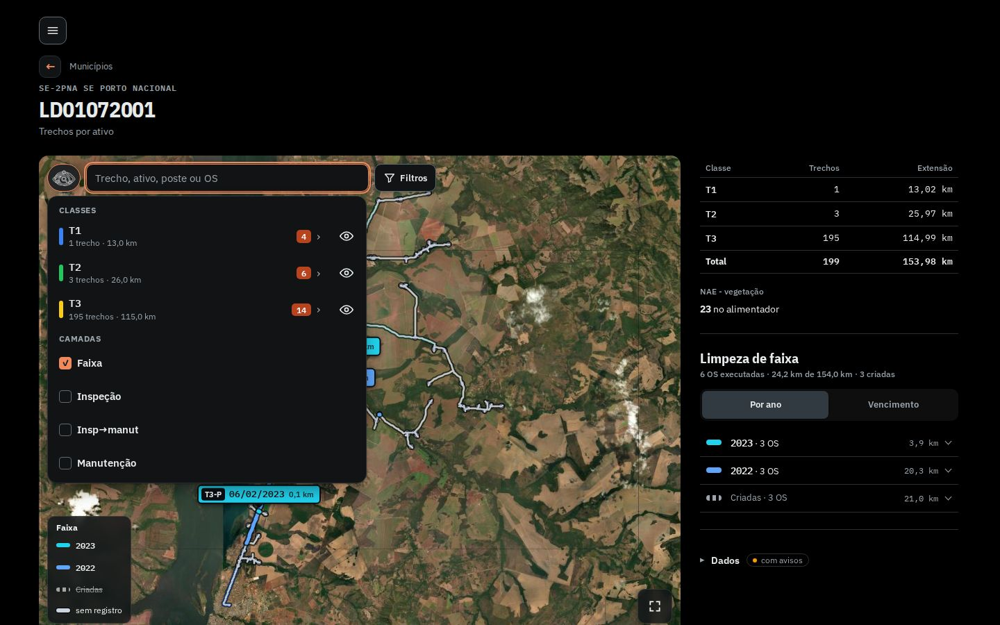 | 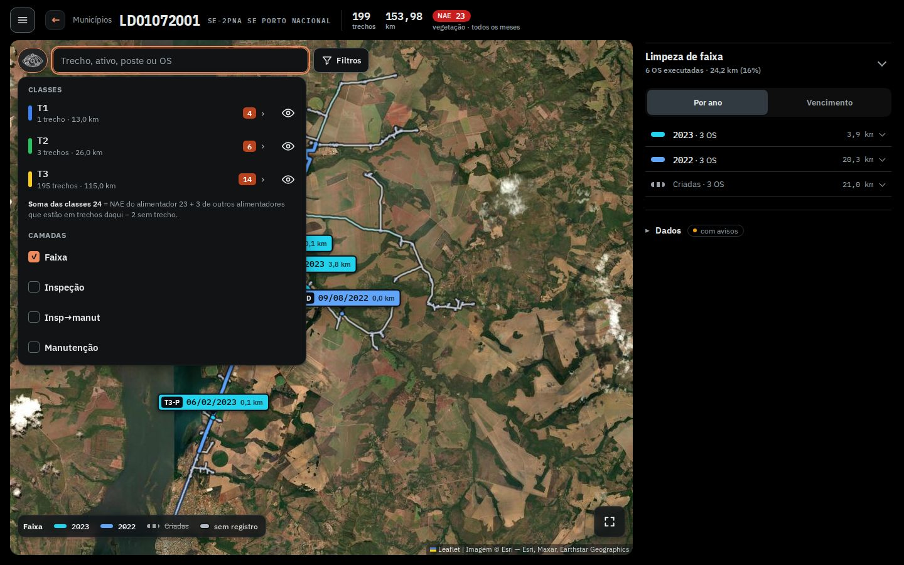 |
| 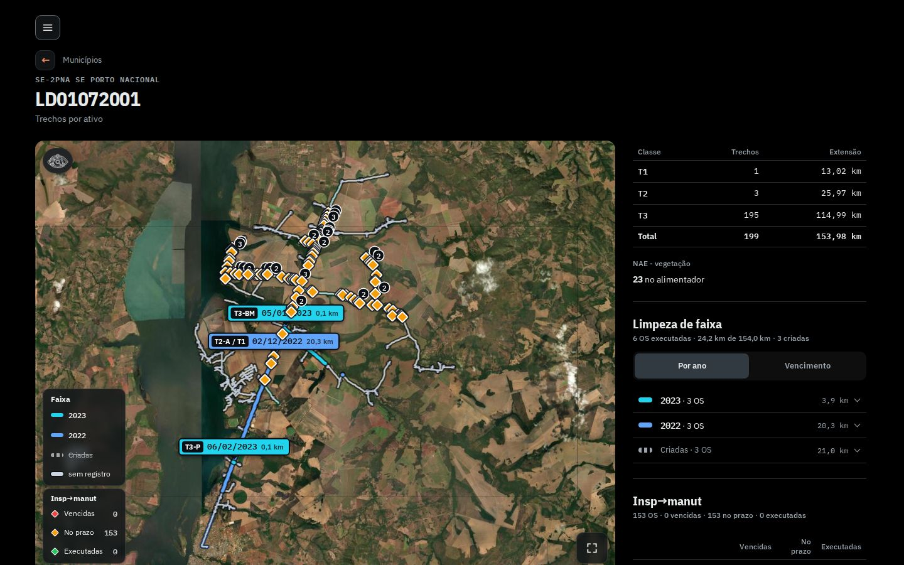 | 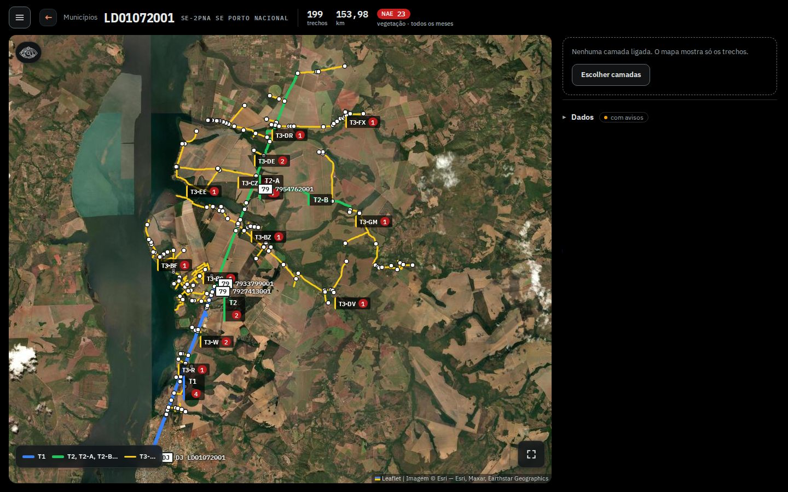 |
| 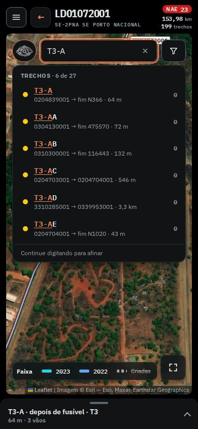 | 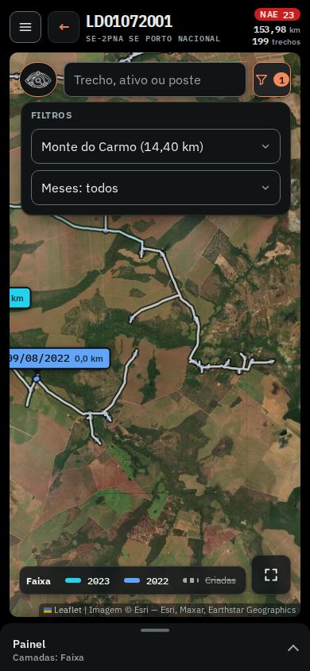 |

**Arquivos.** `alimentador/site/lupa-painel.js` (só a nota; dono: a outra sessão); `painel.js` novo (blocos A, C, H); CSS (seção 2/3).
**Risco.** Sai a escolha de ordem da lista de trechos (Maior NAE / Menor NAE / T1›T2›T3): a classe aberta da lupa é sempre "maior NAE primeiro" e a busca segue a relevância; se fizer falta, vai como opção dentro dos Filtros. Não fiz o `aria-live` do resultado (hoje o `.ativo-hit` anunciava os achados; a lupa nova tem `role="option"`, falta só validar com leitor de tela).

## Sugestão 3 · Trecho escolhido: ficha curta + abas (NAE · Faixa · Inspeção · Insp→manut · Manutenção)
**Esforço M · Risco baixo**

**Problema.** Escolhendo o T2-A com as camadas ligadas, o painel vira uma rolagem de **11.409 px** (NAE, Insp→manut e Manutenção empilhadas; "INSP … → MANUT …" 46 vezes antes de chegar à Manutenção) e, depois dela, ainda vêm os cartões do alimentador inteiro, que dizem outra coisa. Antes: `antes/lupa-LD01072001-d-trecho.jpg`, `antes/lupa-LD01072001-m-trecho.jpg`.

**Proposta.** Ficha fixa (nome, tipo, início, fim, extensão, fases, vem de, derivações) e, embaixo, abas com a contagem de cada uma: **NAE 4 · Faixa 2 · Inspeção 5 · Insp→manut 46 · Manutenção 60**; só a aba aberta mostra a lista que já existe (← → trocam; a escolhida é lembrada ao trocar de trecho; abas vazias apagadas; com uma só, nada muda). As abas dão o nome da camada (o `h3` repetido fica só para leitor de tela; o da Faixa fica, porque traz "T2 a cada 4 anos"). Os cartões do alimentador inteiro ficam recolhidos sob o título "Camadas · alimentador inteiro" e voltam como estavam ao limpar o trecho. No `Insp→manut` as linhas "INSP nº → MANUT nº" ficam como estão (o nº da inspeção continua sendo link).

**Como fica.** `depois/LD01072001-d-trecho.jpg` (aba NAE), `depois/LD01072001-d-trecho-insp.jpg` (aba Insp→manut, 46 linhas), `depois/LD01072001-m-trecho.jpg`, `depois/LD01072001-m-trecho-insp.jpg`, `depois/AL03037009-d-trecho.jpg`, `depois/LD02022033-d-trecho.jpg`, `depois/AL01015049-d-trecho.jpg`; claro: `depois/claro-LD01072001-d-trecho.jpg`, `depois/claro-LD01072001-m-trecho.jpg`. 11.409 px → 1.158 px.

| antes | depois |
|---|---|
| 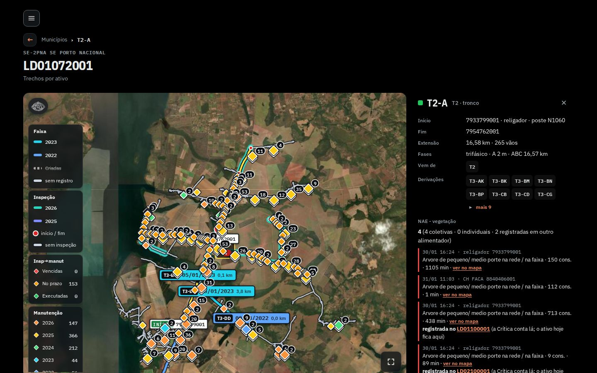 | 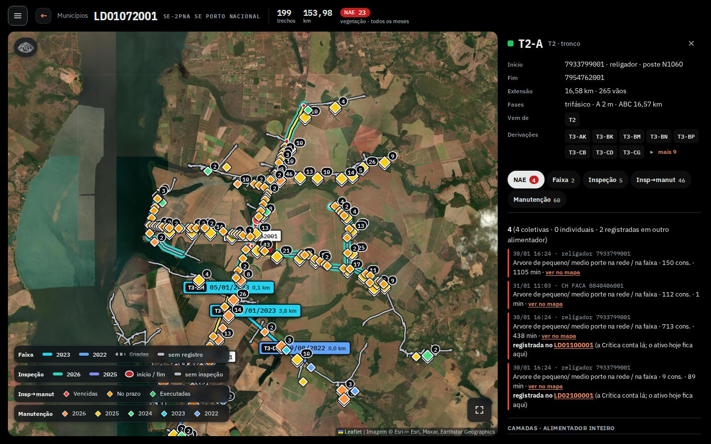 |
| 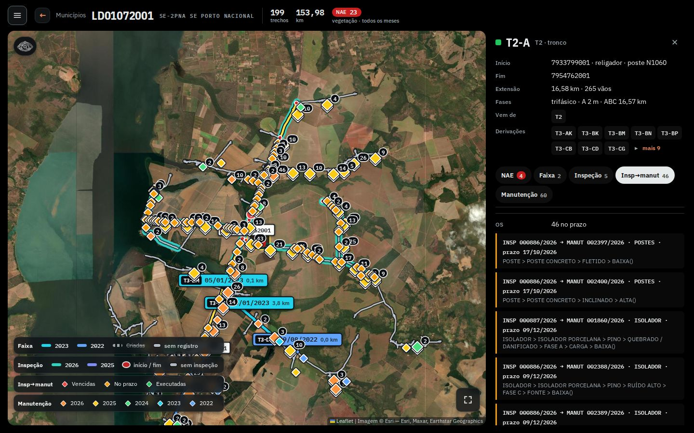 | 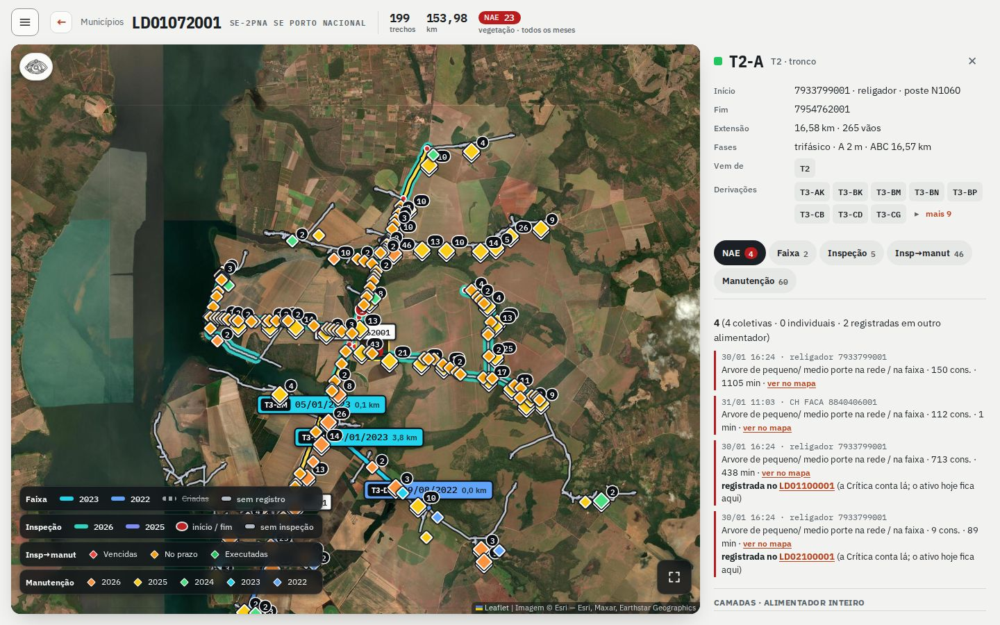 |
| 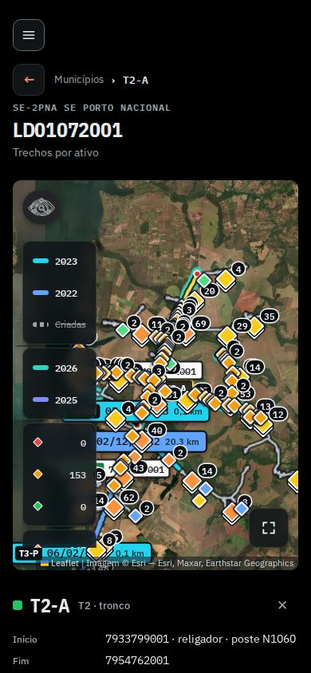 | 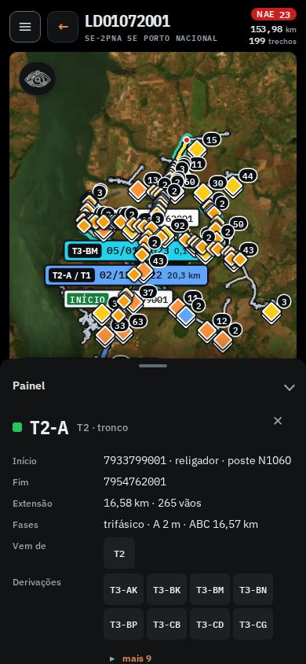 |

**Arquivos.** `alimentador/mapa_trechos.html` (`detalhe()`/`detalheVarios()`: separar o bloco NAE do `<dl>`); `limpeza.js`, `inspecao.js`, `manutencao.js`, `executadas.js` (cada `section.limp-sec` já é um grupo); `painel.js` (bloco F).
**Risco.** As seções de camada entram depois da primeira pintura do detalhe: o protótipo reconstrói as abas ao notar (MutationObserver); na versão real, melhor as camadas entregarem a seção a uma função só. Em 392 px a fileira passa para duas linhas ("Manutenção 60" desce); rolar na horizontal escondia abas, então deixei quebrar. Falta `role="tabpanel"` com `aria-labelledby` (o `role="tab"` e o ← → já estão).

## Sugestão 4 · Camadas em acordeão e legendas do mapa em linha (recolhíveis no celular)
**Esforço M · Risco médio**

**Problema.** Quatro cartões abertos somam **1.528 px** (Insp→manut e Manutenção ficam atrás de rolagem, "Dados" no fim); a coluna de legendas sobre o mapa tem **598 px** no desktop e **386 px** no celular, e cada ano/situação aparece na legenda e de novo no cartão. Insp→manut repete três vezes os mesmos números (subtítulo, linha do alimentador na tabela, as 3 linhas Vencidas/No prazo/Executadas). Antes: `antes/lupa-LD01072001-d-camadas.jpg`, `antes/lupa-LD01072001-m-camadas.jpg`.

**Proposta.** Cada cartão vira uma linha de acordeão (título + o resumo que já existe); abre um por vez; **ligar a camada na lupa abre o cartão dela**. O painel mostra as 4 camadas e o "Dados" de uma vez. Insp→manut aberto: sem subtítulo, a tabela vira a linha do polo; as 3 linhas (que também ligam e desligam no mapa) ficam. Subtítulos "24,2 km de 154,0 km" viram "24,2 km (16%)" (a extensão total já está no cabeçalho). Legendas do mapa em linha: cor + nome, sem números (598 → 156 px); no celular, com 2 ou mais, o botão "Legendas 4" as recolhe (386 → 32 px). A legenda de classes sobe para o canto do mapa, só quando Faixa/Inspeção não pintam as linhas.

**Como fica.** `depois/LD01072001-d-camadas.jpg`, `depois/LD01072001-m-camadas.jpg`, `depois/LD01072001-d-insp-manut.jpg`, `depois/LD01072001-d-sem-faixa.jpg`, `depois/AL03037009-d-camadas.jpg` (4 cartões num painel de 820 px), `depois/LD02022033-d-camadas.jpg`, `depois/AL01015049-d-camadas.jpg`; claro: `depois/claro-LD01072001-d-camadas.jpg`, `depois/claro-LD01072001-m-camadas.jpg`.

| antes | depois |
|---|---|
| 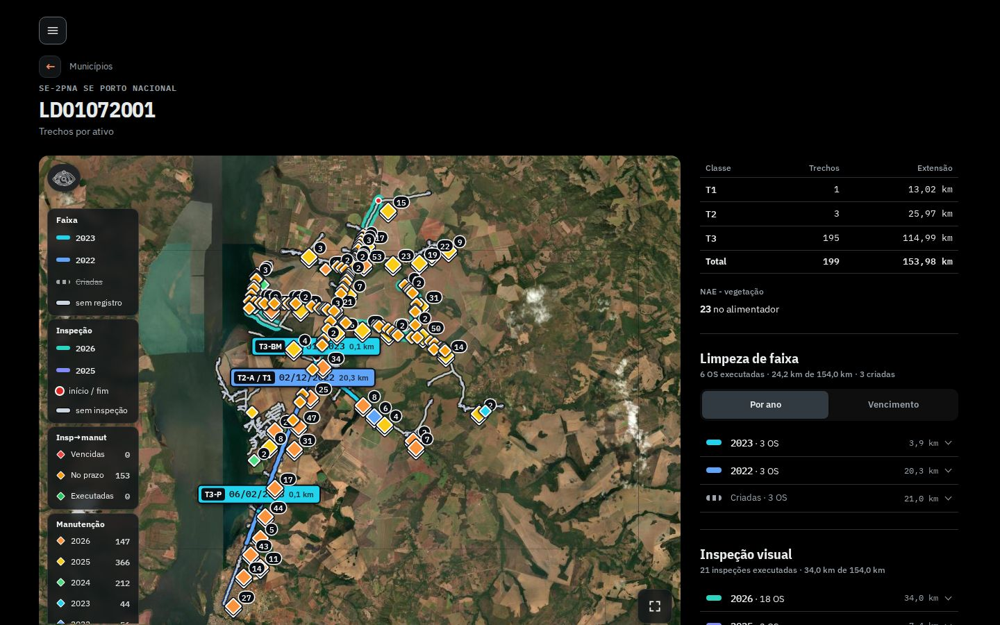 | 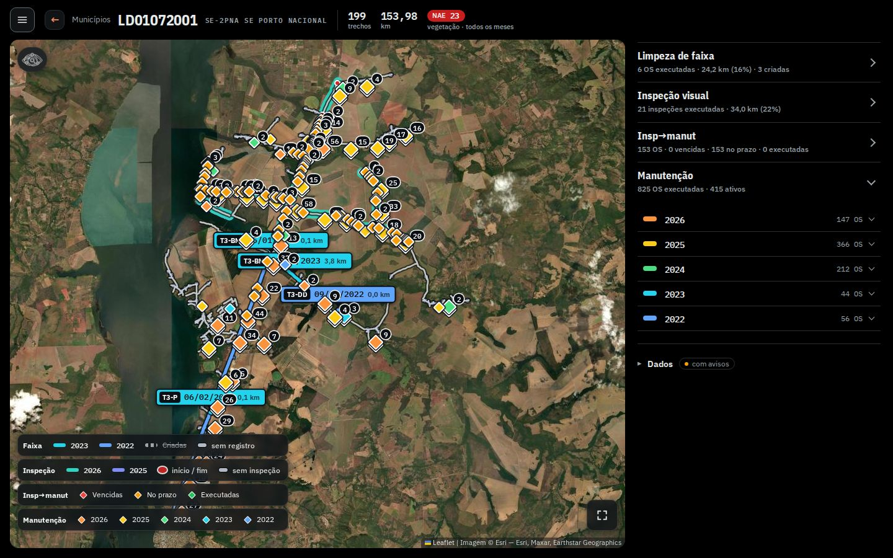 |
| 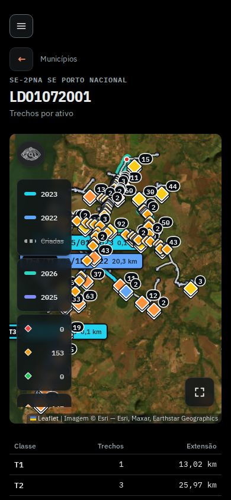 | 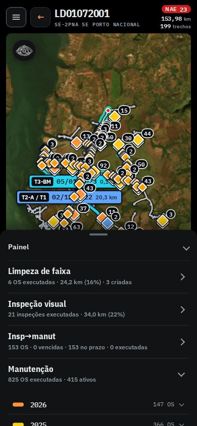 |
| 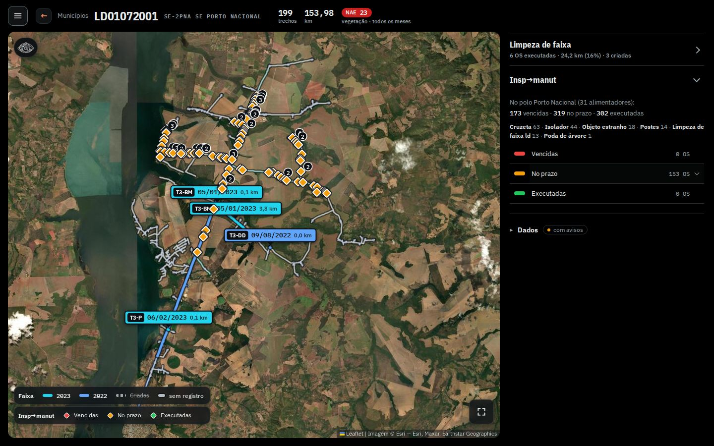 | 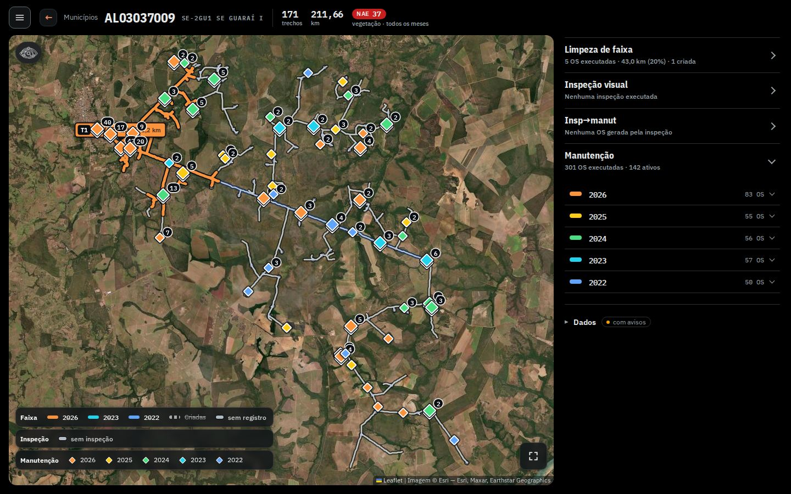 |

**Arquivos.** CSS (seções 4 e 5); `limpeza.js`, `inspecao.js`, `manutencao.js`, `executadas.js` (marcação `.limp-top` e o gancho do acordeão; o subtítulo do Insp→manut); `extras.js` (coluna `.ctl-lgs`, `#legenda`); `painel.js` (blocos D, D2, E).
**Risco.** O cartão refaz o próprio HTML: o protótipo reaplica o gancho com `MutationObserver`; na versão real, cada camada já entrega o cartão com `role=button`. Os títulos dos cartões ("Limpeza de faixa", "Inspeção visual") ainda diferem dos do Menu/lupa ("Faixa", "Inspeção"): unificar quando se mexer nos 4 scripts. "0,0 km (0%)" no `AL01015049` (sem OS) deveria sumir.

## Sugestão 5 · Celular: mapa quase na tela inteira e painel numa gaveta inferior
**Esforço G · Risco médio** (depende da 1)

**Problema.** No celular, mesmo com a lupa no mapa, a primeira tela é cabeçalho de 3 linhas + mapa de 490 px; o resumo, as camadas e o detalhe ficam abaixo (a página rola 526 px; com um trecho escolhido o painel passa de 11.965 px) e só se veem com o mapa grudado em cima. Antes: `antes/lupa-LD01072001-m-inicial.jpg`, `antes/lupa-LD01072001-m-camadas.jpg`, `antes/lupa-LD01072001-m-trecho.jpg`.

**Proposta.** A página tem a altura da tela; o mapa ocupa tudo entre o cabeçalho (66 px) e uma faixa de 60 px no pé: a **gaveta**. Fechada: "Painel · Camadas: Faixa · Inspeção …" (ou, com trecho, "T2-A · T2 · tronco · 16,58 km · 265 vãos"); toque ou arraste a abre em 46% ou 88%. **Escolher um trecho** (na lupa ou no mapa) sobe a gaveta até a ficha, menos enquanto o campo de busca tem o foco; o mapa **enquadra o trecho na parte que a gaveta não cobre**; **abrir a lupa (olho ou Filtros) ou focar o campo desce a gaveta** (a lupa vive no mapa, por baixo dela). Tela cheia continua com a gaveta lateral atual.

**Como fica.** `depois/LD01072001-m-inicial.jpg`, `depois/LD01072001-m-gaveta.jpg` (46%), `depois/LD01072001-m-trecho.jpg`, `depois/LD01072001-m-camadas.jpg`, `depois/LD01072001-m-lupa.jpg`, `depois/LD01072001-m-classe.jpg`, `depois/LD01072001-m-busca.jpg`, `depois/LD01072001-m-municipio.jpg`, `depois/LD01072001-m-tela-cheia.jpg`; grande: `depois/LD02022033-m-trecho.jpg`; pequeno: `depois/AL01015049-m-inicial.jpg`; claro: `depois/claro-LD01072001-m-lupa.jpg`, `depois/claro-LD01072001-m-camadas.jpg`.

| fechada | aberta (46%) | lupa por cima | filtros |
|---|---|---|---|
|  | 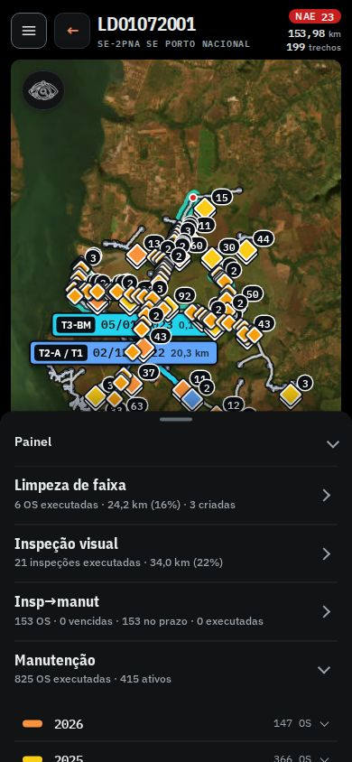 | 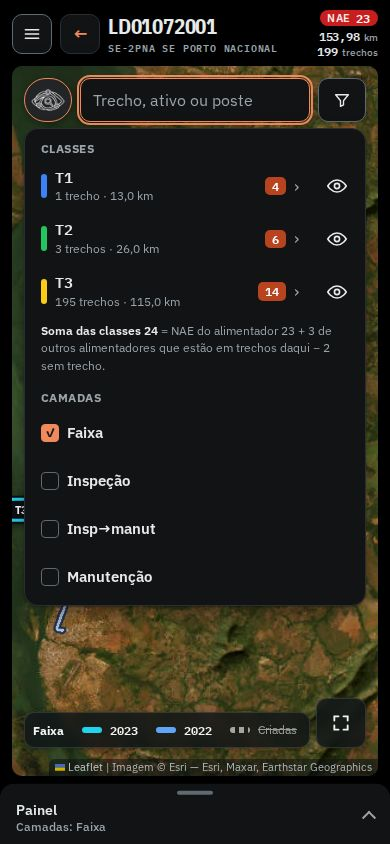 |  |

**Arquivos.** CSS (seção 7: `.panel` fixo, `.sheet-h`); `painel.js` (bloco G: estado peek/meio/cheio, arrastar, rótulo, `fitBounds`); `telacheia.js` (a gaveta lateral continua; o `.panel` precisa de uma regra para não acumular os dois comportamentos).
**Risco.** **Não testado em aparelho real:** o arrastar por dedo (pointer events) e a barra de endereço do iOS (por isso `dvh`). O foco por teclado precisa abrir a gaveta (o protótipo marca o conteúdo fechado como `inert`). Uma OS sem ponto no mapa, escolhida na lupa, faz a lupa rolar a **página** até o bloco da OS (código da lupa: `focaOS`); com a página fixa isso não rola nada, e o painel precisa receber essa rolagem.

## Sugestão 6 (não prototipada) · Croqui da faixa à vista
O **Croqui da faixa** é uma das funções mais úteis e está a 3 cliques (Dados, rolar, Downloads › Faixa). Candidato a botão no cartão da Faixa, com o trecho escolhido já selecionado. Fica para uma rodada própria porque o croqui é Excel e depende do `croqui.js`.

---

## O que implementar primeiro
| # | O quê | Esforço | Risco | Ganho medido | Depende de |
|---|---|---|---|---|---|
| 1 | **Cabeçalho numa faixa + mapa na altura da tela + painel sem tabela/lista/NAE** (Sugestões 1 e 2): `painel.css` seções 1, 2/3 e 7 (sem a gaveta) + `painel.js` A e C. Trocar `html.p-r3` por `html.al-site` | P/M | baixo | +30% de mapa no desktop (624.624 → 813.440 px²), +48% no celular; fim da rolagem da página; 4 → 0 repetições no estado inicial | nada |
| 2 | **Nota da NAE na lupa** (cerca de 10 linhas, `lupa-painel.diff`) | P | baixo | 24 ≠ 23 deixa de parecer erro | a outra sessão aceitar |
| 3 | **Abas no trecho escolhido** (Sugestão 3) | M | baixo | 11.409 → 1.158 px | nada |
| 4 | **Acordeão + legendas em linha** (Sugestão 4) | M | médio | 1.528 px → cabe em 820; legenda 598 → 156 px (celular 386 → 32 px) | 1 |
| 5 | **Gaveta no celular** (Sugestão 5) | G | médio | testar em aparelho real (iOS e Android) antes de publicar | 1 e 4 |
| 6 | Acabamentos: unificar os nomes das camadas nos 4 scripts; esconder "0,0 km (0%)"; `role="tabpanel"`; rolagem do painel para OS sem ponto | P | baixo | — | 3, 4, 5 |
| 7 | Croqui da faixa à vista (Sugestão 6) | M | baixo | — | — |

Como aplicar o patch (nada foi aplicado): `proto/rodada-3.patch` junta quatro arquivos de diff: `gera_trechos.diff` (copia `painel.css`/`painel.js` para `assets/` e liga os dois na página; contra `scripts/gera_trechos.py`), `lupa-painel.diff` (a nota; contra `alimentador/site/lupa-painel.js`, que ainda não está no repositório: aplicar quando a outra sessão trouxer a lupa) e `painel.css.novo.diff` / `painel.js.novo.diff` (arquivos novos em `alimentador/site/`). As partes do JS que na versão real viram mudança nos scripts das camadas (acordeão, abas) estão no `painel.js` como ganchos por `MutationObserver`, para o protótipo não tocar neles.

## Testes (`testes.js`, `testes-*.json`)
@@TESTES@@

## Como reproduzir
```
cd /home/user/smartled/melhorias-noite/rodada-3/tema-4-painel
./roda-prints.sh            # todos os prints (antes, antes claro, depois, depois claro); ~15 min
./roda-testes.sh            # interações, 4 alimentadores × desktop e celular
NODE_USE_ENV_PROXY=1 NODE_EXTRA_CA_CERTS=/root/.ccr/ca-bundle.crt node metricas.js      # metricas.json
NODE_USE_ENV_PROXY=1 NODE_EXTRA_CA_CERTS=/root/.ccr/ca-bundle.crt node repeticoes.js --alim=LD01072001,AL03037009,LD02022033,AL01015049   # repeticoes.json
python3 resume-medidas.py   # tabelas deste README
node prints.js consolidado --alim=LD01072001 --vp=m --estados=inicial,gaveta   # um print avulso; conjuntos: lupa, lupa-claro, consolidado, claro
```
O HTML da página do alimentador é reescrito na resposta (`page.route`): ganha `<style>` e `<script>` do protótipo e o `lupa-painel.js` (que o site ao vivo ainda não publica; o gerador `scripts/gera_trechos.py` já o copia e liga). As respostas de rede passam pelo `fetch` do Node porque o Chromium daqui não confia na CA do proxy. Flags de teste: `window.__PROTO = {a:0, …}` desliga um bloco do `painel.js` (a resumo, b botões da tela cheia, c painel enxuto, d legendas, e acordeão, f abas, g gaveta, h município).

`cls-teste.js` / `cls-teste.json` mede o deslocamento de leiaute (antes, protótipo, protótipo com a classe no `<html>`).

Arquivos: `antes/` (site + lupa atual; prefixo `lupa-`, `claro-lupa-`), `depois/` (protótipo; prefixo `claro-` = tema claro), `proto/painel.css`, `proto/painel.js`, `proto/lupa-painel.js` (lupa atual + a nota), `proto/original/lupa-painel.artifact.js` (a lupa como lida), `proto/*.diff`, `proto/rodada-3.patch`, `prints.js`, `metricas.js`/`metricas.json`, `repeticoes.js`/`repeticoes.json`, `testes.js`/`testes-*.json`, `resume-medidas.py`, `resumo.json`.

## Limites
- Medi o que cabe na janela de 1440×900 e 390×844 (e conferi 1024, 1280 e 360×640 na rodada 2, antes do rebase; nesta rodada só os dois pedidos). Não testei aparelho real (arrastar da gaveta, barra de endereço do iOS).
- A contagem de repetições é um olhar automático sobre o texto visível: não vê o que está só no mapa (rótulos, selos), e dá falso positivo quando dois números coincidem (caso do `LD02022033`).
- A lupa é da outra sessão: a nota é a única mudança proposta nela; o resto é encaixe em volta dela. Se ela mudar os nomes das classes citadas no contrato, o `painel.js` precisa acompanhar.
- Números do site (OS, NAE, km) são os da página no dia 15/10/2026; mudam quando as bases são atualizadas.
