# Tema 5 · Fluidez e acabamento (rodada 3: pacote único)

## Resumo

1. **Um patch só, 263 linhas** (`proto/tema5-rodada3.diff`, confere com `git apply --check` na base atual: `alimentador/site/` = /teste/ ao vivo, gh-pages 5cdff04f). Junta o melhor das rodadas 1 e 2 em 4 blocos: página do alimentador mais leve, CLS do ☰ e dos cartões, Tab/leitor de tela e alvos de 44 px no toque. A animação da página inicial não foi tocada.
2. **Página do alimentador (LD02022033, a maior)**: com CPU 4x, TBT **6,2 s → 3,2 s** (computador) e **6,7 s → 2,8 s** (celular), pronto **4,2 s → 2,6 s**, estilo+layout **3.250 → 1.723 ms**, redesenho a cada zoom **134 → 54 ms**, abrir a lista de trechos **~1.100 → ~700 ms** (CPU 4x). Ficou igual: zoom por roda com CPU 4x (18 fps).
3. **CLS**: início (computador) **0,070 → 0,008**, ranking **0,037 → 0,0001**, alimentador **0,055 → 0** (celular: 0,06 → 0), escuro e claro. O que sobra (0,008) é a troca de fonte do Google Fonts.
4. **Tab/leitor**: 3 paradas invisíveis por nível → **0**, 3 a 4 paradas a menos, cada nível passa a ser anunciado (61 a 108 caracteres) e a lista do município deixa de ser lida inteira (395 → 61). **Toque**: 5 a 30 alvos abaixo de 44 px por tela → **0**, exceções: link "Leaflet" da licença e a orelhinha da legenda aberta (o clique vale no painel todo).
5. **Nada quebrou**: legenda com orelhinha, busca no olho, tela cheia, bandeirinhas e rótulos com fio, lista/camadas/tela cheia do alimentador: 27 estados por fluxo, 4 fluxos (1440 e 390, escuro e claro), **0 diferenças estruturais**, 0 erros de console; no computador os pixels diferem no máximo 0,42 %. A verificação achou **2 defeitos do próprio protótipo** (orelha recolhida andava 52 px, cartões recolhidos com texto no topo) e eles já estão corrigidos no diff.

**Sugestão nº 1 recomendada: aplicar o pacote inteiro, começando pelo bloco da página do alimentador (maior ganho de fluidez) e levando junto o bloco de CLS (3 regras de CSS e 1 linha de JS, risco praticamente nulo).** Ordem sugerida em "O que implementar primeiro".

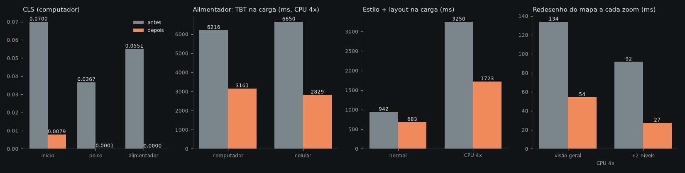

---

## O que entra no pacote

| Arquivo (em `alimentador/`) | Linhas (+/−) | Blocos |
|---|---|---|
| `site/site.css` | +22 / 0 | 2 (CLS), 3 (Tab), 4 (toque) |
| `site/mapa-municipios.js` | +19 / −2 | 2 (1 linha), 3 (aviso, ordem do Tab), 1 (`Intl`) |
| `site/busca-ativo.js` | +6 / −2 | 3 (caixa de resultados fora do Tab, resumo no aviso), 1 (`Intl`) |
| `site/menu.js` | +2 / 0 | 4 (toque) |
| `site/ranking-polos.js` | +3 / −1 | 1 (`Intl`), 4 (`--alvo`) |
| `site/limpeza.js`, `site/inspecao.js`, `site/extras.js` | +13 / −7 | 1 (polilinhas, `Intl`) |
| `mapa_trechos.html` (vira `alimentador.js` e `alimentador.css`) | +31 / −4 | 1 (polilinhas, `papel()`, `Intl`, `content-visibility`), 2 (CLS), 4 (toque) |
| **Total** | **+96 / −16** (263 linhas de diff) | |

Esforço por bloco: 1 = M, 2 = P, 3 = P, 4 = P. Risco: 1 baixo a médio, 2 baixo, 3 baixo (falta teste com NVDA/VoiceOver), 4 baixo.

Custo em bytes (gzip): +0,6 KB `site.css`, +0,7 KB `mapa-municipios.js`, +0,2 KB `busca-ativo.js`, +0,7 KB `alimentador.js/css`, o resto menos de 0,15 KB cada. Total ~ +2,6 KB.

Como aplicar (não foi aplicado, nada no repositório mudou): `cd /home/user/smartled && git apply melhorias-noite/rodada-3/tema-5-fluidez/proto/tema5-rodada3.diff`. Há também um `.diff` por arquivo em `proto/` e as cópias já alteradas em `proto/arvore/` e `proto/assets/` (`alimentador.js` e `alimentador.css` são o que o `gera_trechos.py` publica a partir do `mapa_trechos.html` alterado, conferido byte a byte contra o site ao vivo antes da alteração).

---

## Medições (antes → depois do protótipo, sobre o /teste/ atual)

### CLS por página (mediana de 3 cargas a frio, tema escuro)

| Página · dispositivo · perfil | CLS antes → depois | FCP (ms) antes → depois |
|---|---|---|
| inicio · computador · normal | 0,0700 → 0,0079 | 124 → 96 |
| inicio · computador · CPU 4x | 0,0699 → 0,0079 | 244 → 268 |
| polos · computador · normal | 0,0367 → 0,0001 | 88 → 128 |
| polos · computador · CPU 4x | 0,0384 → 0,0001 | 196 → 224 |
| alimentador · computador · normal | 0,0551 → 0,0000 | 176 → 160 |
| alimentador · computador · CPU 4x | 0,0581 → 0,0009 | 224 → 568 |
| inicio · celular · normal | 0,0000 → 0,0000 | 108 → 304 |
| inicio · celular · CPU 4x | 0,0000 → 0,0000 | 228 → 404 |
| polos · celular · normal | 0,0000 → 0,0000 | 80 → 116 |
| polos · celular · CPU 4x | 0,0585 → 0,0000 | 224 → 304 |
| alimentador · celular · normal | 0,0592 → 0,0000 | 152 → 172 |
| alimentador · celular · CPU 4x | 0,0621 → 0,0000 | 256 → 400 |

### Página do alimentador LD02022033: carga (mediana de 3)

| Dispositivo · perfil | Pronto (ms) | LCP (ms) | TBT (ms) | Maior long task (ms) | CLS | Nós DOM |
|---|---|---|---|---|---|---|
| computador · normal | 1.192 → 1.186 | 2.228 → 2.028 | 1.601 → 1.332 | 429 → 389 | 0,0551 → 0,0000 | 9.127 → 9.127 |
| computador · CPU 4x | 4.178 → 2.593 | 4.328 → 3.180 | 6.216 → 3.161 | 1.338 → 942 | 0,0581 → 0,0009 | 9.127 → 9.127 |
| celular · normal | 1.109 → 887 | 2.420 → 1.452 | 1.676 → 798 | 530 → 317 | 0,0621 → 0,0363 | 9.118 → 9.118 |
| celular · CPU 4x | 3.937 → 2.436 | 4.240 → 3.808 | 6.650 → 2.829 | 1.885 → 874 | 0,0621 → 0,0000 | 9.118 → 9.118 |

#### Interação com o mapa (Leaflet): fps · pior quadro (ms)

| Dispositivo · perfil · gesto | fps | Pior quadro (ms) | Long tasks (máx ms) |
|---|---|---|---|
| computador · normal · arrastar | 51,0 → 53,0 | 217 → 100 | 196 → 75 |
| computador · normal · zoom-roda | 30,7 → 34,2 | 250 → 200 | 155 → 127 |
| computador · normal · hover-linhas | 59,0 → 56,9 | 33 → 67 | 0 → 0 |
| computador · CPU 4x · arrastar | 43,8 → 51,1 | 650 → 200 | 138 → 73 |
| computador · CPU 4x · zoom-roda | 18,0 → 18,2 | 483 → 317 | 397 → 273 |
| computador · CPU 4x · hover-linhas | 51,7 → 55,1 | 133 → 67 | 0 → 0 |
| celular · normal · arrastar | 57,6 → 59,2 | 33 → 33 | 0 → 0 |
| celular · normal · pinca | 53,1 → 52,4 | 217 → 167 | 283 → 95 |
| celular · normal · hover-linhas | 56,1 → 60,0 | 50 → 17 | 0 → 0 |
| celular · CPU 4x · arrastar | 57,3 → 58,5 | 33 → 50 | 0 → 0 |
| celular · CPU 4x · pinca | 26,8 → 29,6 | 867 → 417 | 320 → 272 |
| celular · CPU 4x · hover-linhas | 58,1 → 56,0 | 33 → 50 | 0 → 0 |

### Ranking (polos/): carga (mediana de 3)

| Dispositivo · perfil | Pronto (ms) | LCP (ms) | TBT (ms) | Maior long task (ms) | CLS | Nós DOM |
|---|---|---|---|---|---|---|
| computador · normal | 260 → 215 | 112 → 124 | 17 → 10 | 64 → 60 | 0,0367 → 0,0001 | 1.491 → 1.491 |
| computador · CPU 4x | 772 → 775 | 316 → 228 | 399 → 392 | 249 → 229 | 0,0367 → 0,0001 | 1.491 → 1.491 |
| celular · normal | 376 → 214 | 180 → 80 | 111 → 17 | 114 → 67 | 0,0000 → 0,0000 | 1.488 → 1.488 |
| celular · CPU 4x | 792 → 776 | 320 → 228 | 434 → 492 | 274 → 311 | 0,0002 → 0,0000 | 1.488 → 1.488 |

### Lista de trechos (1.019 linhas, aparece ao buscar): custo da ação até o 2º quadro (ms) e rolagem

| Dispositivo · perfil | Mostrar (digitar "T3-A", "T3") | Filtrar | Limpar | Rolagem fps | Pior quadro na rolagem | Clique numa linha |
|---|---|---|---|---|---|---|
| computador · normal | 682 → 159 | 52 → 29 | 259 → 43 | 51,1 → 51,1 | 117 → 50 | 491 → 133 |
| computador · CPU 4x | 1.268 → 622 | 180 → 130 | 244 → 227 | 26,2 → 14,2 | 133 → 267 | 1.084 → 687 |
| celular · normal | 499 → 174 | 362 → 126 | 119 → 55 | 59,2 → 60,0 | 33 → 17 | 784 → 134 |
| celular · CPU 4x | 1.051 → 610 | 620 → 464 | 224 → 146 | 56,2 → 60,0 | 67 → 17 | 849 → 633 |

### Estilo + layout e scripts na carga da página do alimentador (trace, mediana de 3, ms)

| Perfil | Estilo+layout | Layout | Estilo | EvaluateScript | Commit |
|---|---|---|---|---|---|
| normal | 942 → 683 | 610 → 461 | 346 → 200 | 813 → 691 | 241 → 109 |
| CPU 4x | 3.250 → 1.723 | 1.932 → 1.315 | 1.218 → 483 | 2.034 → 1.752 | 764 → 301 |

### Redesenho da camada de linhas (a cada fim de zoom ou arrasto), ms, mediana de 8

| Perfil | visão geral | +2 níveis | +4 níveis | anéis no canvas |
|---|---|---|---|---|
| normal | 60,7 → 22,7 | 34,7 → 7,0 | 2,1 → 1,5 | 52.548 → 8.104 |
| CPU 4x | 133,9 → 54,3 | 91,7 → 27,4 | 2,0 → 6,0 | 52.548 → 8.104 |

### Tab e leitor de tela (computador; celular igual ou +1 parada)

| Nível | Paradas do Tab | Paradas invisíveis/sem sentido | Aviso ao entrar (caracteres) |
|---|---|---|---|
| estado · computador | 9 → 9 | 0 → 0 | nada → nada |
| estado · celular | 9 → 9 | 0 → 0 | nada → nada |
| regional · computador | 14 → 11 | 3 → 0 | nada → 82 |
| regional · celular | 14 → 11 | 3 → 0 | nada → 82 |
| polo · computador | 12 → 9 | 3 → 0 | nada → 73 |
| polo · celular | 12 → 9 | 3 → 0 | nada → 73 |
| municipio · computador | 13 → 9 | 3 → 0 | 395 → 61 |
| municipio · celular | 13 → 9 | 3 → 0 | 395 → 61 |
| alimentador · computador | 13 → 10 | 3 → 0 | nada → 108 |
| alimentador · celular | 13 → 10 | 3 → 0 | nada → 108 |

### Alvos de toque < 44 px no celular (390 px; sem contar os paths de município)

| Tela | antes → depois | o que sobra |
|---|---|---|
| estado | 5 → 1 | Legenda NAE-Vegetação[48x22] |
| regional | 10 → 1 | Legenda NAE-Vegetação[48x22] |
| polo | 8 → 1 | Legenda NAE-Vegetação[48x22] |
| municipio | 8 → 0 | – |
| alimentador | 9 → 0 | – |
| busca-aberta | 4 → 1 | Legenda NAE-Vegetação[48x22] |
| legenda-recolhida | 8 → 0 | – |
| menu-aberto | 11 → 1 | Legenda NAE-Vegetação[104x30] |
| polos | 12 → 0 | – |
| alimentador-pagina | 30 → 1 | Leaflet[49x14] |

Exceções contadas como atendidas: o link "Leaflet" da atribuição (texto em linha, exigido pela licença); a orelhinha da legenda ABERTA (48x22: o clique vale no painel inteiro, `leg.addEventListener('click')`); no "menu-aberto" a orelhinha fica atrás do menu. Os 111 a 139 paths de município continuam menores que 44 px no estado: é a área do tema 2 (zoom por pinça).


### Lista de trechos: repetição em ordem alternada e ablação (CPU 4x, mediana de 3 cargas, 2 rodadas)

A máquina é compartilhada (carga média 11 em 4 núcleos), então repeti em ordem antes, depois, "depois sem `content-visibility`", duas vezes. A ação "mostrar" é digitar "T3-A" na busca da página (a lista de 1.019 linhas está `display:none` até lá) até o 2º quadro.

| Dispositivo | Variante | Mostrar a lista (ms) | Rolar a lista (fps) | Clique numa linha (ms) |
|---|---|---|---|---|
| computador | antes | 1.213 · 954 | 26,6 · 27,1 | 863 · 1.042 |
| computador | depois (pacote) | **598 · 797** | **17,0 · 15,4** | **531 · 478** |
| computador | depois sem `content-visibility` | 1.048 · 1.118 | 26,9 · 23,3 | 638 · 744 |
| celular | antes | 1.114 · 1.092 | 59,2 · 58,9 | 745 · 608 |
| celular | depois (pacote) | **721 · 760** | 57,3 · 58,1 | **537 · 641** |
| celular | depois sem `content-visibility` | 1.133 · 1.018 | 58,9 · 60,0 | 509 · 734 |

Leitura honesta: **o ganho de abrir a lista vem do `content-visibility`** (as outras mudanças sozinhas não mexem nela), mas **no computador com CPU 4x a rolagem rápida da lista piora (27 → 15 a 17 fps)**: cada linha que entra na vista é medida na hora. Com CPU normal a rolagem fica igual (51 → 51 fps) e o pior quadro cai (117 → 50 ms). A altura estimada está certa (as linhas medem exatamente 48 px; os grupos, 31 px contra 32 estimados), então não é erro de estimativa. Se isso incomodar, dá para limitar a regra ao toque (`@media (pointer:coarse)`), onde o ganho é o mesmo e não há perda de rolagem.

### Tema claro (N = 2)

**CLS (mediana de 2 cargas)**

| Página · dispositivo · perfil | CLS antes → depois |
|---|---|
| inicio · computador · normal | 0,0700 → 0,0079 |
| inicio · computador · CPU 4x | 0,0643 → 0,0079 |
| polos · computador · normal | 0,0384 → 0,0001 |
| polos · computador · CPU 4x | 0,0367 → 0,0001 |
| alimentador · computador · normal | 0,0551 → 0,0009 |
| alimentador · computador · CPU 4x | 0,0581 → 0,0009 |
| inicio · celular · normal | 0,0000 → 0,0000 |
| inicio · celular · CPU 4x | 0,0000 → 0,0000 |
| polos · celular · normal | 0,0000 → 0,0000 |
| polos · celular · CPU 4x | 0,0002 → 0,0002 |
| alimentador · celular · normal | 0,0621 → 0,0000 |
| alimentador · celular · CPU 4x | 0,0592 → 0,0000 |

**Página do alimentador LD02022033, carga (mediana de 2)**

| Dispositivo · perfil | Pronto (ms) | TBT (ms) | Maior long task (ms) |
|---|---|---|---|
| computador · normal | 900 → 673 | 1.180 → 493 | 421 → 232 |
| computador · CPU 4x | 5.179 → 2.746 | 8.040 → 4.569 | 2.221 → 1.137 |
| celular · normal | 826 → 560 | 1.089 → 472 | 444 → 188 |
| celular · CPU 4x | 4.713 → 1.967 | 7.592 → 4.055 | 2.158 → 885 |

O tema claro não muda o que o protótipo faz; a oscilação do TBT entre as duas rodadas (escuro e claro) mostra o tamanho do ruído da máquina compartilhada, e só a direção (CPU 4x: pronto e TBT menores) é confiável.

---

## Sugestão 1 (prioridade 1) · Página do alimentador mais leve

**Problema.** A LD02022033 (1.019 trechos, 16.184 vãos, `dados.js` de 1,8 MB) é a página mais pesada do site: 9.127 nós no DOM (8.153 só na lista de trechos), TBT de 6,2 s a 6,7 s com CPU 4x, três camadas que desenham a rede inteira (52.548 anéis de 2 pontos no canvas, redesenhados a cada fim de zoom ou arrasto), dois laços quadráticos pequenos (`papel()` varre os 1.019 trechos para cada um dos ~1.000 fusíveis) e duas chamadas de `toLocaleString` com opções por linha da lista (cada uma cria um `Intl.NumberFormat`). Abrir a lista (digitar na busca) leva ~1 s com CPU 4x.

Antes (1º quadro, com o `menu.js` atrasado para fotografar o que vem antes dele, e quadro final):

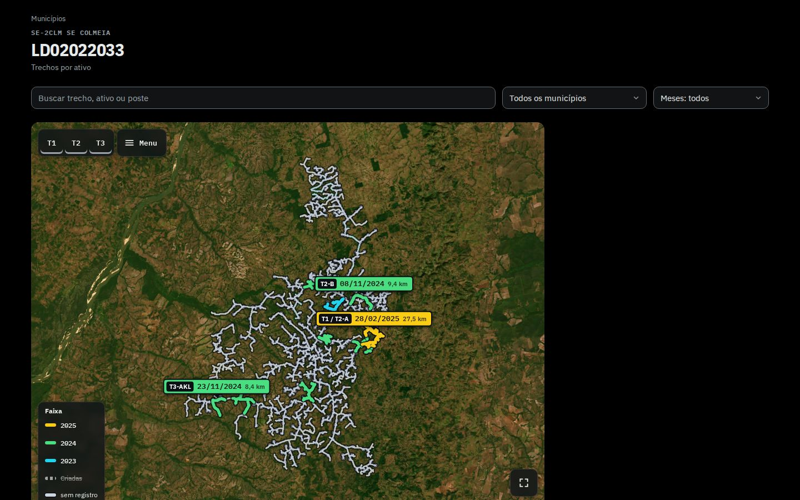


**Proposta.** Quatro ajustes, todos pequenos:

```css
/* alimentador.css: linhas fora da vista não entram no layout (a lista rola por dentro de .lista) */
.lista>.row,.lista>.grp{content-visibility:auto;contain-intrinsic-size:auto 48px}
.lista>.grp{contain-intrinsic-size:auto 32px}
```
```js
// 1) vãos em sequência (o fim de um é o começo do próximo: 13.773 de 16.184) viram UMA polilinha
//    (alimentador.js; o mesmo em linhaDupla() de limpeza.js e inspecao.js): anéis 52.548 -> 8.104
const aneis = []; let cur = null;
vs.forEach(v => { if (cur && cur[cur.length - 1][0] === v[0] && cur[cur.length - 1][1] === v[1]) cur.push([v[2], v[3]]); else aneis.push(cur = [[v[0], v[1]], [v[2], v[3]]]); });
const l = L.polyline(aneis, {color: t.cor, weight: t.peso, opacity: 1, lineCap: 'round', lineJoin: 'round'}).addTo(map);
// 2) papel() com índice por início (igual ao fimDe que já existe)
const inicioDe = {}; D.trechos.forEach(t => (inicioDe[t.inicio] = inicioDe[t.inicio] || []).push(t.nome));
// 3) formatadores criados uma vez (alimentador.js km/mil, limpeza.js, extras.js, ranking-polos.js, mapa-municipios.js, busca-ativo.js)
const __nf2 = new Intl.NumberFormat('pt-BR', {minimumFractionDigits: 2, maximumFractionDigits: 2});
```

**Como fica.** Mesmo desenho (conferido por pixels no computador e por contagem de camadas: 2.121 antes e depois), 0 erros de console e os números das tabelas acima. Depois:

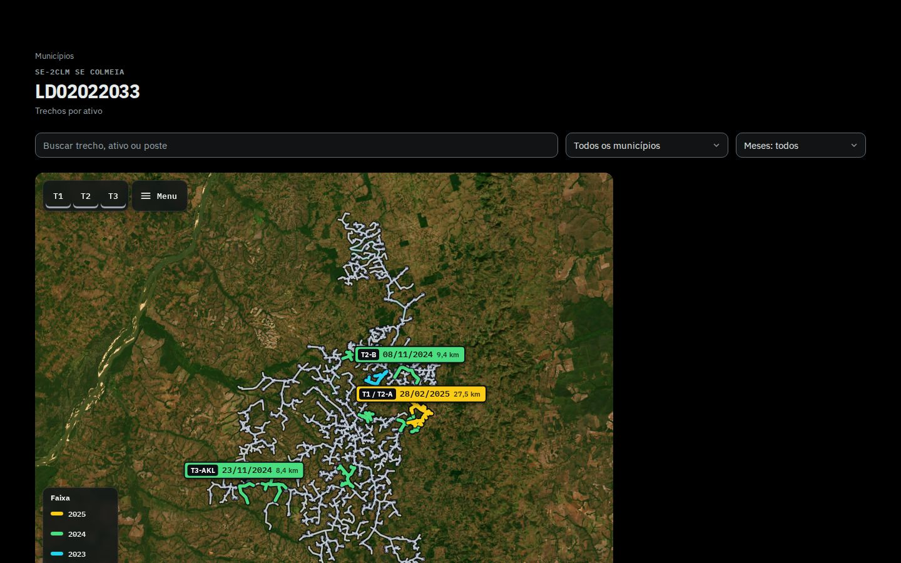
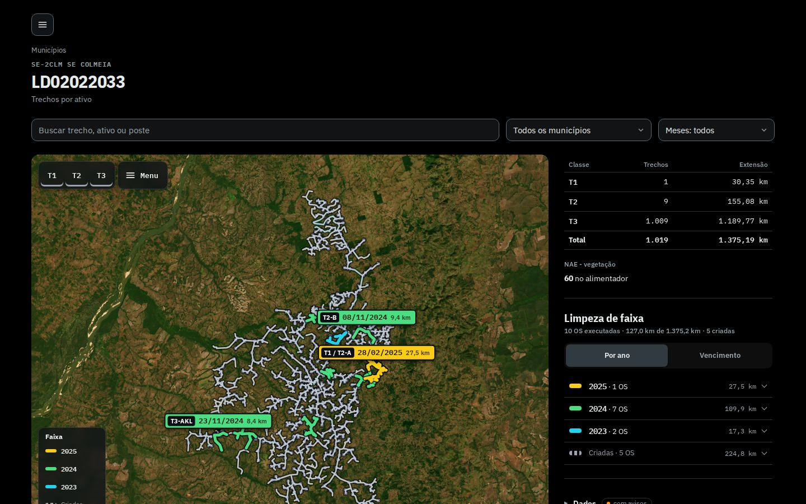
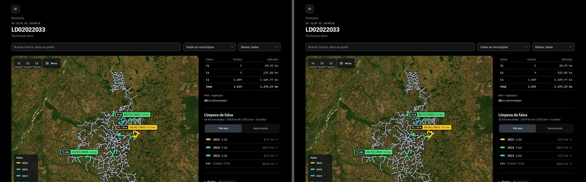
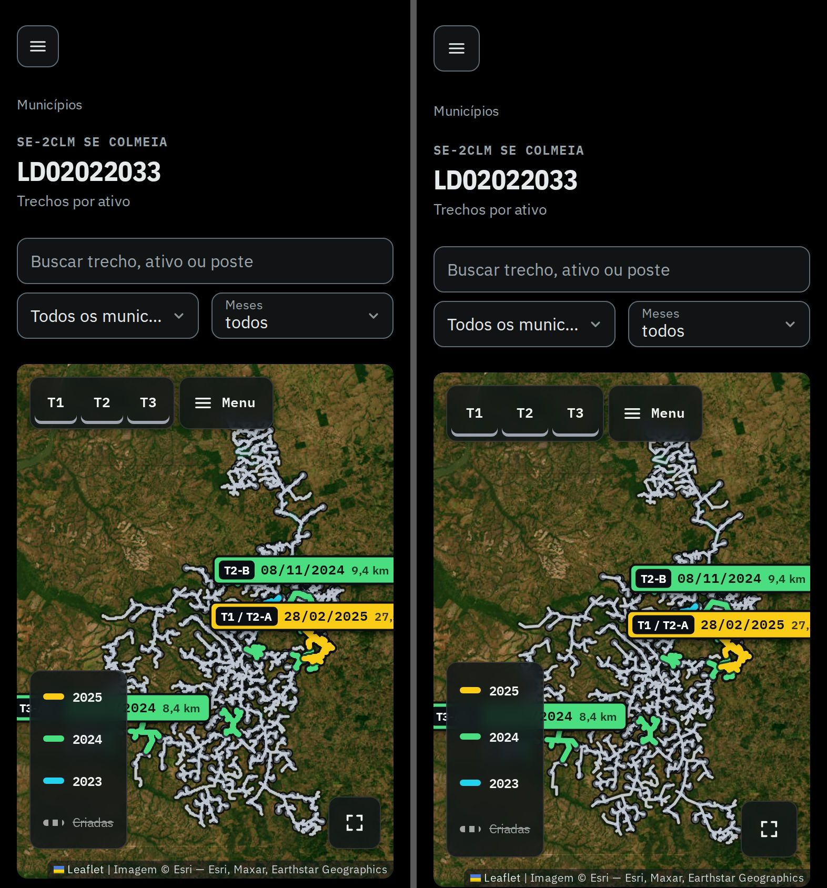

**Esforço** M. **Risco** baixo a médio: `content-visibility` só tem efeito em Chrome 85+, Safari 18+ e Firefox 125+ (nos outros segue como hoje); rolagem rápida da lista no computador lento piora (ver acima); a simplificação de polilinhas do Leaflet é de menos de 1 px; não testei o foco por teclado percorrendo as 1.000 linhas com `content-visibility`. **Arquivos:** `alimentador/mapa_trechos.html` (blocos `<style>` e `<script>` que o `gera_trechos.py` publica), `limpeza.js`, `inspecao.js`, `extras.js`, `ranking-polos.js`, `mapa-municipios.js`, `busca-ativo.js`.

**Não fiz (e por quê):** codificar `D.vaos` em deltas (dados.js cairia ~22 % e exige mexer no gerador); adiar o desenho das camadas Faixa/Inspeção/Manutenção para depois do 1º quadro (é onde está o resto do TBT: `limpeza.js` 120 a 180 ms e `alimentador.js` ~320 ms em CPU normal; o `al-pronto` espera todos os scripts) — ficam para o tema 4 (painel).

---

## Sugestão 2 (prioridade 2, faça junto) · Sem salto de 64 px em nenhuma página

**Problema.** O `menu.js` é o último script e monta a linha do ☰ depois do 1º quadro: em toda página o conteúdo desce 64 px (no alimentador, depois de ~1,3 s de página já visível). Na página inicial os 3 cartões Norte/Centro/Sul nascem em (0,0) e pulam para o lugar (CLS 0,070 no computador).

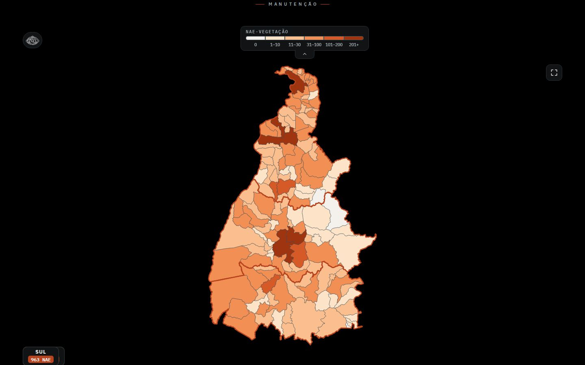
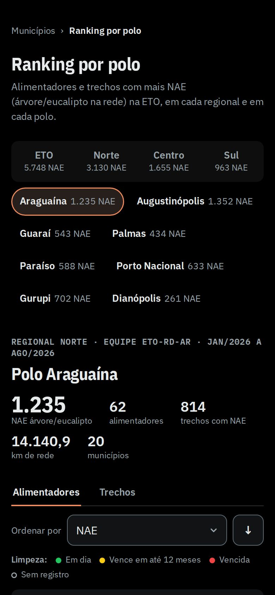
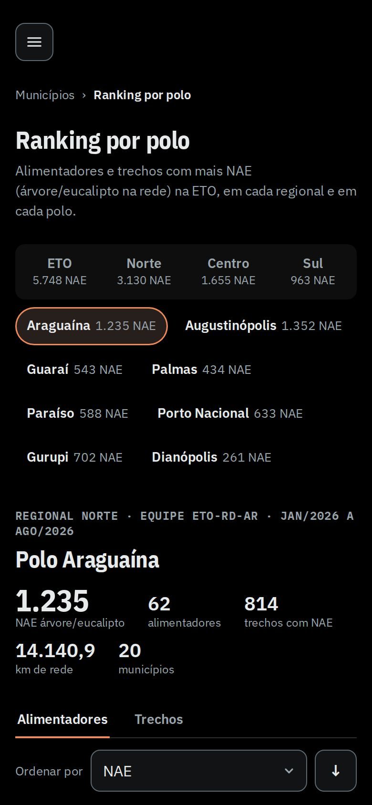

**Proposta.**

```css
/* site.css e alimentador.css: reserva a linha do ☰ com uma pseudo-linha da mesma geometria (some quando o ☰ chega) */
.wrap:not(:has(>.mnu))::before{content:"";display:block;min-height:var(--alvo);margin-bottom:calc(var(--s2) * -1)}
/* site.css: cartões escondidos até serem posicionados */
.mt-regcards:not([data-ok]) button{visibility:hidden}
/* alimentador.css: o "Como os trechos são divididos" sai do cabeçalho quando o extras.js monta a barra de busca */
.al-site:not(.al-pronto) header>details.regra{display:none}
```
```js
// mapa-municipios.js, em poeCartoes(), logo antes de desenhar as bandeirinhas
cartoes.dataset.ok = '1';
```

**Como fica.** Título e mapa já no lugar no 1º quadro; nenhuma página muda de altura ao chegar o ☰.

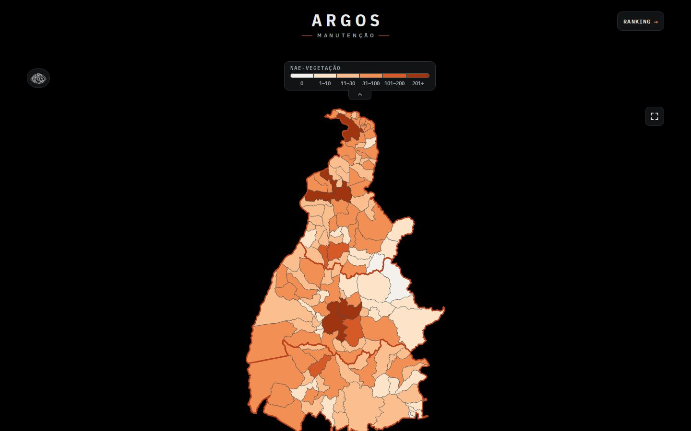
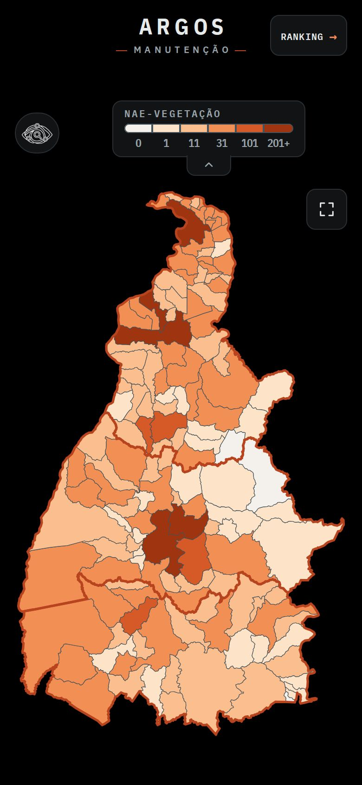
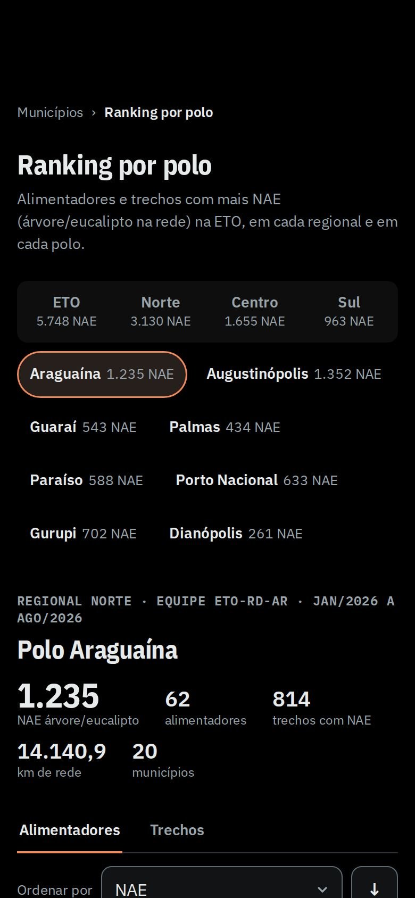
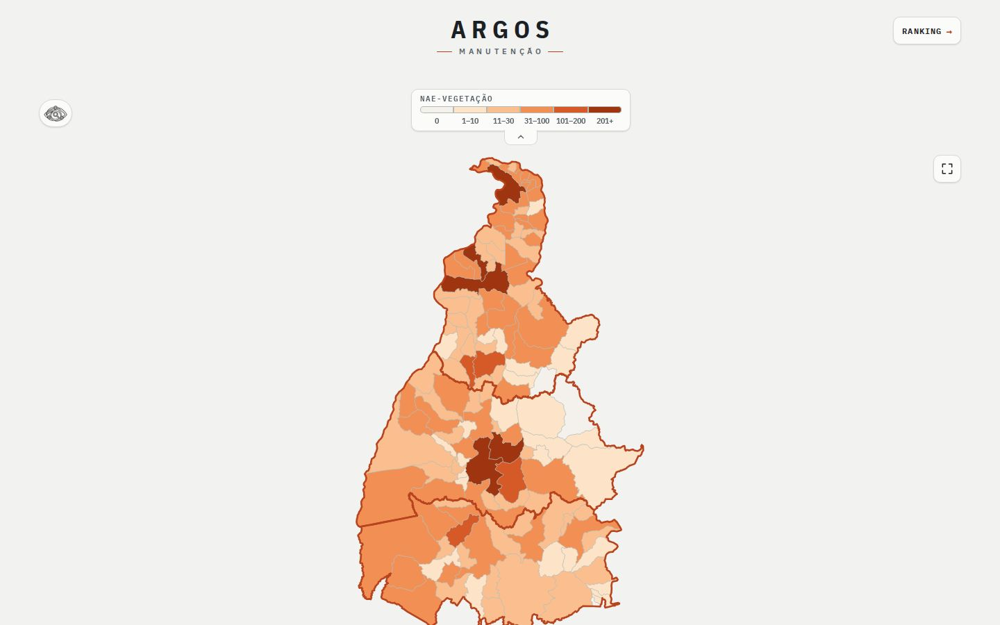

**Esforço** P. **Risco** baixo: `:has()` precisa de Chrome 105+, Safari 15.4+, Firefox 121+ (sem ele o salto continua como hoje); se o `menu.js` falhar, sobra uma faixa vazia de ~40 px. **Limite:** o 0,008 que sobra no início (computador) é o título e o mapa descendo 4 a 5 px quando o Google Fonts chega (`display=swap`); fontes próprias com `size-adjust` zeram. **Arquivos:** `site.css`, `mapa_trechos.html` (CSS), `mapa-municipios.js`.

---

## Sugestão 3 (prioridade 3) · Tab coerente e leitor de tela que sabe onde o mapa está

**Problema.** (a) Com uma regional, polo, município ou alimentador abertos, os cartões Norte/Centro/Sul (`opacity:0`) continuam no Tab: 3 paradas em que o foco some. (b) Tab saindo do campo de busca cai na caixa de resultados (o Chromium põe áreas roláveis no Tab), com contorno gigante. (c) No estado inteiro as regionais (a ação principal) vêm depois de "Palmas" e da legenda. (d) Nenhum nível é anunciado e, ao abrir um município, a região `aria-live` do `#ativo-res` lê a lista inteira (395 caracteres, 1.112 com a miniatura).

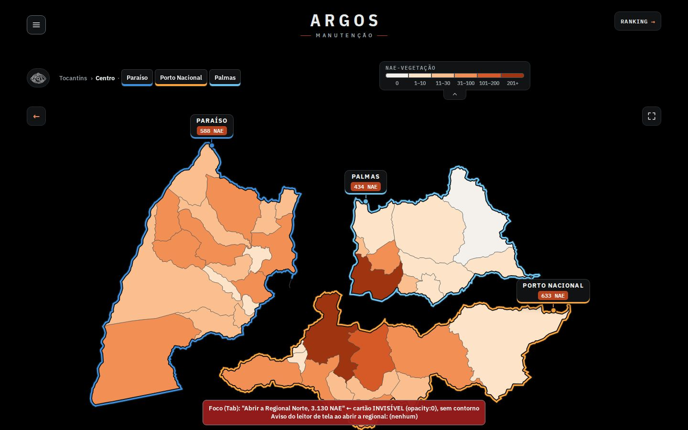
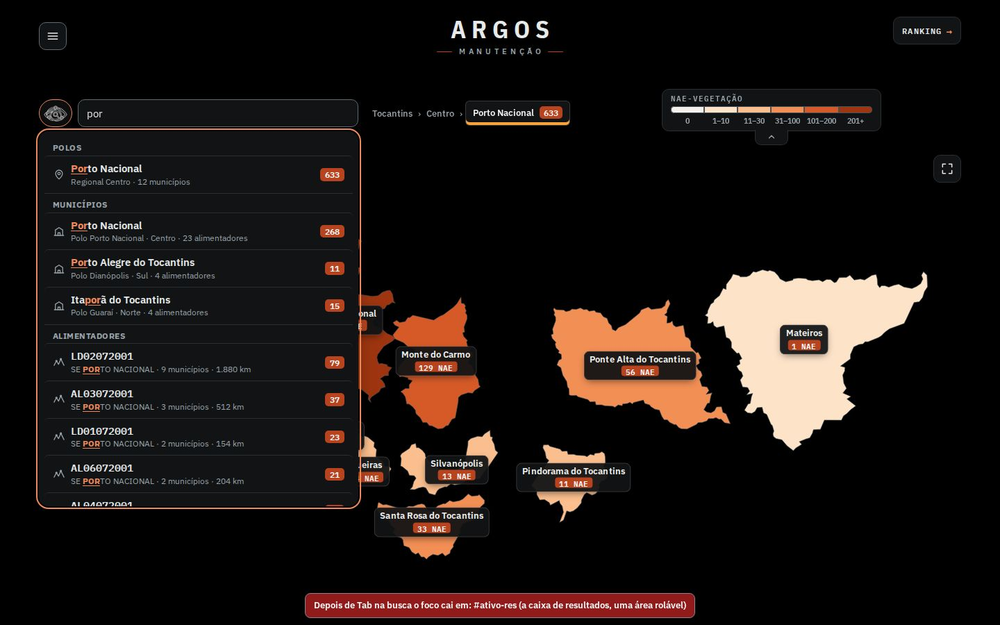

(A faixa vermelha/verde no rodapé dos prints é uma legenda desenhada só no print; não faz parte do site.)

**Proposta.**

```css
/* site.css: o cartão some de verdade (e sai do Tab) depois do fade */
.mt-regcards button{transition:opacity .3s,border-color .15s,visibility 0s}
.aberta .mt-regcards button,.voando .mt-regcards button{visibility:hidden;transition:opacity .3s,border-color .15s,visibility 0s .3s}
```
```js
// mapa-municipios.js
caixa.prepend(cartoes);   // as regionais são a 1ª parada do mapa (posição é por JS: o visual não muda)
// região <p class="vh" role="status" aria-live="polite" aria-atomic="true"> + document.addEventListener('argos-nivel', ...) com texto curto do nível final
// busca-ativo.js
res.tabIndex = -1; res.removeAttribute('aria-live');   // a lista não é mais lida inteira; o resumo vai no aviso ("12 opções. Use as setas...")
```

No estado inteiro o número de paradas é o mesmo (9), só a ordem muda: as três regionais vêm antes de "Palmas".

Textos do aviso (todos dos dados do mapa): "Regional Centro: 3 polos, Paraíso, Porto Nacional, Palmas. Esc volta ao Tocantins." · "Polo Porto Nacional: 12 municípios, 633 NAE. Esc volta à regional Centro." · "Porto Nacional: 23 alimentadores, 268 NAE. Esc volta ao polo." · "Alimentador AL02057189 em foco, em Porto Nacional: 44 NAE. Enter abre a página dele. Esc volta ao município." **Mudança em relação à rodada 2:** o botão do olho NÃO sai mais do Tab (agora ele é a única entrada da busca; a lupa duplicada da rodada 2 deixou de existir).

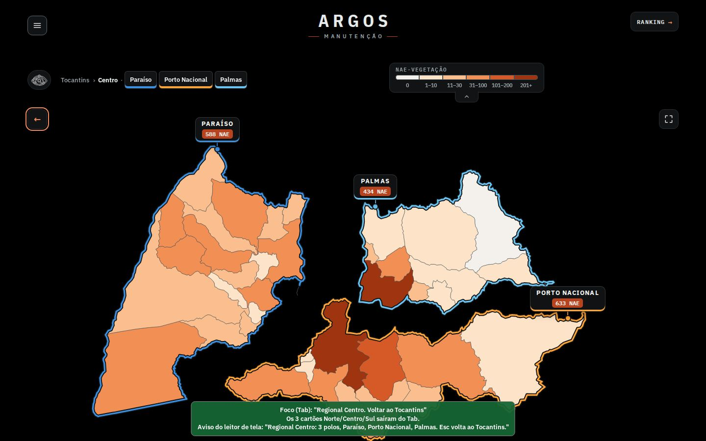
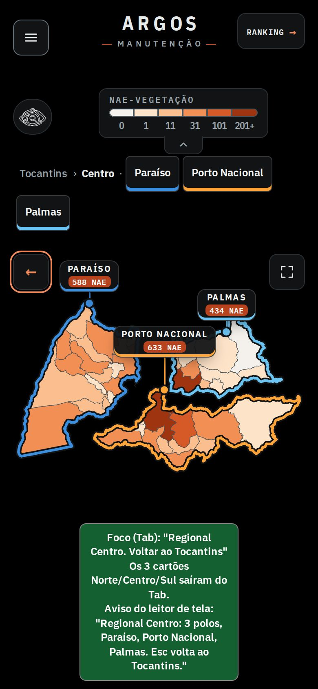
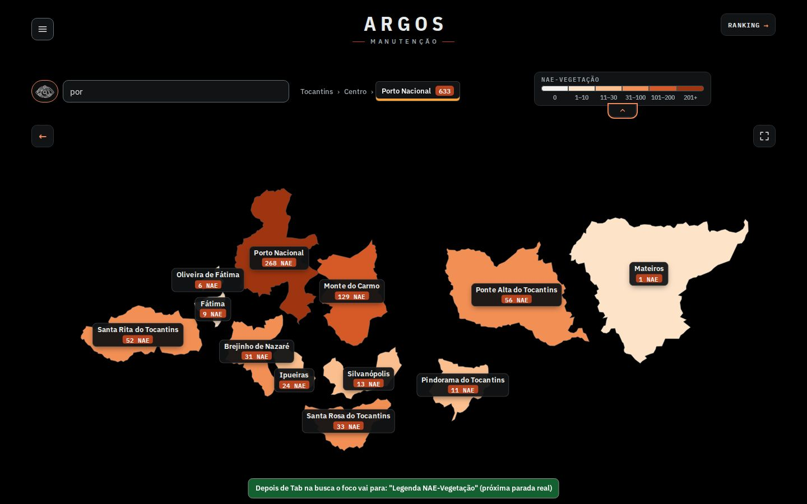

**Esforço** P. **Risco** baixo: verifiquei as paradas do Tab e o texto das regiões `aria-live` por script (MutationObserver); **não** testei com NVDA, VoiceOver ou TalkBack. Anunciar "N opções" a cada abertura da busca pode ser repetitivo para quem abre e fecha muito. **Arquivos:** `site.css`, `mapa-municipios.js`, `busca-ativo.js`.

---

## Sugestão 4 (prioridade 4) · Alvos de toque de 44 px em todas as telas

**Problema.** `--alvo` é 40 px em `site.css`, em `alimentador.css` e dentro do CSS embutido do `ranking-polos.js`; o ☰ (`menu.js`) tem 40 px fixos. No celular: ☰, Ranking, olho, tela cheia, trilha, chips dos polos (36 px), menu aberto; no ranking os 8 botões de polo e as abas; na página do alimentador T1/T2/T3, camadas, anos, botões de download (30 alvos). Com a legenda recolhida (novo desde a rodada 2) os cartões das regionais caem para 27 px e a orelhinha tem 30 px.

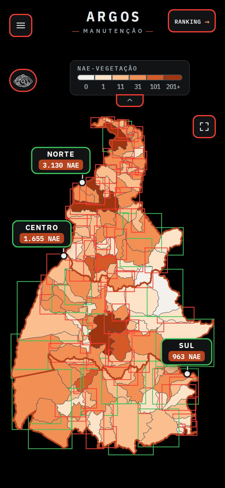

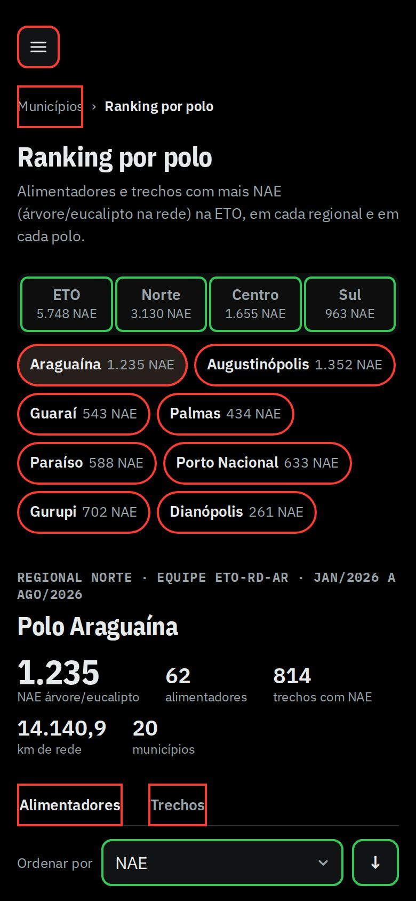

**Proposta.** Só em tela de toque (`pointer:coarse`; no mouse nada muda):

```css
@media (pointer:coarse){
  :root{--alvo:44px}                                     /* site.css, alimentador.css e o bloco :root do ranking-polos.js */
  .mt-barra .mt-pchip,.mt-passo,.mt-puxa,.ativo .ir-mapa,.mt-regs>summary{min-height:44px}
  .mt-volta{min-width:44px} .mt-amun{display:inline-flex;align-items:center;min-height:44px}
  .mt-regcards button{min-height:44px;align-content:center}      /* legenda recolhida: cartões de 27 px */
  .mt-regs.fechada .mt-regs-b{position:relative;left:auto;top:auto}   /* a regra de base tem left:50%: sem zerar a orelha andava 52 px */
  .mt-regs.fechada .mt-regs-b::after{content:"";position:absolute;inset:-8px}   /* orelha recolhida: visual igual, toque de 46 px */
}
/* menu.js (CSS embutido): .mnu{min-height:44px} .mnu .mnu-btn,.mnu .mnu-x{width:44px;height:44px} .mnu-lista a,.mnu-lista button{min-height:44px} ... */
/* alimentador.css: html body na frente porque limpeza.js/extras.js/telacheia.js injetam <style> depois */
@media (pointer:coarse){ html body .migalhas a{min-height:44px} html body .mapbox .classes button{min-width:44px;min-height:44px} /* ... 10 regras */ }
```

**Como fica.** Verde = 44 px ou mais, vermelho = menor (a orelhinha da legenda aberta fica vermelha no print porque o clique vale no painel inteiro, `leg.addEventListener('click')`; o cartão e o olho ficam verdes):


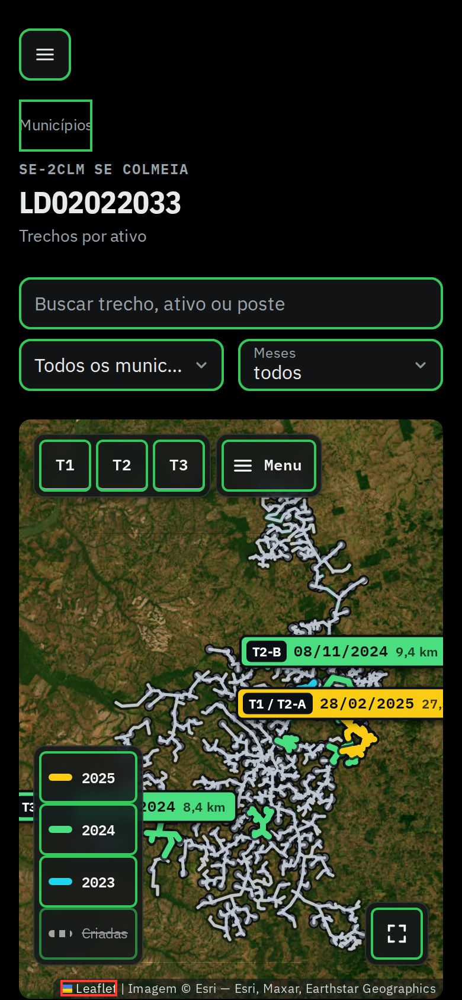
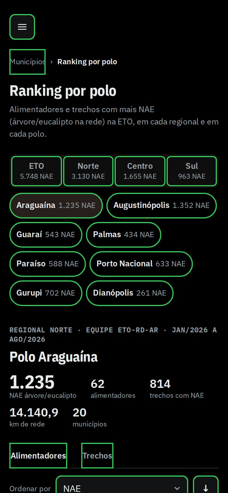
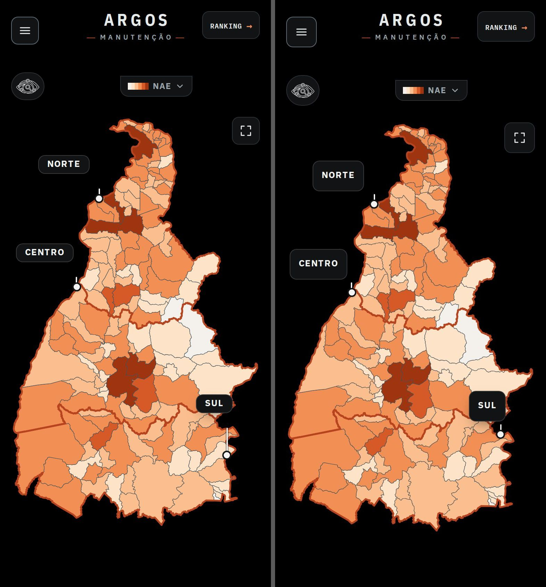

O layout do celular cresce 4 px por linha de controles (por isso a comparação por pixels só vale no computador). **Esforço** P. **Risco** baixo; trocar `--alvo` mexe em tudo que usa a variável (migalhas, rodapé, `.cab-link`, opções da busca), conferido nas telas acima, mas não em tablet. **Arquivos:** `site.css`, `menu.js`, `ranking-polos.js`, `mapa_trechos.html` (CSS). A regra da orelhinha mexe numa peça da outra sessão (legenda): é só área de toque, pode ser aplicada por quem cuida dela.

---

## Nada quebra: legenda, busca no olho, tela cheia, bandeirinhas, rótulos com fio

`verifica.js` percorre 15 estados da página inicial (estado, legenda recolhida e reaberta pela orelhinha, busca "palmas" com seta e Enter, regional, polo Porto Nacional, polo Araguaína com rótulos e fios, município, alimentador em foco, tela cheia dentro de um município e no estado inteiro, Esc na tela cheia) e, nas páginas LD02022033 e AL03037009, a carga, a busca de trechos, a rolagem da lista, o clique numa linha, as 4 camadas (Faixa, Inspeção, Insp→manut, Manutenção) e a tela cheia. Compara **contagens e estados** (bandeirinhas `.mt-fio`/`.mt-pino`, `.mt-fios line/circle`, rótulos, chips, legenda aberta/recolhida, `.sem-nae`, tela cheia e trava de rolagem, opções da busca, nível do mapa, linhas da lista, camadas do Leaflet) e, no computador, os **pixels**.

| Fluxo | Estados comparados | Com diferença estrutural | Maior diferença de pixels | Erros de console antes/depois |
|---|---|---|---|---|
| 1440-claro | 27 | 0 | 0.42 % (01-estado) | 0 / 0 |
| 1440-escuro | 27 | 0 | 0.32 % (01-estado) | 0 / 0 |
| 390-claro | 27 | 0 | não vale (alvos de 44 px mudam a altura) | 0 / 0 |
| 390-escuro | 27 | 0 | não vale (alvos de 44 px mudam a altura) | 0 / 0 |

Nenhuma diferença estrutural.


- A única diferença de pixels no computador (0,3 a 0,4 %) é o cartão de uma regional 5 px mais perto ou mais longe: **acontece também sem o protótipo** (4 cargas do site sem alteração deram 3 vezes (800,391) e 1 vez (805,396)): a posição das bandeirinhas depende do momento em que a fonte chega. Fica como achado para a sessão dona das bandeirinhas.
- Prints lado a lado (antes à esquerda, depois à direita), 1440 reduzido a 62 % e 390 em tamanho real, escuro e `-claro`: `prints/07-nada-quebra-*`:

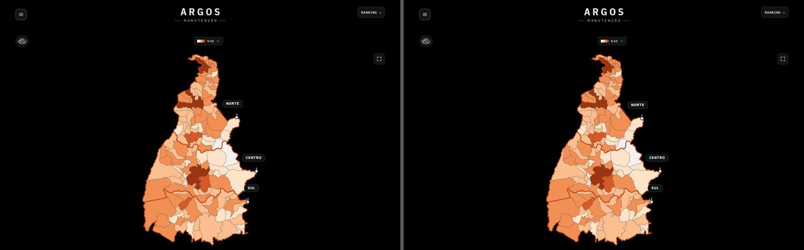
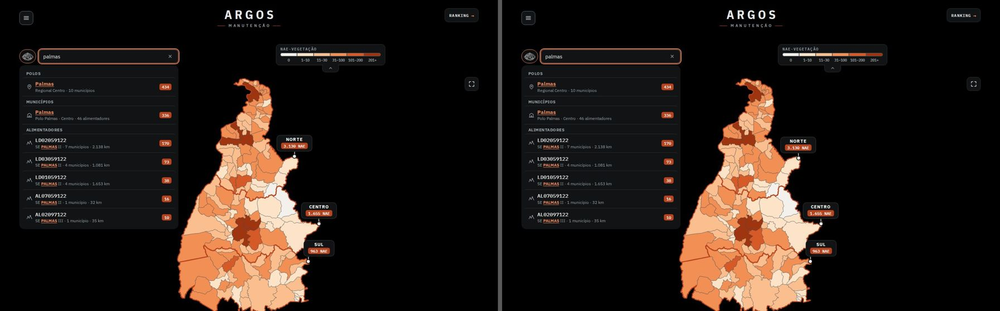
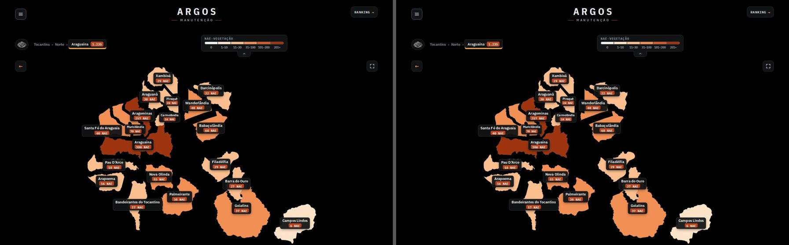
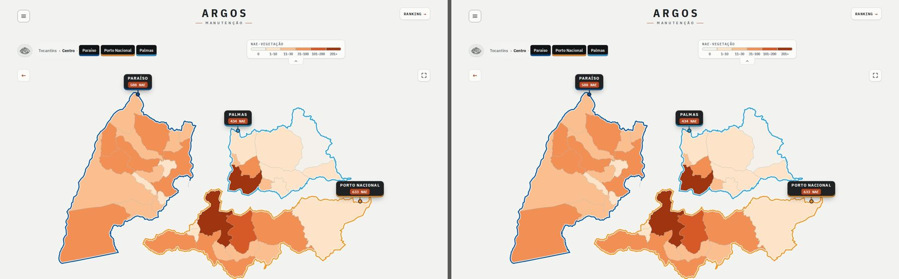
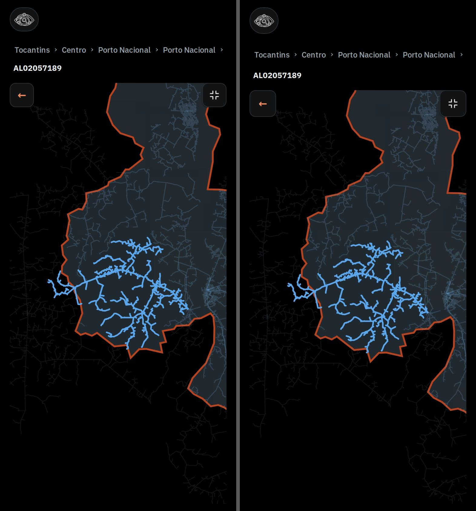
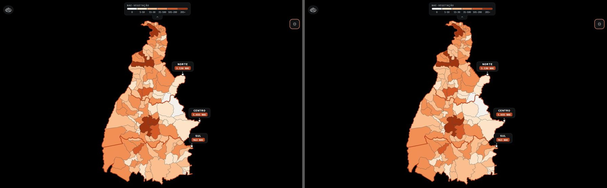
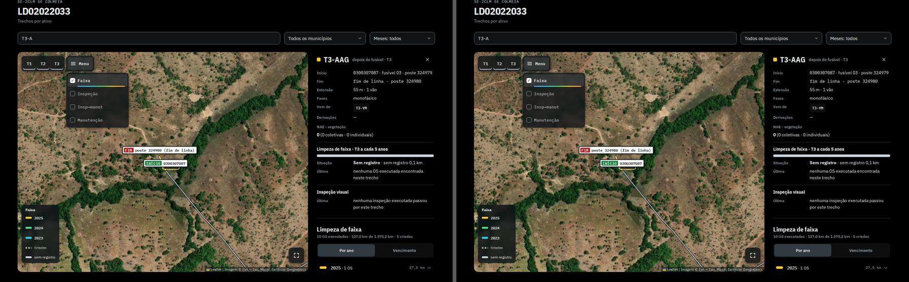

---

## O que implementar primeiro

| # | O quê | Esforço | Por quê nessa ordem |
|---|---|---|---|
| 1 | **Bloco 1 · página do alimentador mais leve** (decidir antes se `content-visibility` vai em todos os aparelhos ou só no toque) | M | É onde o usuário espera e vê engasgo: TBT -50 % a -60 % com CPU 4x, redesenho de zoom -60 %, lista abre 2x mais rápido |
| 2 | **Bloco 2 · CLS** (3 regras + 1 linha) | P | Melhor custo-benefício: 5 minutos, nenhum risco visual, tira o salto de 64 px de TODAS as páginas; pode sair no mesmo dia que o 1 |
| 3 | **Bloco 4 · alvos de 44 px no toque** | P | Só vale em celular; conferir menu, ranking e página do alimentador no aparelho; avisar a sessão da legenda sobre a orelhinha |
| 4 | **Bloco 3 · Tab e leitor de tela** | P | Ganho real para teclado e leitor, mas pede uma volta com NVDA ou VoiceOver antes de publicar |
| 5 | Fontes próprias (IBM Plex em `assets/`, `size-adjust`) | M | Zera o CLS que sobra (0,008) e o FCP em rede lenta; discutível por causa do cache de 10 min do GitHub Pages |
| 6 | Adiar o desenho das camadas Faixa/Inspeção/Manutenção para depois do 1º quadro (tema 4) | G | É onde está o resto do TBT da página do alimentador |

## Como medi (e limites)

- **Espelho local.** O Chromium daqui não confia na CA do proxy: `servidor-espelho.js` (porta 18767) baixa o /teste/ ao vivo com `curl` na 1ª requisição, guarda em cache e serve com gzip; os tiles do Esri e as fontes do Google passam por `route` + `curl` (`lib.js`). Base: assets do /teste/ de hoje (conferidos iguais a `alimentador/site/`, exceto os rascunhos `ativos-zoom.js`, `croqui-modelo.js`, `municipios-rascunho.js`, que não são publicados). O `lupa-painel.js` do repositório ainda não está no site ao vivo e **não foi testado junto**: ele tem regras próprias com `.wrap:not(:has(>.barra-busca))` e `.al-site:not(.al-pronto)` que convém conferir ao publicar os dois.
- **Protótipo.** `gera-proto.js` parte dos arquivos do repositório (só leitura), aplica cada troca por substituição exata (para se o trecho não casar uma vez) e grava `proto/`. `injeta.js` entrega o resultado por `page.route`; `PROTO=1` liga tudo, `PROTO_SEM=lista` tira o `content-visibility` (ablação). Nada no site nem no repositório foi alterado.
- **Medidas.** CLS: `layout-shift`; carga: long tasks e TBT (depois do FCP), "pronto" = mapa do Leaflet criado + lista; estilo e layout: trace do Chromium; redesenho: `renderer._update()` (API privada do Leaflet, só para medir); gestos: mouse e roda no computador, `Input.synthesizeScrollGesture`/`PinchGesture` no celular; lista: digitar na busca até o 2º quadro. Perfis: normal e CPU 4x (`Emulation.setCPUThrottlingRate`); **a 4G lenta da rodada 2 não foi refeita** (pedido desta rodada: com e sem CPU 4x). Viewports 1440x900 (mouse) e 390x844 (toque, DPR 2), escuro e claro.
- **Ruído.** A máquina é compartilhada e renderiza por software (sem GPU): o TBT oscila até 50 % entre rodadas (o "antes" do computador normal deu 1.601 ms aqui e 966 ms na rodada 2). Só confio em diferenças grandes: CLS, estilo+layout, redesenho, mostrar a lista, paradas do Tab. FCP e LCP de páginas pequenas variam sem relação com o protótipo (por isso não os destaco). Transferência: o Playwright entrega o protótipo sem gzip (760 KB contra 635 KB); com gzip o acréscimo é ~2,6 KB.
- **Não coberto:** leitor de tela real, Safari/Firefox, tablet, foco por teclado nas 1.000 linhas com `content-visibility`, o zoom por roda com CPU 4x no computador (continua em 18 fps: o resto é carga de tiles e animação do navegador).
- **Achado paralelo (não é do pacote):** 1 em cada 3 cargas do celular mostra um salto de 52 px no `div.stage` da página do alimentador (CLS 0,036, ainda abaixo de 0,1) quando a barra de busca chega.

## Arquivos

- `proto/tema5-rodada3.diff` (o patch completo), `proto/*.diff` (um por arquivo), `proto/arvore/alimentador/…` (cópias alteradas), `proto/assets/alimentador.js|css` (o que o gerador publica).
- Scripts: `gera-proto.js`, `injeta.js`, `lib.js`, `servidor-espelho.js`, `medir-cls.js`, `medir-alim.js`, `medir-lista.js`, `layout-carga.js`, `redesenho.js`, `tab-foco.js`, `alvos.js`, `verifica.js`, `comparar.py`, `prints.js`, `tabelas.js`, `grafico.py`, `roda-antes.sh`, `roda-depois.sh`, `roda-ab-lista.sh`, `roda-verifica.sh`, `roda-claro.sh`, `roda-fim.sh`.
- Resultados: `medicoes/*.json` e `*.log`, `medicoes/tabelas.md`, `medicoes/verifica.md`, `verif/` (um JPEG por estado, antes e depois).
- Reprodução: `ESPELHO=<pasta> PORTA=18767 node servidor-espelho.js &`, `node gera-proto.js`, `./roda-antes.sh`, `./roda-depois.sh`, `./roda-ab-lista.sh`, `./roda-verifica.sh`, `node prints.js` (e `TEMA=claro node prints.js`).
